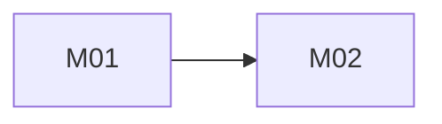

# Plan — <title>

- **Spec:** `<SPEC>`.
- **Unit branch:** `feature/<NAME>`, created from `<BASE>`.
- **Plan files:** subagent rules in `RULES.md`; traceability in `TRACEABILITY.md`; decisions, risks and owner answers in `DECISIONS.md`; execution log in `LOG.md`; evidence in `evidence/M<NN>.md`; handoff notes and proposals in `work/`.

## Validation

- **Plan verdict:** not validated (date —, reviews run —)
- **Approval:** not approved
- **Implementation verdict:** not verified (date —, reviews run —)

## Unresolved questions

None.

## Legend

⚪ pending · 🟡 in progress · 🟢 done · 🔴 blocked

## Milestones

**Table: Milestones**

| Milestone | Status | Depends on | ACs | Wave | Batch |
|---|---|---|---|---|---|
| [M01 — <title>](M01-<slug>.md) | ⚪ | — | … | 1 | 1 |

## Dependencies and waves

**Figure: Dependency graph**

- **Wave 1:** <milestones; which run in parallel>.

## File ownership

- **M01:** <files>.
- **Orchestrator (shared documents):** those listed in `RULES.md`.

## Plan phases

**Table: Phases of the master plan**

| Phase | Content | Status |
|---|---|---|
| 0 Preparation | <spec ready to implement, baseline taken, branches created, prior refactors> | ⚪ |
| 1 Implementation | Waves 1 to <n> | ⚪ |
| 2 Integration | Batches closed, single PR, green matrix | ⚪ |
| 3 Closing | <spec status, manual checks, merge on the owner's order> | ⚪ |

## Batches and integration

**Table: Integration batches**

| Batch | Milestones | Integration branch | Expected CI runs |
|---|---|---|---|

**Table: Integration budget**

| Scenario | PRs | Matrix runs | Jobs |
|---|---|---|---|
| This plan | 1 | … | … |
| One PR per milestone | … | … | … |

<integration rules: milestone → batch, batch → unit branch, single PR, CI triggers, package version, restrictions>

## Gates

- **Milestone:** …
- **Batch:** …
- **Phase:** …

## Launch protocol

1. **Before launch.** No milestone is launched unless the plan verdict is ready, "Unresolved questions" is empty and the plan is approved. <dependency check, worktree reset to the batch tip, baseline>
2. **Context.** <what the subagent receives and reads>
3. **Deliverables.** <commits, raw evidence data, proposals, handoff note, final message>
4. **Status lights.** <who changes which light and when>
5. **Milestone closing.** <verification, evidence, proposals applied, integration, sync of the milestone table, traceability and log>
6. **Defects and gaps.** <return to 🟡; contradictions go back to the orchestrator; owner answers recorded>
