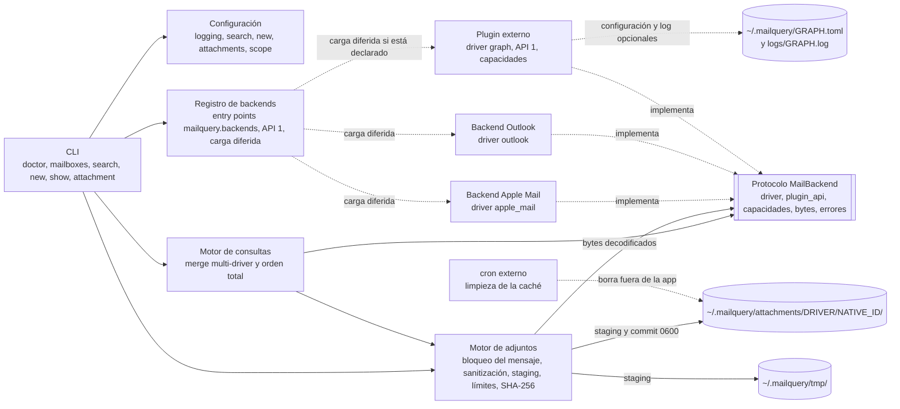
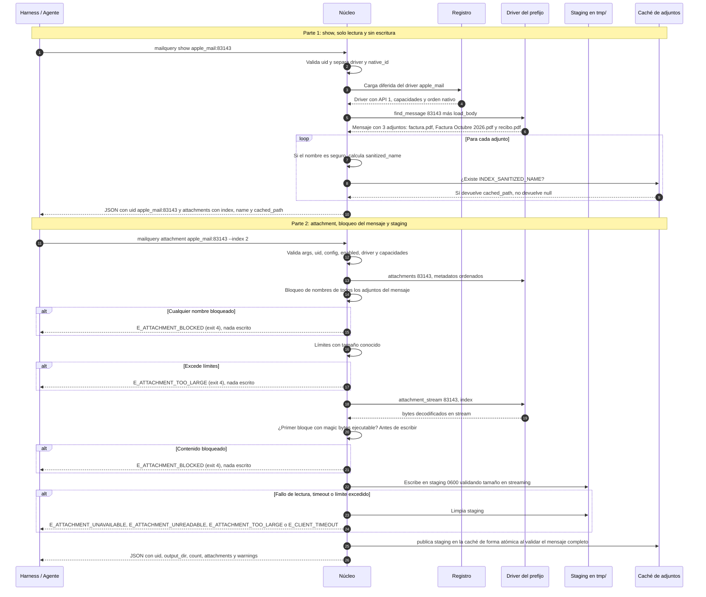

# PRD (Incremental) — Plugins de Backend y Recuperación Local de Adjuntos

**Producto:** `mailquery` — CLI de solo lectura para leer y buscar el correo del cliente de escritorio local desde un harness de agentes.
**Versión del documento:** 2.1 — **delta normativo** sobre [`PRD.md`](PRD.md) v1.3.
**Versión del paquete que introduce:** `3.0.0`.
**Fecha:** 2026-11-10.
**Repositorio:** <https://github.com/dayler/mailquery>.
**Estado:** borrador para aprobación. Decisiones de producto de §0.6 aprobadas por el dueño el 2026-11-11. No implementado.
**Alcance:** exclusivamente dos features: (1) plugins de backend mediante entry points; (2) recuperación local de adjuntos con `mailquery attachment`. El resto del producto no cambia salvo lo declarado en §0.2.

---

## 0. Naturaleza del delta

### 0.1 Reglas de lectura

1. Este documento es un **delta normativo**: cubre solo las dos features del alcance y **sustituye** las reglas del `PRD.md` v1.3 que aparecen en la tabla §0.2. Todo lo que no aparece en esa tabla **sigue vigente** en el `PRD.md` v1.3 sin cambios.
2. Para las reglas sustituidas, este documento es la **única fuente de verdad**. Hasta la conciliación (§0.3), el `PRD.md` v1.3 no puede citarse como dueño de esas reglas.
3. Convención de referencias: `§N` sin prefijo = sección de este delta; `PRD.md §N` = sección del documento central.
4. Los ejemplos y los criterios de aceptación de este delta sustituyen a los del `PRD.md` en lo que toca. Los AC de este documento son **locales del delta** (AC-01..AC-21) y se renumeran al conciliar; el `PRD.md` v1.3 no usa identificadores AC-xx, así que no hay colisión.
5. Este delta **no implementa** ningún plugin externo (`mailquery-graph`, `mailquery-thunderbird`, etc.). Define el contrato para que, si se implementan en la línea 3.x, funcionen sin cambiar este documento (ver §4 y §6.1).

### 0.2 Tabla de supersesión (normativa)

En esta tabla, las referencias `§N` de la columna central son siempre del `PRD.md` v1.3 (no de este delta); los `RF-*` y `ADR-*` citados también son del documento central.

| Contrato | Sección del `PRD.md` v1.3 | Qué cambia en este delta |
|---|---|---|
| No objetivos / clientes soportados | §3.3 | Se admite leer cuentas servidas por plugins externos instalados por el usuario. El núcleo sigue sin red y sin clientes nuevos; la implementación de plugins concretos queda fuera de esta versión. El no objetivo "no descargar adjuntos de servidores remotos" se reinterpreta: el **núcleo** no descarga; un plugin externo con `network: true` y `attachments: "remote"` puede obtener los bytes desde su origen, y su uso de red es responsabilidad del plugin (ADR-22). |
| Invariante de solo lectura (I-1) | §4 | I-1 se mantiene para el núcleo y los backends internos. Los plugins externos declaran capacidades (`network`, `readonly`, `body_local`, `attachments`) y su comportamiento es responsabilidad del plugin; instalarlo es el consentimiento explícito del usuario. El núcleo nunca abre red. |
| Red del núcleo y de plugins | RNF-02 (§7), §16.2 y §1 | "Cero red" sigue siendo cierto para el núcleo y los backends internos. Un plugin externo puede abrir red si declara `network: true`; `attachments: "remote"` obtiene bytes desde el origen del plugin. Instalar el plugin es el consentimiento; `doctor` muestra la capacidad. |
| Selección de backend | RF-26 (§6.4) y §15.6 | El driver se elige por bloque de `[scope]` (`<driver>:<cuenta>`), con el driver nativo del SO como valor por defecto. Ya no es exclusivamente por plataforma. |
| Tipo y formato de `uid` | RF-27, §11.1, §11.3, ADR-12, RNF-04, §12.2, §12.3 y Anexo F | `uid` es siempre `string` opaco `"<driver>:<native_id>"` en JSON y en `state.json`. Se acepta el uid legado sin prefijo en la entrada. El orden a igual fecha usa `(driver, native_order_key)` en lugar de la comparación textual del uid, también en `new`. |
| Modelo de mensaje: adjuntos | §11.1, §11.3 y §24 (Anexo D) | `message.attachments[]` pasa a `{"index", "name", "cached_path"}`; el núcleo puede leer los bytes del adjunto desde el store local del cliente. Sigue sin haber contenido en el JSON ni copia del correo. |
| Bytes de adjuntos en Outlook (COM) | §9.3 | El proxy de solo lectura autoriza una operación adicional de materialización de adjunto local (`Attachment.SaveAsFile`/`GetTemporaryFilePath`) para trasladar bytes de un adjunto **ya descargado** al staging temporal; el resto de la lista blanca no cambia. Queda registrado como excepción de riesgo OMG y de escritura en `tmp/` (§15). |
| `state.json` | §11.2 y RF-23 | `schema: 2` con uids prefijados y migración determinista desde `schema: 1`. La migración se hace en memoria y se persiste atómicamente en la siguiente corrida de `new` que no sea `--peek`; `doctor` informa `schema: 1 (migration pending)`. |
| `show` | §12.4 | El uid se valida con el formato nuevo (con compatibilidad de entrada) y `attachments` usa la forma definida en RF-43. |
| Contrato JSON | §12.5 | `uid` pasa a string; `show.attachments` cambia de forma; el resto del contrato no cambia. |
| Códigos de salida y errores | §12.6 | Se añaden los códigos de §11.7. La tabla de §11.7 es la única del delta. Se añade `E_IO`; `E_CLIENT_TIMEOUT`, `E_CLIENT_BUSY` y `E_PERMISSION` amplían su uso a operaciones de driver; `E_ACCOUNT_NOT_IN_SCOPE` amplía su uso a un driver instalado pero no declarado (ver §11.3). |
| Tabla de comandos y ayuda | §12 (tabla de comandos) y §12.7 | Seis comandos (`attachment` nuevo), línea de códigos de salida actualizada y sin referencias a “cinco comandos”. |
| `doctor` | §12.8 | Se añade el chequeo común `driver` tras `home`; `config` depende de `driver`; se documenta la composición de chequeos con varios drivers y las capacidades. |
| `--version` | §12.9 | Formato **aditivo**: conserva `backend`, `Python` y plataforma y añade `drivers: <driver> <versión>, ...` dentro del paréntesis. |
| Catálogo de warnings | §12.10 | No se añade ningún warning nuevo: el bloqueo de adjuntos es un error (`E_ATTACHMENT_BLOCKED`, exit 4). El resto del catálogo no cambia. |
| Instalación y dependencias | §13.1 y §13.2 | Versión `3.0.0`; entry points para los backends internos; `pipx inject mailquery <paquete>` para plugins externos. `pyproject.toml` gana `[project.entry-points."mailquery.backends"]`. |
| Logs | §14 | Evento `start`: `backend=` (driver nativo) y `drivers=` (lista declarada). Evento `end` de `attachment` con `count`, `cached`, `bytes` y `duration_ms`. Se mantiene la prohibición de registrar uids, nombres, rutas, cuentas y términos. |
| Errores y timeouts de Windows | §17 | `E_CLIENT_TIMEOUT` y `E_CLIENT_BUSY` amplían su uso según §11.7; no cambia su exit. |
| Operación con el harness | §21.1 | El `uid` se sigue tratando como token opaco, ahora `string`; los comandos `show`/`attachment` se rigen por §11.3. |
| Configuración | §15 completa | Nueva tabla `[attachments]`; las claves de `[scope]` pasan a `"<driver>:<cuenta>"` (con `<driver>:` opcional); la resolución de cuenta usa las formas del `PRD.md` §15.2 para los backends internos y `label`/`uuid` opacos para plugins, **dentro de cada driver**; un plugin externo puede tener, opcionalmente, `~/.mailquery/<driver>.toml` (configuración) y `~/.mailquery/logs/<driver>.log` (log), ambos propiedad del plugin; el núcleo no los lee. |
| Layout del home | §10.2 | Se añade `~/.mailquery/attachments/` (caché de adjuntos); un plugin puede añadir, opcionalmente, `~/.mailquery/<driver>.toml` y `~/.mailquery/logs/<driver>.log`. El staging de adjuntos usa `~/.mailquery/tmp/`. |
| Rendimiento | §19 | El presupuesto de latencia y el p95 aplican a los backends internos; un plugin local solo está acotado por el timeout (RNF-16) y un plugin remoto no tiene presupuesto. Se añade presupuesto de acierto de caché. |
| Criterios de aceptación | §20 | Los criterios 1 y 2 (solo lectura) siguen vigentes; los criterios 3 y 4 se sustituyen por §14 de este delta (el contrato y la versión ya no son los de 2.0.x). |
| Cambios de comportamiento en macOS | §22.2 | Se sustituye/amplía por §0.4. |
| Versión del paquete | §22.3 | Se sustituye por §0.5: `3.0.0`. |

> **Consumidores del contrato:** este delta cambia el contrato que consumen `skills/mailquery/SKILL.md`, `docs/recipes/*`, `README.md`/`README.es.md`, `docs/INTERFACES.md` y `docs/config.example.toml`. Al implementar, esos documentos deben reflejar el `uid` string, el comando `attachment`, `show.attachments[]`, `[attachments]`, `doctor`/`--version` y los errores nuevos. Su actualización es parte de la entrega de implementación, no de este PRD.

> **Sobre el `ROADMAP.md`:** no es normativo ni una decisión de producto: es una lluvia de ideas. No se cita como fuente de requisitos, no obliga a implementar sus propuestas (`--out DIR`, `[backend.<driver>]`, descarga remota, etc.) y no genera contradicciones si este delta elige otra solución. La sección §5–§6 del ROADMAP sirve solo como contexto histórico.

### 0.3 Conciliación con el PRD central

Este delta es temporal. Antes de publicar `3.0.0` debe conciliarse en `PRD.md`: se aplican las filas de §0.2, se renumeran los AC y el delta se elimina o queda como anexo histórico sin valor normativo. Hasta entonces, este documento es la fuente de verdad para las reglas que sustituye.

### 0.4 Cambios visibles en macOS (sustituye y amplía `PRD.md` §22.2)

Además de lo que el `PRD.md` §22.2 ya lista, `3.0.0` cambia en macOS exactamente esto:

| Cambio | Antes (2.0.x) | Después (3.0.0) |
|---|---|---|
| `uid` en `search`/`new`/`show` | Entero | String `"apple_mail:<n>"` |
| `uid` en `state.json` | Entero | String prefijado, `schema: 2` (migrado automáticamente) |
| `show.message.attachments[]` | `[{"name": "..."}]` | `[{"index", "name", "cached_path"}]` |
| `[scope]` | `[scope."<cuenta>"]` | `[scope."<driver>:<cuenta>"]` (el prefijo puede omitirse) |
| `doctor` | `python`, `home`, chequeos, `config`, `state`, `lock` | `python`, `home`, `driver`, chequeos, `config`, `state`, `lock` |
| `--version` | `... (backend apple_mail; Python x; macOS y)` | `... (backend apple_mail; Python x; macOS y; drivers: ...)` |
| Ayuda raíz | Cinco comandos | Seis comandos |
| `uid` en `new` (`cursor.previous/current.last_uid`) | Entero | String `"apple_mail:<n>"` |
| Logs | `backend=` | `backend=` (nativo) y `drivers=` (lista declarada) |
| Errores nuevos | — | §11.7 (incluye `E_ATTACHMENT_UNAVAILABLE` y `E_IO`) |

Todo lo demás de macOS debe quedar idéntico.

### 0.4.1 Cambios visibles en Windows (sustituye y amplía `PRD.md` §22.2/§15.7)

En Windows, `3.0.0` cambia exactamente esto; el resto debe quedar idéntico:

| Cambio | Antes (2.0.x) | Después (3.0.0) |
|---|---|---|
| `[scope]` | `[scope."<cuenta>"]` | `[scope."<driver>:<cuenta>"]` (el prefijo puede omitirse; nativo `outlook`) |
| `uid` | String `EntryID` hexadecimal | String `"<driver>:<native_id>"` |
| `uid` en `state.json` | String `EntryID` | String prefijado, `schema: 2` (migrado automáticamente) |
| `show.message.attachments[]` | `[{"name": "..."}]` | `[{"index", "name", "cached_path"}]` |
| `doctor` | `python`, `home`, chequeos, `config`, `state`, `lock` | `python`, `home`, `driver`, chequeos, `config`, `state`, `lock` |
| `--version` | `... (backend outlook; Python x; Windows y)` | `... (backend outlook; Python x; Windows y; drivers: ...)` |
| Ayuda raíz | Cinco comandos | Seis comandos (`attachment`) |
| Errores nuevos | — | §11.7 (incluye `E_ATTACHMENT_UNAVAILABLE` y `E_IO`) |

### 0.5 Versión del paquete (sustituye `PRD.md` §22.3)

`3.0.0` (mayor). El cambio de tipo y forma de `uid` (incluido `cursor.*.last_uid`), la forma de `show.attachments`, el esquema de `[scope]` y la semántica de errores son incompatibles para un harness que consume la 2.0.x. El formato de `--version` es aditivo. Se aplica la regla que el propio `PRD.md` usó para justificar `2.0.0`.

### 0.6 Decisiones de producto aprobadas

| ID | Decisión | Dónde aplica |
|---|---|---|
| DP-01 | **`E_IO` (exit 3)** para fallos de E/S de caché/staging (espacio, cuota, sistema de archivos); `E_PERMISSION` queda para permisos. | §11.3, §11.7, RNF-14, §15, AC-12 |
| DP-02 | **`--version` lista solo drivers disponibles en la plataforma**: en macOS no lista `outlook`; en Windows no lista `apple_mail`. | §11.9, RF-41 |
| DP-03 | **Desinstalar un plugin** deja sus bloques `[scope]` en `E_DRIVER_UNKNOWN`, su cursor en `E_STATE_CORRUPT`, poda el anillo y conserva la caché. | §10.2 punto 10 |

---

## 1. Resumen ejecutivo

1. **Plugins de backend (`<driver>:`).**
   - El núcleo descubre backends por el entry point group `mailquery.backends`; los backends internos (`apple_mail`, `outlook`) se registran por la misma vía y cualquier plugin externo usa el mismo contrato. El registro funciona también en modo desarrollo sin instalación.
   - Cada plugin declara `driver` (`[a-z0-9_]{1,64}`, único), `plugin_api = 1` y un mapa de capacidades (`network`, `readonly`, `body_local`, `attachments`, `native_order`).
   - En `~/.mailquery/config.toml` las cuentas se declaran como `[scope."<driver>:<cuenta>"]`; si se omite `<driver>:`, aplica el driver nativo del SO (`apple_mail` en macOS, `outlook` en Windows).
   - Todo `uid` es un `string` opaco `"<driver>:<native_id>"`; el núcleo separa el prefijo y el plugin solo ve su `<native_id>` limpio. Esto da rutas de caché deterministas y routing `O(1)` en `show` y `attachment`, sin bloques `"backend"`/`"driver"` en el JSON.
   - La configuración y el log de un plugin externo son **opcionales**: si existen, viven en `~/.mailquery/<driver>.toml` y `~/.mailquery/logs/<driver>.log`, los gestiona el plugin y el núcleo no los lee ni los rota.
2. **Recuperación local de adjuntos (`mailquery attachment`).**
   - `mailquery attachment <uid> (--index N | --all) [--force]` recupera los adjuntos ya presentes en el store local hacia `~/.mailquery/attachments/<driver>/<native_id>/<index:02d>_<sanitized_name>` (directorios `0700`, archivos `0600` en POSIX) y devuelve ruta, nombres, tamaño y SHA-256.
   - El bloqueo es **del mensaje completo**: si cualquier adjunto tiene nombre hostil, extensión peligrosa o contenido ejecutable, no se escribe **ningún** archivo del mensaje, ni con `--index` ni con `--all`, y el comando falla con `E_ATTACHMENT_BLOCKED` (exit 4). No hay extracción parcial; el mensaje entero se considera no confiable.
   - Si el adjunto no puede recuperarse, falla con `E_ATTACHMENT_UNAVAILABLE` (exit 3) y un motivo (`not_local`, `unsupported`, `network`, ...); si está corrupto o es S/MIME, con `E_ATTACHMENT_UNREADABLE` (exit 3).
   - El núcleo aplica sanitización determinista del nombre (`sanitized_name`: ≤ 150 bytes UTF-8 sin contar el prefijo; el nombre final, prefijo incluido, ≤ 153 bytes), límites de `[attachments]` y escritura atómica vía staging en `~/.mailquery/tmp/`.
   - La caché es **efímera y best-effort**: su limpieza la hace un cron externo; la aplicación no barre ni valida la caché al arrancar ni durante la ejecución.

---

## 2. Problema y contexto

1. **Múltiples orígenes de correo:** el usuario consulta cuentas en distintos clientes o conectores (Apple Mail, Outlook clásico, futuros plugins) manteniendo el núcleo libre de dependencias de red y un único contrato JSON.
2. **Inspección de adjuntos por el agente:** `show <uid>` lista nombres, pero el agente necesita el archivo en disco para leer su contenido (PDFs, facturas). Un mismo correo puede traer varios adjuntos con el mismo nombre; se requieren `index` posicional determinista (1..N) y una caché reutilizable.
3. **Entrada no confiable:** el nombre del adjunto viene del remitente; puede contener *Path Traversal*, caracteres de control/inversión Unicode, nombres reservados de Windows, extensiones ejecutables dobles o contenido ejecutable camuflado.
4. **Contrato estable para el harness:** los códigos de error y exit son la interfaz de decisión del agente; los plugins externos no pueden introducir códigos ni exit arbitrarios.

---

## 3. Objetivos y no objetivos

### 3.1 Objetivos específicos (continúan la numeración del `PRD.md` §3.2, que termina en O7)

| ID | Objetivo | Medida de éxito |
|----|----------|-----------------|
| O8 | Descubrimiento dinámico de backends | Backends internos y externos registrados en `mailquery.backends`, con `driver` único, `plugin_api = 1`, capacidades declaradas y carga diferida. |
| O9 | Esquema `[scope."<driver>:<cuenta>"]` | Selección de driver por prefijo, con el nativo del SO como fallback; todos los comandos consultan los drivers declarados. |
| O10 | `uid` opaco prefijado y routing `O(1)` | Todo `uid` en JSON y `state.json` es `"<driver>:<native_id>"`; `show` y `attachment` invocan directamente al driver del prefijo. |
| O11 | Contrato de plugin y de errores | El PRD y `INTERFACES.md` definen la interfaz, las capacidades, el protocolo de errores y la política de timeouts. |
| O12 | Chequeo `driver` en `doctor` y `--version` aditivo | `doctor` valida drivers, API y capacidades; `--version` lista los drivers instalados sin romper el formato existente. |
| O13 | Recuperación local con `mailquery attachment` | Extrae adjuntos locales hacia la caché devolviendo ruta, nombres, tamaño y SHA-256. |
| O14 | Bloqueo del mensaje completo, sanitización y escritura segura | Ningún archivo de un mensaje bloqueado se escribe; sanitización determinista; permisos `0700`/`0600`; staging atómico; límites configurables. |

### 3.2 No objetivos

- **No implementar** plugins externos concretos en esta versión: `mailquery-graph`, `mailquery-thunderbird`, `bird` u otros. El contrato queda listo para ellos (§4, §6.1).
- **El núcleo no abre conexiones de red ni descarga adjuntos de servidores remotos.** Un plugin externo puede usar red si declara `network: true`; esa decisión es del plugin y del usuario que lo instala.
- No escribir adjuntos fuera de `~/.mailquery/attachments/` (ni siquiera temporales: el staging vive bajo `~/.mailquery/tmp/` y se limpia).
- **No habrá flag de ruta de salida (`--out DIR`): está descartado definitivamente.** La caché en `~/.mailquery/attachments/` es la única ruta de escritura; `--force` es la única forma de reemplazar un archivo.
- No devolver contenido binario ni Base64 en `stdout`; no ejecutar ni abrir archivos extraídos.
- No extraer adjuntos S/MIME.
- No añadir daemon, scheduler ni limpieza automática: la caché la limpia un cron externo (§10.4).
- No inspeccionar archivos comprimidos ni el contenido de documentos OLE/PDF en busca de cargas; el catálogo y los *magic bytes* son la única barrera (§15, riesgos aceptados).
- No añadir campos `"backend"`/`"driver"` al JSON de mensajes: el driver se deriva del prefijo del `uid`.

---

## 4. Invariante I-1 y modelo de confianza

> **Invariante I-1 (núcleo y backends internos):** el núcleo de `mailquery` y los backends internos (`apple_mail`, `outlook`) nunca modifican el store del cliente ni el estado de ningún mensaje, no lanzan el cliente, no abren conexiones de red y no provocan descargas desde el servidor. Solo escriben dentro de `~/.mailquery` (incluida `~/.mailquery/attachments/` y `~/.mailquery/tmp/`); el repositorio no se modifica en ejecución.

1. **Plugins externos.** Son paquetes de terceros instalados explícitamente por el usuario (`pipx inject mailquery <paquete>`); instalar el plugin es el consentimiento. El núcleo no los sandboxea ni puede verificar su comportamiento: cada plugin declara en su metadata de capacidades si usa red (`network`), si su solo-lectura es estructural o una promesa (`readonly`) y si sus cuerpos son locales (`body_local`). `doctor` muestra esas capacidades (§11.6).
2. **Adjuntos.** La extracción de adjuntos de un store local no modifica el buzón y no dispara descargas. Para un driver con `attachments: "remote"`, los bytes los obtiene el plugin desde su origen (uso de red declarado por el plugin); el núcleo solo valida, sanea y escribe. Un driver con `attachments: "none"` no soporta `mailquery attachment` (§11.3).
3. **Nada de esto habilita escritura en el correo, envío ni modificación de flags.** Las reglas del `PRD.md` §4 y §21.1 sobre contenido no confiable siguen vigentes, y se amplían a los archivos extraídos: el harness los trata como datos no confiables y no los ejecuta.
4. **Logs y JSON no se contaminan con datos del plugin** más allá de lo permitido en §11.7/§12.

---

## 5. Casos de uso adicionales (continúan la numeración del `PRD.md`, que termina en CU-07)

| ID | Caso de uso | Comando típico | Desencadenante |
|----|-------------|----------------|----------------|
| CU-08 | Recuperar adjuntos locales de un correo a disco | `mailquery attachment <uid> --index 2` o `--all` | Bajo demanda, tras inspeccionar el correo con `show <uid>`. |
| CU-09 | Consultar una cuenta servida por un plugin instalado | `mailquery search --since 7d` con `[scope."graph:..."]` | Bajo demanda; el plugin debe estar instalado y declarado. |

---

## 6. Requisitos funcionales

Prioridades: **M** = imprescindible. Numeración continuada respecto al `PRD.md` §6 (que termina en RF-34).

### 6.1 Arquitectura de plugins de backend (`driver`)

| ID | Requisito | Prioridad |
|----|-----------|-----------|
| RF-35 | **Registro `mailquery.backends`:** el núcleo descubre backends por el entry point group `mailquery.backends`. Los backends internos (`apple_mail`, `outlook`) se registran por la misma vía; el registro funciona también en modo desarrollo sin instalación. Cada plugin declara `driver` único (`[a-z0-9_]{1,64}`; el máximo de 64 mantiene `<driver>.toml`, `logs/<driver>.log`, `tmp/plugin-<driver>/` y la ruta de caché dentro de los límites del sistema de archivos); `apple_mail` y `outlook` son nombres reservados para los internos. Un driver duplicado o reservado ⇒ `E_PLUGIN_INCOMPATIBLE` (exit 3). Solo se importan los drivers declarados en `config.toml` o referenciados por un `uid`; `--version` no importa plugins (usa metadata). | M |
| RF-36 | **Esquema `[scope."<driver>:<cuenta>"]`:** la clave se divide en el **primer** `:`; la parte izquierda debe ser un driver instalado (`[a-z0-9_]{1,64}`) y la derecha se resuelve como cuenta dentro de ese driver: con las formas del `PRD.md` §15.2 para los backends internos (etiqueta, email único, UUID/prefijo ≥ 8) y con el `label`/`uuid` opaco y estable que expone el plugin (el prefijo ≥ 8 no aplica a plugins). Si se omite `<driver>:`, se usa el driver nativo del SO (`apple_mail` en macOS, `outlook` en Windows; en otras plataformas, `apple_mail`, solo para desarrollo/CI como en el `PRD.md` RF-26). Un `<driver>` no instalado ⇒ `E_DRIVER_UNKNOWN` (exit 2). Solo se cargan los drivers declarados o el nativo. El nativo solo se abre si hay bloques sin prefijo o un uid sin prefijo; `doctor` lo evalúa igualmente. Un driver **instalado pero sin ningún bloque `[scope]` que lo declare** queda fuera de alcance: los comandos de datos no lo consultan y `show`/`attachment` con su prefijo fallan con `E_ACCOUNT_NOT_IN_SCOPE` (exit 2) **sin cargarlo**; el hint indica declarar la cuenta en `config.toml`. | M |
| RF-37 | **Ejecución multi-driver:** los comandos de datos consultan todos los drivers declarados y fusionan resultados. La deduplicación por `message_id`/id global se mantiene **dentro de cada driver** (RF-07 del `PRD.md`); **no hay deduplicación cross-driver** (documentado en §10.2). El orden total es `(date_received DESC, driver ASC, native_order_key DESC)`, donde `native_order_key` lo define el driver (`numeric` para Apple Mail, `text` para Outlook y por defecto para plugins). Si un driver declarado **no carga** o **falla en runtime**, el comando falla con el código correspondiente y no devuelve resultados parciales; las exclusiones de stores del backend interno siguen siendo warnings (`W_STORE_EXCLUDED`). | M |
| RF-38 | **Contrato de plugin (API 1):** cada plugin declara `driver` (`[a-z0-9_]{1,64}`), `plugin_api = 1` y capacidades `network: bool`, `readonly: "structural" \| "promise"`, `body_local: bool`, `attachments: "local" \| "remote" \| "none"`, `native_order: "numeric" \| "text"`; e implementa el contrato de backend completo que exige `INTERFACES.md` (cuentas, carpetas, consulta, búsqueda de mensaje, cuerpo, adjuntos y las operaciones de deduplicación, destinatarios y resolución de carpetas que usan `search`/`new`/`show`). Reglas de capacidades: `attachments: "remote"` exige `network: true`; `body_local: false` exige `network: true`; una combinación inválida ⇒ `E_PLUGIN_INCOMPATIBLE`. Las firmas exactas son parte del contrato de interfaz y se documentarán en `INTERFACES.md` al conciliar este delta; este PRD fija el comportamiento. Incumplir el contrato o declarar capacidades inválidas ⇒ `E_PLUGIN_INCOMPATIBLE` en la carga; fallos en runtime ⇒ `E_PLUGIN_FAILED` o el código mapeado por el protocolo de errores (§11.7). | M |
| RF-39 | **Configuración y log autónomos por plugin:** un plugin externo que necesite configuración o log usa, por convención, `~/.mailquery/<driver>.toml` y `~/.mailquery/logs/<driver>.log`; ambos son **opcionales** (un plugin puede no tener ninguno) y los gestiona el plugin. El núcleo no los crea, no los lee, no los valida ni los rota. El plugin debe usar `0600` para archivos con secretos y no puede escribir secretos en `config.toml` ni en `state.json`. Nombres reservados: `<driver>.toml` no puede ser `config.toml` ni `state.json`, y `logs/<driver>.log` no puede ser `mailquery.log` ni `mailquery.log.<n>`; el plugin no puede incluir PII en su log. Si el plugin necesita temporales, usa `tmp/plugin-<driver>/` (opcional), con permisos `0700`/`0600`, y los limpia él mismo; el núcleo no lo lee ni lo borra. | M |
| RF-40 | **`uid` opaco prefijado:** todo `uid` emitido (JSON y `state.json`) es `string` con formato `"<driver>:<native_id>"`, donde `<driver>` cumple `[a-z0-9_]{1,64}` y `<native_id>` cumple `[A-Za-z0-9._=-]{1,1024}`, sin punto inicial, sin `..` y sin espacios (el plugin codifica su id, p. ej. base64url, si necesita otros caracteres; un incumplimiento ⇒ `E_USAGE`). Si el componente supera el límite del sistema de archivos o la ruta excede el máximo, se aplica el identificador estable de 32 hex derivado de `uid` de §10.3.3. El núcleo separa el prefijo en el primer `:` y entrega al plugin solo el `<native_id>`. En la **entrada**, se acepta además el uid legado sin prefijo (entero para Apple Mail, `EntryID` hexadecimal para Outlook), que se resuelve con el driver nativo del SO. El plugin expone `parse_native_id` para validar su parte. Un uid inválido ⇒ `E_USAGE` (exit 2); un driver desconocido ⇒ `E_DRIVER_UNKNOWN` (exit 2). `state.json` migra a `schema: 2` (§10.2). | M |
| RF-41 | **`doctor` y `--version`:** `doctor` añade el chequeo `driver` (§11.6); `--version` (`-v`) mantiene el formato del `PRD.md` §12.9 y añade `; drivers: <driver> <versión>, ...` dentro del paréntesis. | M |

### 6.2 Recuperación local y segura de adjuntos (`attachment` y `show`)

| ID | Requisito | Prioridad |
|----|-----------|-----------|
| RF-42 | **Interruptor `[attachments].enabled`:** default `true`. Si es `false`, `mailquery attachment` falla con `E_ATTACHMENTS_DISABLED` (exit 2) después de validar sintaxis de argumentos y uid y antes de abrir el store; `show` no se ve afectado. | M |
| RF-43 | **`index` y `cached_path` en `show <uid>`:** `message.attachments[]` devuelve `{"index": 1..N, "name": "<original_name>", "cached_path": "<ruta absoluta>" \| null}`. `index` es la posición en la lista que devuelve el driver (determinista y estable entre `show` y `attachment`); `cached_path` se calcula con el nombre sanitizado determinista (§10.3) y es `null` si no hay archivo en caché, si el nombre no es seguro (bloqueo por nombre, §10.3.1) o si el driver tiene `attachments: "none"`. Un driver con `attachments: "none"` devuelve `attachments: []`. En S/MIME `attachments` es `[]` y `attachment` falla con `E_ATTACHMENT_UNREADABLE`. Un driver con `attachments: "remote"` puede obtener los nombres desde su origen (red declarada por el plugin). Si `body_local` es `false`, `show` puede obtener el cuerpo desde el plugin; si no está disponible, aplica el warning del `PRD.md` §12.10 (`W_BODY_NOT_LOCAL` o `W_BODY_UNREADABLE`). `cached_path` solo apunta a archivos regulares: un symlink, directorio o dispositivo se trata como no-cache. `show` nunca escribe en disco y no inspecciona contenido: solo aplica la regla de nombre, por lo que un mensaje que `attachment` bloquearía por contenido puede seguir mostrando `cached_path`. | M |
| RF-44 | **Subcomando `mailquery attachment <uid>`:** exige exactamente uno de `--index <N>` (entero ≥ 1) o `--all`, acepta `--force` opcional y resuelve `<uid>` según §11.3. | M |
| RF-45 | **Caché, `--force` y staging:** escribe en `~/.mailquery/attachments/<driver>/<native_id>/<index:02d>_<sanitized_name>` (directorios `0700`, archivos `0600` en POSIX). Si el archivo existe y no se pasa `--force`, devuelve `saved: true, cached: true` con `size_bytes` y `sha256` del archivo existente; si el driver informa un tamaño esperado y no coincide, se trata como miss y se re-extrae. Con `--force`, o si falta, extrae de nuevo. El bloqueo del mensaje (§10.3.1) se evalúa **antes** de servir caché: un mensaje bloqueado no devuelve ningún `cached_path` ni archivo. Toda escritura se hace en staging bajo `~/.mailquery/tmp/` (`0700`, archivos `0600`, sin nombre original) y se publica de forma atómica tras validar el mensaje completo; un abort no toca los archivos previos de la caché. Un archivo de caché que no sea regular (symlink, directorio) se trata como miss; la publicación no sigue symlinks. | M |
| RF-46 | **Disponibilidad (`E_ATTACHMENT_UNAVAILABLE` / `E_ATTACHMENT_UNREADABLE`):** si el adjunto no puede recuperarse, falla con `E_ATTACHMENT_UNAVAILABLE` (exit 3) y un `reason` (`not_local`, `not_downloaded`, `unsupported`, `network`, ...); si está corrupto, es S/MIME o ilegible, con `E_ATTACHMENT_UNREADABLE` (exit 3). No hay un código separado de “no local”: el motivo viaja en `message`/`hint` (§11.7). Un driver con `attachments: "none"` responde `E_ATTACHMENT_UNAVAILABLE` con motivo `unsupported` antes de abrir el store. La comprobación de “ya descargado” es responsabilidad del driver y no puede forzar descarga: en Outlook se usan solo propiedades locales del item; si no puede determinarse sin descargar, ⇒ `E_ATTACHMENT_UNAVAILABLE` (`not_downloaded`). | M |
| RF-47 | **Frontera núcleo / backend:** el backend entrega metadatos y el flujo de bytes **decodificado** del adjunto; el núcleo hace la validación de seguridad, la sanitización, el control de límites, el SHA-256 y la escritura. Un plugin no escribe en la caché. | M |
| RF-48 | **Bloqueo del mensaje completo y sanitización:** antes de escribir cualquier byte, el núcleo evalúa los nombres normalizados de **todos** los adjuntos del mensaje y, para cada adjunto que la invocación vaya a extraer (`--index N`: ese; `--all`: todos), sus primeros bytes decodificados. Si cualquier adjunto dispara una regla, **se aborta toda extracción del mensaje** con `E_ATTACHMENT_BLOCKED` (exit 4): no se escribe ningún archivo, no se sirve caché y se limpia staging. Los adjuntos permitidos aplican la sanitización de §10.3. Si el contenido de un adjunto a extraer no se puede inspeccionar por un error de lectura, ⇒ `E_ATTACHMENT_UNREADABLE` y tampoco se extrae nada del mensaje; un flujo vacío (0 bytes) es válido. En Outlook, el driver materializa el adjunto en staging temporal antes de la comprobación (excepción de COM, §15); el núcleo valida el primer bloque antes de promoverlo a la caché y el staging se borra siempre. | M |
| RF-49 | **Límites de `[attachments]`:** aplica `max_count` (default `50`, solo `--all`; incluye aciertos de caché), `max_file_size_mb` (default `100`) y `max_total_size_mb` (default `200`). Un valor **estrictamente mayor** que el límite lo excede; 1 MB = 1.048.576 bytes. Los límites se evalúan sobre el conjunto que la invocación devuelve (los aciertos de caché cuentan con su tamaño real). Si se excede con el tamaño conocido por metadatos, falla antes de escribir; si el tamaño es desconocido, aborta al detectarlo, limpia staging y conserva la caché previa. Error: `E_ATTACHMENT_TOO_LARGE` (exit 4). | M |

### 6.3 Contrato de errores y ciclo de vida de la caché

| ID | Requisito | Prioridad |
|----|-----------|-----------|
| RF-50 | **Propiedad de errores núcleo/plugin:** el núcleo posee el `code` (conjunto cerrado), el `exit` y la plantilla de `message`; el plugin aporta `reason` de un enum cerrado, `hint`, `detail` opcional y `log_message`. El núcleo valida y sanea esos campos y **nunca** permite que un plugin elija `code` o `exit`. El plugin no puede incluir uids, nombres de archivo, rutas ni cuentas en `hint`/`detail`/`log_message`; el núcleo elimina controles y limita longitudes. Un fallo no mapeado del plugin ⇒ `E_PLUGIN_FAILED` (exit 3), nunca `E_INTERNAL`. Los errores de plugin no añaden campos al objeto `error` del JSON (se mantiene `{code, message, hint}`). | M |
| RF-51 | **Caché efímera y limpieza externa:** la caché es best-effort y no es estado de la aplicación. No hay barrido, validación integral ni purga al arrancar ni durante la ejecución. Un archivo desaparecido o borrado por el cron externo se trata como miss (se re-extrae una vez); la app tolera borrados concurrentes. `cached: true` significa “el archivo existía y no se pidió `--force`”, no “verificado”; `sha256` es el hash del archivo servido. | M |

---

## 7. Requisitos no funcionales (continúan la numeración del `PRD.md` §7, que termina en RNF-11)

| ID | Requisito |
|----|-----------|
| RNF-12 | **Biblioteca estándar en el núcleo:** el núcleo y los backends internos usan solo la biblioteca estándar (≥ 3.11), más `pywin32` en Windows (ADR-14 del `PRD.md`). Los plugins externos son paquetes separados y sus dependencias no son del núcleo. |
| RNF-13 | **Bloqueo preventivo, confinamiento y permisos:** ningún archivo con patrón bloqueado o contenido ejecutable se publica en la caché; el staging temporal de Outlook (excepción de COM, §15) se borra siempre. Los archivos permitidos se escriben solo bajo `~/.mailquery/attachments/<driver>/<native_id>/`, con directorios `0700` y archivos `0600` en POSIX, sin `+x`. La publicación en la caché es atómica: el destino nunca queda parcial y nunca se sigue un symlink. En Outlook el archivo de staging lo crea la operación COM dentro del directorio `0700`; el núcleo comprueba que sea un archivo regular dentro de staging (no un symlink) antes de leerlo y lo borra siempre. En Windows se hereda la ACL del perfil; no se relajan permisos. |
| RNF-14 | **Atomicidad y limpieza:** todo se escribe en staging bajo `~/.mailquery/tmp/` y se publica en la caché de forma atómica tras validar el mensaje. Ante cualquier fallo **previo a la publicación** (`E_ATTACHMENT_BLOCKED` en `--index`, `E_ATTACHMENT_TOO_LARGE`, `E_ATTACHMENT_UNREADABLE`, error de E/S, timeout) no queda ningún archivo nuevo ni parcial en la caché ni temporales en `~/.mailquery/tmp/`. Un crash o un fallo de E/S a mitad de la publicación puede dejar archivos nuevos **completos**, nunca parciales; se documenta como riesgo aceptado (§15). Si un crash deja staging huérfano, la siguiente ejecución de `attachment` limpia solo su propio staging; no toca archivos de plugins ni cachés del backend. `tmp/` y `attachments/` deben estar en el mismo sistema de archivos para que la publicación sea atómica; si el sistema no lo permite o falla la E/S, no se publica nada y el comando falla con `E_IO` (exit 3). |
| RNF-15 | **Privacidad en logs:** `~/.mailquery/logs/mailquery.log` registra conteos, tamaños y códigos, omitiendo `uid`, `native_id`, `original_name`, `sanitized_name`, rutas, cuentas y `driver` específicos del mensaje (el nombre del driver sí puede registrarse). El `log_message` que aporte un plugin se sanea (controles eliminados, longitud limitada) y el plugin no puede incluir PII en él (§11.7). |
| RNF-16 | **Timeouts:** el núcleo impone 30 s por operación de metadatos de un driver y 120 s por extracción completa de un adjunto. En Outlook, toda llamada COM sigue sujeta a RF-33 del `PRD.md` (30 s por llamada, incluida la materialización); el tope de 120 s es total y no amplía ese límite. Al excederse: `E_CLIENT_TIMEOUT` (exit 3, sin reintento automático) y limpieza de staging. Un plugin que no responde se documenta como riesgo aceptado (§15). |
| RNF-17 | **Determinismo:** el mismo mensaje, driver y adjunto producen siempre el mismo `index`, `sanitized_name`, ruta y orden de resultados con el mismo `state.json`. No hay hash aleatorio ni orden dependiente de entry points. |

---

## 8. Decisiones de arquitectura (ADR)

Numeración continuada respecto al `PRD.md` §8 (que termina en ADR-16).

| ID | Decisión | Alternativas descartadas | Motivo |
|----|----------|--------------------------|--------|
| ADR-17 | **Entry points `mailquery.backends` y `[scope."<driver>:<cuenta>"]`**, con split en el primer `:` y fallback al driver nativo del SO. Los backends internos se registran por la misma vía (con respaldo estático en desarrollo). | Sección `[backend.<driver>]`; flag `--backend`; clave `driver = "..."` en `[scope]` | Mantiene `mailbox_list` como única clave del bloque y permite varios drivers por archivo. |
| ADR-18 | **Configuración y log de plugins externos en `~/.mailquery/<driver>.toml` y `~/.mailquery/logs/<driver>.log`, ambos opcionales** y gestionados por el plugin. | Secciones dinámicas `[driver.<nombre>]` en `config.toml`; directorio por plugin | Mantiene cerrado el esquema de `config.toml`, usa el mismo identificador que el driver y permite plugins sin configuración ni log. El núcleo no los lee. |
| ADR-19 | **`uid` string opaco `"<driver>:<native_id>"`,** con aceptación del uid legado en entrada y migración `state.json` `schema 1 → 2`. | `uid` sin prefijo; `int \| str` por plataforma; campo `backend` en el JSON | Unifica el tipo entre plugins, evita colisiones, permite routing y rutas de caché deterministas y deja el JSON sin bloques de backend. |
| ADR-20 | **`mailquery attachment` con caché fija `~/.mailquery/attachments/<driver>/<native_id>/`,** sin `--out DIR` (descartado definitivamente). | Extraer en `show`; emitir Base64; `--out DIR` explícito (idea del ROADMAP, no vinculante y descartada) | Evita rutas controladas por el llamador, hace la caché reutilizable y determinista y permite limpieza externa simple. El ROADMAP es una lluvia de ideas: no hay decisión previa que revertir. |
| ADR-21 | **Bloqueo del mensaje completo, sanitización defensiva y escritura `0600` en el núcleo; staging atómico.** | Bloqueo por archivo; bloquear solo por extensión; escritura directa por backend | Si un adjunto es hostil, el mensaje entero es sospechoso: no hay garantía de que los demás sean benignos, así que no se extrae ninguno. El staging evita perder caché previa. |
| ADR-22 | **I-1 se mantiene para núcleo y backends internos; los plugins declaran capacidades y su red/solo-lectura es su responsabilidad.** Instalar un plugin es consentimiento explícito. | Exigir sandbox a los plugins; prohibir red también a plugins | Un sandbox real no es viable en un proceso Python; la declaración de capacidades + `doctor` da al harness la información para decidir. |
| ADR-23 | **Taxonomía de errores cerrada en el núcleo; el plugin aporta `reason`/`hint`/`log_message`; nunca `code` ni `exit`.** Lo no mapeado ⇒ `E_PLUGIN_FAILED` (exit 3). | Permitir `exit_code` explícito en `MailqueryError`; exponer códigos `E_<DRIVER>_*` en el JSON | Preserva la política de reintento del harness (basada en exit) y la estabilidad de `code`; el diagnóstico del plugin viaja en `message`/`hint` saneados. |
| ADR-24 | **Caché efímera con limpieza externa (cron); la app no barre ni purga.** Se tolera el borrado concurrente. | Daemon de limpieza; TTL configurable; validación al inicio | Sin daemon, sin tokens y sin coste en la ruta caliente; la corrección no depende de la caché (se re-extrae). |
| ADR-25 | **Semántica multi-driver:** merge por driver, sin dedupe cross-driver, orden total `(date_received, driver, native_order_key)`, fail-fast ante fallo de driver y cursor global. | Dedupe cross-driver por `message_id`; resultados parciales con warning | Evita ocultar mensajes (dos drivers pueden ver el mismo correo), mantiene determinismo y una semántica única de cursor. |
| ADR-26 | **Delta normativo con tabla de supersesión y checklist de conciliación; el `PRD.md` no se edita hasta el release.** | Fusionar ahora en `PRD.md` v2.2; delta con nota simple | Permite revisar solo estas dos features sin sobrecargar al harness, sin dejar contradicciones en el documento central. |
| ADR-27 | **Versión `3.0.0` por cambio incompatible de contrato, con migración automática de `state.json`.** | `2.1.0` con nota de compatibilidad | Aplica la regla semver que el propio `PRD.md` fijó al justificar `2.0.0`; la migración evita romper el cursor. |

---

## 9. Arquitectura

### 9.1 Vista de componentes



### 9.2 Flujo de `show` y `attachment`



### 9.3 Responsabilidades por componente

| Componente | Responsabilidad | Límites |
|---|---|---|
| API pública de plugin | Contrato `plugin_api = 1`, `PluginError(reason, hint, detail, log_message)`, `PluginContext(home, tmp_dir)` y el enum de `reason`. Es lo único que un plugin externo necesita del núcleo. | Sin dependencia de backends ni del store. |
| Protocolo de backend | Operaciones, capacidades y metadata que todo backend implementa (§6.1). | Sin clientes concretos ni acceso a disco. |
| Registro de backends | Descubrir, validar (`driver`, `plugin_api`, capacidades), detectar duplicados y resolver prefijos; metadata de versión para `--version`. | No importa plugins no declarados; `--version` no importa ninguno. |
| Backend Apple Mail | `driver = "apple_mail"`, orden nativo numérico, bytes del adjunto local. | Solo lectura sobre el store de Apple Mail. |
| Backend Outlook | `driver = "outlook"`, orden nativo hexadecimal, disponibilidad local del adjunto y entrega de bytes (excepción COM, §15). | Solo lectura sobre stores locales de Outlook. |
| Motor de adjuntos | Validar `[attachments]`, bloqueo del mensaje y *magic bytes*, sanitización determinista, staging y publicación, caché, límites, SHA-256 y permisos. | Independiente del protocolo del cliente. |
| Configuración | `[attachments]` en el esquema cerrado; `[scope."<driver>:<cuenta>"]`; rangos y `max_total_size_mb >= max_file_size_mb`. | Los archivos de plugin no se leen. |
| Estado | `schema: 2`, migración desde `schema: 1`, validación de uid prefijado y poda de anillos con drivers no instalados. | Sin cuerpos, asuntos ni rutas. |
| Consulta y CLI | Merge multi-driver, orden total, comando `attachment`, chequeo `driver` de `doctor`, `--version` aditivo, logging de §12. | El núcleo sigue sin red. |

---

## 10. Estructura de carpetas y modelo de datos

### 10.1 Home de la aplicación (`~/.mailquery`)

```text
~/.mailquery/                        # macOS: 0700 | Windows: %USERPROFILE%\.mailquery
├── config.toml                      # opcional; esquema cerrado de §13
├── state.json                       # schema 2: cursor + anillo de uids "<driver>:<native_id>"
├── <driver>.toml                    # OPCIONAL: configuración de un plugin externo (propiedad del plugin; el núcleo no la lee)
├── attachments/                     # caché efímera de adjuntos (0700) — la limpia un cron externo
│   └── <driver>/                    # "apple_mail" | "outlook" | clave del plugin
│       └── <native_id>/             # ID nativo (0700); si la ruta excede el límite del SO, identificador estable derivado de uid
│           └── <index:02d>_<sanitized_name>   # archivo (0600)
├── locks/mailquery.lock
├── tmp/                             # temporales; mismo sistema de archivos que attachments/
│   ├── staging/                     # staging del núcleo (0700; se limpia)
│   ├── outlook-cache/               # caché del backend Outlook
│   └── plugin-<driver>/             # OPCIONAL: temporal de un plugin (propiedad del plugin)
└── logs/
    ├── mailquery.log                # log del núcleo (rotación §14)
    └── <driver>.log                 # OPCIONAL: log de un plugin externo (propiedad del plugin; el núcleo no lo lee)
```

### 10.2 Modelo común y `state.json`

1. **`uid`:** `str` `"<driver>:<native_id>"` en todas las salidas JSON y en `state.json`. El plugin recibe y devuelve `<native_id>` como `string`.
2. **`account.label`:** sin cambios respecto al `PRD.md` §11.3 para los backends internos (`iCloud (you@icloud.com)`, `PST (Archivo 2025)`, …). Para un plugin, `label` es un string opaco estable definido por el plugin; `uuid` es un identificador opaco estable (no se exige forma de UUID a los plugins).
3. **`message.attachments[]`:** `{"index", "name", "cached_path"}` (RF-43).
4. **`state.json` schema 2:**
   ```json
   {
     "schema": 2,
     "updated_at": "2026-11-09T21:00:00-04:00",
     "last_run": {"command": "new", "at": "2026-11-09T21:00:00-04:00"},
     "cursor": {"last_date_received": 1793573649, "last_uid": "apple_mail:83143", "lookback_seconds": 600},
     "emitted_uids": ["apple_mail:83135", "apple_mail:83138", "apple_mail:83143"]
   }
   ```
5. **Migración `schema 1 → 2`:** al cargar un `state.json` con `schema: 1`, el núcleo convierte los uids legados de forma determinista: entero ⇒ `"apple_mail:<n>"` (solo en macOS); string hexadecimal en mayúsculas ⇒ `"outlook:<HEX>"` (solo en Windows); cualquier otro valor ⇒ `E_STATE_CORRUPT` (exit 3) con hint de renombrar el archivo. El resultado se persiste como `schema: 2` en la siguiente escritura de estado (una corrida de `new` que no sea `--peek`). `--peek` migra en memoria y no escribe. La validación de `schema: 2` (§10.2, punto 6) aplica la cota de 1024 caracteres; un valor migrado que la exceda ⇒ `E_STATE_CORRUPT` con hint. Mientras la migración no se haya persistido, el chequeo `state` de `doctor` muestra `schema: 1 (migration pending)`.
6. **Validación de `schema: 2`:** un uid que no sea `string` con formato válido ⇒ `E_STATE_CORRUPT`. Un `cursor.last_uid` cuyo driver no está instalado ⇒ `E_STATE_CORRUPT` (hint: reinstalar el plugin o renombrar el estado). Los elementos de `emitted_uids` cuyo driver no está instalado se **podan** en silencio (no rompen `new`) y se informa en `doctor` (`state`).
7. **Orden total (sustituye al criterio de §11.3 y al orden de §12.3 del `PRD.md`):** en `search`/`show` es `(date_received DESC, driver ASC, native_order_key DESC)`; en `new` es `(date_received ASC, driver ASC, native_order_key ASC)`. `native_order_key` lo define el driver: Apple Mail entero, Outlook texto hexadecimal en mayúsculas, plugins según `native_order`. No hay deduplicación cross-driver: si dos drivers ven el mismo correo, aparecen dos resultados con `duplicate_count` calculado dentro de cada driver. El avance del cursor y del anillo usan este mismo orden total, no la comparación lexicográfica del uid.
8. **Cursor multi-driver:** el cursor es global (un solo `last_date_received`/`last_uid`) y el anillo almacena uids prefijados. Cada driver declarado se consulta con el mismo `last_date_received` y `lookback`; el anillo global filtra duplicados por `uid`. La primera corrida emite la ventana `[más reciente − lookback, más reciente]` sobre el conjunto fusionado, como en el `PRD.md` §12.3. Si el driver del `last_uid` está instalado pero ya no declarado, el cursor se conserva y se usa `last_date_received` como marca (no es `E_STATE_CORRUPT`); los uids de drivers no declarados permanecen en el anillo y no se comparan.
9. **Composición JSON multi-driver:** `mailboxes` concatena drivers en el orden de aparición de sus bloques en la config; `accounts[]`, `mailboxes[]` y `excluded_stores[]` siguen el orden de cada driver (un plugin devuelve `excluded_stores: []`). En `search`/`new`, `--limit` se aplica tras el merge, `scan.candidates` suma por driver, y `truncated`/`hint` siguen el `PRD.md` §12.5. `duplicate_count` es por driver; no hay dedupe cross-driver.
10. **Ciclo de vida del plugin (DP-03):** actualizar un plugin dentro de la API 1 no cambia `config.toml`, `state.json` ni la caché. Desinstalarlo deja sus bloques `[scope]` en `E_DRIVER_UNKNOWN` y su cursor en `E_STATE_CORRUPT` (el anillo se poda y la caché se conserva). `plugin_api = 1` está cerrada para la línea 3.x; un cambio incompatible requiere una nueva versión de API y un PRD/ADR nuevo.

### 10.3 Bloqueo, sanitización y ruta de caché

#### 10.3.1 Bloqueo del mensaje completo (`E_ATTACHMENT_BLOCKED`, exit 4)

Antes de escribir cualquier byte se evalúan los nombres de **todos** los adjuntos del mensaje y los primeros bytes decodificados de cada adjunto que la invocación vaya a extraer (`--index N`: ese; `--all`: todos). Si cualquiera dispara una regla, **se bloquea el mensaje entero**: no se escribe ningún archivo, no se sirve caché y se limpia staging. El acierto de caché no re-valida el contenido (la caché es efímera y del usuario); las reglas de contenido se aplican a las extracciones nuevas, y el mensaje bloqueado no devuelve `cached_path` ni archivos. Un adjunto no solicitado no se inspecciona en contenido y no se extrae; se validará si se pide en el futuro.

1. **Nombre (sobre la forma normalizada NFKC una sola vez, más la forma cruda para controles):**
   - NUL o caracteres de categoría Unicode `Cc`, `Cf`, `Cs`, `Co` (incluye RLO `\u202e`) en el nombre crudo.
   - Separadores `/` o `\`, segmentos `..`, prefijo de unidad (`C:`) o cualquier `:` (evita NTFS ADS), en la forma normalizada.
   - Extensiones peligrosas simples o encadenadas: tras normalizar y recortar puntos/espacios finales, si la extensión final o cualquiera de las extensiones encadenadas (separadas por `.`, case-insensitive, p. ej. `factura.pdf.exe`) pertenece al catálogo de §10.3.2.
   - Nombre reservado del sistema: la raíz (antes del primer punto, case-insensitive) es `CON`, `PRN`, `AUX`, `NUL`, `COM1`..`COM9` o `LPT1`..`LPT9`.
2. **Contenido (*magic bytes*) en el primer bloque decodificado:**
   - `4D 5A` (`MZ`), `7F 45 4C 46` (`\x7fELF`), `FE ED FA CE`/`FE ED FA CF`/`CE FA ED FE`/`CF FA ED FE`/`CA FE BA BE` (Mach-O/Universal) o `23 21` (`#!`).
   - El bloque se lee **antes** de crear el archivo en la caché (en Outlook, en el staging temporal de §15), con un máximo de 512 bytes.
3. Si el flujo de un adjunto a extraer no se puede leer (error de E/S o timeout), ⇒ `E_ATTACHMENT_UNREADABLE` y no se extrae ningún archivo del mensaje. Un flujo vacío (0 bytes) es válido: no tiene firma y pasa el control de contenido.

#### 10.3.2 Catálogo de extensiones peligrosas

| Categoría | Extensiones bloqueadas |
|-----------|------------------------|
| Ejecutables y binarios | `.exe`, `.com`, `.scr`, `.pif`, `.dll`, `.sys`, `.drv`, `.ocx`, `.cpl`, `.app`, `.bin`, `.run`, `.elf`, `.dylib`, `.so` |
| Scripts y automatización | `.bat`, `.cmd`, `.ps1`, `.psm1`, `.psd1`, `.vbs`, `.vbe`, `.js`, `.jse`, `.wsf`, `.wsh`, `.hta`, `.sh`, `.bash`, `.zsh`, `.ksh`, `.csh`, `.command`, `.tool`, `.applescript`, `.scpt`, `.workflow` |
| Instaladores e imágenes | `.msi`, `.msp`, `.mst`, `.msix`, `.appx`, `.pkg`, `.mpkg`, `.dmg`, `.iso`, `.img`, `.deb`, `.rpm`, `.apk` |
| Accesos directos y registro | `.lnk`, `.url`, `.scf`, `.inf`, `.reg`, `.ins`, `.isp`, `.prf`, `.terminal`, `.desktop`, `.webloc` |
| Intérpretes y bytecode | `.jar`, `.jnlp`, `.class`, `.py`, `.pyc`, `.pyo`, `.pyw`, `.rb`, `.pl`, `.php`, `.lua`, `.tcl` |
| Office con macros | `.docm`, `.dotm`, `.xlsm`, `.xltm`, `.xlam`, `.pptm`, `.potm`, `.ppam`, `.sldm` |

> **Ejemplos:** `"Factura Octubre 2026.pdf"` ⇒ permitido y `"02_Factura_Octubre_2026.pdf"`; `"../../../Users/.ssh/CON.\u202efdp.exe"` ⇒ bloqueado; `"reporte.pdf.bat.cmd"` ⇒ bloqueado; `"install.sh"` ⇒ bloqueado.

#### 10.3.3 Nombre sanitizado (`sanitized_name`)

Solo para adjuntos que superan el bloqueo. `sanitized_name` es la representación segura, determinista e idempotente de `original_name` con el prefijo del índice. Debe cumplir:

- Se deriva de `original_name` aplicando NFKC; si queda vacío, se usa `"attachment"`.
- Se recortan espacios y puntos en los extremos y se eliminan los puntos iniciales (dotfiles); si vuelve a quedar vacío, `"attachment"`.
- Cada espacio o carácter de `< > : " / \ | ? *` se sustituye por `_`, sin colapsar repeticiones.
- La extensión es el sufijo desde el último punto (si no es el primer carácter); se limita a 20 bytes UTF-8 sin partir un carácter.
- El nombre sin prefijo no supera 150 bytes UTF-8; el nombre final (prefijo + raíz + extensión) no supera 153 bytes; si el prefijo mide más de 3 bytes (índice ≥ 100), la raíz se reduce en la diferencia. Ningún truncado parte un carácter.
- Se antepone `<index:02d>_`.
- La ruta resultante es `~/.mailquery/attachments/<driver>/<native_id>/<sanitized_name>`; si la ruta excede el límite de la plataforma o el directorio `<native_id>` supera el límite de componente, se usa un identificador estable de 32 caracteres hexadecimales derivado de `uid` en lugar de `<native_id>`.
- El mismo `original_name` e `index` producen siempre el mismo resultado en todas las plataformas.

> **Ejemplo:** `" invoice.pdf "` (índice 1) ⇒ `01_invoice.pdf`; con índice 100 el prefijo es `100_` y la raíz se reduce para que el nombre final no supere 153 bytes.

**Nota:** `show` calcula `cached_path` con esta misma representación. El nombre incrustado en `message`/`warnings`/`hint` se muestra sin controles, sin segmentos de ruta y truncado a 120 bytes; los límites de `hint`/`detail`/`log_message` se definen en §11.7 y §12.1.

### 10.4 Ciclo de vida de la caché

- La caché es **best-effort y efímera**: no se considera estado, no se versiona y no se valida al arrancar.
- Un archivo ausente o borrado concurrentemente por el cron ⇒ miss y re-extracción (una vez). Si la re-extracción falla ⇒ `E_ATTACHMENT_UNAVAILABLE`.
- La app no purga, no mide el tamaño total de la caché y no inspecciona su contenido fuera de lo que devuelve.
- Limpieza externa periódica (cron del operador): se borran archivos por antigüedad; no hay TTL configurable ni purga dentro de la app.

---

## 11. CLI y contrato de salida (JSON)

### 11.1 Comandos (seis)

| Comando | Descripción | Salida |
|---------|-------------|--------|
| `doctor` | Diagnóstico del entorno, drivers y garantía read-only. | Texto (JSON con `--json`) |
| `mailboxes` | Cuentas, carpetas, contadores y carpetas incluidas. | JSON con `accounts[]`, `mailboxes[]`, `excluded_stores[]` |
| `search` | Búsqueda por metadatos y/o contenido. | JSON con `messages[]` |
| `new` | Mensajes recibidos desde la última ejecución. | JSON con `messages[]`, `cursor` |
| `show <uid>` | Detalle de un mensaje. | JSON con `message` |
| `attachment <uid>` | Recupera adjuntos locales del mensaje. | JSON con `uid`, `output_dir`, `count`, `attachments[]`, `warnings[]` |

Línea de códigos de salida de la ayuda raíz: `0 ok | 2 usage or config error | 3 environment error | 4 rejected query or blocked attachments | 5 busy or transient error | 6 mail client not running`.

### 11.2 Sintaxis y opciones de `attachment`

```bash
mailquery attachment apple_mail:83143 --index 2
mailquery attachment apple_mail:83143 --index 2 --force
mailquery attachment apple_mail:83143 --all
```

| Opción | Descripción |
|--------|-------------|
| `<uid>` | `<driver>:<native_id>` o, en entrada, el uid legado del driver nativo del SO. Obligatorio. |
| `--index N` | Índice 1-based (`1..N`) según `show <uid>`. Mutuamente excluyente con `--all`. |
| `--all` | Recupera todos los adjuntos del mensaje; si cualquier adjunto dispara el bloqueo, falla el mensaje completo. |
| `--force` | Ignora la caché, re-extrae y reemplaza el archivo de forma atómica (`cached: false`). |

**Campos de la respuesta de `attachment`:** `uid` (string), `output_dir` (ruta absoluta del directorio del mensaje), `count` (número de adjuntos devueltos en `attachments[]`), `attachments[]` (cada uno con `index`, `original_name`, `sanitized_name`, `saved` (`true` en todo éxito: el archivo está en disco), `cached`, `path`, `size_bytes`, `sha256`) y `warnings[]`. Un acierto de caché devuelve `cached: true` y `saved: true`.

### 11.3 Precedencia de validaciones y errores

Se evalúa en este orden; el primer fallo determina el código y el exit. “Antes del store” significa que no se abre el cliente ni se leen/escriben estado o caché; `~/.mailquery` y el log pueden crearse como en el `PRD.md` §21.3.

| # | Validación | Error | Momento |
|---|---|---|---|
| 1 | `--index`/`--all` mutuamente excluyentes y presentes; `--index` entero ≥ 1 | `E_USAGE` (2) | Antes del store |
| 2 | Sintaxis genérica del `uid` (`<driver>:<native_id>`: driver `[a-z0-9_]{1,64}`, caracteres y longitud) y driver instalado | `E_USAGE` (2) / `E_DRIVER_UNKNOWN` (2) | Antes del store |
| 3 | Parseo y esquema de `config.toml` (incluye `[attachments]` y `[scope]`) | `E_CONFIG_INVALID` (2); driver desconocido en `[scope]` ⇒ `E_DRIVER_UNKNOWN` (2) | Antes del store |
| 4 | `[attachments].enabled = false` (solo `attachment`) | `E_ATTACHMENTS_DISABLED` (2) | Antes del store |
| 5 | Carga del driver, `plugin_api`, capacidades, validación nativa (`parse_native_id`); si el driver del uid está instalado pero no declarado ⇒ `E_ACCOUNT_NOT_IN_SCOPE` sin cargarlo; `attachments: "none"` | `E_PLUGIN_INCOMPATIBLE` (3) / `E_PLUGIN_FAILED` (3) / `E_ATTACHMENT_UNAVAILABLE` (3) / `E_ACCOUNT_NOT_IN_SCOPE` (2) | Antes del store (el registro no abre el cliente) |
| 6 | Resolución de cuenta y alcance | `E_CONFIG_ACCOUNT_UNKNOWN` / `E_ACCOUNT_AMBIGUOUS` / `E_ACCOUNT_NOT_IN_SCOPE` / `E_STORE_NOT_FOUND` (2/3) | Antes de leer mensajes |
| 7 | Existencia del mensaje (y no oculto/borrado) | `E_USAGE` (2) | Con el store abierto |
| 8 | Mensaje con `0` adjuntos | `E_USAGE` (2) | Con el store abierto |
| 9 | `--index N > M` | `E_USAGE` (2) | Con el store abierto |
| 10 | Bloqueo de **nombres** de cualquier adjunto del mensaje | `E_ATTACHMENT_BLOCKED` (4) | Antes de escribir |
| 11 | Límites (con tamaño conocido) | `E_ATTACHMENT_TOO_LARGE` (4) | Antes de escribir |
| 12 | Lectura del stream y *magic bytes* de los adjuntos a extraer | `E_ATTACHMENT_BLOCKED` (4); `E_ATTACHMENT_TOO_LARGE` (4) si el límite se detecta al leer | Durante la extracción |
| 13 | Disponibilidad/lectura/permiso/timeout del driver | `E_ATTACHMENT_UNAVAILABLE` (3) / `E_ATTACHMENT_UNREADABLE` (3) / `E_PERMISSION` (3) / `E_CLIENT_TIMEOUT` (3) / `E_PLUGIN_FAILED` (3) / `E_CLIENT_BUSY` (5) | Durante la extracción |
| 14 | Escritura y publicación en la caché | `E_IO` (3) para fallos de E/S; `E_PERMISSION` (3) para permisos; `E_INTERNAL` (1) solo para fallos inesperados del núcleo | Después del staging |

Reglas adicionales:

- Si cualquier adjunto dispara el bloqueo (nombre o contenido), se bloquea el mensaje completo: `--index` y `--all` fallan con `E_ATTACHMENT_BLOCKED` (exit 4), no se escribe ningún archivo y no hay resultados parciales.
- Si `--all` aborta por un error distinto del bloqueo (límite, ilegible, timeout, permiso), tampoco hay resultado parcial: se limpia staging y el comando falla. Si varios adjuntos fallan, se informa el primer fallo en orden de índice.
- El formato del uid se valida antes de leer la config y antes de abrir el cliente, igual que en el `PRD.md` §12.4.
- Un bloque `[scope]` cuyo driver no está instalado produce `E_DRIVER_UNKNOWN` (exit 2) aunque el resto del esquema sea válido; `E_CONFIG_INVALID` queda para sintaxis, claves desconocidas y valores fuera de rango.
- Un `uid` cuyo driver está instalado pero no aparece en ningún bloque `[scope]` ⇒ `E_ACCOUNT_NOT_IN_SCOPE` (exit 2) sin cargar el driver; los comandos de datos no lo consultan.
- En `show`, `[attachments].enabled` no aplica: siempre lista nombres y `cached_path`.

**Textos de referencia (inglés, dueño: núcleo) para los casos de §11.3 sin ejemplo JSON:** `attachment requires exactly one of --index or --all`; `invalid --index <v>: expected a positive integer (1 or greater)`; `message uid <uid> was not found`; `message <uid> has no attachments`. El índice fuera de rango usa el texto del ejemplo G. Los `message` pueden contener el uid/nombre; el log usa `log_message` sin ellos (§12.1).

### 11.4 Ayuda (`mailquery attachment --help`)

```text
usage: mailquery attachment [-h] (--index N | --all) [--force] <uid>

Recover local attachments of one message into ~/.mailquery/attachments/.

Positional arguments:
  <uid>          message uid (as returned by search, new or show, e.g. apple_mail:83143;
                 the legacy unprefixed uid is accepted for the native driver)

Options:
  -h, --help     show this help message and exit
  --index N      1-based attachment index to recover (as shown by `mailquery show <uid>`)
  --all          recover all attachments of the message; if any is blocked the whole message fails
  --force        re-extract from the driver and overwrite existing cached files

Examples:
  mailquery show apple_mail:83143
  mailquery attachment apple_mail:83143 --index 1
  mailquery attachment apple_mail:83143 --all

Notes:
  - If any attachment of the message matches a dangerous filename pattern, a blocked
    extension or executable content, the whole message is blocked: the command fails
    with E_ATTACHMENT_BLOCKED (exit 4) and no file is written (both --index and --all).
  - Attachments that cannot be recovered fail with E_ATTACHMENT_UNAVAILABLE (exit 3);
    corrupt or S/MIME attachments fail with E_ATTACHMENT_UNREADABLE (exit 3).
  - Files are saved with mode 0600 under
    ~/.mailquery/attachments/<driver>/<native_id>/<index:02d>_<sanitized_name>.
```

### 11.5 Ejemplos de salida JSON

Los valores abreviados con `…` (rutas, hashes) simplifican los ejemplos; en la salida real son completos. Todos los objetos siguen el formato JSON del `PRD.md` §12.5.

#### A. `mailquery show apple_mail:83143`

```json
{
  "ok": true,
  "command": "show",
  "generated_at": "2026-11-09T21:00:00-04:00",
  "message": {
    "uid": "apple_mail:83143",
    "message_id": "<id@example.net>",
    "subject": "Facturas pendientes",
    "from": {"name": "Pepito", "address": "pepito@email.com"},
    "to": [{"name": "", "address": "me@example.com"}],
    "cc": [],
    "date_sent": "2026-11-09T20:50:00-04:00",
    "date_received": "2026-11-09T20:50:05-04:00",
    "mailbox": {
      "account": {"uuid": "D70DBCF6-...", "label": "iCloud (you@icloud.com)", "email": "you@icloud.com"},
      "name": "INBOX",
      "path": "INBOX",
      "url": "imap://D70DBCF6-.../INBOX"
    },
    "is_read": false,
    "is_flagged": false,
    "has_attachments": true,
    "size_bytes": 412900,
    "headers": {
      "From": "Pepito <pepito@email.com>",
      "To": "me@example.com",
      "Cc": "",
      "Subject": "Facturas pendientes",
      "Date": "Mon, 09 Nov 2026 20:50:00 -0400",
      "Message-ID": "<id@example.net>"
    },
    "body_text": "Hola, te adjunto las tres facturas de este trimestre.",
    "body_truncated": false,
    "attachments": [
      {"index": 1, "name": "factura.pdf", "cached_path": null},
      {"index": 2, "name": "Factura Octubre 2026.pdf", "cached_path": null},
      {"index": 3, "name": "recibo.pdf", "cached_path": null}
    ],
    "partial": false,
    "readable": true,
    "source": {"emlx_path": "/Users/dayler/Library/Mail/V10/.../83143.emlx", "partial": false}
  },
  "warnings": []
}
```

#### B. `mailquery attachment apple_mail:83143 --index 2` (archivo normal)

```json
{
  "ok": true,
  "command": "attachment",
  "generated_at": "2026-11-09T21:01:00-04:00",
  "uid": "apple_mail:83143",
  "output_dir": "/Users/dayler/.mailquery/attachments/apple_mail/83143",
  "count": 1,
  "attachments": [
    {
      "index": 2,
      "original_name": "Factura Octubre 2026.pdf",
      "sanitized_name": "02_Factura_Octubre_2026.pdf",
      "saved": true,
      "cached": false,
      "path": "/Users/dayler/.mailquery/attachments/apple_mail/83143/02_Factura_Octubre_2026.pdf",
      "size_bytes": 128450,
      "sha256": "3a7bd3e2360a3d29eea436fcfb7e44c735d117c42d1c1835420b6b9942dd4f1b"
    }
  ],
  "warnings": []
}
```

#### C. `mailquery attachment apple_mail:83199 --all` (mensaje bloqueado por nombre, exit 4)

```json
{
  "ok": false,
  "command": "attachment",
  "error": {
    "code": "E_ATTACHMENT_BLOCKED",
    "message": "message apple_mail:83199 was blocked: attachment 3 ('CON.fdp.exe') has a dangerous filename pattern",
    "hint": "notify the user to inspect the message and its attachments in the email client at their own risk; do not retry the same request"
  }
}
```

#### D. `mailquery attachment apple_mail:83200 --index 2` (mensaje bloqueado por contenido, exit 4)

```json
{
  "ok": false,
  "command": "attachment",
  "error": {
    "code": "E_ATTACHMENT_BLOCKED",
    "message": "message apple_mail:83200 was blocked: attachment 2 ('presupuesto.pdf') has executable content",
    "hint": "notify the user to inspect the message and its attachments in the email client at their own risk; do not retry the same request"
  }
}
```

#### E. `mailquery attachment apple_mail:83150 --index 2` (no disponible localmente, exit 3)

```json
{
  "ok": false,
  "command": "attachment",
  "error": {
    "code": "E_ATTACHMENT_UNAVAILABLE",
    "message": "attachment 2 ('Factura Octubre 2026.pdf') of message apple_mail:83150 is not available in the local store",
    "hint": "open the message in Apple Mail so the client downloads the attachment to disk, then retry"
  }
}
```

#### F. `mailquery attachment graph:abc123 --index 1` con un driver de plugin futuro y fallo de red (exit 3)

> Ejemplo ilustrativo del contrato para un plugin externo; en `3.0.0` no se implementa ningún plugin concreto.

```json
{
  "ok": false,
  "command": "attachment",
  "error": {
    "code": "E_ATTACHMENT_UNAVAILABLE",
    "message": "attachment 1 ('factura.pdf') of message graph:abc123 could not be retrieved from its origin",
    "hint": "check the network connection and the plugin configuration, then retry"
  }
}
```

#### G. `mailquery attachment apple_mail:83143 --index 9` (índice fuera de rango, exit 2)

```json
{
  "ok": false,
  "command": "attachment",
  "error": {
    "code": "E_USAGE",
    "message": "attachment index 9 is out of range: message apple_mail:83143 has 3 attachment(s) (valid: 1..3)",
    "hint": "run `mailquery show apple_mail:83143` to list the attachment indexes"
  }
}
```

#### H. `mailquery attachment apple_mail:83143 --all` con `max_total_size_mb` excedido (exit 4)

```json
{
  "ok": false,
  "command": "attachment",
  "error": {
    "code": "E_ATTACHMENT_TOO_LARGE",
    "message": "message apple_mail:83143 exceeds max_total_size_mb=200: 2 attachment(s) total 261 MiB",
    "hint": "recover attachments one by one with --index, or raise max_total_size_mb in ~/.mailquery/config.toml"
  }
}
```

### 11.6 Chequeo `driver` en `doctor`

Se inserta después de `home`, antes de los chequeos del backend:

- **`name`:** `"driver"`.
- **`ok`:** `true` si todos los drivers declarados en `[scope."<driver>:<cuenta>"]` (más el nativo del SO cuando hay bloques sin prefijo) están instalados, declaran `driver` válido y único (`[a-z0-9_]{1,64}`), `plugin_api = 1` y capacidades válidas; `false` en caso contrario.
- **`detail`:** por cada driver, `<driver> (api=1; pkg <versión>; network=<true|false>; readonly=<structural|promise>; body_local=<true|false>; attachments=<local|remote|none>; native_order=<numeric|text>)`, unidos por `; `. Si falla, incluye el motivo y el hint del error correspondiente.
- **Config inválida:** si `config.toml` no parsea, `driver` valida solo el driver nativo y su `detail` añade `declared drivers: unknown (config failed)`; el error de configuración lo reporta el chequeo `config` con su código y hint.
- **Dependencias:** `config` depende de `driver` (`not evaluated: driver failed`) y conserva, para el backend nativo, sus dependencias de `schema` (macOS) y `stores` (Windows) del `PRD.md` §12.8. Los chequeos `store`, `envelope_index`, `schema`, `readonly_strategy`, `accounts_db`, `pywin32`, `outlook`, `stores` y `object_model_guard` son específicos del backend interno y solo se evalúan para el driver nativo. Un plugin externo no añade chequeos propios en esta versión. Sin `config.toml` o sin bloques declarados, `driver` valida solo el nativo y su detalle indica `no declared drivers`. `doctor` evalúa siempre los chequeos del backend nativo de la plataforma (aunque no haya cuentas nativas declaradas), como hasta ahora; los comandos de datos no abren el nativo si no está declarado, salvo un uid legado sin prefijo. Si `driver` falla y además fallan `schema`/`stores`, `config` informa `not evaluated: driver failed` (el driver se evalúa primero).
- **Compatibilidad:** el chequeo `driver` es común y su nombre es estable. La lista ordenada de chequeos para macOS queda `python`, `home`, `driver`, `store`, `envelope_index`, `schema`, `readonly_strategy`, `accounts_db`, `config`, `state`, `lock`; para Windows, `python`, `home`, `driver`, `pywin32`, `outlook`, `stores`, `readonly_strategy`, `object_model_guard`, `config`, `state`, `lock`.

### 11.7 Diccionario de errores (único del delta)

**Regla de propiedad:** el núcleo define `code`, `exit` y la plantilla de `message`; el plugin aporta `reason` (enum cerrado), `hint` (inglés, ≤ 300 bytes, sin PII ni rutas), `detail` opcional (≤ 200 bytes, sin PII) y `log_message` (≤ 200 bytes, sin PII). El núcleo sanea controles y longitudes. Un plugin nunca elige `code` ni `exit`; un fallo no mapeado ⇒ `E_PLUGIN_FAILED` (exit 3), nunca `E_INTERNAL`.

| Código | Exit | Dueño | Cuándo | Hint |
|--------|------|-------|--------|------|
| `E_DRIVER_UNKNOWN` | 2 | Núcleo | El prefijo `<driver>` de `[scope]` o del `uid` no corresponde a un driver instalado (o el nombre no cumple `[a-z0-9_]{1,64}`). | Lista los drivers instalados (`installed drivers: ...`) e indica `pipx inject mailquery <paquete>`; los nombres de driver deben cumplir `[a-z0-9_]{1,64}`. |
| `E_ATTACHMENTS_DISABLED` | 2 | Núcleo | `mailquery attachment` con `[attachments].enabled = false`. | `set [attachments].enabled = true in ~/.mailquery/config.toml to allow attachment recovery`. |
| `E_PLUGIN_INCOMPATIBLE` | 3 | Núcleo | Un driver declarado no declara `plugin_api = 1`, carece de `driver` válido/único (`[a-z0-9_]{1,64}`), declara capacidades inválidas, incumple el protocolo en la carga o no se puede importar (dependencia faltante). | Versión esperada (`1`) vs. encontrada, dependencia faltante y sugerencia de actualizar/reinstalar el plugin; `driver` debe cumplir `[a-z0-9_]{1,64}`. |
| `E_PLUGIN_FAILED` | 3 | Núcleo | Un driver lanza una excepción no mapeada, devuelve tipos inválidos, usa un `reason` desconocido o falla al ejecutar una operación. | `run "mailquery doctor" and check the driver entry for details`. |
| `E_ATTACHMENT_UNAVAILABLE` | 3 | Núcleo (mensaje) + plugin (`reason`) | El adjunto no puede recuperarse: `not_local`, `not_downloaded`, `unsupported`, `network` (el plugin no distingue un fallo transitorio: para eso usa `busy`). | Redactado por el plugin si lo aporta; por defecto, según el motivo (p. ej. abrir el mensaje para que el cliente lo descargue, instalar/declarar otro driver, revisar la conexión). |
| `E_ATTACHMENT_UNREADABLE` | 3 | Núcleo (mensaje) + plugin (`reason`) | Adjunto corrupto, ilegible o S/MIME (`smime`, `corrupt`, `unreadable`). | Causa específica; `S/MIME attachments cannot be extracted`. |
| `E_ATTACHMENT_BLOCKED` | 4 | Núcleo | **Cualquier** adjunto del mensaje tiene nombre peligroso, extensión del catálogo o *magic bytes* ejecutables; se bloquea el mensaje completo. | `notify the user to inspect the message and its attachments in the email client at their own risk`; no reintentar la misma operación. |
| `E_ATTACHMENT_TOO_LARGE` | 4 | Núcleo | Se excede `max_count`, `max_file_size_mb` o `max_total_size_mb`. | Límite superado, clave en `[attachments]` y sugerencia de usar `--index` si se usó `--all`. |
| `E_PERMISSION` | 3 | Núcleo | (Ampliado) El plugin o el store devuelven `permission`/`auth`; también fallos de E/S de la caché. | Conceder permisos o revisar la configuración del plugin. |
| `E_IO` | 3 | Núcleo | Fallo de E/S al leer o escribir la caché o el staging (espacio, cuota, sistema de archivos) — DP-01. | Revisar espacio libre y permisos de `~/.mailquery`, y reintentar. |
| `E_CLIENT_BUSY` | 5 | Núcleo | (Ampliado) El plugin clasifica la condición como transitoria (`busy`). Reintentable. | Reintentar una vez. |
| `E_CLIENT_TIMEOUT` | 3 | Núcleo | (Ampliado) Una operación del driver supera 30 s (metadatos) o 120 s (extracción). | Revisar `doctor`; no reintentar en bucle. |
| `E_STATE_CORRUPT` | 3 | Núcleo | `state.json` inválido, migración imposible, o `cursor.last_uid` con driver no instalado. | Renombrar el archivo (la siguiente corrida será primera corrida) o reinstalar el plugin. |
| `E_USAGE` | 2 | Núcleo | Uid mal formado, mensaje inexistente/oculto, sin adjuntos, índice fuera de rango, argumentos inválidos. | Mensaje específico según §11.3. |

**Mapeo `reason` → código (protocolo de plugin):**

| `reason` | Operación de adjuntos | Resto de operaciones |
|---|---|---|
| `invalid_uid` | `E_USAGE` (2) | `E_USAGE` (2) |
| `not_found` | `E_USAGE` (2) | `E_USAGE` (2) |
| `not_local`, `not_downloaded`, `unsupported` | `E_ATTACHMENT_UNAVAILABLE` (3) | `E_PLUGIN_FAILED` (3) |
| `corrupt`, `smime`, `unreadable` | `E_ATTACHMENT_UNREADABLE` (3) | `E_PLUGIN_FAILED` (3) |
| `network` | `E_ATTACHMENT_UNAVAILABLE` (3) | `E_PLUGIN_FAILED` (3) |
| `permission`, `auth` | `E_PERMISSION` (3) | `E_PERMISSION` (3) |
| `busy` | `E_CLIENT_BUSY` (5) | `E_CLIENT_BUSY` (5) |
| `timeout` | `E_CLIENT_TIMEOUT` (3) | `E_CLIENT_TIMEOUT` (3) |
| cualquier otro / inválido | `E_PLUGIN_FAILED` (3) | `E_PLUGIN_FAILED` (3) |

**Plantillas de `message` por motivo (en inglés, dueño: núcleo):** `not available in the local store`, `could not be retrieved from its origin`, `cannot be recovered by driver '<driver>'`, `is corrupt or unreadable`, `is S/MIME protected and cannot be extracted`, `cannot be read: permission denied`, `is temporarily unavailable`, `did not respond within the timeout`. El `detail` del plugin, si existe, se añade después del motivo separado por `: `.

### 11.8 Warnings

No se añade ningún warning nuevo en este delta: el bloqueo de un mensaje es un error (`E_ATTACHMENT_BLOCKED`, exit 4). El resto del catálogo (`PRD.md` §12.10) no cambia; `W_ATTACHMENTS_UNAVAILABLE` se mantiene para `show` con cuerpo ilegible.

### 11.9 `--version` (`-v`)

```text
$ mailquery --version
mailquery 3.0.0 (backend apple_mail; Python 3.14.6; macOS 27.0.1 arm64; drivers: apple_mail 3.0.0)

$ mailquery -v          # en Windows con un plugin instalado
mailquery 3.0.0 (backend outlook; Python 3.14.7; Windows 10.0.26200 AMD64; drivers: graph 0.1.0, outlook 3.0.0)
```

- El prefijo `mailquery <versión> (backend <backend>; Python <x.y.z>; <plataforma>` y el paréntesis final se conservan; `; drivers: <driver> <versión>, ...` es aditivo y ordenado alfabéticamente por driver. Como se conserva `backend <nativo>`, la comprobación de `scripts/install.ps1` (`mailquery -v` contiene `backend outlook`) sigue funcionando.
- Sin efectos: no crea `~/.mailquery`, no escribe log, no toma lock, no lee `config.toml`, no importa plugins (usa metadata de distribución) y no accede al cliente.
- `--version` lista los drivers por metadata de distribución, sin importarlos, y solo los disponibles en la plataforma actual (DP-02): por ejemplo, en macOS no se lista el backend interno `outlook` y en Windows no se lista `apple_mail`. Un plugin incompatible o no declarado aparece listado igualmente, y si está declarado es `doctor` quien reporta el problema en el chequeo `driver`.

---

## 12. Logs y rendimiento

### 12.1 Logs (`~/.mailquery/logs/mailquery.log`)

- `event=start`: `command=... backend=<driver nativo> drivers=<lista declarada separada por comas>`. `backend` es siempre el driver nativo; `drivers` es el conjunto declarado, que puede diferir (p. ej. solo un plugin declarado en macOS).
- `event=end` de `attachment`: `exit_code=<n> count=<N> cached=<M> bytes=<total> duration_ms=<ms>`.
- Se mantienen las prohibiciones del `PRD.md` §14: nunca uids, `native_id`, `original_name`, `sanitized_name`, rutas, cuentas, asuntos, cuerpos ni términos.
- El `log_message` de un plugin se sanea (controles, 200 bytes) y se registra en lugar del `message` si está presente; el núcleo no registra nunca `hint` ni `detail` de plugin con datos personales.
- El log de un plugin (`~/.mailquery/logs/<driver>.log`) es opcional y propiedad del plugin: el núcleo no lo escribe, no lo rota ni lo lee. El plugin debe aplicar la misma política de privacidad (sin uids, nombres, rutas, cuentas ni secretos).
- Un `E_INTERNAL` registra traceback; un fallo de plugin se registra en nivel `error` con `code` y `log_message` saneado.

### 12.2 Presupuesto de rendimiento (p95)

| Operación | Apple Mail | Outlook | Plugin local | Plugin remoto |
|-----------|------------|---------|--------------|---------------|
| `attachment` acierto de caché (archivo local) | < 50 ms | < 50 ms | — | — |
| `attachment` 1 adjunto ≤ 5 MB | < 200 ms | < 600 ms | sin objetivo fijo | sin presupuesto (red) |
| `attachment --all` de N adjuntos | presupuesto × N (lineal) | presupuesto × N (lineal) | sin objetivo fijo | — |

Apple Mail y Outlook tienen presupuesto; un plugin local solo está acotado por RNF-16, y un plugin remoto no tiene objetivo de latencia. El timeout de §7/RNF-16 acota el peor caso.

---

## 13. Configuración (`~/.mailquery/config.toml`)

### 13.1 Propiedades nuevas y esquema de `[scope]`

| Propiedad | Tipo | Obligatoria | Default | Valores válidos | Ejemplo | Qué hace |
|-----------|------|-------------|---------|-----------------|---------|----------|
| `[attachments]` | tabla TOML | No | — | — | `[attachments]` | Configuración de recuperación local de adjuntos. |
| `attachments.enabled` | booleano | No | `true` | `true`, `false` | `false` | Habilita o deshabilita `mailquery attachment`. |
| `attachments.max_file_size_mb` | entero | No | `100` | 1–500 | `100` | Tamaño máximo por adjunto, en MiB (1 MiB = 1.048.576 bytes). |
| `attachments.max_total_size_mb` | entero | No | `200` | 1–1024 (`>= max_file_size_mb`) | `200` | Tamaño máximo acumulado por ejecución. Un valor menor que `max_file_size_mb` ⇒ `E_CONFIG_INVALID`. |
| `attachments.max_count` | entero | No | `50` | 1–500 | `20` | Máximo de adjuntos de `attachment --all` (incluye aciertos de caché). No aplica a `--index`. |
| `[scope."<driver>:<cuenta>"]` | tabla TOML | No | `<driver>` nativo del SO | `<driver>`: `[a-z0-9_]{1,64}` instalado; `<cuenta>`: etiqueta/email/UUID de un backend interno o identificador opaco del plugin (resuelto dentro del driver) | `[scope."apple_mail:you@icloud.com"]` | Declara una cuenta observada y su driver. Si se omite `<driver>:`, usa el nativo del SO. |

Reglas de validación:

- El esquema sigue cerrado: una sección o clave desconocida ⇒ `E_CONFIG_INVALID` (exit 2), igual que en el `PRD.md` §15.
- El prefijo del driver se separa en el **primer** `:`; si la parte izquierda no cumple `[a-z0-9_]{1,64}` o no corresponde a un driver instalado, el bloque es inválido con `E_DRIVER_UNKNOWN` (exit 2). Una etiqueta de cuenta que contenga `:` debe declararse **con** el prefijo explícito (`[scope."<driver>:<etiqueta>"]`), porque el primer `:` se interpreta como separador de driver; una etiqueta con `:` sin prefijo produce `E_DRIVER_UNKNOWN` (limitación documentada).
- La parte de cuenta se resuelve dentro de los `accounts()` de ese driver: con las formas del `PRD.md` §15.2 para los backends internos y por `label`/`uuid` opacos para plugins; una cuenta inexistente ⇒ `E_CONFIG_ACCOUNT_UNKNOWN`; ambigua ⇒ `E_ACCOUNT_AMBIGUOUS`; store excluido (solo Outlook) ⇒ `W_STORE_EXCLUDED` como en el `PRD.md`.
- Dos bloques que resuelven a la misma `(driver, cuenta)` se combinan (unión de `mailbox_list`), como en el `PRD.md` §15.
- Un bloque con un driver declarado pero no instalado hace fallar **todos** los comandos de datos con `E_DRIVER_UNKNOWN`; no se ignoran drivers declarados.

### 13.2 Ejemplos de configuración

Plantilla inicial (`docs/config.example.toml`):

```toml
# [attachments]
# enabled = true               # true | false
# max_file_size_mb = 100       # 1..500
# max_total_size_mb = 200      # 1..1024 (>= max_file_size_mb)
# max_count = 50               # 1..500

[scope."apple_mail:you@icloud.com"]
mailbox_list = ["Facturas"]

# Un bloque sin prefijo usa el driver nativo del SO
[scope."you@company.com"]
mailbox_list = ["Proyectos"]
```

Ejemplo con plugin instalado (solo si el paquete está instalado; si se copia sin instalarlo, `E_DRIVER_UNKNOWN`):

```toml
[scope."graph:trabajo@empresa.com"]
mailbox_list = ["INBOX/Facturas"]

[scope."outlook:PST (Archivo 2025)"]
mailbox_list = ["Contabilidad"]
```

### 13.3 Valores fijos (no configurables)

| Aspecto | Valor fijo | Nota |
|---------|-----------|------|
| Directorio de adjuntos | `~/.mailquery/attachments/<driver>/<native_id>/` | `native_id` se sustituye por un identificador estable de 32 hex derivado de `uid` solo si la ruta excede el límite del SO. |
| Staging | subdirectorio transitorio bajo `~/.mailquery/tmp/` | Se limpia al terminar, con éxito o no; el núcleo no toca archivos de plugins ni cachés del backend. |
| Longitud de `driver` | ≤ 64 caracteres (`[a-z0-9_]{1,64}`) | Se usa como componente de archivo/directorio; 64 deja margen a `<driver>.toml`, `logs/<driver>.log` y `tmp/plugin-<driver>/`. |
| Longitud de `sanitized_name` | ≤ 150 bytes UTF-8 sin prefijo; nombre final ≤ 153 bytes (extensión ≤ 20 bytes) | Si el prefijo mide más de 3 bytes (índice ≥ 100), la raíz se reduce en la diferencia. |
| Unidad de tamaño | 1 MB = 1.048.576 bytes | Se aplica a todos los límites de `[attachments]`. |
| Timeouts | 30 s metadatos / 120 s extracción | Sin configuración. |

---

## 14. Criterios de aceptación

**AC-01.** `apple_mail` y `outlook` se registran como drivers con `driver` válido y único (`[a-z0-9_]{1,64}`) y `plugin_api = 1`; un plugin externo que cumpla el contrato se registra por la misma vía; un driver duplicado, reservado, inválido o con `plugin_api ≠ 1` ⇒ `E_PLUGIN_INCOMPATIBLE` (exit 3).
**AC-02.** Las capacidades declaradas (`network`, `readonly`, `body_local`, `attachments`, `native_order`) se validan; una capacidad inválida o ausente ⇒ `E_PLUGIN_INCOMPATIBLE`; `doctor` las muestra en el detalle del chequeo `driver`.
**AC-03.** `[scope."<driver>:<cuenta>"]` divide en el primer `:`; sin prefijo usa el driver nativo; un driver inválido o de más de 64 caracteres ⇒ `E_DRIVER_UNKNOWN` (exit 2); un driver no instalado ⇒ `E_DRIVER_UNKNOWN` (exit 2); un bloque de un driver no instalado hace fallar los comandos de datos (no se ignora); un driver instalado pero no declarado ⇒ `E_ACCOUNT_NOT_IN_SCOPE` (exit 2) sin cargarlo.
**AC-04.** Varios drivers declarados se consultan en la misma ejecución y se fusionan con el orden `(date_received, driver, native_order_key)`; no hay dedupe cross-driver; si un driver no carga o falla en runtime, el comando falla sin resultados parciales.
**AC-05.** Todo `uid` emitido (JSON y `state.json`) es `string` `"<driver>:<native_id>"`; el uid legado sin prefijo se acepta en entrada para el driver nativo; un uid malformado ⇒ `E_USAGE` y un driver desconocido ⇒ `E_DRIVER_UNKNOWN`, validados antes de abrir el cliente y sin leer ni escribir estado o caché.
**AC-06.** Un `state.json` `schema: 1` con uids enteros (macOS) o hexadecimales (Windows) se migra de forma determinista en memoria y se persiste atómicamente en la siguiente corrida de `new` no `--peek` (`doctor` informa `schema: 1 (migration pending)` hasta entonces); un estado inválido ⇒ `E_STATE_CORRUPT` con hint; los anillos con drivers no instalados se podan y `doctor` lo reporta.
**AC-07.** `show` expone `attachments: [{"index", "name", "cached_path"}]` con `index` estable 1..N y `cached_path` calculado con el nombre sanitizado (o `null`); `show` nunca escribe.
**AC-08.** `attachment` exige `--index` o `--all` mutuamente excluyentes; valida los casos de §11.3 en el orden indicado con los textos de referencia de §11.3 y el ejemplo G (incluido `--index 0`, mensaje inexistente, sin adjuntos, índice fuera de rango).
**AC-09.** Un mensaje con un adjunto hostil y otro seguro: `--index` del seguro, `--index` del hostil y `--all` fallan los tres con `E_ATTACHMENT_BLOCKED` (exit 4); no se escribe nada y no se sirve caché del mensaje.
**AC-10.** Un nombre con traversal, separadores, `..`, `C:`, ADS, RLO/controles, reservado de Windows o extensión del catálogo (simple o doble) ⇒ mensaje bloqueado; un `MZ`, ELF, Mach-O o `#!` en los primeros bytes de un adjunto a extraer ⇒ mensaje bloqueado; en ambos casos no se escribe ningún archivo, no hay resultados parciales y el `message`/`hint` no contienen controles.
**AC-11.** La sanitización cumple la tabla normativa de §10.3.3: NFKC, trim/dotfiles antes de los reemplazos, extensión ≤ 20 bytes sin partir un carácter, nombre sin prefijo ≤ 150 bytes UTF-8 y nombre final (prefijo incluido) ≤ 153; si el prefijo mide más de 3 bytes, la raíz se reduce; dos ejecuciones producen exactamente el mismo `sanitized_name`, la misma ruta y el mismo `cached_path`.
**AC-12.** La primera extracción devuelve `cached: false`; una segunda sin `--force` devuelve `cached: true` con `size_bytes`/`sha256` del archivo existente; con `--force` re-extrae y devuelve `cached: false`; todo se escribe primero en staging y se publica de forma atómica, sin dejar parciales al abortar; un fallo de E/S ⇒ `E_IO` (exit 3) sin parciales.
**AC-13.** `max_file_size_mb`, `max_total_size_mb` y `max_count` se aplican con `>` estricto y MiB; los aciertos de caché cuentan para el total; un exceso con tamaño conocido falla antes de escribir; un exceso detectado en streaming limpia staging y conserva la caché previa; error `E_ATTACHMENT_TOO_LARGE` (exit 4).
**AC-14.** `enabled = false` ⇒ `E_ATTACHMENTS_DISABLED` (exit 2) antes de abrir el store; valores fuera de rango o `max_total_size_mb < max_file_size_mb` ⇒ `E_CONFIG_INVALID`; `show` no se ve afectado por `enabled`.
**AC-15.** Un adjunto no disponible ⇒ `E_ATTACHMENT_UNAVAILABLE` (exit 3) con el motivo correcto (`not_local`, `not_downloaded`, `unsupported`, `network`); corruption/S/MIME ⇒ `E_ATTACHMENT_UNREADABLE` (exit 3); un driver con `attachments: "none"` ⇒ `E_ATTACHMENT_UNAVAILABLE` antes de abrir el store.
**AC-16.** El protocolo de errores de plugin: `reason`/`hint`/`detail`/`log_message` se mapean a los códigos y exits de §11.7; un `reason` desconocido o una excepción no mapeada en runtime ⇒ `E_PLUGIN_FAILED` (exit 3), nunca `E_INTERNAL`; una capacidad inválida en la carga ⇒ `E_PLUGIN_INCOMPATIBLE`; el `code` del JSON pertenece siempre al conjunto cerrado del núcleo.
**AC-17.** Un timeout de metadatos (30 s) o de extracción (120 s) ⇒ `E_CLIENT_TIMEOUT` (exit 3), staging limpio y sin archivos nuevos.
**AC-18.** `doctor` incluye `driver` después de `home` con el detalle de capacidades y versiones; un fallo de driver marca `ok=false`, sus dependientes salen `not evaluated: driver failed` y `doctor` sigue saliendo con exit 0; `--version` conserva el formato base y añade `drivers: ...` sin leer config ni importar plugins.
**AC-19.** Los logs registran `backend=`/`drivers=` y los conteos de `attachment` sin uids, nombres, rutas, cuentas ni términos; el `log_message` del plugin se sanea y nunca se registran `hint`/`detail` con PII.
**AC-20.** La caché es best-effort: un archivo borrado entre `show` y `attachment` o durante la ejecución se re-extrae una vez; una caché vacía o inexistente no es un error; no hay barrido ni purga en la app.
**AC-21.** La ayuda raíz y la de `attachment` son coherentes con §11.1/§11.4; la línea de exits y los textos no contradicen este documento.

---

## 15. Riesgos y decisiones aceptadas

| Riesgo | Prob. | Impacto | Mitigación / decisión |
|--------|-------|---------|-----------------------|
| Un plugin externo ejecuta código arbitrario en el proceso (red, escritura, cuelgue) | Media | Alto | Es el modelo: instalar el plugin es consentimiento; `doctor` muestra capacidades; sin sandbox (documentado). |
| Un hilo de plugin colgado no se puede matar tras el timeout | Media | Medio | Timeout de 30 s/120 s y `E_CLIENT_TIMEOUT`; el proceso termina igualmente; riesgo aceptado. |
| El catálogo es una blocklist: `.zip`/`.7z`/`.tar.gz` pueden contener ejecutables; `.doc`/`.xls`/`.pdf` con macros/JS no se inspeccionan | Media | Medio | Riesgo aceptado; se documenta que el filtro no es exhaustivo y que el harness no ejecuta los archivos. |
| Falsos positivos del catálogo (correos de desarrollo con `.sh`/`.py`) | Media | Bajo | Bloqueo del mensaje completo: se pierden los adjuntos legítimos de ese correo; aceptado por seguridad; el usuario puede revisarlos manualmente en su cliente. |
| *Magic bytes* no recursivos y falsos positivos (`#!` en texto) | Baja | Bajo | El bloqueo es del mensaje completo: un falso positivo inutiliza todos los adjuntos de ese correo; el usuario puede revisarlos en su cliente. La detección no es recursiva (no se inspeccionan ZIP/OLE/PDF/imágenes ni firmas en offsets distintos de 0); el harness no debe abrir ni ejecutar archivos y AV/EDR/sandbox son la barrera real. Riesgo aceptado. |
| Contenido de adjuntos no solicitados no se inspecciona | Baja | Bajo | No se extraen; se validarán si se piden con `--index` en el futuro. La inspección de contenido se limita a lo que se va a extraer. |
| Outlook materializa el adjunto en `tmp/` antes de la validación de contenido | Media | Medio | Excepción de COM documentada (§0.2): staging con nombre opaco, `0600`, borrado garantizado; RNF-13 solo exige no publicar en la caché; el límite se aplica al copiar. |
| `Attachment.SaveAsFile` fuera de la lista blanca COM; Object Model Guard puede mostrar aviso | Media | Alto | Se autoriza la operación solo para adjuntos locales en el proxy de solo lectura. La materialización es una llamada COM sujeta a RF-33 (30 s); un aviso bloqueante se traduce en `E_CLIENT_TIMEOUT` o `E_PERMISSION`. `object_model_guard` no se extiende a esta operación en 3.0.0 (riesgo aceptado). |
| Lectura de adjuntos externalizados de `.partial.emlx` no verificada en producción (Anexo B del `PRD.md`) | Media | Medio | Riesgo conocido de la implementación actual de Apple Mail; si no se puede leer ⇒ `E_ATTACHMENT_UNAVAILABLE` (`unsupported`). |
| Fallo de E/S a mitad de la publicación | Baja | Bajo | La publicación es atómica: no hay parciales, aunque pueden quedar archivos nuevos completos; staging se limpia; se documenta. |
| `tmp/` y `attachments/` en sistemas de archivos distintos, o fallo de E/S al publicar | Baja | Medio | Se asume el mismo FS bajo `~/.mailquery`; si la publicación falla no se publica nada y se devuelve `E_IO` (exit 3); staging se limpia. |
| Caché manipulada o sustituida por el usuario | Baja | Medio | Directorio `0700` del usuario; si el driver informa tamaño y no coincide se re-extrae; `sha256` es del archivo servido; riesgo aceptado. |
| Cron externo borra archivos en mitad de la ejecución | Media | Bajo | Miss ⇒ re-extracción; si falla ⇒ `E_ATTACHMENT_UNAVAILABLE`; la app nunca asume la caché. |
| Migración de `state.json` interrumpida | Baja | Alto | Validar todo en memoria y escribir con el mecanismo atómico del `PRD.md` (RF-23); el original queda intacto hasta el reemplazo. |
| Rutas largas en Windows (EntryID largo) | Baja | Medio | Fallback determinista a un identificador de 32 hex derivado de `uid`; límite de 240 bytes de ruta. |
| Documentación desincronizada tras el release | Media | Medio | Checklist de conciliación (§0.3) como gate de release. |
