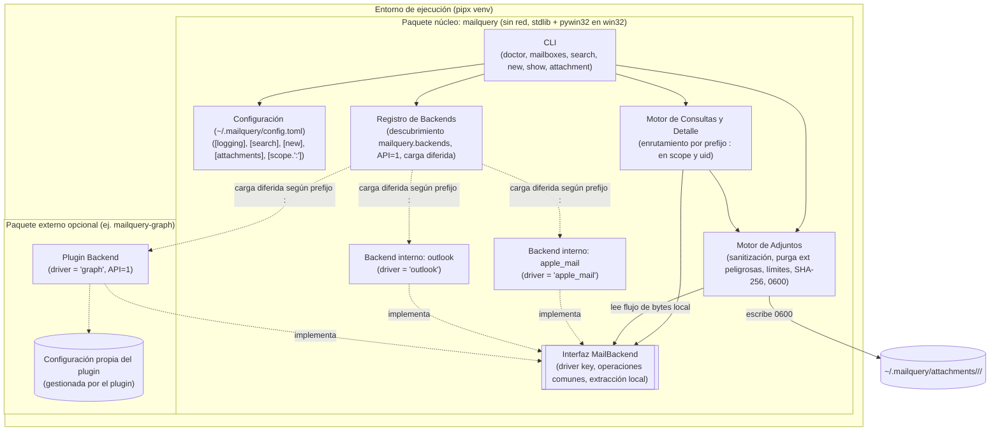
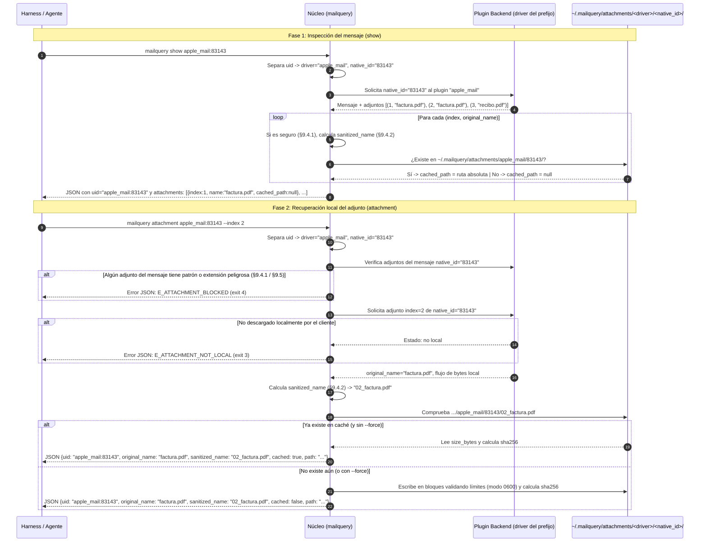

# PRD (Incremental) — Plugins de Backend y Recuperación Local de Adjuntos

**Producto:** `mailquery` — CLI de solo lectura para leer y buscar el correo del cliente de escritorio local desde un harness de agentes.
**Versión del documento:** 2.1 (incremental sobre [`PRD.md`](PRD.md) v1.3).
**Fecha:** 2026-11-10.
**Repositorio:** <https://github.com/dayler/mailquery>.
**Alcance:**
1. **Plugins de backend (`<driver>:`):** descubrimiento dinámico bajo `mailquery.backends`, esquema `[scope."<driver>:<cuenta>"]` en `config.toml`, `uid` con formato `"<driver>:<native_id>"` y configuración independiente por plugin.
2. **Recuperación local de adjuntos (`mailquery attachment <uid>`):** extracción desde el almacén local del cliente hacia `~/.mailquery/attachments/<driver>/<native_id>/`, bloqueo de patrones y extensiones peligrosas (`E_ATTACHMENT_BLOCKED`), sanitización determinista de nombres y sección `[attachments]` en `config.toml`.

---

## 1. Resumen ejecutivo

1. **Plugins de backend (`<driver>:`):**
   - `src/mailquery/backends/` descubre backends internos (`apple_mail`, `outlook`) y externos (`mailquery-graph`, `mailquery-thunderbird`, etc.) mediante entry points `mailquery.backends` (interfaz versión `1`, carga diferida).
   - Cada plugin define su clave única `driver` (`[a-z0-9_]+`, p. ej. `"apple_mail"`, `"outlook"`, `"graph"`, `"bird"`).
   - En `~/.mailquery/config.toml`, las cuentas se declaran como `[scope."<driver>:<cuenta>"]`, donde `<cuenta>` es el correo, nombre o UUID configurado en el cliente y `mailbox_list` es su lista de carpetas. Cuando se omite `<driver>:`, aplica el driver nativo del SO (`"apple_mail"` en macOS, `"outlook"` en Windows).
   - Todo `uid` usa el formato `"<driver>:<native_id>"` (p. ej. `"apple_mail:83143"`), lo que permite enrutar `show` y `attachment` en `O(1)` directamente al plugin correspondiente. Los plugins externos que requieran configuración propia la gestionan en archivos independientes bajo `~/.mailquery/`.

2. **Recuperación local de adjuntos (`mailquery attachment`):**
   - El subcomando `mailquery attachment <uid> (--index N | --all) [--force]` recupera los adjuntos ya descargados por el cliente de correo hacia `~/.mailquery/attachments/<driver>/<native_id>/<index:02d>_<sanitized_name>` (directorios `0700`, archivos `0600` en POSIX) y devuelve en JSON su ruta local, nombres, tamaño y SHA-256.
   - Si el mensaje contiene algún adjunto con patrón hostil (*Path Traversal*, RLO/caracteres de control Unicode, nombre reservado de Windows) o extensión peligrosa (§9.5, incluyendo dobles extensiones como `.pdf.exe`), **se bloquea por completo la extracción del mensaje** (`E_ATTACHMENT_BLOCKED`, exit 4) y se notifica al usuario para que lo revise en su cliente de correo bajo su propio riesgo.
   - Si el adjunto no está descargado en el disco local, falla con `E_ATTACHMENT_NOT_LOCAL` (exit 3).
   - El núcleo aplica además la sanitización defensiva del nombre (§9.4) y los límites de `[attachments]` (§13.1).

---

## 2. Problema y contexto

1. **Soporte de múltiples orígenes de correo:** el usuario necesita consultar cuentas alojadas en distintos clientes o conectores (Apple Mail, Outlook clásico, Thunderbird, Microsoft Graph) manteniendo el núcleo de `mailquery` libre de dependencias de red y con un único contrato JSON.
2. **Inspección de archivos adjuntos por el harness:**
   - `show <uid>` lista los nombres de los adjuntos, pero el agente necesita acceder al archivo en disco para leer su contenido (p. ej. inspeccionar PDFs o facturas).
   - Un mismo correo puede contener varios adjuntos con el mismo nombre (`factura.pdf`), por lo que requieren identificación posicional determinista (`1..N`) y caché local reutilizable.
   - El nombre del adjunto proviene del remitente (entrada no confiable) y puede contener secuencias de *Path Traversal*, caracteres de control Unicode (`\u202e`), nombres reservados del sistema o extensiones ejecutables (`.exe`, `.bat`, `.pdf.exe`).

---

## 3. Objetivos y no objetivos

### 3.1 Objetivos específicos

| ID | Objetivo | Medida de éxito |
|----|----------|-----------------|
| O1 | Descubrimiento dinámico de backends | Backends internos y externos registrados en `mailquery.backends` con clave `driver`, carga diferida y validación de interfaz `1` |
| O2 | Esquema `[scope."<driver>:<cuenta>"]` | Selección de plugin por prefijo en la clave de cuenta (con fallback al nativo del SO); todos los comandos consultan los drivers declarados en `config.toml` |
| O3 | Enrutamiento `O(1)` por `uid` prefijado | `uid` emitido como `"<driver>:<native_id>"`; `show` y `attachment` invocan directamente al plugin del prefijo |
| O4 | Chequeo `driver` en `doctor` | `doctor` incorpora el chequeo `driver` (§11.6) |
| O5 | Recuperación local con `mailquery attachment` | Extrae adjuntos locales hacia `~/.mailquery/attachments/<driver>/<native_id>/` devolviendo ruta, nombres, tamaño y SHA-256 |
| O6 | Bloqueo de patrones peligrosos y sanitización defensiva | Rechazo total (`E_ATTACHMENT_BLOCKED`) ante patrones hostiles o extensiones de §9.5, más sanitización defensiva (§9.4) y permisos `0700`/`0600` |
| O7 | Configuración `[attachments]` | Límites e interruptor configurables en `config.toml` (§13.1) con la biblioteca estándar |

### 3.2 No objetivos

- No descargar adjuntos desde servidores remotos (IMAP, Exchange, POP3).
- No escribir adjuntos fuera de `~/.mailquery/attachments/`.
- No devolver contenido binario ni Base64 en `stdout`.
- No consultar plugins que no estén declarados en `config.toml` (salvo el nativo del SO por defecto).
- No implementar en este alcance plugins externos concretos (`mailquery-graph`, `mailquery-thunderbird`) ni extraer adjuntos S/MIME.

---

## 4. Garantía de solo lectura (Invariante I-1)

> **Invariante I-1:** `mailquery` nunca modifica el almacén del cliente de correo ni el estado de ningún mensaje (leído/no leído, flags, carpeta, contenido). No lanza el cliente de correo. No abre conexiones de red ni provoca descargas desde el servidor en los backends locales (`apple_mail`, `outlook`). Solo escribe dentro de `~/.mailquery` (incluyendo `~/.mailquery/attachments/`); el repositorio no se modifica en ejecución.

---

## 5. Casos de uso adicionales

| ID | Caso de uso | Comando típico | Desencadenante |
|----|-------------|----------------|----------------|
| CU-08 | Recuperar adjuntos locales de un correo a disco | `mailquery attachment <uid> --index 2` o `mailquery attachment <uid> --all` | Bajo demanda, tras inspeccionar el correo con `show <uid>` |

---

## 6. Requisitos funcionales

Prioridades: **M** = imprescindible. Numeración continuada respecto a [`PRD.md`](PRD.md) (§6).

### 6.1 Arquitectura de plugins de backend (`driver`)

| ID | Requisito | Prioridad |
|----|-----------|-----------|
| RF-35 | **Registro `mailquery.backends` y clave `driver`:** `src/mailquery/backends/` descubre backends internos y externos mediante el entry point group `mailquery.backends`. Cada plugin provee una clave única `driver` (`[a-z0-9_]+`). | M |
| RF-36 | **Esquema `[scope."<driver>:<cuenta>"]` y carga diferida:** cada bloque en `config.toml` usa `[scope."<driver>:<cuenta>"]` (§13.1). Si omite `<driver>:`, usa el driver nativo del SO (`"outlook"` en Windows, `"apple_mail"` en el resto). Un `<driver>` no instalado produce `E_DRIVER_UNKNOWN` (exit 2). Solo se importan los drivers declarados en `config.toml` (o el nativo por defecto). | M |
| RF-37 | **Ejecución multi-driver:** distintos bloques `[scope]` pueden usar distintos `driver`. El núcleo separa `<driver>:` y pasa a cada plugin sus `<cuenta>`. Todos los comandos consultan los drivers declarados en `config.toml` y fusionan sus resultados antes de deduplicar y paginar. Si un driver declarado falla, el comando falla con el código de error correspondiente. | M |
| RF-38 | **Versión de interfaz (`1`):** todo plugin cargado debe declarar versión de interfaz `1` e implementar `MailBackend`; de lo contrario aborta con `E_PLUGIN_INCOMPATIBLE` (exit 3). | M |
| RF-39 | **Configuración autónoma por plugin:** cualquier configuración específica de un plugin externo se almacena en su propio archivo dentro de `~/.mailquery/`, independiente de `config.toml`. | M |
| RF-40 | **`uid` prefijado `"<driver>:<native_id>"`:** todo `uid` en JSON y `state.json` es un `string` `"<driver>:<native_id>"`. El plugin recibe y devuelve `<native_id>` como `string`. En `show <uid>` y `attachment <uid>`, el núcleo separa `<driver>` y `<native_id>` (usando el nativo del SO si se omite `<driver>:`) e invoca directamente a ese plugin (§11.3). | M |
| RF-41 | **`doctor` y `--version`:** `doctor` añade el chequeo `driver` (§11.6). `--version` (`-v`) muestra la versión de `mailquery` junto con los plugins instalados y sus respectivas versiones de paquete (p. ej. `mailquery 2.1.0 (drivers: apple_mail 2.1.0, graph 0.1.0)`). | M |

### 6.2 Recuperación local y segura de adjuntos (`attachment` y `show`)

| ID | Requisito | Prioridad |
|----|-----------|-----------|
| RF-42 | **Interruptor `[attachments].enabled`:** default `true` (§13.1). Si es `false`, `mailquery attachment` falla antes de abrir el almacén con `E_ATTACHMENTS_DISABLED` (exit 2). | M |
| RF-43 | **`index` y `cached_path` en `show <uid>`:** `message.attachments[]` devuelve objetos `{"index": 1..N, "name": "<original_name>", "cached_path": "<ruta>" | null}`, donde `cached_path` es la ruta absoluta en `~/.mailquery/attachments/<driver>/<native_id>/` si ya fue recuperado o `null` si no está en caché. | M |
| RF-44 | **Subcomando `mailquery attachment <uid>`:** exige `--index <N>` (entero ≥ 1) o `--all` (mutuamente excluyentes), acepta `--force` opcional y resuelve `<uid>` según §11.3. | M |
| RF-45 | **Almacenamiento, caché (`cached`) y recarga (`--force`):** guarda en `~/.mailquery/attachments/<driver>/<native_id>/<index:02d>_<sanitized_name>` (directorios `0700`, archivos `0600` en POSIX). Si el archivo ya existe en disco y no se pasa `--force`, calcula `size_bytes` y `sha256` del archivo existente y devuelve `saved: true, cached: true`. Si se pasa `--force`, vuelve a extraer el adjunto desde el backend, reemplaza el archivo de forma atómica y devuelve `saved: true, cached: false`. | M |
| RF-46 | **Disponibilidad local (`E_ATTACHMENT_NOT_LOCAL`):** si un adjunto solicitado no está descargado localmente por el cliente, falla con `E_ATTACHMENT_NOT_LOCAL` (exit 3). En mensajes S/MIME o contenedores corruptos, falla con `E_ATTACHMENT_UNREADABLE` (exit 3). | M |
| RF-47 | **Frontera núcleo / backend:** el backend entrega los metadatos y el flujo de bytes local del adjunto; el núcleo ejecuta la validación de seguridad, la sanitización, el control de límites, el cálculo de `sha256` y la escritura en disco. | M |
| RF-48 | **Bloqueo de patrones peligrosos y *Magic Bytes* (`E_ATTACHMENT_BLOCKED`) más sanitización defensiva:** antes de extraer cualquier byte, el núcleo evalúa los nombres de todos los adjuntos del mensaje contra las reglas de bloqueo (§9.4.1 y §9.5), y al leer el primer bloque del stream verifica también que no comience con *Magic Bytes* de un ejecutable o script (§9.4.1). Si cualquier adjunto del mensaje dispara el bloqueo, **se aborta toda extracción del mensaje** (eliminando cualquier archivo nuevo creado en esa corrida) y falla con `E_ATTACHMENT_BLOCKED` (exit 4), indicando al usuario que revise el mensaje en su cliente de correo bajo su propio riesgo. Si pasa el bloqueo, el núcleo aplica la sanitización defensiva (§9.4.2) para producir `sanitized_name`. | M |
| RF-49 | **Límites en streaming (`[attachments]`):** aplica `max_count` (default `50`), `max_file_size_mb` (default `25`) y `max_total_size_mb` (default `50`) (§13.1). Si se excede cualquiera, aborta, elimina los archivos nuevos o parciales creados en esa ejecución (conservando los previos en caché) y falla con `E_ATTACHMENT_TOO_LARGE` (exit 4). | M |

---

## 7. Requisitos no funcionales

| ID | Requisito |
|----|-----------|
| RNF-12 | **Biblioteca estándar:** implementado exclusivamente con la biblioteca estándar de Python (≥ 3.11). |
| RNF-13 | **Bloqueo preventivo, confinamiento y permisos `0700`/`0600`:** ningún archivo con patrón o extensión peligrosa (§9.4.1, §9.5) se extrae a disco; los adjuntos permitidos se escriben exclusivamente bajo `~/.mailquery/attachments/<driver>/<native_id>/` (directorios `0700`, archivos `0600` en POSIX, sin `+x`). |
| RNF-14 | **Atomicidad:** ante cualquier fallo (`E_ATTACHMENT_BLOCKED`, `E_ATTACHMENT_TOO_LARGE`, `E_ATTACHMENT_UNREADABLE`, error de E/S), no queda ningún archivo nuevo o parcial en `~/.mailquery/attachments/` ni temporales en `~/.mailquery/tmp/`. |
| RNF-15 | **Privacidad en logs:** `~/.mailquery/logs/mailquery.log` registra conteos y tamaños (§12.1), omitiendo `uid`, `original_name`, `sanitized_name` y rutas. |

---

## 8. Decisiones de arquitectura (ADR)

Numeración continuada respecto a [`PRD.md`](PRD.md) (§8).

| ID | Decisión | Alternativas descartadas | Motivo |
|----|----------|--------------------------|--------|
| ADR-17 | **Entry points `mailquery.backends` y esquema `[scope."<driver>:<cuenta>"]`.** | Clave `driver = "..."` en `[scope]`; sección `[backend]`; flag `--backend` | Conserva `mailbox_list` como única clave en `[scope]` y permite múltiples plugins por cuenta. |
| ADR-18 | **Configuración de plugins externos en archivos propios bajo `~/.mailquery/`.** | Secciones dinámicas `[driver.<nombre>]` en `config.toml` | Mantiene cerrado y estático el esquema de `config.toml`. |
| ADR-19 | **`uid` prefijado `"<driver>:<native_id>"` gestionado por el núcleo.** | `uid` sin prefijo; `uid` entero en Apple Mail | Evita colisiones de ID entre plugins y permite enrutamiento `O(1)` en `show` y `attachment`. |
| ADR-20 | **Subcomando `mailquery attachment <uid>` en `~/.mailquery/attachments/<driver>/<native_id>/`.** | Extraer en `show`; emitir Base64 en JSON | Separa la lectura del mensaje de la extracción de archivos, devuelve rutas ligeras en JSON, preserva I-1 y habilita caché determinista. |
| ADR-21 | **Bloqueo de adjuntos peligrosos (`E_ATTACHMENT_BLOCKED`), sanitización defensiva y escritura `0600` centralizados en el núcleo.** | Renombrar/recortar extensiones ejecutables y guardarlas como archivos inocentes; escritura directa por cada backend | Evita depositar payloads maliciosos disfrazados en disco para el agente, manteniendo la sanitización de nombres y los permisos `0700`/`0600` como segunda línea de defensa. |

---

## 9. Arquitectura

### 9.1 Vista de componentes



### 9.2 Flujo de `show` y `attachment`



### 9.3 Responsabilidades por módulo

| Módulo | Responsabilidad | Límites |
|---|---|---|
| `backends/base.py` | Definir versión de interfaz (`1`), propiedad `driver` (`[a-z0-9_]+`) y contrato `MailBackend` (opera con `<cuenta>` y `<native_id>`). | Sin dependencia de clientes concretos ni acceso a disco. |
| `backends/__init__.py` | Descubrir `mailquery.backends`, resolver prefijos `<driver>:` en `[scope]` y `<uid>`, cargar de forma diferida los drivers activos y validar interfaz `1`. | Solo importa los drivers declarados en `config.toml` (o el nativo del SO por defecto). |
| `attachments.py` *(nuevo)* | Validar `[attachments].enabled`, bloquear patrones y extensiones peligrosas (`E_ATTACHMENT_BLOCKED`, §9.4.1 y §9.5), sanitizar nombres (§9.4.2), gestionar `~/.mailquery/attachments/<driver>/<native_id>/` (`0700`), servir caché, aplicar límites en streaming, calcular SHA-256 y escribir con modo `0600`. | Independiente del protocolo del cliente de correo. |
| `backends/apple_mail.py` | Proveer `driver = "apple_mail"` (API `1`), operar con `native_id` como `string` numérico y entregar el flujo de bytes local (desde `.emlx` o `Attachments/<native_id>/<part>/` en `.partial.emlx`). | Solo lectura sobre el store local de Apple Mail. |
| `backends/outlook.py` | Proveer `driver = "outlook"` (API `1`), operar con `native_id` hexadecimal (`EntryID`), verificar disponibilidad local y entregar bytes mediante un temporal efímero en `~/.mailquery/tmp/` eliminado al instante. | Solo lectura sobre los stores locales de Outlook. |

### 9.4 Bloqueo de patrones peligrosos y sanitización del nombre de archivo

#### 9.4.1 Bloqueo preventivo (`E_ATTACHMENT_BLOCKED`, exit 4)
Antes de extraer cualquier archivo de un mensaje (tanto con `--index N` como con `--all`), el núcleo evalúa los nombres originales de **todos los adjuntos del mensaje**, y al iniciar la lectura de cada flujo inspecciona sus primeros bytes. Si **cualquiera** de ellos cumple al menos una de las siguientes condiciones, **se bloquea toda extracción del mensaje** con `E_ATTACHMENT_BLOCKED` (exit 4), limpiando cualquier archivo nuevo de esa corrida:

1. **Secuencias de ruta o *Path Traversal*:** presencia de separadores `/` o `\`, segmentos `..`, prefijos de unidad (`C:`) o sufijos NTFS ADS (`:...`).
2. **Caracteres de control o inversión Unicode:** presencia de bytes nulos o caracteres de control/formato Unicode (`Cc`, `Cf`, `Cs`, `Co`), incluyendo marcas de inversión como *Right-to-Left Override* (`\u202e`).
3. **Extensiones peligrosas simples o múltiples (§9.5):** tras normalizar con `NFKC` y recortar puntos/espacios finales, si la extensión final o cualquiera de las extensiones encadenadas del nombre (separadas por `.`, case-insensitive, p. ej. `factura.pdf.exe` o `reporte.pdf.bat.cmd`) pertenece al catálogo de §9.5.
4. **Nombres reservados del sistema:** si la raíz del nombre coincide (case-insensitive) con `CON`, `PRN`, `AUX`, `NUL`, `COM1`..`COM9` o `LPT1`..`LPT9`.
5. ***Magic Bytes* de ejecutables o scripts en el flujo de datos:** si los primeros bytes del contenido coinciden con una firma de ejecutable o script camuflado bajo otra extensión:
   - `4D 5A` (`MZ` — ejecutable/DLL Windows PE)
   - `7F 45 4C 46` (`\x7fELF` — binario Linux ELF)
   - `FE ED FA CE`, `FE ED FA CF`, `CE FA ED FE`, `CF FA ED FE`, `CA FE BA BE` (binarios macOS Mach-O / Universal)
   - `23 21` (`#!` — script con *shebang*)

#### 9.4.2 Sanitización defensiva del nombre (`sanitized_name`)
Para los archivos que superan el bloqueo de §9.4.1, el núcleo aplica igualmente la sanitización determinista sobre `original_name` e `index` (`1..N`) como defensa en profundidad:

1. **Extracción de nombre base y normalización `NFKC`:** si el nombre está vacío, se usa `"attachment"`; en caso contrario se normaliza en `NFKC` y se conserva únicamente el nombre base sin caracteres no imprimibles.
2. **Caracteres especiales y espacios:** cualquier secuencia de espacios o caracteres `< > : " / \ | ? *` se reemplaza por `_`; se recortan puntos y espacios extremos.
3. **Puntos iniciales y vacíos:** se eliminan puntos iniciales (dotfiles); si el resultado queda vacío, pasa a `"attachment"`.
4. **Truncado a 150 caracteres:** si supera 150 caracteres, se conserva la extensión (≤ 20 caracteres) y se trunca la raíz a ≤ 150 caracteres totales.
5. **Prefijo de índice:** se antepone `<index:02d>_` (`01_`, `02_`, ..., `10_`).

### 9.5 Catálogo de extensiones peligrosas bloqueadas

| Categoría | Extensiones bloqueadas (`E_ATTACHMENT_BLOCKED`) |
|-----------|-------------------------------------------------|
| **Ejecutables y binarios** | `.exe`, `.com`, `.scr`, `.pif`, `.dll`, `.sys`, `.drv`, `.ocx`, `.cpl`, `.app`, `.bin`, `.run`, `.elf`, `.dylib`, `.so` |
| **Scripts y automatización** | `.bat`, `.cmd`, `.ps1`, `.psm1`, `.psd1`, `.vbs`, `.vbe`, `.js`, `.jse`, `.wsf`, `.wsh`, `.hta`, `.sh`, `.bash`, `.zsh`, `.ksh`, `.csh`, `.command`, `.tool`, `.applescript`, `.scpt`, `.workflow` |
| **Instaladores e imágenes** | `.msi`, `.msp`, `.mst`, `.msix`, `.appx`, `.pkg`, `.mpkg`, `.dmg`, `.iso`, `.img`, `.deb`, `.rpm`, `.apk` |
| **Accesos directos y registro** | `.lnk`, `.url`, `.scf`, `.inf`, `.reg`, `.ins`, `.isp`, `.prf`, `.terminal`, `.desktop`, `.webloc` |
| **Intérpretes y bytecode** | `.jar`, `.jnlp`, `.class`, `.py`, `.pyc`, `.pyo`, `.pyw`, `.rb`, `.pl`, `.php`, `.lua`, `.tcl` |
| **Office con macros** | `.docm`, `.dotm`, `.xlsm`, `.xltm`, `.xlam`, `.pptm`, `.potm`, `.ppam`, `.sldm` |

> **Ejemplos de evaluación:**
> - `"Factura Octubre 2026.pdf"` (índice 2) ⇒ permitido, se guarda como `"02_Factura_Octubre_2026.pdf"`
> - `"../../../Users/dayler/.ssh/CON.\u202efdp.exe"` ⇒ **bloqueado (`E_ATTACHMENT_BLOCKED`, exit 4)**; no se guarda nada
> - `"reporte.pdf.bat.cmd"` ⇒ **bloqueado (`E_ATTACHMENT_BLOCKED`, exit 4)**; no se guarda nada
> - `"install.sh"` ⇒ **bloqueado (`E_ATTACHMENT_BLOCKED`, exit 4)**; no se guarda nada

---

## 10. Estructura de carpetas y modelo de datos

### 10.1 Home de la aplicación (`~/.mailquery`)

```text
~/.mailquery/                       # macOS: 0700 | Windows: %USERPROFILE%\.mailquery
├── config.toml                     # opcional
├── state.json                      # cursor + anillo de uids ("<driver>:<native_id>")
├── attachments/                    # caché local de adjuntos recuperados (0700)
│   └── <driver>/                   # clave única del driver (apple_mail | outlook | graph | bird)
│       └── <native_id>/            # ID nativo del mensaje (0700)
│           └── <index:02d>_<sanitized_name>   # archivo recuperado (0600)
├── locks/mailquery.lock
├── tmp/
└── logs/mailquery.log
```

### 10.2 Cambios en el modelo común y en `state.json`

1. **`uid`:** `str` con formato `"<driver>:<native_id>"` en todas las salidas JSON y en `state.json`.
2. **`account.label`:** correo o nombre real configurado en el cliente (`"you@icloud.com"`, `"trabajo@empresa.com"`, `"Archivo 2025"`).
3. **`message.attachments[]` en `show`:** objetos `{"index", "name", "cached_path"}`.
4. **`state.json`:** `cursor.last_uid` y `emitted_uids` almacenan `"<driver>:<native_id>"`. Un `uid` que no sea `string` o cuyo `<driver>` sea inválido produce `E_STATE_CORRUPT` (exit 3):
   ```json
   {
     "schema": 1,
     "updated_at": "2026-11-09T21:00:00-04:00",
     "last_run": {"command": "new", "at": "2026-11-09T21:00:00-04:00"},
     "cursor": {"last_date_received": 1793573649, "last_uid": "apple_mail:83143", "lookback_seconds": 600},
     "emitted_uids": ["apple_mail:83135", "apple_mail:83138", "apple_mail:83143"]
   }
   ```

---

## 11. CLI y contrato de salida (JSON)

### 11.1 Comando nuevo

| Comando | Descripción | Salida |
|---------|-------------|--------|
| `attachment <uid>` | Recupera uno (`--index N`) o todos (`--all`) los adjuntos locales de `<uid>` en `~/.mailquery/attachments/`. | JSON con `uid`, `output_dir`, `count`, `attachments[]` |

### 11.2 Sintaxis y opciones de `attachment`

```bash
mailquery attachment apple_mail:83143 --index 2
mailquery attachment apple_mail:83143 --index 2 --force
mailquery attachment apple_mail:83143 --all
```

| Opción | Descripción |
|--------|-------------|
| `<uid>` | Identificador `<driver>:<native_id>` (si se omite `<driver>:`, usa el driver nativo del SO). Obligatorio. |
| `--index N` | Índice 1-based (`1..N`) del adjunto según `show <uid>`. Mutuamente excluyente con `--all`. |
| `--all` | Recupera todos los adjuntos del mensaje respetando `[attachments]`. Mutuamente excluyente con `--index`. |
| `--force` | Ignora la caché en disco, re-extrae el adjunto desde el backend y reemplaza el archivo (`cached: false`). |

### 11.3 Resolución de `<uid>` y argumentos en `attachment` (y `show`)

| Caso | Resultado |
|------|-----------|
| `[attachments].enabled = false` en `config.toml` (solo `attachment`) | `E_ATTACHMENTS_DISABLED` (exit 2), antes de abrir almacenes. |
| Se omiten `--index` y `--all`, o se pasan ambos | `E_USAGE` (exit 2). |
| `--index N` no es entero o `< 1` | `E_USAGE` (exit 2): `invalid --index …: expected a positive integer (1 or greater)`. |
| Prefijo `<driver>:` en `<uid>` no instalado | `E_DRIVER_UNKNOWN` (exit 2). |
| `<uid>` vacío, o `<native_id>` no existe / borrado / en carpeta oculta | `E_USAGE` (exit 2): `message uid … was not found`. |
| Mensaje pertenece a una cuenta no declarada en `[scope]` (o store excluido) | `E_ACCOUNT_NOT_IN_SCOPE` (exit 2), misma regla que `show` (§12.4 de `PRD.md`). |
| Mensaje sin adjuntos (`0` adjuntos) | `E_USAGE` (exit 2): `message uid … has no attachments`. |
| `--index N` mayor que el total `M` de adjuntos (`N > M`) | `E_USAGE` (exit 2): `attachment index N is out of range: message … has M attachment(s) (valid: 1..M)`. |
| Cualquier adjunto del mensaje contiene un patrón peligroso, *Magic Bytes* de ejecutable (§9.4.1) o extensión prohibida (§9.5) | `E_ATTACHMENT_BLOCKED` (exit 4); bloquea toda extracción del mensaje y limpia cualquier archivo nuevo de esa corrida. |
| Mensaje S/MIME o adjunto corrupto / ilegible | `E_ATTACHMENT_UNREADABLE` (exit 3). |
| Adjunto no descargado localmente por el cliente | `E_ATTACHMENT_NOT_LOCAL` (exit 3). |
| Supera `max_count`, `max_file_size_mb` o `max_total_size_mb` | `E_ATTACHMENT_TOO_LARGE` (exit 4); borra los archivos nuevos/parciales de esa corrida. |

### 11.4 Ayuda (`mailquery attachment --help`)

```text
usage: mailquery attachment [-h] (--index N | --all) [--force] <uid>

Recover local attachments of one message into ~/.mailquery/attachments/.

Positional arguments:
  <uid>          message uid (as returned by search, new or show, e.g. apple_mail:83143)

Options:
  -h, --help     show this help message and exit
  --index N      1-based attachment index to recover (as shown by `mailquery show <uid>`)
  --all          recover all attachments of the message
  --force        re-extract from the backend and overwrite existing cached file(s)

Examples:
  mailquery show apple_mail:83143
  mailquery attachment apple_mail:83143 --index 1
  mailquery attachment apple_mail:83143 --index 2 --force
  mailquery attachment apple_mail:83143 --all

Notes:
  - Only extracts attachments already downloaded locally by the desktop mail client
    (otherwise exits 3 with E_ATTACHMENT_NOT_LOCAL).
  - Blocks extraction of the entire message if any attachment matches a dangerous
    pattern or executable extension (exits 4 with E_ATTACHMENT_BLOCKED).
  - Safe files are sanitized and saved with mode 0600 under
    ~/.mailquery/attachments/<driver>/<native_id>/<index>_<sanitized_name>.
```

### 11.5 Ejemplos de salida JSON

#### A. `mailquery show apple_mail:83143`
```json
{
  "ok": true,
  "command": "show",
  "generated_at": "2026-11-09T21:00:00-04:00",
  "message": {
    "uid": "apple_mail:83143",
    "message_id": "<id@example.net>",
    "subject": "Facturas pendientes",
    "from": {"name": "Pepito", "address": "pepito@email.com"},
    "to": [{"name": "", "address": "me@example.com"}],
    "cc": [],
    "date_sent": "2026-11-09T20:50:00-04:00",
    "date_received": "2026-11-09T20:50:05-04:00",
    "mailbox": {
      "account": {"uuid": "D70DBCF6-...", "label": "you@icloud.com", "email": "you@icloud.com"},
      "name": "INBOX",
      "path": "INBOX",
      "url": "imap://D70DBCF6-.../INBOX"
    },
    "is_read": false,
    "is_flagged": false,
    "has_attachments": true,
    "size_bytes": 412900,
    "headers": {
      "From": "Pepito <pepito@email.com>",
      "To": "me@example.com",
      "Subject": "Facturas pendientes",
      "Date": "Mon, 09 Nov 2026 20:50:00 -0400",
      "Message-ID": "<id@example.net>"
    },
    "body_text": "Hola, te adjunto las tres facturas de este trimestre.",
    "body_truncated": false,
    "attachments": [
      {"index": 1, "name": "factura.pdf", "cached_path": null},
      {"index": 2, "name": "factura.pdf", "cached_path": null},
      {"index": 3, "name": "factura.pdf", "cached_path": null}
    ],
    "partial": false,
    "readable": true,
    "source": {"emlx_path": "/Users/dayler/Library/Mail/V10/.../83143.emlx", "partial": false}
  },
  "warnings": []
}
```

#### B. `mailquery attachment apple_mail:83143 --index 2` (Archivo normal)
```json
{
  "ok": true,
  "command": "attachment",
  "generated_at": "2026-11-09T21:01:00-04:00",
  "uid": "apple_mail:83143",
  "output_dir": "/Users/dayler/.mailquery/attachments/apple_mail/83143",
  "count": 1,
  "attachments": [
    {
      "index": 2,
      "original_name": "Factura Octubre 2026.pdf",
      "sanitized_name": "02_Factura_Octubre_2026.pdf",
      "saved": true,
      "cached": false,
      "path": "/Users/dayler/.mailquery/attachments/apple_mail/83143/02_Factura_Octubre_2026.pdf",
      "size_bytes": 128450,
      "sha256": "3a7bd3e2360a3d29eea436fcfb7e44c735d117c42d1c1835420b6b9942dd4f1b"
    }
  ],
  "warnings": []
}
```

#### C. `mailquery attachment apple_mail:83199 --all` (Bloqueado por patrón/extensión peligrosa, exit 4)
```json
{
  "ok": false,
  "command": "attachment",
  "error": {
    "code": "E_ATTACHMENT_BLOCKED",
    "message": "attachment 1 ('../../../Users/dayler/.ssh/CON.fdp.exe') of message apple_mail:83199 was blocked due to a dangerous filename pattern or extension",
    "hint": "notify the user to double-check and inspect this attachment directly in the email client at their own risk"
  }
}
```

#### D. `mailquery attachment apple_mail:83143 --index 2` (No descargado localmente, exit 3)
```json
{
  "ok": false,
  "command": "attachment",
  "error": {
    "code": "E_ATTACHMENT_NOT_LOCAL",
    "message": "attachment 2 ('Factura Octubre 2026.pdf') of message apple_mail:83143 is not downloaded locally in Apple Mail",
    "hint": "open the message in Apple Mail so the client downloads the attachment to disk, then retry"
  }
}
```

### 11.6 Chequeo `driver` en `doctor`

Se inserta inmediatamente después del chequeo `python`:
- **`name`:** `"driver"`
- **`ok`:** `true` si todos los `driver` referenciados en `[scope."<driver>:<cuenta>"]` (o el nativo del SO por defecto) están instalados, proveen su clave `driver` y cumplen `plugin_api=1`; `false` en caso contrario.
- **`detail`:** `<driver> (plugin_api=1)` (p. ej. `"apple_mail (plugin_api=1)"`). Si falla, incluye el motivo y `hint`, y los chequeos dependientes del almacén reportan `not evaluated: driver failed`.

### 11.7 Nuevos códigos de error

| Código | Exit | Cuándo | Hint exigido |
|--------|------|--------|--------------|
| `E_DRIVER_UNKNOWN` | 2 | El prefijo `<driver>` en `[scope."<driver>:<cuenta>"]` o en `<uid>` no corresponde a ningún plugin instalado. | Lista los drivers instalados (`installed drivers: ...`) y cómo instalar con `pipx inject mailquery <package>`. |
| `E_ATTACHMENTS_DISABLED` | 2 | Se ejecuta `mailquery attachment` con `[attachments].enabled = false`. | `set [attachments].enabled = true in ~/.mailquery/config.toml to allow attachment recovery`. |
| `E_PLUGIN_INCOMPATIBLE` | 3 | Un plugin activo no declara versión de interfaz `1`, carece de clave `driver` o incumple `MailBackend`. | Versión esperada (`1`) vs. encontrada y sugerencia de actualizar el plugin. |
| `E_ATTACHMENT_NOT_LOCAL` | 3 | El adjunto solicitado no está descargado en el almacén local del cliente. | `open the message in Apple Mail (or classic Outlook) so the client downloads the attachment locally, then retry`. |
| `E_ATTACHMENT_UNREADABLE` | 3 | Mensaje S/MIME o adjunto corrupto/ilegible en el almacén local. | Causa específica (`S/MIME attachments cannot be extracted` o archivo corrupto). |
| `E_ATTACHMENT_BLOCKED` | 4 | Algún adjunto del mensaje presenta un patrón peligroso, *Magic Bytes* de ejecutable (§9.4.1) o una extensión prohibida (§9.5). | `notify the user to double-check and inspect this attachment directly in the email client at their own risk`. |
| `E_ATTACHMENT_TOO_LARGE` | 4 | Se supera `max_count`, `max_file_size_mb` o `max_total_size_mb`. | Límite superado, clave en `[attachments]` y sugerencia de usar `--index` si se usó `--all`. |

---

## 12. Logs y rendimiento

### 12.1 Registro en `~/.mailquery/logs/mailquery.log`

- Evento `start`: `backend=` registra el `driver` activo (o lista separada por comas si `[scope]` usa varios).
- Evento `end` de `attachment`: registra `count=<N> cached=<M> bytes=<total_bytes> duration_ms=<ms>`.

### 12.2 Presupuesto de rendimiento (p95)

| Operación | Apple Mail (macOS) | Outlook (Windows) |
|-----------|--------------------|-------------------|
| `attachment` (1 adjunto local ≤ 5 MB) | < 200 ms | < 600 ms |

---

## 13. Configuración (`~/.mailquery/config.toml`) y valores fijos

### 13.1 Propiedades nuevas y esquema de `[scope]`

| Propiedad | Tipo | Obligatoria | Default | Valores válidos | Ejemplo | Qué hace |
|-----------|------|-------------|---------|-----------------|---------|----------|
| `[attachments]` | tabla TOML | No | — | — | `[attachments]` | Configuración de recuperación local de adjuntos. |
| `attachments.enabled` | booleano | No | `true` | `true`, `false` | `false` | Habilita o deshabilita `mailquery attachment`. |
| `attachments.max_file_size_mb` | entero | No | `25` | 1–500 | `50` | Tamaño máximo en MB por adjunto individual. |
| `attachments.max_total_size_mb` | entero | No | `50` | 1–1024 (`>= max_file_size_mb`) | `100` | Tamaño máximo acumulado en MB por ejecución de `attachment` (`< max_file_size_mb` ⇒ `E_CONFIG_INVALID`). |
| `attachments.max_count` | entero | No | `50` | 1–500 | `20` | Máximo de adjuntos permitidos en `attachment --all`. |
| `[scope."<driver>:<account-id>"]` | tabla TOML | No | `<driver>` = `"outlook"` en Windows, `"apple_mail"` en el resto | `<driver>`: `[a-z0-9_]+` instalado; `<account-id>`: correo, nombre o UUID de la cuenta en el cliente | `[scope."apple_mail:you@icloud.com"]` | Declara una cuenta observada y su plugin. Si se omite `<driver>:`, usa el driver nativo del SO. |

### 13.2 Ejemplos de configuración

- **Plantilla inicial (`docs/config.example.toml`):**
  ```toml
  # [attachments]
  # enabled = true               # true | false
  # max_file_size_mb = 25        # 1..500
  # max_total_size_mb = 50       # 1..1024 (>= max_file_size_mb)
  # max_count = 50               # 1..500

  [scope."apple_mail:you@icloud.com"]
  mailbox_list = ["Facturas"]
  ```

- **Ejemplo completo (`README.md` y §15.5 de `PRD.md`):**
  ```toml
  [attachments]
  enabled = true                 # true (default) | false (disables `mailquery attachment`)
  max_file_size_mb = 25          # 1..500
  max_total_size_mb = 50         # 1..1024 (>= max_file_size_mb)
  max_count = 50                 # 1..500

  [scope."apple_mail:you@icloud.com"]
  mailbox_list = ["Facturas", "Archivo"]

  [scope."outlook:Archivo 2025"]
  mailbox_list = ["Contabilidad"]

  [scope."graph:trabajo@empresa.com"]
  mailbox_list = ["INBOX/Facturas"]

  [scope."bird:yo@dominio.com"]
  mailbox_list = ["Impuestos"]

  # Sin prefijo <driver>: usa el driver nativo del SO
  [scope."you@company.com"]
  mailbox_list = ["Proyectos"]
  ```

### 13.3 Valores fijos (no configurables)

| Aspecto | Valor fijo | Nota |
|---------|-----------|------|
| Directorio de adjuntos | `~/.mailquery/attachments/<driver>/<native_id>/` | Destino de `mailquery attachment`. |
| Longitud máxima del nombre base sanitizado | 150 caracteres | Antes del prefijo `<index:02d>_` (conservando hasta 20 caracteres de extensión). |

---

## 14. Criterios de aceptación (AC)

### 14.1 Plugins de backend (`driver`)
- **AC-01:** `apple_mail` y `outlook` se registran en `mailquery.backends`, proveen su clave única `driver` (`[a-z0-9_]+`) y se resuelven por el mismo registro que cualquier plugin externo.
- **AC-02:** `[scope."<driver>:<cuenta>"]` tiene `mailbox_list` como única clave; omitir `<driver>:` usa `"outlook"` en Windows y `"apple_mail"` en el resto; un `<driver>` no instalado produce `E_DRIVER_UNKNOWN` (exit 2); todos los comandos cargan y consultan solo los drivers declarados en `config.toml` (o el nativo por defecto).
- **AC-03:** Un plugin activo con versión de interfaz distinta de `1` o sin clave `driver` falla con `E_PLUGIN_INCOMPATIBLE` (exit 3).
- **AC-04:** Múltiples bloques `[scope."<driver>:<cuenta>"]` con distintos `driver` se consultan y fusionan en la misma ejecución; `config.toml` mantiene su esquema cerrado (`E_CONFIG_INVALID` ante secciones no reconocidas).
- **AC-05:** Todo `uid` en JSON y `state.json` tiene formato `"<driver>:<native_id>"`; `account.label` expone el correo o nombre real de la cuenta; `show` y `attachment` enrutan en `O(1)` al plugin del prefijo (o al nativo del SO si `<uid>` omite `:`).
- **AC-06:** `doctor` incluye el chequeo `driver` (§11.6) y `--version` (`-v`) lista los plugins instalados con sus respectivas versiones.

### 14.2 Recuperación local de adjuntos (`attachment` y `show`)
- **AC-07:** `[attachments]` aplica los defaults de §13.1; `enabled = false` rechaza `mailquery attachment` con `E_ATTACHMENTS_DISABLED` (exit 2) antes de abrir almacenes; rangos inválidos o `max_total_size_mb < max_file_size_mb` producen `E_CONFIG_INVALID` (exit 2).
- **AC-08:** `show <uid>` expone `attachments: [{"index": 1..N, "name": "<original_name>", "cached_path": "<ruta>" | null}]`.
- **AC-09:** `attachment <uid>` exige `--index <N>` o `--all`, valida los casos de §11.3 y con `--all` extrae adjuntos con nombres repetidos (`"factura.pdf"`) como `01_factura.pdf`, `02_factura.pdf`, etc.
- **AC-10:** Todo adjunto permitido se escribe en `~/.mailquery/attachments/<driver>/<native_id>/<index:02d>_<sanitized_name>` (directorios `0700`, archivos `0600` en POSIX) con `cached: false` la primera vez, `cached: true` en corridas posteriores sobre el archivo existente, y `cached: false` (re-extrayendo y reemplazando el archivo) cuando se invoca con `--force`.
- **AC-11:** Cuando un adjunto no está descargado localmente, `attachment` falla con `E_ATTACHMENT_NOT_LOCAL` (exit 3); en S/MIME falla con `E_ATTACHMENT_UNREADABLE` (exit 3).
- **AC-12:** Si cualquier adjunto del mensaje contiene un patrón peligroso (*Path Traversal*, caracteres de control/RLO Unicode, nombre reservado de Windows), una extensión simple/múltiple del catálogo §9.5 (`.exe`, `.bat`, `.cmd`, `.sh`, `.pdf.exe`, etc.) o *Magic Bytes* de ejecutable/script (`MZ`, `\x7fELF`, Mach-O, `#!`) camuflados bajo otra extensión (§9.4.1), se bloquea la extracción de todos los adjuntos del mensaje, no queda ningún archivo nuevo en disco y falla con `E_ATTACHMENT_BLOCKED` (exit 4) pidiendo al usuario verificar el mensaje en su cliente de correo bajo su propio riesgo. Los nombres permitidos aplican además la sanitización defensiva de §9.4.2.
- **AC-13:** `size_bytes` y `sha256` coinciden con el archivo en disco; superar `max_count`, `max_file_size_mb` o `max_total_size_mb` aborta, elimina los archivos nuevos/parciales de esa corrida y falla con `E_ATTACHMENT_TOO_LARGE` (exit 4).
- **AC-14:** `attachment` mantiene intacto el almacén del cliente (archivos, `mtime`, estado de lectura) y limpia cualquier archivo temporal en `~/.mailquery/tmp/`.
- **AC-15:** `pyproject.toml` mantiene sus dependencias actuales y `mailquery.log` registra únicamente los campos de §12.1.
