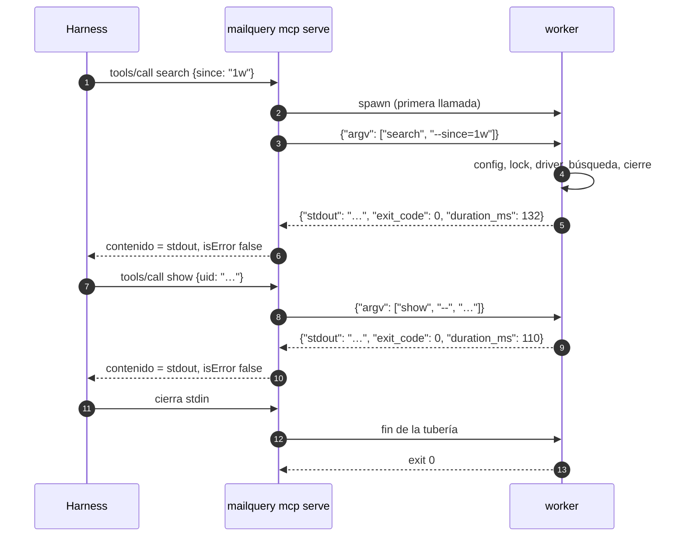

# Proceso hijo persistente del servidor MCP

**Tipo:** funcionalidad
**Base:** PRD 2.5
**Fecha:** 2026-11-24
**Aprobación:** —
**Paquete:** 3.0.0 (menor)

> **Archivada el 2026-11-24 por orden del dueño.** La unidad no se aprobó ni se implementó: quedó en `borrador`, sus IDs son marcadores y no reservó ninguno. Se guarda como registro; no se mantiene al día y no es una unidad abierta. La espera del lock (RF-x2) siguió como unidad propia, `docs/changes/espera-del-lock.md`. Las notas de la revisión están al final, en "Notas de revisión".

## Estado

borrador

## Contexto

### Problema

- **Cada llamada paga el arranque del intérprete y del paquete.** Medido el 2026-11-24 sobre siete llamadas reales del servidor MCP en macOS: de 191 a 294 ms por llamada se van en lanzar `python -P -m mailquery …`, importar `mailquery.cli` y volver a salir; el trabajo del comando costó entre 132 y 496 ms. Entre el 36 % y el 65 % de cada llamada es arranque, no consulta. En la misma sesión, `initialize` tardó 245 ms y el primer `show` de un cuerpo, 1.281 ms frente a 356 ms en caliente.
- **El coste escala con el número de llamadas, no con el correo.** Un resumen de una semana necesitó seis llamadas y 4,4 s de tiempo de servidor; un tercio de ese tiempo no leyó nada.
- **Dos sesiones a la vez se rechazan.** El lock de ejecución es exclusivo y no espera: la segunda llamada recibe `E_LOCKED` (exit 5) al instante. El servidor MCP no reintenta y el modelo tiene que decidir si repite. Como el lock se retiene entre 130 y 500 ms por comando, dos agentes que trabajen a la vez chocan con facilidad.
- **La decisión vigente de ADR-51 es un proceso por llamada.** Se tomó para que un driver colgado, un plugin que deja un hilo vivo o un fallo de COM no tumben la sesión. Cualquier propuesta de proceso persistente tiene que conservar esa propiedad, no solo ser más rápida.

### Solución elegida

- **Un proceso hijo que vive lo que vive el servidor.** `mcp serve` lanza un único worker con su mismo intérprete y su mismo paquete, y le envía una petición por línea. El worker importa el paquete una vez y ejecuta cada petición por la misma ruta de despacho que la CLI.
- **El estado del comando no se comparte.** La configuración, el lock, los drivers, el store, el cursor y la caché de ids nativos se abren y se cierran en cada petición, igual que en una invocación suelta. Lo único que sobrevive entre peticiones son los módulos importados.
- **El worker se mata cuando estorba.** Si una petición no responde en su tope o el proceso muere, el servidor lo mata, devuelve el error de esa llamada y relanza uno nuevo; tras tres relevos en un minuto, degrada a un proceso por llamada en vez de dejar la sesión sin servicio.
- **La espera del lock sustituye al rechazo inmediato.** Un comando espera a que el lock se libere, con un límite, antes de rendirse con `E_LOCKED`.
- **Nada de demonio.** Un worker por servidor, sin socket, sin puerto, sin PID que sobreviva a la sesión y sin estado compartido entre sesiones.

### Alternativas descartadas

- **Demonio compartido por todas las sesiones.** Una sola conexión y un solo lock para todos: una sesión lenta bloquea a las demás, y hay que inventar autenticación, límites y limpieza de estado obsoleto. Sustituye un problema de latencia por uno de operación.
- **Ejecutar los comandos dentro del propio servidor.** Elimina todo el coste de proceso, pero un driver colgado o un fallo del cliente de correo cierra la sesión MCP entera: renuncia a la propiedad que justificó ADR-51. También comparte memoria y estado entre llamadas, que es justo lo que hoy no ocurre.
- **Un pool de workers en paralelo.** Las llamadas de MCP se atienden en serie; un pool añade concurrencia donde no hay demanda y multiplica los procesos que compiten por el mismo lock.
- **Separar el lock en un lector compartido y un escritor exclusivo.** Atacaría la contención de raíz, pero `state.json` no es transaccional: sin el lock global hay que hacer atómico el cursor de `new` y el caché de adjuntos. Es un cambio de garantías que merece su propia unidad.
- **Compactar la respuesta y recortar el sobre.** Reduce tokens, no latencia: los 191–294 ms fijos siguen ahí. Es un cambio independiente, con su propia entrada registrada.

### Preguntas abiertas

Ninguna.

### Medición que motiva los presupuestos

**Tabla: Llamadas MCP medidas el 2026-11-24 en macOS**

| Llamada | Total ms | Ejecución ms | Arranque ms | Arranque % |
|---|---|---|---|---|
| `search` 2 resultados, 2 semanas | 381 | 132 | 249 | 65 |
| `search` 100 filas, 1 semana | 779 | 496 | 283 | 36 |
| `search` agrupado por dominio | 742 | 448 | 294 | 40 |
| `search` agrupado por día | 464 | 222 | 242 | 52 |
| `search` no leídos por remitente | 446 | 255 | 191 | 43 |

## Requerimiento

### Lo que no cambia

- El contrato JSON de las herramientas, sus parámetros, sus códigos de salida, la equivalencia entre parámetro y opción (RF-85) y el texto del resultado, que sigue siendo el de la CLI salvo `generated_at`.
- La garantía de solo lectura de §4 y los permisos que necesitan la app y el proceso que ejecutan la CLI.
- La atención en serie de las llamadas y el orden de llegada.
- Que `mcp serve` no lee correo, no abre drivers y de la configuración solo lee lo que necesita para su log.

### Requerimientos

**RF-x1. Proceso hijo persistente del servidor MCP.** Prioridad M.

**Como** harness de agentes, **quiero** que el servidor MCP reutilice un proceso hijo entre llamadas, **para** que una consulta no pague el arranque del intérprete y del paquete cada vez.

Condiciones:

- **Un worker por servidor.** `mcp serve` lanza como mucho un worker y le envía las peticiones por tuberías privadas; no abre socket, no escucha en ninguna dirección y no lo comparte con otra sesión.
- **Arranque perezoso.** El worker se lanza en la primera llamada que lo necesita, no al responder `initialize` ni `tools/list`; una sesión que nunca llama a una herramienta no deja ningún proceso hijo.
- **Misma ruta de despacho.** Cada petición ejecuta el comando con el mismo parser, la misma configuración, el mismo lock, los mismos drivers y los mismos eventos de log que una invocación suelta de la CLI.
- **Estado por petición.** Ninguna petición ve el store, el lock, el cursor, la configuración ni un driver abierto por la anterior; al terminar cada una, todos quedan cerrados. Lo único que persiste es lo importado.
- **Sin datos de correo retenidos.** El worker no guarda asuntos, direcciones, cuerpos, rutas ni adjuntos entre peticiones.
- **Relevo por caída.** Si el worker muere o no responde dentro del tope de la llamada, el servidor lo mata, responde a esa llamada con `E_INTERNAL` y `isError: true`, y relanza el worker para la siguiente.
- **Degradación.** Tras tres relevos en un minuto, el servidor deja de relanzar y atiende las llamadas siguientes con un proceso por llamada, como hoy, hasta que la sesión termina.
- **Ciclo de vida.** El worker termina cuando el servidor lo hace: al cerrar stdin, al recibir la señal de terminación del harness y al detectar el fin de su tubería. No queda ningún proceso `mailquery` vivo después.
- **Versión importada.** Si la fecha de modificación del paquete instalado cambia mientras la sesión está abierta, el servidor reemplaza el worker antes de atender la llamada siguiente, para que no ejecute código viejo.
- **Log.** El log del servidor añade una línea por evento del worker (`start`, `respawn`, `fallback`, `end`) sin valores de parámetros, y conserva el formato de `event=call` con `tool`, `exit_code` y `duration_ms`.

Se comprueba con AC-x1, AC-x2, AC-x3 y AC-x6.

**RF-x2. Espera acotada del lock de ejecución.** Prioridad M.

**Como** harness de agentes, **quiero** que una llamada espere un poco a que se libere el lock, **para** que dos sesiones que coinciden no fallen por turnarse.

Condiciones:

- **Opción.** `--lock-wait MS` es una opción común, aceptada antes del comando como `--log-level`, por todos los comandos menos `--help` y `--version`.
- **Rango.** Un entero de 0 a 60000 milisegundos; fuera de rango o no entero ⇒ `E_USAGE` (exit 2) antes de abrir el store.
- **Por defecto.** 5000 ms. `--lock-wait 0` recupera el rechazo inmediato de 2.0.0.
- **Espera.** El comando reintenta el lock con una espera creciente hasta agotar el presupuesto y empieza a trabajar en cuanto lo consigue.
- **Agotado.** Si el presupuesto se agota, el error es `E_LOCKED` (exit 5), con el mismo `code` y el mismo `exit` que hoy; el `hint` nombra el presupuesto y el archivo del lock.
- **`doctor` no espera.** Diagnostica el lock sin tomarlo en espera y sin bloquearse.
- **MCP.** Cada herramienta expone `lock_wait`, un entero con el mismo rango, que el servidor traduce a `--lock-wait=<ms>` antes del comando. Sin `lock_wait` en la llamada, el comando usa el valor por defecto.
- **Serialización.** La espera no cambia lo que protege el lock: sigue habiendo como mucho una ejecución de `mailquery` tocando el store a la vez.

Se comprueba con AC-x4 y AC-x5.

### Decisiones de arquitectura

**ADR-x1. Worker persistente por sesión, con el estado de cada comando abierto y cerrado por llamada.**

El servidor MCP mantiene un único proceso hijo por sesión y le envía una petición por línea; el worker ejecuta cada petición por la misma ruta de despacho que la CLI y cierra configuración, lock, drivers, store y estado al terminar cada una. Solo sobreviven los módulos importados. Si el worker muere o no responde dentro del tope, se mata, la llamada falla sola y se relanza; tras tres relevos en un minuto, el servidor atiende con un proceso por llamada.

Reglas:

- **Aislamiento.** El worker es un proceso aparte del servidor: un driver colgado o un fallo del cliente de correo no cierra la sesión MCP, que sigue respondiendo a `ping` y a las llamadas siguientes tras el relevo.
- **Sin estado entre peticiones.** La configuración, el lock, los drivers, el store, el cursor y la caché de ids nativos se abren y se cierran en cada petición, como en una invocación suelta; ninguna petición hereda los de la anterior.
- **Sin datos retenidos.** El worker no guarda asuntos, direcciones, cuerpos, rutas ni adjuntos entre peticiones.
- **Sin superficie nueva.** Solo tuberías privadas entre el servidor y su hijo: ni socket, ni puerto, ni estado compartido con otra sesión.
- **Relevo y degradación.** Un worker muerto o colgado se reemplaza; tres relevos en un minuto degradan la sesión a un proceso por llamada en lugar de dejarla sin servicio.

Motivo: el arranque del intérprete y del paquete cuesta entre 191 y 294 ms por llamada, del 36 % al 65 % del total, y no depende del correo.

Alternativas descartadas: ejecutar los comandos en el propio servidor (elimina el coste de proceso, pero un driver colgado cierra la sesión, que es lo que ADR-51 evita); un demonio compartido por todas las sesiones (una sesión lenta bloquea a las demás y hay que resolver autenticación y estado obsoleto); un pool de workers (concurrencia donde las llamadas van en serie); y separar el lock en lector compartido y escritor exclusivo (deja `state.json` sin la atomicidad que hoy le da el lock).

### Contrato del proceso hijo

El worker se lanza con el intérprete del servidor y el módulo del servidor: `python -P -m mailquery.mcp_server --worker`. No es un comando de la CLI: no aparece en `mailquery --help`, no se documenta como uso público y no cambia el número de comandos.

**Tabla: Mensajes del protocolo privado del worker**

| Dirección | Mensaje | Campos |
|---|---|---|
| Servidor → worker | petición | `argv`: lista de argumentos de la CLI, sin el intérprete ni el nombre del módulo |
| Worker → servidor | respuesta | `stdout`: texto de la salida del comando; `exit_code`: entero; `duration_ms`: entero |

- Una petición por línea, una respuesta por línea, JSON compacto en UTF-8 terminado en `\n`; el worker responde en el mismo orden en que recibe.
- El fin de la entrada termina el worker con exit 0, también con una petición a medias.
- Una línea que no es una petición válida termina el worker con exit 1; el servidor lo trata como caída (relevo).

**Figura: Secuencia de dos llamadas con el worker**

### Interfaz de los módulos

- `ToolRunner`: protocolo con `run(argv: Sequence[str]) -> ToolOutcome`; se mantiene. `WorkerRunner` lo implementa con el worker; `OneShotRunner` con un proceso por llamada, y queda como respaldo y como ejecutor de las pruebas.
- `ToolOutcome`: `stdout: str`, `exit_code: int`, `duration_ms: int`; no cambia.
- `serve(stdin, stdout, *, runner)`: no cambia su firma ni el conjunto de mensajes del protocolo MCP.
- `RunLock.acquire(wait_ms: int = 0) -> None`: nuevo parámetro; con 0 se comporta como hoy.
- `mailquery.cli` expone la opción `--lock-wait` y la pasa al lock; el servidor MCP la traduce desde `lock_wait`.

### Riesgos

- **Un driver colgado ahora cuelga un proceso reutilizado.** Mitigación: el tope por llamada mata el worker y la llamada falla sola, sin tocar la sesión (RF-x1, relevo).
- **Código viejo en memoria tras una actualización.** Mitigación: reemplazo por fecha de modificación del paquete (RF-x1); una actualización a mitad de sesión se aplica en la llamada siguiente.
- **Un worker que no muere deja procesos huérfanos.** Mitigación: fin de tubería, señal de terminación y comprobación de que no queda ningún proceso al cerrar (AC-x2).
- **Memoria creciente por fuga del propio paquete.** Mitigación: la degradación a proceso por llamada se activa sola tras tres relevos, así que una sesión con fuga se recupera reiniciándola; el worker no retiene datos de correo y su consumo se vigila en la prueba manual (CL-12).
- **La espera por defecto cambia el tiempo de una CLI concurrente.** Mitigación: 5000 ms, `--lock-wait 0` para el comportamiento anterior y §17 lo documenta.

### Cambios visibles

- En ambas plataformas: la opción común `--lock-wait`, con 5000 ms por defecto; una llamada MCP en caliente responde en una fracción del tiempo anterior; `E_LOCKED` deja de aparecer por coincidencias cortas entre sesiones.

## Criterios de aceptación

**AC-x1.** Con el servidor en marcha y sin instrumentación del cliente, veinte `show` seguidos del mismo uid y veinte `search` de metadatos de veinte filas, en caliente: el p95 del sobre —duración de la llamada menos `duration_ms` de la ejecución— es ≤ 25 ms, y el p95 total de cada operación baja al menos un 40 % respecto de la misma batería medida con un proceso por llamada en la misma máquina. El texto de cada resultado es idéntico al de la invocación de la CLI salvo `generated_at`, e `isError` sigue al código de salida.

**AC-x2.** Matar el worker con `SIGKILL` durante una llamada: esa llamada termina con `E_INTERNAL` e `isError: true`, la siguiente responde bien tras el relevo, y no queda ningún proceso `mailquery` vivo al cerrar stdin. Tres muertes en menos de un minuto dejan el servidor en modo de un proceso por llamada, que sigue respondiendo; el log lo registra como `fallback`. Matar el servidor con el worker ocupado no deja el worker vivo.

**AC-x3.** Con el servidor en marcha, un cambio en `config.toml` (`[logging].json`, `[scope]` o `[attachments]`) se aplica en la llamada siguiente sin reiniciar la sesión, y volver a cambiarlo lo deshace igual. `since: "1w"` y `today` se resuelven en el instante de cada llamada, no al arrancar el worker. Mientras el servidor está ocioso, un comando de la CLI obtiene el lock sin esperar.

**AC-x4.** Dos servidores de dos sesiones distintas, cada uno con veinte llamadas que se solapan en el tiempo: ninguna llamada falla con `E_LOCKED`, y el reparto de resultados es coherente con una ejecución tras otra. Con `lock_wait: 0` en cada herramienta, las que coinciden fallan con `E_LOCKED` (exit 5) como hoy. Dos `new` concurrentes no pierden ni repiten mensajes: cada uno ve exactamente los que no había consumido el otro.

**AC-x5.** `--lock-wait` acepta 0 y 60000 y rechaza `-1`, `60001` y `abc` con `E_USAGE` (exit 2) antes de abrir el store; aparece en `mailquery --help` como opción global y en la ayuda de cada comando como se documenta en §12.7. Con un lock retenido 2 s, `--lock-wait 5000` espera y termina bien, `--lock-wait 100` falla con `E_LOCKED` a los ~100 ms con un `hint` que nombra el presupuesto, `--lock-wait 0` no espera, y `doctor` con el lock retenido informa sin esperar.

**AC-x6.** Reemplazar el paquete instalado por otra compilación mientras la sesión está abierta: la llamada siguiente ejecuta el código nuevo, sin reiniciar el servidor, y el log registra el reemplazo del worker. Sin cambio en el paquete, no hay reemplazo.

## IDs

- Crea: RF-x1, RF-x2, ADR-x1, AC-x1, AC-x2, AC-x3, AC-x4, AC-x5, AC-x6
- Elimina: —

## Dependencias

- servidor-mcp

## Decisiones

- **¿Proceso por llamada o proceso persistente?** (2026-11-24) Un proceso hijo persistente por sesión, con el estado de cada comando abierto y cerrado por llamada y relevo ante caída o bloqueo. Sustituye a la parte de ADR-51 que exigía un proceso nuevo por llamada.
- **¿Cómo se ejecuta el worker sin añadir un comando?** (2026-11-24) Con el propio módulo del servidor, `python -P -m mailquery.mcp_server --worker`, que no aparece en la ayuda ni cuenta como comando.
- **¿Qué pasa si el worker se cuelga o se cae?** (2026-11-24) Se mata, la llamada falla con `E_INTERNAL` y se relanza; tras tres relevos en un minuto se degrada a un proceso por llamada.
- **¿El worker sobrevive a la sesión?** (2026-11-24) No: uno por servidor, muere con él. Nada de demonio, socket ni estado compartido entre sesiones.
- **¿Se espera el lock o se rechaza?** (2026-11-24) Se espera con `--lock-wait`, 5000 ms por defecto en la CLI y en MCP; `--lock-wait 0` recupera el rechazo inmediato.
- **¿La espera se configura en `config.toml`?** (2026-11-24) No: es una opción de la línea de comandos y un parámetro de las herramientas.
- **¿Se cachean cuerpos o resultados entre llamadas?** (2026-11-24) No: el worker no retiene datos de correo.

## Glosario

- **Worker** (nuevo): proceso hijo persistente que el servidor MCP lanza una vez por sesión y reutiliza para ejecutar las llamadas de sus herramientas, con el estado de cada comando abierto y cerrado por llamada (RF-x1).
- **Relevo** (nuevo): matar el worker y lanzar otro cuando muere, se cuelga o cambia la instalación; se registra en el log del servidor (RF-x1).
- **Espera del lock** (nuevo): el tiempo, hasta 60000 ms, que un comando reintenta el lock de ejecución antes de fallar con `E_LOCKED` (RF-x2).

## Conciliación con el PRD

**Tabla: Conciliación con el PRD**

| ID | Contrato | Archivo | Ancla | Qué cambia | Estado |
|---|---|---|---|---|---|
| RC-01 | Resumen del servidor MCP | `01-resumen.md` | después de `**Servidor MCP por stdio.**` | El bloque dice que el servidor reutiliza un proceso hijo persistente y que una llamada en caliente no paga el arranque del paquete (RF-x1). | pendiente |
| RC-02 | Ejecución de una llamada | `06-requisitos-funcionales.md` | `RF-86` | Cada llamada se ejecuta en el worker de la sesión, no en un proceso nuevo; el estado del comando se abre y se cierra por llamada, y se mantienen el contrato JSON y los códigos de salida (RF-x1). | pendiente |
| RC-03 | Requisitos del worker y del lock | `06-requisitos-funcionales.md` | después de `RF-88` | Nueva subsección 6.13 con RF-x1 y RF-x2, con sus condiciones. | pendiente |
| RC-04 | Proceso de un solo disparo | `08-adr.md` | `ADR-51` | La excepción de `mcp serve` pasa a ser un worker por sesión con estado por llamada; se mantiene el motivo de no compartir proceso con el servidor (ADR-x1). | pendiente |
| RC-05 | Decisión del worker | `08-adr.md` | después de `ADR-51` | Nueva fila ADR-x1 con la decisión, el motivo, las alternativas descartadas y el riesgo aceptado (RF-x1). | pendiente |
| RC-06 | Vista de componentes | `09-arquitectura.md` | `### 9.1 Vista de componentes` | El diagrama añade el worker como proceso del servidor, con su protocolo privado y su relevo (RF-x1). | pendiente |
| RC-07 | Flujo de una llamada MCP | `09-arquitectura.md` | después de `### 9.5 Flujo de un mensaje en` | Nueva subsección 9.7 "Proceso hijo persistente del servidor MCP": arranque perezoso, petición y respuesta por línea, estado por petición, tope, relevo y degradación (RF-x1). | pendiente |
| RC-08 | Opciones comunes | `12.01-opciones-comunes.md` | `--log-level {error,warning,info,debug}` | Nueva fila `--lock-wait MS`, entero de 0 a 60000, 5000 por defecto; la lista de opciones que no existen sigue igual (RF-x2). | pendiente |
| RC-09 | Chequeo del lock en `doctor` | `12.08-doctor.md` | `### 12.8` | El chequeo `lock` no espera: con `--lock-wait` sigue informando `available` o `held by another mailquery process` en el acto (RF-x2). | pendiente |
| RC-10 | Comportamiento con el lock ocupado | `17-comportamiento-errores.md` | `Lock ocupado` | La fila describe la espera acotada, su valor por defecto y el `hint`; se distingue del lock de la caché de ids nativos, que no cambia (RF-x2). | pendiente |
| RC-11 | Ayuda | `12.07-ayuda.md` | `Global options:` | Las opciones globales de la ayuda listan `--lock-wait MS` con su rango y su valor por defecto (RF-x2). | pendiente |
| RC-12 | Rendimiento de una llamada MCP | `19-rendimiento.md` | después de `**Tabla: Presupuesto p95 de` | Nueva subsección después de la tabla de adjuntos con el presupuesto de una llamada MCP en caliente: sobre del worker ≤ 25 ms p95, y `search` de metadatos y `show` con el 40 % menos de tiempo total que con un proceso por llamada (RF-x1). | pendiente |
| RC-13 | Alcance de los criterios | `20-criterios-aceptacion.md` | `3. **Plugins, adjuntos` | El rango de criterios incluye los del worker y la espera del lock (RF-x1, RF-x2). | pendiente |
| RC-14 | Criterios de aceptación | `20-criterios-aceptacion.md` | después de `AC-78` | AC-x1…AC-x6. | pendiente |
| RC-15 | Ciclo de vida de la sesión MCP | `21-harness.md` | después de `### 21.3 Idempotencia y concurrencia` | La subsección de operación con MCP describe un worker por sesión, su arranque perezoso, su relevo, la degradación y el cierre al terminar el harness; la concurrencia explicada pasa a ser la espera del lock (RF-x1, RF-x2). | pendiente |
| RC-16 | Cambios visibles en 3.0.0 | `22-versiones.md` | `**Tabla: Cambios visibles de 3.0.0 en ambas plataformas**` | Nuevas filas: la opción `--lock-wait` y la llamada MCP en caliente con el worker (RF-x1, RF-x2). | pendiente |
| RC-17 | Riesgos del servidor MCP | `23-riesgos.md` | después de `Documentación desincronizada` | Nuevas filas: driver colgado en un proceso reutilizado, código viejo en memoria tras actualizar, worker huérfano y sesiones concurrentes, con sus mitigaciones (RF-x1, RF-x2). | pendiente |

## Documentos consumidores

- README.md: pendiente
- README.es.md: pendiente
- docs/INTERFACES.md: pendiente
- skills/mailquery/SKILL.md: pendiente
- docs/PERFORMANCE-BACKLOG.md: pendiente
- docs/tests/TEST-CATALOG.md: pendiente
- docs/tests/mcp-server.md: pendiente
- docs/tests/cli-config.md: pendiente
- docs/tests/search.md: pendiente
- docs/tests/end-to-end.md: pendiente
- docs/config.example.toml: sin cambio
- docs/recipes/: sin cambio
- docs/security/: sin cambio

## Checklist de conciliación

**Tabla: Checklist de conciliación**

| ID | Ítem | Cómo se verifica | Estado |
|---|---|---|---|
| CL-01 | Cada fila de "Conciliación con el PRD" está aplicada en su archivo | Revisión fila por fila | pendiente |
| CL-02 | El resto del PRD no cambia | Diff del PRD limitado a los archivos de la tabla, el glosario, el Anexo D, la portada y el historial | pendiente |
| CL-03 | Los IDs de la unidad están creados y eliminados en el PRD, sin huecos ni referencias rotas | `doc_14` | pendiente |
| CL-04 | Las decisiones están en el Anexo D y el glosario está aplicado | Revisión de "Decisiones" y "Glosario" | pendiente |
| CL-05 | Los documentos consumidores están actualizados | Ninguno está `pendiente` | pendiente |
| CL-06 | No quedan textos obsoletos en el PRD ni en los documentos consumidores: "un proceso hijo por llamada", "proceso de un solo disparo" sin la excepción del worker, `E_LOCKED` descrito como rechazo inmediato y cualquier presupuesto de §19 medido con el arranque incluido | Búsqueda de cada texto | pendiente |
| CL-07 | El defecto registrado está cerrado | Su entrada de `docs/KNOWN-DEFECTS.md` | no aplica |
| CL-08 | La versión del documento, el historial y los próximos IDs libres están al día | Portada e `HISTORIAL.md` | pendiente |
| CL-09 | La suite pasa | Suite completa, con `doc_14` y `doc_15` | pendiente |
| CL-10 | Medición antes y después con el mismo cliente y la misma batería de llamadas: p95 del sobre, p95 total y bytes por respuesta, guardadas como evidencia de la rama | Salida de la batería, con su log del servidor | pendiente |
| CL-11 | Dos sesiones MCP a la vez, 20 llamadas solapadas cada una: ninguna `E_LOCKED`; con `lock_wait: 0`, las coincidentes fallan con `E_LOCKED` (exit 5); dos `new` concurrentes no pierden ni repiten mensajes | Prueba manual en macOS y en Windows, con su log | pendiente |
| CL-12 | Procesos: sin worker tras cerrar stdin, sin worker tras matar el servidor, sin huérfanos tras tres relevos, y consumo de memoria del worker estable en 200 llamadas | `ps` y `pgrep mailquery` antes y después; lectura de memoria del worker | pendiente |
| CL-13 | Documentación de la espera: §17, §12.1, §12.7, README y README.es.md dicen lo mismo del valor por defecto y de `--lock-wait 0` | Revisión cruzada de los cinco documentos | pendiente |

## Desviaciones aprobadas

Ninguna

## Notas de revisión

Revisión del 2026-11-24, antes de archivar. Las rutas y los números de línea son los del código de ese día.

### Veredicto

- **La dirección es correcta.** Un worker por sesión es la mejor de las alternativas que la unidad compara, y el razonamiento de las descartadas se sostiene.
- **El beneficio no compensa el coste hoy.** El worker ahorra unos 250 ms por llamada: en el resumen semanal medido, alrededor de 1,5 s sobre 4,4 s. En una sesión de agente, cada turno del modelo tarda varios segundos y ese ahorro apenas se nota. A cambio se pierde la propiedad más simple del diseño de ADR-51: un proceso nuevo por llamada, con el estado limpio garantizado por el sistema operativo.
- **No choca con la skill.** El worker vive solo dentro de `mcp serve`; la CLI que usa la skill sin MCP sigue siendo un proceso por invocación. El único roce entre los dos caminos es el lock, y eso lo resuelve la espera del lock sin worker.

### Huecos de diseño que impedían aprobarla

- **El tope de la llamada no está definido.** RF-x1 mata el worker cuando "no responde dentro del tope", pero la unidad no le da valor, origen ni criterio de aceptación; RF-86 dice que el servidor no impone tope propio. El tope tendría que superar la espera del lock más los topes de la CLI, o mataría llamadas legítimas. AC-x2 solo prueba una muerte por señal, nunca un cuelgue.
- **`ping` no responde durante un cuelgue.** ADR-x1 dice que la sesión "sigue respondiendo a `ping`", pero las llamadas van en serie: con el worker colgado, `ping` espera hasta el tope.
- **Las salidas con `os._exit` cambian los códigos de salida.** El watchdog COM termina el proceso con `os._exit(3)` (`backends/outlook_com.py`, línea 476) y `doctor` con `os._exit(0)` (`cli.py`, línea 1892). En el worker eso es una caída: el harness recibiría `E_INTERNAL` en lugar de `E_CLIENT_TIMEOUT`, y el informe de `doctor` se perdería. Contradice "Lo que no cambia".
- **El protocolo comparte descriptores con el comando.** Si las peticiones y las respuestas viajan por stdin y stdout del worker, un plugin que escribe en stdout corrompe el protocolo y uno que lee stdin consume peticiones. RF-86 garantiza stdin vacío y un `E_INTERNAL` limitado a esa llamada; la unidad no dice que el protocolo use descriptores propios.
- **"Solo sobreviven los módulos importados" no es comprobable.** También sobreviven los globales de módulo, los handlers de logging, el estado de los plugins y los hilos abandonados (`plugins/api.py`, línea 464), que son uno de los motivos de ADR-51. Falta una regla que se pueda probar, por ejemplo relevo si queda un hilo vivo al terminar la petición, o cada cierto número de llamadas.
- **La muerte del servidor no llega a un worker ocupado.** Un worker bloqueado en un driver no lee su tubería, así que no ve el fin de la entrada. AC-x2 y CL-12 exigen que no quede vivo, sin mecanismo. AC-x2 nombra además `SIGKILL`, que no existe en Windows.

### Medición

- **Solo hay datos de macOS.** En Windows la conexión COM se abre en cada petición y puede dominar el tiempo de la llamada; la bajada del 40 % de AC-x1 puede no cumplirse allí.
- **El texto y la tabla no coinciden.** El problema habla de siete llamadas y la tabla tiene cinco filas, ninguna de `show`, aunque AC-x1 mide `show`.
- **Falta una alternativa.** Reducir los imports del arranque no se midió ni se descartó; puede recuperar parte de los 191–294 ms sin tocar ADR-51.

### Otros defectos

- **Dos cambios en una unidad.** RF-x2 no depende del worker y afecta a toda la CLI.
- **La mitigación de la fuga de memoria no se sigue.** La degradación se activa por relevos, y una fuga no provoca relevos.
- **"Versión importada" está sin definir.** No dice qué archivo se mira ni si ese reemplazo cuenta para los tres relevos; el glosario lo incluye en "relevo".
- **`ToolRunner` no "se mantiene".** `argv` lleva hoy el intérprete (`mcp_server.py`, línea 439) y el protocolo lo quita; el ciclo de vida exige además un cierre que `run` no cubre.
- **`docs/security/: sin cambio` es dudoso.** Un proceso que conserva el código de los plugins entre llamadas cambia el modelo de amenazas.
- **La base quedó atrás.** La unidad se escribió contra el PRD 2.5; el PRD pasó a 2.6 el mismo día, al conciliarse `servidor-mcp`.

### Qué habría que tener antes de reabrirla

1. La espera del lock implementada, para medir sin el ruido de `E_LOCKED`.
2. El coste de los imports del arranque medido con `python -X importtime`, y lo que recuperan los imports diferidos.
3. El arranque medido en Windows con Outlook, con la misma batería de llamadas.
4. Una decisión con esos datos: el worker solo si el arranque sigue siendo un coste que se nota en uso real, y entonces con los huecos de diseño de arriba resueltos.
