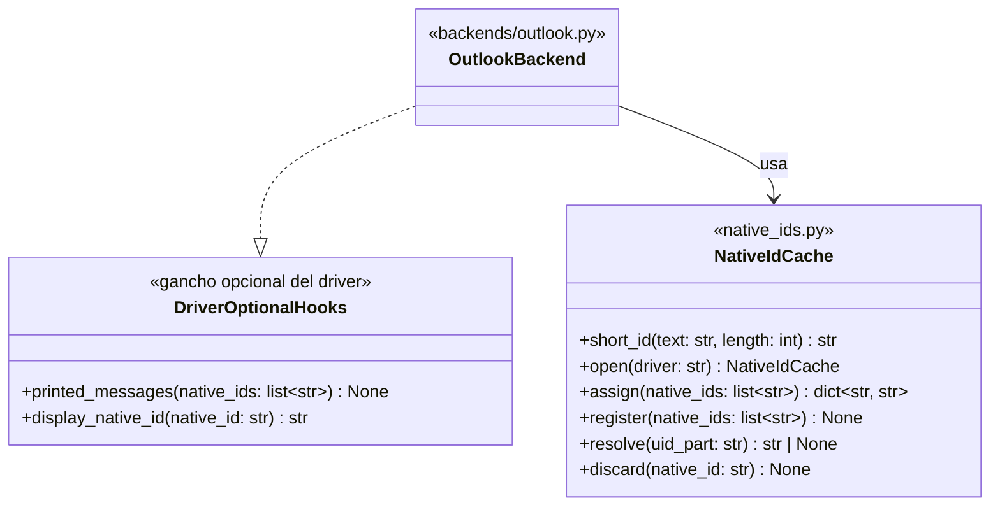

# Id corto de mensaje en Outlook y caché de ids nativos

**Tipo:** cambio
**Base:** PRD 2.4
**Fecha:** 2026-11-22
**Aprobación:** dueño del producto, 2026-11-23
**Paquete:** 3.0.0 (mayor)

## Estado

aprobado

## Contexto

### Problema

- El `uid` es `"<driver>:<native_id>"`. En Outlook, con un `EntryID` de Exchange u OST, mide 148 caracteres: `outlook:` más 140 hexadecimales; con un PST es más corto. En Apple Mail mide unos 16 (`apple_mail:83143`).
- Los mensajes de una misma carpeta comparten casi todo el `EntryID`: en las capturas medidas, solo cambiaban los 11 últimos caracteres.
- El `uid` se repite en cada fila, en cada warning de mensaje y en el `cursor` de `new`. En una fila mínima de `search` es cerca de un tercio de la fila.
- En Windows, el `EntryID` no cabe en el límite de ruta, y la caché de adjuntos lo sustituye por un identificador de 32 hexadecimales.
- El problema es solo de Outlook: el id nativo de Apple Mail ya es corto.

### Solución elegida

- **Alias y nada más.** Una tabla local traduce un id corto al `native_id` del mensaje. No guarda nada más y ninguna fila de mensaje se actualiza.
- **Lo decide el driver.** El driver `outlook` emite el id corto como su parte del `uid` y lo traduce cuando el núcleo le pide un mensaje. El driver `apple_mail` no cambia.
- **El núcleo no se entera.** Ya trata la parte posterior al prefijo como texto opaco.
- **El núcleo pone las herramientas.** Una librería del núcleo da el cálculo del id corto, la conexión a la base y las operaciones sobre la tabla. La usan los drivers que lo deciden, también los plugins.

Con la unidad, el `uid` de Outlook pasa de 148 caracteres a 18 (`outlook:k3f9q2m7xa`); con sufijo, 20 o más (`outlook:k3f9q2m7xa-2`).

### Por qué el núcleo avisa de lo que imprime

El driver lee todas las filas del alcance y el núcleo decide después cuáles se imprimen. El driver no sabe cuáles son. Ejemplo con `mailquery search --from acme --since 2026-01-01 --limit 20`:

1. El driver lee las carpetas del alcance: 10.000 filas.
2. El núcleo filtra por `--from acme`: 37 filas.
3. El núcleo quita duplicados: 35 filas.
4. El núcleo recorta a `--limit 20` e imprime: 20 filas.

- Dentro de una ejecución la base se lee una sola vez: el driver calcula en memoria el id corto de las 10.000 filas (13 ms, medido con ids sintéticos), asigna sus uids una sola vez por ejecución y traduce desde memoria cuando el núcleo le devuelve esos ids.
- La base hace falta para la ejecución siguiente (`show`, `attachment`), y solo para las 20 filas impresas.
- Registro medido con ids sintéticos: 200 filas, de 4 a 6 ms y 96 KB; 10.000 filas, de 64 a 290 ms y 3,7 MB.

### Por qué 10 caracteres

**Tabla: Pares de mensajes con el mismo id corto esperados**

| Filas en la tabla | 8 caracteres | 10 caracteres |
|---|---|---|
| 100.000 | 0,0045 | 0,000004 |
| 1.000.000 | 0,45 | 0,0004 |

Una colisión no rompe nada, porque `seq` distingue los dos mensajes. Con 10 caracteres, las colisiones son unas mil veces menos probables que con 8, a cambio de 2 caracteres por `uid`.

### Alternativas descartadas

- **`uid` propio del núcleo, derivado de la cabecera `Message-ID`, con el estado de `new` en la misma base.** Cambia el contrato del `uid`, `state.json`, la ruta de adjuntos y varias decisiones de arquitectura para un problema que solo tiene Outlook.
- **Id corto también en Apple Mail.** Su `uid` pasaría de 16 a 21 caracteres, con una escritura en disco por búsqueda y sin nada a cambio.
- **Actualizar el `native_id` de una fila, o buscar el mensaje en otras carpetas cuando ya no existe.** El único propósito de la tabla es dar un alias al `native_id`; un mensaje movido es otro `native_id`.
- **Devolver todas las coincidencias de un id corto, con un warning nuevo.** `show` devuelve un solo mensaje y `attachment` necesita exactamente uno: obliga a cambiar el contrato JSON y el de plugins.
- **Registrar todas las filas que el driver lee.** La tabla se llena de mensajes que nadie pidió y crece hasta el tamaño del buzón.
- **Calcular el id corto de la cabecera `Message-ID`.** Cada copia del mismo mensaje en otra carpeta compartiría id corto.
- **Id corto de 8 caracteres.** Igualaría el `uid` de Apple Mail, pero con un millón de filas se esperarían 0,45 pares de mensajes con el mismo id corto, frente a 0,0004 con 10.
- **Un contador único de la base para `seq`.** Es uno solo para toda la tabla: no puede empezar en 1 para cada par `driver` y `short_id`.
- **Migrar o validar el `state.json` y la caché de adjuntos anteriores.** No hay transición: ver "Sin transición".
- **Aceptar el `EntryID` como `uid` en la entrada.** Solo se admite el id corto.
- **`--show-native-id` también en `search`, `new` y `attachment`.** Es una opción de depuración: solo aplica a `show`.
- **Caché del árbol de carpetas; tabla de adjuntos extraídos.** Dan falsos positivos o negativos, o no aportan nada sobre la caché de adjuntos actual.

### Sin transición

- El requerimiento describe el producto como si siempre hubiera funcionado con ids cortos. No hay migración, compatibilidad ni validación de datos anteriores.
- Un `state.json` anterior no es compatible: el dueño lo borra a mano y `new` crea otro.
- Los directorios de adjuntos anteriores de Outlook (`attachments/outlook/`) no se usan ni se validan: el dueño los borra a mano para que no interfieran.

### Preguntas abiertas

Ninguna. Las respuestas están en "Decisiones".

## Requerimiento

### Resumen

1. **`uid` corto.** En Windows el `uid` es `outlook:` más un id corto de 10 caracteres, en lugar de los 140 del `EntryID`.
2. **Caché de ids nativos.** `~/.mailquery/db/cache.db` relaciona cada id corto impreso con su id nativo. El núcleo ofrece la librería y cada driver decide si la usa.
3. **`--show-native-id`.** Opción de depuración de `show`, que muestra el id nativo en lugar del id corto.

### Lo que no cambia

- El formato del `uid`, `"<driver>:<native_id>"`, y el contrato JSON. Ninguna salida tiene una propiedad `short_id` ni `seq`.
- El `uid` de Apple Mail y el driver `apple_mail`.
- `state.json`, su esquema y su migración.
- El cursor de `new` y el orden total. La clave de orden de Outlook sigue siendo el `EntryID`.
- La regla de la ruta de la caché de adjuntos. En Outlook el directorio pasa a ser `attachments/outlook/<parte del uid>/`; el identificador de 32 hexadecimales deja de ser lo habitual en Outlook y solo se usa si el home tiene una ruta tan larga que el nombre no cabe, como con cualquier driver.
- `plugin_api = 1`. Los dos ganchos nuevos del driver son opcionales: el núcleo los busca y un driver que no los tiene funciona igual.

### Versión

`develop` anuncia la pre-release `3.0.0a2` (forma PEP 440 normalizada de `3.0.0-alpha.2`) en lugar de `3.0.0a1`, en `pyproject.toml`, `mailquery.__version__`, `--version` y `doctor`. La versión del paquete sigue siendo `3.0.0`.

### Requerimientos

**RF-80. Librería de ids cortos y caché de ids nativos.** Prioridad M.

**Como** autor de un driver interno o de un plugin, **quiero** que el núcleo me dé una librería que asigne un id corto a un `<native_id>` largo y lo resuelva después, **para** acortar los uids de mi driver sin escribir mi propia caché y sin que el núcleo ni el contrato JSON cambien.

Condiciones:

- **Quién la usa.** Usarla es decisión de cada driver. Ningún comando del núcleo la usa, y el núcleo no distingue un id corto de cualquier otro `<native_id>`.
- **Cálculo del id corto.** Recibe un texto y una cantidad de caracteres, de 1 a 51. Devuelve el principio, con esa longitud, de la codificación en base32 del `SHA-256` del texto en UTF-8: grupos de 5 bits desde el bit de mayor peso, sin relleno, con el alfabeto `0123456789abcdefghjkmnpqrstvwxyz`.
- **Ejemplo del cálculo.** El texto `mailquery` con 10 caracteres da `pmw3w06f5e`.
- **Id corto y parte del `uid`.** El id corto nunca lleva sufijo. La parte del `uid` es el id corto, seguido del sufijo `-<seq>` cuando `seq` es mayor que 1.
- **Conexión.** La librería da la conexión a la caché, `~/.mailquery/db/cache.db`.
- **Creación.** Al abrir la base, la librería crea la carpeta `~/.mailquery/db/` si no existe y crea siempre el archivo si no lo encuentra.
- **Uso desde un plugin.** La conexión sirve también dentro de cualquier llamada del núcleo a un plugin, incluidas las que el núcleo vigila con su tope de tiempo (RNF-21).
- **Solo sus filas.** Cada driver lee y escribe solo las filas de su propio driver.
- **Acceso de un plugin.** Un plugin no abre la base: el núcleo le da, en su contexto de plugin, la base ya abierta para su driver, y no puede elegir otro driver.
- **Asignar.** Da la parte del `uid` de cada `native_id` que el driver lee: la de su fila si ya está registrado; si no, el id corto con el `seq` que le toca. No escribe.
- **Una parte por ejecución.** Dentro de una ejecución, un `native_id` conserva la parte del `uid` que recibió la primera vez, aunque el driver lo lea en varias consultas, y dos `native_id` distintos nunca reciben la misma.
- **Registrar.** Guarda, todas a la vez, las filas de los `native_id` que aún no están, con la parte del `uid` que les dio "Asignar".
- **Conflicto al registrar.** Si la parte del `uid` de un `native_id` ya es de otro, si el `native_id` ya tiene otra o si "Asignar" no le dio ninguna en la ejecución, el registro falla sin guardar nada.
- **Resolver.** Dada la parte del `uid`, devuelve el `native_id` de su fila, o nada si no hay fila. No escribe.
- **Descartar.** Borra la fila de un `native_id`.
- **Filas.** Cada fila relaciona `driver`, `short_id` y `seq` con un `native_id`. Un `native_id` tiene como mucho una fila por driver. Una fila de mensaje no se actualiza: se inserta y se borra.
- **Mayor `seq` registrado.** La caché recuerda, por cada `driver` y `short_id`, el mayor `seq` registrado. Ese dato solo crece y no se borra al borrar filas.
- **`seq`.** Los `native_id` sin fila que comparten `driver` y `short_id` reciben el `seq` siguiente al mayor registrado del par y al mayor ya asignado en la ejecución; sin ninguno, el primero recibe 1. Si varios lo reciben en la misma consulta, van en el orden de su `native_id`.
- **Sin reutilizar.** Un `seq` registrado para un `native_id` no pasa nunca a otro mientras exista el archivo.
- **Forma del sufijo.** `seq` va en decimal sin ceros a la izquierda. Así cada parte del `uid` representa a un solo `native_id`.
- **Qué no guarda.** Ni `Message-ID`, asuntos, direcciones, cuerpos, cuentas, carpetas, fechas ni rutas.
- **Salida.** Ninguna salida JSON tiene una propiedad `short_id`, `seq` ni otra propia de la caché: el id corto solo aparece dentro del `uid`.
- **Base ocupada.** El lock de ejecución ya impide que dos comandos de mailquery usen la base a la vez. Si otro proceso la mantiene bloqueada más de 5 s ⇒ `E_LOCKED` (exit 5). Su mensaje dice que otro proceso tiene bloqueada la caché de ids nativos, y su hint, que se cierre ese proceso y se repita el comando.
- **Sin permiso.** Sin permiso sobre el archivo o su directorio ⇒ `E_PERMISSION` (exit 3).
- **Otro fallo.** Cualquier otro fallo al abrir, leer o escribir el archivo, un archivo que no es una base válida de la librería o un registro que falla ⇒ `E_IO` (exit 3). Su hint dice que, si se borra el archivo, mailquery crea uno vacío y los uids ya impresos no se resuelven hasta repetir la búsqueda.
- **Errores dentro de un plugin.** Cuando la librería falla dentro de una llamada a un plugin, el error llega al núcleo como un error del protocolo de RF-50, aunque el plugin no lo capture: base ocupada ⇒ `busy` (`E_CLIENT_BUSY`, exit 5); sin permiso ⇒ `permission` (`E_PERMISSION`, exit 3); cualquier otro ⇒ `E_PLUGIN_FAILED` (exit 3).
- **Quién convierte.** La conversión la hace la librería, no el plugin: el acceso a la librería que el núcleo da a un plugin ya entrega sus fallos con ese protocolo.

Se comprueba con AC-64, AC-67, AC-69 y AC-70.

**RF-81. Id corto en Outlook.** Prioridad M.

**Como** harness de agentes que usa `mailquery` en Windows, **quiero** que el `uid` de un mensaje de Outlook mida 18 caracteres en lugar de 148, **para** que cada respuesta ocupe menos contexto y pueda volver a pedir el mensaje con ese mismo `uid`.

Condiciones:

- **Forma.** El `<native_id>` que el driver `outlook` emite y acepta es el id corto de 10 caracteres del `EntryID` permanente del mensaje, con el sufijo de RF-80 cuando corresponde: `outlook:k3f9q2m7xa`, `outlook:k3f9q2m7xa-2`.
- **De qué se calcula.** Del `EntryID` como texto hexadecimal en mayúsculas. El mismo `EntryID` da siempre el mismo id corto, también después de borrar la caché. El sufijo depende del orden de registro: cambia si se borra la caché, y también si se borra la fila de un mensaje que después vuelve a imprimirse, que recibe un `seq` nuevo.
- **El `EntryID` no es un uid.** No se acepta como uid, con prefijo o sin él, y solo sale en el JSON con `--show-native-id` (RF-83).
- **Asignación al leer.** El driver asigna con RF-80 los uids de todas las filas que lee en una ejecución.
- **Resolución.** `show` y `attachment` resuelven el uid en la caché y abren el mensaje por su `EntryID`. Un uid que no está en la caché se trata como mensaje inexistente.
- **Hint de "no encontrado".** Un uid que no está en la caché o cuyo mensaje está *ausente confirmado* lleva un hint que remite a repetir la búsqueda. Los demás casos de "no encontrado" conservan el hint actual.
- **Resultado de la consulta al cliente.** *Encontrado*; *ausente confirmado*, solo cuando el store del mensaje está montado y Outlook, al abrir el `EntryID` en ese store, responde que no existe o que no es válido; o *indeterminado*, en cualquier otro caso: Outlook cerrado o que no responde, sin conexión, store no montado o ilegible, item que existe pero no se puede abrir, item que no es un correo, que está en una carpeta oculta o que está marcado para borrar, otro error o timeout.
- **Borrado a demanda.** Solo *ausente confirmado* borra la fila; el comando responde entonces como a un mensaje inexistente.
- **Garantía.** Con *indeterminado* la fila se conserva. El comando falla con el error de la causa; si la causa no tiene error propio (store no montado, item que no se puede abrir, que no es un correo, que está en una carpeta oculta o que está marcado para borrar), con `message uid … was not found`, como hoy.
- **Sin actualizar ni buscar.** Nunca se cambia el `native_id` de una fila ni se busca el mensaje en otras carpetas. Un mensaje movido tiene otro `EntryID` y, por tanto, otro uid.
- **Sin otra purga.** No se borran filas por antigüedad ni al arrancar. Borrar una fila no borra el directorio de la caché de adjuntos de su parte del `uid` (RF-51), que ningún otro mensaje recibe mientras exista `cache.db`; queda sin uso hasta que lo borra el cron externo.
- **Adjuntos con colisión.** El directorio de la caché de adjuntos de un mensaje se nombra con su parte del `uid`, sufijo incluido: dos mensajes con el mismo id corto tienen directorios distintos, `attachments/outlook/k3f9q2m7xa/` y `attachments/outlook/k3f9q2m7xa-2/`.
- **Apple Mail.** El driver `apple_mail` no usa la caché y su uid no cambia.

Se comprueba con AC-63 y AC-66.

**RF-82. Aviso de mensajes impresos.** Prioridad M.

**Como** autor de un driver que usa ids cortos, **quiero** que el núcleo me diga qué mensajes míos va a imprimir, **para** registrar en la caché solo esos y no todos los que leí.

Condiciones:

- **Qué entrega.** Antes de escribir la respuesta, el núcleo avisa a cada driver que acepta el aviso con la lista de los `<native_id>` de sus mensajes que van en las filas de la respuesta. Con la lista vacía no avisa.
- **Warnings.** Un uid que solo aparece en el texto de un warning no va en la lista y no se registra: puede no resolverse o, en una ejecución posterior, pasar a otro mensaje con el mismo id corto.
- **Cuándo avisa.** En `search`, también con `--group-by`, y en `new`, también con `--peek`. `search --count`, `show`, `attachment`, `mailboxes` y `doctor` no avisan.
- **Opcional.** El aviso es un gancho opcional del driver y no cambia `plugin_api`: un driver que no lo tiene no recibe nada. El núcleo ignora lo que el gancho devuelve y no interpreta lo que el driver hace con la lista.
- **Llamada a un plugin.** Sigue las reglas de cualquier llamada a un plugin: los errores de RF-50 y el tope de metadatos de 30 s de RNF-21. Lo que el plugin registre después de vencido el tope no cambia la respuesta, que ya ha fallado.
- **Si falla.** El comando falla con el error del driver y no imprime mensajes ni escribe estado.
- **Outlook.** El driver `outlook` registra en el aviso, todos a la vez, los mensajes de la lista que aún no están en la caché. Un mensaje leído que no va en la respuesta no se registra.

Se comprueba con AC-65 y AC-70.

**RF-83. `--show-native-id` en `show`.** Prioridad S.

**Como** persona que depura `mailquery`, **quiero** ver en la salida de `show` el id nativo de un mensaje en lugar de su id corto, **para** saber a qué `EntryID` de Outlook corresponde un `uid`.

Condiciones:

- **Qué muestra.** Con la opción, `message.uid` muestra, después del prefijo del driver, el id nativo del mensaje: en `outlook`, `outlook:<EntryID>`. Los textos de warnings y errores no cambian.
- **Solo de presentación.** `show` valida y resuelve el uid, lee el mensaje y arma la respuesta igual que sin la opción. Solo cambia el texto del uid al escribirla.
- **Qué no toca.** La caché de ids nativos, `state.json`, la caché de adjuntos, `cached_path` ni las claves del JSON.
- **No sirve como entrada.** El id nativo mostrado no se acepta como entrada de ningún comando (RF-81).
- **Cómo lo obtiene el núcleo.** Pide la forma nativa al driver con un gancho opcional, que no cambia `plugin_api` y sigue las reglas de llamada de RF-82.
- **Validación.** La forma nativa que devuelve el driver cumple las reglas de un `<native_id>` de RF-38; si no, `E_PLUGIN_FAILED` (exit 3) en un plugin.
- **Sin gancho.** Con un driver que no lo tiene, la salida es la misma con la opción y sin ella: es el caso de `apple_mail`, cuyo uid ya es el id nativo.
- **Solo en `show`.** En `search`, `new`, `attachment`, `mailboxes` y `doctor`, la opción ⇒ `E_USAGE` (exit 2).

Se comprueba con AC-68 y AC-70.

### Requisitos existentes que cambian

- **RF-25.** El uid legado sin prefijo de Windows es el id corto de RF-81, no el `EntryID` hexadecimal.
- **RF-38.** El uid legado sin prefijo de Outlook es el id corto de RF-81, no el `EntryID` hexadecimal.
- **RF-36.** El contrato de plugin de la API 1 añade los dos ganchos opcionales, el aviso de mensajes impresos (RF-82) y la forma nativa (RF-83), el cálculo del id corto en la superficie pública y la base de la caché de ids nativos, ya abierta para su driver, en el contexto de plugin (RF-80).
- **RF-41.** `show` sigue sin escribir en disco salvo en la caché de ids nativos: la crea si no existe y borra la fila de un mensaje *ausente confirmado*.
- **RF-51.** "La caché" a secas pasa a ser "la caché de adjuntos"; la caché de ids nativos no es efímera (RF-80).
- **ADR-27.** `develop` anuncia la pre-release `3.0.0a2` ("Versión").
- **Sección 11.2 y sección 13.3.** Al desinstalar un plugin, sus filas de la caché de ids nativos se conservan, igual que la caché de adjuntos.
- **RF-73.** `show --help` y los README describen `--show-native-id` como opción de depuración (RF-83). La skill no la menciona.
- **RNF-05.** En macOS, la carpeta `~/.mailquery/db/` se suma a los subdirectorios con permisos 0700, y la caché de ids nativos a los archivos con permisos 0600.
- **AC-07.** `show` no escribe nada salvo en la caché de ids nativos: la crea si no existe (RF-80) y borra la fila de un mensaje *ausente confirmado* (RF-81).
- **Sección 21.3.** `search`, `new` (también con `--peek`), `show` y `attachment` pueden escribir además en la caché de ids nativos.

### Decisión de arquitectura

**ADR-50. Id corto de mensaje a cargo del driver, con una caché local de ids nativos en SQLite (`~/.mailquery/db/cache.db`).**

El driver `outlook` emite como `<native_id>` un id corto de 10 caracteres derivado del `EntryID`. El núcleo ofrece la librería y avisa a cada driver de los mensajes que imprime, sin saber que el id es corto.

- **Motivo.** El uid de Outlook pasa de 148 a 18 caracteres sin cambiar el formato `"<driver>:<native_id>"`, el contrato JSON, `state.json` ni la regla de la ruta de adjuntos. La caché solo traduce ids, registrar solo lo impreso la mantiene pequeña y cada uid apunta a un solo mensaje.
- **Alternativas descartadas.** `uid` propio del núcleo derivado de `Message-ID`, con el estado de `new` en la misma base; id corto también en Apple Mail; registrar todos los mensajes leídos; devolver todas las coincidencias de un id corto con un warning; cambiar el `native_id` de una fila o buscar el mensaje en otras carpetas; un contador único de la base para `seq`.

ADR-02 cambia: el único estado de `new` sigue siendo el cursor de `state.json`. La caché de ids nativos es una base SQLite con identificadores y el mayor `seq` registrado de cada par, sin mensajes ni estado de `new`; en ese punto ADR-50 supera el descarte de "SQLite de estado".

### Arquitectura

- **`native_ids.py`** (nuevo, en `src/mailquery/`). La librería de RF-80. La usan los drivers que lo deciden. No la llaman los comandos del núcleo y no guarda contenido de correos.
- **`backends/outlook.py`.** Emite el id corto de cada mensaje y lo resuelve en la caché de ids nativos (RF-81). Registra en el aviso los mensajes impresos (RF-82).
- **`search.py`.** Avisa a cada driver de los mensajes impresos (RF-82).
- **`cli.py`.** Opción de depuración `--show-native-id` en `show` (RF-83).
- **`plugins/api.py`.** Las llamadas a los dos ganchos opcionales siguen las reglas del resto de llamadas a un plugin.
- **`plugins/__init__.py`.** La superficie pública de un plugin incluye el cálculo del id corto. La base no se importa: el plugin la recibe abierta para su driver en su contexto de plugin, que da `plugins/api.py`.
- **Home.** `cache.db` está en la carpeta `~/.mailquery/db/`.

**Figura: Contrato de la librería de ids cortos y de los ganchos opcionales del driver**



- **`short_id`.** Cálculo del id corto de RF-80.
- **`open`.** Abre la base de un driver: crea la carpeta y el archivo si faltan y solo da acceso a las filas de ese driver.
- **`assign`.** Devuelve, por cada `native_id`, su parte del `uid`, con la regla de una parte por ejecución. No escribe.
- **`register`.** Registra todos a la vez los `native_id` que aún no tienen fila, con la parte que les dio `assign`.
- **`resolve`.** Devuelve el `native_id` de una parte del `uid`, o nada si no hay fila.
- **`discard`.** Borra la fila de un `native_id`.
- **Acceso de un plugin.** Un plugin no llama a `open`: recibe del núcleo, en su contexto, la base ya abierta para su driver, y ese acceso entrega sus fallos con el protocolo de RF-50.
- **`printed_messages`.** Aviso de RF-82: recibe los `native_id` de los mensajes del driver que van en las filas de la respuesta. El núcleo ignora lo que devuelve.
- **`display_native_id`.** Forma nativa de RF-83: recibe el `native_id` que el driver usa como parte del `uid` y devuelve el id nativo que muestra `--show-native-id`.

### Caché de ids nativos

Base SQLite de la librería, en `~/.mailquery/db/cache.db`. La escriben solo los drivers que usan la librería; de los internos, solo `outlook`.

**Tabla: Estructura de la tabla `cache_native_ids`**

| Columna | Tipo | Nulo | Contenido |
|---|---|---|---|
| `driver` | texto | no | Driver dueño de la fila |
| `short_id` | texto | no | Id corto del `native_id`, sin sufijo |
| `seq` | entero ≥ 1 | no | Se calcula al registrar, con la regla de RF-80 |
| `native_id` | texto | no | Id del mensaje en su driver; en `outlook`, el `EntryID` |

- **Clave primaria.** `driver`, `short_id` y `seq`: no hay dos filas con los mismos tres valores.
- **Única.** `driver` y `native_id`: un `native_id` tiene como mucho una fila por driver.

**Tabla: Estructura de la tabla `cache_native_seq`**

| Columna | Tipo | Nulo | Contenido |
|---|---|---|---|
| `driver` | texto | no | Driver del par |
| `short_id` | texto | no | Id corto del par, sin sufijo |
| `max_seq` | entero ≥ 1 | no | Mayor `seq` registrado del par; solo crece y no se borra al borrar filas de `cache_native_ids` |

- **Clave primaria.** `driver` y `short_id`.
- **Cuándo cambia.** Se crea o se actualiza en la misma transacción que registra filas en `cache_native_ids`.
- **Versión de formato.** La base guarda una versión de formato; la de esta estructura es la 1.

Reglas del archivo:

- **Ubicación.** El archivo está en la carpeta `~/.mailquery/db/`.
- **No es efímera.** No es la caché de adjuntos de RF-51: no es best-effort y ninguna limpieza externa debe borrarla.
- **Qué comandos la abren.** El driver `outlook` la abre en `search`, `new`, `show` y `attachment`; `mailboxes`, `doctor` y `--version` no la abren ni la crean.
- **Creación.** Al abrir la base, la librería comprueba la carpeta y la crea si no existe; si no encuentra el archivo, lo crea siempre, con su tabla y una versión de formato, aunque el comando no llegue a registrar nada; también `search --count`, que no registra filas. Con solo el driver `apple_mail`, nadie usa la librería y el archivo no se crea.
- Un archivo recién creado no tiene filas: ningún uid se resuelve hasta que `search` o `new` vuelven a imprimir el mensaje.
- Un archivo vacío se inicializa como uno nuevo. Uno con otra versión de formato no es una base válida de la librería.
- Las filas de mensajes solo se insertan y se borran; el mayor `seq` registrado de cada par solo crece.
- Si el archivo se borra, los uids ya impresos dejan de resolverse hasta que `search` o `new` vuelven a imprimir el mensaje, con el mismo id corto. `new` y su estado no dependen de este archivo, salvo en el caso de "Riesgos" en que se borra con dos mensajes que comparten id corto.
- Si el archivo no se puede abrir, leer o escribir, o no es una base válida, el comando que lo necesita falla con el error de RF-80.
- En macOS la carpeta tiene permisos 0700, y el archivo y los archivos auxiliares de la base, 0600.

### Modelo de datos

- **`uid` de Outlook.** `"outlook:<parte del uid>"`: el id corto de 10 caracteres del `EntryID` permanente del item, con su sufijo cuando lo lleva (RF-80) y el prefijo del driver. Cambia si el mensaje se mueve de carpeta.
- **Orden total.** `native_order_key` de Outlook sigue siendo el `EntryID` como texto hexadecimal en mayúsculas, no el id corto.
- **Mensaje movido a otra carpeta del alcance dentro de la ventana de lookback.** Su `EntryID` cambia y, con él, su `uid`; puede re-emitirse una vez, como hoy.

### Comando `show` y errores

**Figura: Formas del uid de Outlook en la entrada**

```bash
mailquery show outlook:k3f9q2m7xa         # Windows: uid prefijado, con el id corto
mailquery show k3f9q2m7xa                 # Windows: uid legado sin prefijo (driver nativo)
mailquery show outlook:k3f9q2m7xa-2       # segundo mensaje con el mismo id corto
mailquery show outlook:k3f9q2m7xa --show-native-id   # depuración: la salida muestra outlook:<EntryID>
```

Validación del uid en Windows, en `show` y en `attachment`:

- **Forma válida.** 10 caracteres de `0123456789abcdefghjkmnpqrstvwxyz`, seguidos o no de `-` y un entero ≥ 2 sin ceros a la izquierda.
- **Forma inválida** ⇒ `E_USAGE` (exit 2), mensaje `invalid uid part '<id>': expected a short id`. Incluye un `EntryID`, con prefijo o sin él, y un id corto en mayúsculas.
- **Id corto que no está en la caché de ids nativos** ⇒ `E_USAGE` (exit 2), mensaje `message uid … was not found`, con un hint que remite a repetir la búsqueda.
- **Id corto cuyo mensaje está ausente confirmado (RF-81)** ⇒ el mismo `message uid … was not found`, y su fila se borra.
- **Sin `cache.db`** ⇒ la librería crea la base vacía y el uid se trata como un id corto que no está en la caché.
- **Fallo de `cache.db`** ⇒ el error de RF-80: `E_LOCKED` (exit 5), `E_PERMISSION` (exit 3) o `E_IO` (exit 3). `E_IO` y `E_PERMISSION` pasan a cubrir la caché de ids nativos, además de la caché de adjuntos y el staging.
- **Según el driver.** La resolución en la caché solo ocurre con un driver que usa la librería: en los internos, `outlook`. La tabla de resolución del uid de la sección 12.4 deja de ser igual en ambas plataformas en este punto.
- **Orden en `show` y `attachment`.** La forma se valida antes de crear `~/.mailquery` y de abrir la caché, como cualquier uid (AC-05). Después van, sin cambios, el driver, el alcance y la cuenta. La resolución en la caché forma parte de la comprobación de existencia del mensaje, con el store abierto (fila 7 de la tabla de la sección 12.11 en `attachment`).

Los ejemplos del PRD con un uid de Outlook usan el id corto.

### Cambios visibles en 3.0.0

- **`uid` en Windows.** Antes, string `EntryID` hexadecimal. Después, string `"outlook:<parte del uid>"`, de 18 caracteres, o 20 o más con sufijo; el `EntryID` no se acepta como uid.
- **Opciones de `show`, en macOS y en Windows.** Nueva opción de depuración `--show-native-id`.
- **Archivos de `~/.mailquery`.** Nueva carpeta `db/` con `cache.db`, la caché de ids nativos: en Windows, desde el primer `search`, `new`, `show` o `attachment` con el driver `outlook`; en macOS, solo con un plugin que use la librería.
- **Versión en `develop`.** Pre-release `3.0.0a2` en lugar de `3.0.0a1`.

### Riesgos

- **Borrado o pérdida de `cache.db`.** Probabilidad baja, impacto bajo. Los uids de Outlook ya impresos dejan de resolverse hasta que una búsqueda vuelve a imprimir el mensaje, con el mismo id corto.
- **`cache.db` crece con filas de mensajes borrados que nadie vuelve a pedir y con el mayor `seq` registrado de cada id corto, que nunca se borra.** Probabilidad media, impacto bajo. Solo se registran los mensajes impresos y cada fila guarda dos identificadores; las filas tienen borrado a demanda (RF-81), el mayor `seq` no. Riesgo aceptado.
- **Un mensaje cuya fila se borró vuelve a imprimirse.** Probabilidad muy baja, impacto bajo. Si Outlook da por ausente un mensaje que luego reaparece, el mensaje recibe un `seq` nuevo: su uid cambia y `new` puede emitirlo otra vez. Riesgo aceptado.
- **Dos mensajes con el mismo id corto.** Probabilidad baja, impacto bajo. Cada uno tiene su `seq` y su uid (RF-80), y un `seq` no se reutiliza mientras exista `cache.db`. Riesgo aceptado.
- **Borrar `cache.db` con dos mensajes que comparten id corto.** Probabilidad muy baja, impacto medio. El sufijo vuelve a asignarse por orden de registro y un uid puede pasar a otro mensaje. Un uid guardado por el harness abre entonces el otro mensaje; `attachment` puede servir un adjunto ya extraído del mensaje anterior con el mismo nombre e índice; y `new` puede no emitir un mensaje nuevo cuyo uid ya estaba en su anillo. Exige una colisión de 10 caracteres y el borrado manual del archivo. Riesgo aceptado.
- **`cache.db` guarda el `EntryID` de los mensajes impresos.** Probabilidad media, impacto bajo. Es un archivo privado del usuario (RNF-05), sin `Message-ID`, asuntos, direcciones ni cuerpos.
- **Un uid que solo salió en un warning abre otro mensaje.** Probabilidad muy baja, impacto bajo. Ese uid no se registra (RF-82): si en una ejecución posterior otro mensaje con el mismo id corto se imprime antes, recibe esa misma parte del `uid`. Riesgo aceptado.
- **Un uid de Outlook guardado por el harness deja de resolverse** (mensaje movido, `cache.db` borrada). Probabilidad media, impacto bajo. Se vuelve a buscar el mensaje.
- **Riesgo actual que cambia.** "Rutas largas en Windows (EntryID largo)" pasa a ser excepcional en Outlook, solo con un home de ruta muy larga, y sigue valiendo para un plugin con un `<native_id>` largo.

## Criterios de aceptación

**AC-63.** En Windows, todo `uid` que emite el driver `outlook` es `outlook:` más un id corto de 10 caracteres, con o sin sufijo; el mismo mensaje da el mismo `uid` en corridas sucesivas y, si ningún otro mensaje con su id corto se lee ni se registra después del borrado, también después de borrar `cache.db`; `show` y `attachment` lo resuelven; un `EntryID` como uid, con prefijo o sin él, un id corto en mayúsculas o los sufijos `-1` y `-02` ⇒ `E_USAGE` sin abrir ni crear la caché. En macOS el `uid` no cambia y, con solo el driver `apple_mail`, `cache.db` no se crea.

**AC-64.** Dos `native_id` del mismo driver con el mismo id corto reciben `seq` 1 y 2 y los uids `<driver>:<short_id>` y `<driver>:<short_id>-2`, también cuando llegan en la misma consulta; un `native_id` leído en dos consultas de una misma ejecución conserva su uid; cada uid resuelve a su mensaje, y `attachment` extrae los adjuntos de cada uno en su propio directorio, sin servir los del otro. Si se borra la fila del `seq` 2, un tercer `native_id` con ese id corto recibe el `seq` 3.

**AC-65.** `search` (también con `--group-by`) y `new` (también con `--peek`) registran en la caché de ids nativos solo los mensajes que imprimen; `search --count` no registra filas; una respuesta sin mensajes no avisa al driver; si el registro falla, el comando falla sin imprimir mensajes ni escribir estado.

**AC-66.** Un `uid` cuyo mensaje está ausente confirmado (RF-81) ⇒ `message uid … was not found` y su fila desaparece de la caché. Con cada causa de *indeterminado* de RF-81, la fila sigue en la caché: hay un caso de prueba por cada causa. Ninguna fila cambia de `native_id`.

**AC-67.** Ninguna salida JSON tiene una propiedad `short_id` ni `seq`: las claves de las respuestas de `search`, `new`, `show`, `attachment`, `mailboxes` y `doctor` en Windows son las que fija la sección 12.5, las mismas que en macOS con solo el driver `apple_mail`.

**AC-68.** `show --show-native-id` muestra en Windows `outlook:<EntryID>` en `message.uid`; las claves del JSON, los demás valores, la caché de ids nativos y `cached_path` son los mismos que sin la opción; ese id nativo como entrada de `show` o de `attachment` ⇒ `E_USAGE`; `search`, `new`, `attachment`, `mailboxes` y `doctor` rechazan la opción con `E_USAGE`. Un plugin que devuelve una forma nativa que no cumple RF-38 ⇒ `E_PLUGIN_FAILED`. En macOS la salida de `show` es la misma con la opción y sin ella.

**AC-69.** El texto `mailquery` con 10 caracteres da el id corto `pmw3w06f5e`. Con el driver `outlook`: base bloqueada por otro proceso más de 5 s ⇒ `E_LOCKED` (exit 5); sin permiso sobre `cache.db` ⇒ `E_PERMISSION`; archivo que no es una base válida de la librería o conflicto al registrar ⇒ `E_IO`, con el hint de RF-80; archivo vacío ⇒ se inicializa. Desde el aviso de un plugin que no captura el error, los mismos fallos dan `E_CLIENT_BUSY`, `E_PERMISSION` y `E_PLUGIN_FAILED`. Un uid que no está en la caché o cuyo mensaje está ausente confirmado lleva el hint de repetir la búsqueda. `show` sin la carpeta `~/.mailquery/db/` ni `cache.db` ⇒ crea las dos, con la base vacía, y responde `message uid … was not found`. En macOS, la carpeta tiene permisos 0700, y `cache.db` y sus archivos auxiliares, 0600. Las tablas de `cache.db` solo tienen las columnas de sus estructuras. `mailboxes`, `doctor` y `--version` no crean `cache.db`.

**AC-70.** Un plugin recibe en su contexto la base abierta para su driver: con ella registra y resuelve sus filas, también dentro de un gancho vigilado por el tope de 30 s, y no ve ni cambia las filas de otro driver. Un plugin sin los ganchos opcionales funciona igual: no recibe el aviso y `show --show-native-id` muestra su uid sin cambios. Un gancho de un plugin que supera el tope de 30 s ⇒ `E_CLIENT_TIMEOUT`, sin imprimir mensajes.

## IDs

- Crea: RF-80…RF-83, ADR-50, AC-63…AC-70
- Elimina: —

## Dependencias

Ninguna

## Decisiones

- **¿Cómo se acorta el `uid` de Outlook?** (2026-11-22) Con un id corto de 10 caracteres derivado del `EntryID`, a cargo del driver, sin cambiar el formato del `uid` ni el contrato JSON; Apple Mail no cambia (ADR-50, RF-81).
- **¿Quién ofrece las herramientas del id corto?** (2026-11-22) Una librería del núcleo, con el cálculo (recibe la cantidad de caracteres), la conexión y las operaciones de la tabla; cada driver decide si la usa (RF-80).
- **¿Qué guarda la caché de ids nativos?** (2026-11-22) `driver`, `short_id`, `seq` y `native_id` en la tabla `cache_native_ids`, y el mayor `seq` registrado de cada `driver` y `short_id` en `cache_native_seq`, y nada más; ninguna salida JSON tiene una propiedad `short_id` (RF-80).
- **¿Qué pasa si dos mensajes tienen el mismo id corto?** (2026-11-22) `seq` los distingue y va en el `uid` a partir de 2; cada `uid` apunta a un solo mensaje y no hay warning nuevo (RF-80).
- **¿Qué mensajes se registran en la caché de ids nativos?** (2026-11-22) Solo los que el comando imprime: el núcleo avisa de ellos a cada driver antes de imprimir (RF-82).
- **¿Qué pasa si el `native_id` de una fila ya no existe?** (2026-11-22) La fila se borra solo con la ausencia confirmada; con Outlook cerrado, sin conexión o con un PST desmontado no se borra nada; no se actualiza la fila ni se busca el mensaje en otras carpetas (RF-81).
- **¿Hay transición desde el `state.json` y la caché de adjuntos anteriores?** (2026-11-22) No: sin migración, compatibilidad ni validación; se asume que el producto siempre funcionó con ids cortos. El dueño borra a mano el `state.json` antiguo, que `new` vuelve a crear, y los directorios de adjuntos residuales de Outlook.
- **¿Cómo se llaman el archivo y el módulo, y cambia `plugin_api`?** (2026-11-22) `~/.mailquery/db/cache.db` y `native_ids.py`. Los dos ganchos nuevos, `printed_messages` y `display_native_id`, son opcionales y `plugin_api` sigue en 1 (RF-80, RF-82, RF-83).
- **¿Qué errores da la caché de ids nativos?** (2026-11-22) Los del PRD, sin código nuevo y sin cambiar RF-50. Con un driver interno: base ocupada por otro proceso más de 5 s ⇒ `E_LOCKED`; sin permiso ⇒ `E_PERMISSION`; otro fallo, base no válida o registro que falla ⇒ `E_IO`. Dentro de un plugin, por el protocolo de RF-50: `busy`, `permission` o `E_PLUGIN_FAILED` (RF-80).
- **¿Qué pasa si dos mensajes nuevos con el mismo id corto aparecen en la misma ejecución?** (2026-11-22) La asignación vale para toda la ejecución: un `native_id` conserva la primera parte del `uid` que recibió, aunque se lea en varias consultas, y los nuevos de un mismo id corto reciben `seq` siguientes en el orden de su `native_id` (RF-80).
- **¿Se reutiliza el `seq` de una fila borrada?** (2026-11-22) No: la caché recuerda el mayor `seq` registrado de cada par mientras exista el archivo. Así no se hereda un directorio de adjuntos ni `new` deja de emitir un mensaje nuevo; solo el borrado manual del archivo lo permite (RF-80, "Riesgos").
- **¿Cuándo está un mensaje ausente confirmado?** (2026-11-22) Solo cuando su store está montado y Outlook, al abrir su `EntryID` en ese store, responde que no existe o que no es válido; cualquier otro resultado conserva la fila (RF-81).
- **¿Dónde está la base y quién la crea?** (2026-11-22) En la carpeta `~/.mailquery/db/`. Al abrir la base, la librería crea la carpeta si no existe y crea siempre el archivo si no lo encuentra; un archivo vacío se inicializa (RF-80, "Caché de ids nativos").
- **¿Qué versión anuncia `develop`?** (2026-11-22) La pre-release `3.0.0a2`, en lugar de `3.0.0a1` ("Versión"). Sustituye a la decisión del 2026-11-11 que fijaba `3.0.0a1` hasta el release.
- **¿Quién convierte los errores de la librería dentro de un plugin?** (2026-11-22) La propia librería: el acceso que el núcleo da a un plugin entrega sus fallos con el protocolo de RF-50, aunque el plugin no los capture (RF-80).
- **¿Qué hint lleva un uid que la caché no resuelve?** (2026-11-22) El de repetir la búsqueda, tanto si el uid no está en la caché como si su mensaje está ausente confirmado; los demás casos de "no encontrado" conservan el hint actual (RF-81).
- **¿Cómo se acepta el id corto en la entrada?** (2026-11-22) Solo tal como se emite: minúsculas y sufijo sin ceros a la izquierda; si no, `invalid uid part '<id>': expected a short id` (RF-81).
- **¿`new --peek` registra los mensajes que imprime?** (2026-11-22) Sí: escribe en la caché de ids nativos y no en el estado; sin registro, sus uids no se podrían abrir (RF-82).
- **¿Cambian `doctor` o los presupuestos de rendimiento?** (2026-11-22) No: `doctor` no tiene chequeo nuevo y los presupuestos no cambian.
- **¿Se puede ver el id nativo en la salida?** (2026-11-22) Sí, solo para depurar: con `--show-native-id` en `show` y en ningún otro comando; es solo de presentación y el id nativo no se acepta como entrada (RF-83).

## Glosario

- **Id corto** (nuevo): Alias de un `native_id` largo: el principio de la codificación en base32 de su `SHA-256`, sin sufijo. En Outlook tiene 10 caracteres. Con el sufijo `-<seq>`, que llevan desde el segundo `native_id` del mismo driver con el mismo id corto, forma la parte del `uid` posterior al prefijo (RF-80, RF-81).
- **Caché de ids nativos (`cache.db`)** (nuevo): Base SQLite de `~/.mailquery` que relaciona cada id corto impreso con su `native_id`.

## Conciliación con el PRD

**Tabla: Conciliación con el PRD**

| ID | Contrato | Archivo | Ancla | Qué cambia | Estado |
|---|---|---|---|---|---|
| RC-01 | Resumen del producto | `01-resumen.md` | después de `` `new` y `search --unread` se mantienen `` | Bloque nuevo "Id corto de mensaje en Outlook" con los tres puntos del resumen del requerimiento. | pendiente |
| RC-02 | uid legado de Windows | `06-requisitos-funcionales.md` | RF-25; RF-38 | El uid legado sin prefijo de Windows es el id corto (RF-81). | pendiente |
| RC-03 | Forma del `uid` de Outlook | `11-modelo-de-datos.md` | `` `uid` `` | `"outlook:<parte del uid>"`: el id corto del `EntryID`, con su sufijo cuando lo lleva; cambia si el mensaje se mueve de carpeta. | pendiente |
| RC-04 | Ejemplos de `show` con uid de Outlook | `12.04-show.md` | `mailquery show apple_mail:83143` | Los ejemplos de Windows usan el id corto, con prefijo y sin él. | pendiente |
| RC-05 | Ejemplo de invocación con uid de Outlook | `anexos/E-ejemplos-invocacion.md` | `mailquery show outlook:00000000A1B2C3D4…` | El ejemplo usa el id corto. | pendiente |
| RC-06 | Requisitos nuevos | `06-requisitos-funcionales.md` | después de RF-79 | Subsección nueva 6.10 con RF-80…RF-83. | pendiente |
| RC-07 | Ayuda de `show` | `06-requisitos-funcionales.md` | RF-73 | `show --help` y los README describen `--show-native-id` como opción de depuración. | pendiente |
| RC-08 | Privacidad y permisos | `07-requisitos-no-funcionales.md` | RNF-05 | La carpeta `~/.mailquery/db/` entre los subdirectorios con permisos 0700, y la caché de ids nativos entre los archivos con permisos 0600. | pendiente |
| RC-09 | Decisiones de arquitectura | `08-adr.md` | ADR-02; después de ADR-49 | ADR-02: el único estado de `new` sigue siendo el cursor; la caché de ids nativos es una base SQLite con identificadores y el mayor `seq` de cada par, y ADR-50 supera en ese punto el descarte de "SQLite de estado". ADR-50 nueva. | pendiente |
| RC-10 | Módulos | `09-arquitectura.md` | `### 9.1 Vista de componentes`; `` `cli.py` ``; `` `search.py` ``; `` `backends/outlook.py` ``; después de `` `uid.py` ``; `` `plugins/api.py` ``; `` `plugins/__init__.py` `` | Diagrama: `native_ids.py` y `~/.mailquery/db/cache.db`, usados por `backends/outlook.py`. `cli.py`: opción de depuración de `show`. `search.py`: aviso de mensajes impresos. `backends/outlook.py`: id corto y su resolución. Fila nueva de `native_ids.py`. `plugins/api.py`: las llamadas a los dos ganchos opcionales siguen las reglas de las demás llamadas a un plugin. `plugins/__init__.py`: reexporta el cálculo del id corto; el contexto de plugin da la base abierta para su driver. | pendiente |
| RC-11 | Árbol de fuentes y home | `10-carpetas-y-cache.md` | `│   ├── cli.py, config.py`; `├── state.json` | `native_ids.py` en el árbol de fuentes. Carpeta nueva `db/` con `cache.db` en el del home. | pendiente |
| RC-12 | Orden total | `11-modelo-de-datos.md` | `- **Orden total:**` | Aclara que `native_order_key` de Outlook es el `EntryID`, no el id corto. | pendiente |
| RC-13 | Caché de ids nativos | `11-modelo-de-datos.md` | después de `- **Composición JSON multi-driver:**` | Subsección nueva 11.4 con las estructuras de las tablas `cache_native_ids` y `cache_native_seq` y las reglas del archivo. | pendiente |
| RC-14 | Opciones de `show` | `12.04-show.md` | `` Opciones: `--fields LISTA` `` | Añade `--show-native-id`, opción de depuración (RF-83). | pendiente |
| RC-15 | Validación del uid | `12.04-show.md` | `**Tabla: Resolución del uid (igual en ambas plataformas)**`; `` `uid` con formato inválido ``; `` `uid` que no existe, está borrado ``; `` `uid` cuyo `EntryID` identifica `` | Título: la resolución en la caché de ids nativos depende del driver. Formato inválido en Windows: no es un id corto, con el mensaje `expected a short id`. No encontrado: también un uid que no está en la caché de ids nativos, incluida una base recién creada, o cuyo mensaje está ausente confirmado, con el hint de repetir la búsqueda. La forma se valida antes de abrir la caché. Store excluido: el `EntryID` es el resuelto en la caché de ids nativos. | pendiente |
| RC-16 | Errores `E_PERMISSION` y `E_IO` | `12.06-errores.md` | `**Tabla: Errores propios de cada plataforma**`; `**Tabla: Errores de drivers, plugins y adjuntos, con su dueño y su hint**` | Filas `E_PERMISSION` de las dos tablas y fila `E_IO`: cubren también la caché de ids nativos; el hint de `E_IO` para ella dice qué pasa si se borra el archivo (RF-80). | pendiente |
| RC-17 | Mensaje movido de carpeta | `18-procesamiento-unico.md` | `Mensaje movido a otra carpeta del alcance` | Cambia su `EntryID` y, con él, su `uid`. | pendiente |
| RC-18 | Criterios de aceptación | `20-criterios-aceptacion.md` | después de AC-62; `3. **Plugins, adjuntos, contenido no confiable y salida a medida:**` | AC-63…AC-70. El rango del grupo 3 llega hasta AC-70. | pendiente |
| RC-19 | Cambios visibles: opciones | `22-versiones.md` | `` Opciones de `search`, `new` y `show` `` | Añade `--show-native-id` en `show`. | pendiente |
| RC-20 | Cambios visibles en Windows | `22-versiones.md` | `**Tabla: Cambios visibles de 3.0.0 solo en Windows**` | Fila `uid`: `"outlook:<parte del uid>"`, de 18 caracteres, o 20 o más con sufijo; el `EntryID` no se acepta como uid. Fila nueva: carpeta `db/` con `cache.db` en `~/.mailquery`. | pendiente |
| RC-21 | Riesgos | `23-riesgos.md` | después de `Los chequeos de un plugin son tan fiables como el plugin`; `Rutas largas en Windows (EntryID largo)` | Los ocho riesgos nuevos del requerimiento. "Rutas largas en Windows (EntryID largo)" pasa a ser excepcional en Outlook y sigue valiendo para los plugins con un `<native_id>` largo. | pendiente |
| RC-22 | Problema | `02-problema.md` | después de `` 6. **`mailboxes` para elegir carpetas (F3):** ``; `Las razones de cada decisión` | Necesidad 7: el `uid` de Outlook mide 148 caracteres y se repite en cada fila, warning y cursor. El rango de ADR llega hasta ADR-50. | pendiente |
| RC-23 | Validación de `attachment` | `12.11-attachment.md` | `` **Tabla: Precedencia de validaciones y errores de `attachment`** `` | Fila 7, existencia del mensaje: incluye la resolución en la caché de ids nativos; un fallo de `cache.db` da `E_LOCKED`, `E_PERMISSION` o `E_IO`. Las menciones a la caché a secas pasan a "caché de adjuntos". | pendiente |
| RC-24 | Privacidad | `16-seguridad.md` | `- El estado no guarda contenido de correos` | La caché de ids nativos tampoco: solo guarda identificadores. | pendiente |
| RC-25 | Desinstalación | `13-despliegue.md` | `### 13.3 Actualización y desinstalación` | Lo que desinstalar no borra de `~/.mailquery` incluye la caché de ids nativos. Al desinstalar un plugin, sus filas de la caché de ids nativos se conservan. "La caché" a secas pasa a "caché de adjuntos". | pendiente |
| RC-26 | Contrato de plugin | `06-requisitos-funcionales.md` | RF-36 | Los dos ganchos opcionales (aviso de mensajes impresos y forma nativa), el cálculo del id corto en la superficie pública y la base abierta para su driver en el contexto de plugin. | pendiente |
| RC-27 | `show` no escribe | `20-criterios-aceptacion.md` | AC-07 | `show` no escribe nada salvo en la caché de ids nativos: la crea si no existe y borra la fila de un mensaje ausente confirmado. | pendiente |
| RC-28 | Efectos de cada comando | `21-harness.md` | `` - `search`/`show`/`mailboxes`/`doctor`: ``; `` - `attachment`: ``; `` - `new`: `` | `search`, `new` (también con `--peek`), `show` y `attachment` pueden escribir además en la caché de ids nativos. | pendiente |
| RC-29 | Lock ocupado | `17-comportamiento-errores.md` | `Lock ocupado` | También la caché de ids nativos bloqueada por otro proceso más de 5 s, con el mensaje y el hint de RF-80. | pendiente |
| RC-30 | Ciclo de vida del plugin | `11-modelo-de-datos.md` | `- **Ciclo de vida del plugin:**` | Al desinstalar un plugin, sus filas de la caché de ids nativos se conservan; "la caché" a secas pasa a "caché de adjuntos". | pendiente |
| RC-31 | Versión en `develop` | `22-versiones.md` | `**Estado:**` | `develop` anuncia la pre-release `3.0.0a2` (`3.0.0-alpha.2`). | pendiente |
| RC-32 | Formato de `--version` | `12.09-version.md` | `Formato:` | En `develop`, `<versión>` es la pre-release `3.0.0a2`. | pendiente |
| RC-33 | Versión mayor | `08-adr.md` | ADR-27 | En `develop` se anuncia la pre-release `3.0.0a2`. | pendiente |
| RC-34 | Caché de adjuntos | `06-requisitos-funcionales.md` | RF-51 | "La caché" a secas pasa a "caché de adjuntos"; la caché de ids nativos no es efímera. | pendiente |
| RC-35 | `show` no escribe en disco | `06-requisitos-funcionales.md` | RF-41 | `show` no escribe en disco salvo en la caché de ids nativos: la crea si no existe y borra la fila de un mensaje ausente confirmado. | pendiente |
| RC-36 | Home de la app | `15-configuracion.md` | `Home de la app` | El contenido del home incluye la carpeta `db/` con la caché de ids nativos. | pendiente |
| RC-37 | Versión del paquete en la portada | `00-indice.md` | `**Versión del paquete:**` | En `develop` se anuncia la pre-release `3.0.0a2`. | pendiente |
| RC-38 | Flujo de `show` | `09-arquitectura.md` | `` ### 9.4 Flujo de `show` y `attachment` `` | La parte 1 deja de ser "sin escritura": `show` puede crear la caché de ids nativos y borrar la fila de un mensaje ausente confirmado. | pendiente |

Secciones revisadas que no cambian:

- Sección 10.3.3 y fila "Directorio de adjuntos" de la sección 15: la regla de la ruta no cambia.
- Sección 11.2, salvo "Ciclo de vida del plugin" (RC-30), AC-06 y fila "`uid` en `state.json`" de la sección 22.4: el esquema de `state.json` y su migración no cambian. La migración `schema 1 → 2` sigue convirtiendo un hexadecimal en `"outlook:<HEX>"`, que no coincide con ningún uid; no hay transición desde un estado anterior (ver "Sin transición").
- AC-05: se sigue cumpliendo, porque la forma de la parte del `uid` se valida antes de abrir o crear la caché de ids nativos.
- Sección 1 ("sin base de datos propia de mensajes") y O5: siguen siendo ciertos; la caché de ids nativos solo guarda identificadores.
- Sección 12.5: sus ejemplos no tienen ningún `uid` de Outlook, y `--show-native-id` no cambia las claves ni la forma del JSON.
- Secciones 12.2 y 12.3: `search` y `new` no tienen la opción.
- Sección 12.7: solo cambia la ayuda de `show`, por RF-73 (RC-07).
- Sección 4: la caché de ids nativos está en `~/.mailquery`; mailquery sigue sin escribir en el correo.
- Sección 12.8: `doctor` no cambia.
- Sección 12.10: los warnings no cambian; el uid de su texto es el corto.
- Sección 14: los logs no cambian; la redacción vigente ya cubre los errores de `cache.db`.
- Sección 19: los presupuestos de rendimiento no cambian.
- Sección 22.3, salvo "Estado" (RC-31): el cambio de forma del `uid` ya justifica la versión mayor.
- ADR-12: ya estaba superado; queda como registro.
- Anexo A: es el registro del spike y no se cambia.

## Documentos consumidores

- README.md: pendiente
- README.es.md: pendiente
- skills/mailquery/SKILL.md: pendiente
- docs/INTERFACES.md: pendiente
- docs/config.example.toml: sin cambio
- docs/recipes/: pendiente
- docs/security/: pendiente
- docs/tests/: pendiente

## Checklist de conciliación

**Tabla: Checklist de conciliación**

| ID | Ítem | Cómo se verifica | Estado |
|---|---|---|---|
| CL-01 | Cada fila de "Conciliación con el PRD" está aplicada en su archivo | Revisión fila por fila | pendiente |
| CL-02 | El resto del PRD no cambia | Diff del PRD limitado a los archivos de la tabla, el glosario, el Anexo D, la portada y el historial | pendiente |
| CL-03 | Los IDs de la unidad están creados y eliminados en el PRD, sin huecos ni referencias rotas | `doc_14` | pendiente |
| CL-04 | Las decisiones están en el Anexo D y el glosario está aplicado | Revisión de "Decisiones" y "Glosario" | pendiente |
| CL-05 | Los documentos consumidores están actualizados | Ninguno está `pendiente` | pendiente |
| CL-06 | No quedan textos obsoletos en el PRD ni en los documentos consumidores: "`EntryID` hexadecimal" como uid legado de Windows; `"outlook:<EntryID>"` como `uid` emitido o aceptado, fuera de `--show-native-id`; `expected an uppercase hexadecimal EntryID`; `mailquery show outlook:00000000A1B2C3D4…`; "Rutas largas en Windows (EntryID largo)"; "`show` nunca escribe" | Búsqueda de cada texto | pendiente |
| CL-07 | El defecto registrado está cerrado | Su entrada de `docs/KNOWN-DEFECTS.md` | no aplica |
| CL-08 | La versión del documento, el historial y los próximos IDs libres están al día | Portada e `HISTORIAL.md` | pendiente |
| CL-09 | La suite pasa | Suite completa, con `doc_14` y `doc_15` | pendiente |
| CL-10 | La garantía de no borrar filas con un resultado *indeterminado* está probada | Un caso de prueba por cada causa de RF-81 (AC-66) | pendiente |
| CL-11 | `develop` anuncia `3.0.0a2` en el PRD, la portada, `pyproject.toml`, `mailquery.__version__`, `--version`, `doctor` y los documentos consumidores | `mailquery --version` y búsqueda de `3.0.0a1` en el PRD y en los documentos consumidores, donde solo queda en registros históricos | pendiente |

## Desviaciones aprobadas

Ninguna
