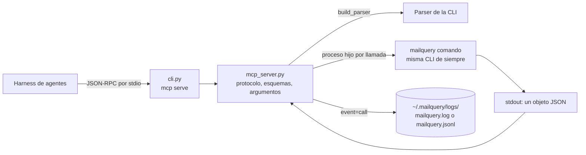
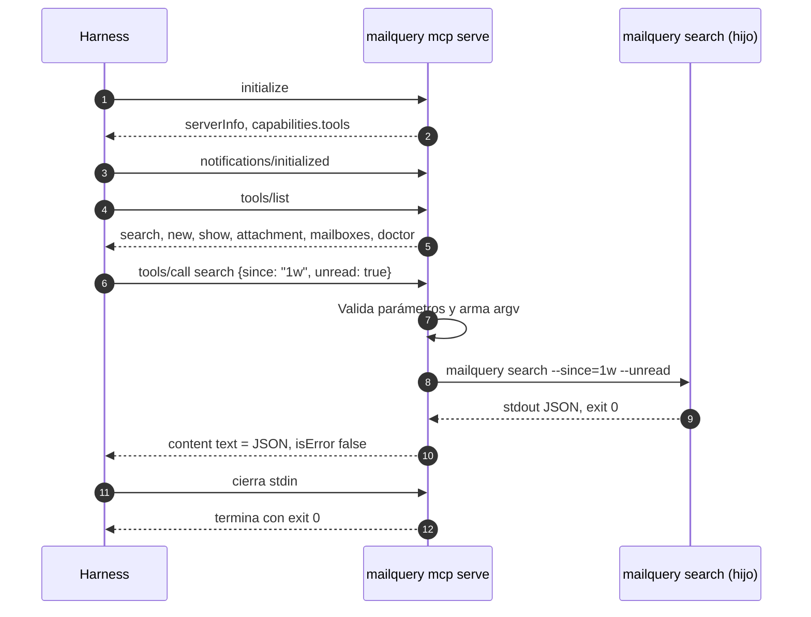

# Servidor MCP por stdio

**Tipo:** funcionalidad
**Base:** PRD 2.5
**Fecha:** 2026-11-23
**Aprobación:** dueño del producto, 2026-11-23
**Paquete:** 3.0.0 (menor)

## Estado

aprobado

## Contexto

### Problema

- El harness usa `mailquery` a través de la skill, que le dice cuándo y cómo usarlo y le hace ejecutar la CLI con su herramienta de shell. El agente tiene que componer la línea de comandos, citar los valores y leer el código de salida; un harness con la skill pero sin herramienta de shell, o con la shell restringida, no puede ejecutarlo.
- Cada comando aparece en el harness como una llamada de shell genérica: el usuario no puede autorizar `mailquery` por separado del resto de la shell ni ver sus parámetros como campos.
- La skill aporta el conocimiento (cuándo usar cada comando, recetas, reglas de seguridad y lectura de errores); lo que falta es un transporte tipado. MCP por stdio es la forma estándar en que un harness registra herramientas locales, y `mailquery` debe registrarse y comportarse como cualquier servidor MCP por stdio.

### Solución elegida

- **Subcomando `mcp serve`.** El mismo ejecutable `mailquery` arranca un servidor MCP que habla JSON-RPC por stdin y stdout. El harness lo lanza como proceso hijo al abrir su sesión y lo termina al cerrar stdin, como a cualquier servidor MCP por stdio.
- **Una herramienta por comando.** `search`, `new`, `show`, `attachment`, `mailboxes` y `doctor`, con los parámetros de las opciones de cada comando. El esquema se genera desde el parser de la CLI, que sigue siendo la única definición de las opciones.
- **Cada llamada es una ejecución de la CLI.** El servidor traduce la llamada a argumentos, ejecuta `mailquery <comando> …` como proceso hijo con el mismo intérprete y devuelve su JSON tal cual. El servidor no lee correo ni el estado, y de la configuración solo lee `[logging]` para su propio log.
- **Sin dependencias nuevas.** El protocolo se implementa con la biblioteca estándar: solo el subconjunto que necesita un servidor de herramientas.
- **La skill sigue siendo la puerta de entrada.** Usa las herramientas MCP si el servidor está registrado y la CLI si no, con las mismas recetas y reglas.
- **Independiente del driver.** El servidor no importa ni conoce drivers: Apple Mail, Outlook y los plugins se consultan dentro de la CLI, con el contrato de plugin sin cambios.

### Por qué un proceso hijo por llamada

- **Un driver puede bloquear el proceso sin que se le pueda interrumpir.** Una llamada a un cliente de correo o a una extensión nativa colgada no se cancela desde Python; en Windows, por ejemplo, un timeout COM termina el proceso con `E_CLIENT_TIMEOUT` (RF-31). Dentro de un servidor de larga vida, eso cerraría la sesión MCP entera; en un hijo, termina solo esa llamada. Mientras la llamada dura, dentro de los topes de la CLI, la sesión espera (Riesgos).
- **Un plugin colgado deja un hilo vivo.** RNF-21 deja de esperar a un plugin que no responde, pero no detiene su hilo. En un hijo, el hilo muere con el proceso.
- **Un driver deja estado de proceso.** Conexiones abiertas, la copia `copy_ro` del Envelope Index en macOS, la sesión COM en Windows o la sesión de un plugin de red. Un proceso por llamada lo libera siempre, sin que cada driver tenga que soportar un proceso de larga vida.
- **Mismo comportamiento que la CLI.** Configuración, lock, cursor de `new`, caché de ids nativos, logs y códigos de error son los de una ejecución normal: no hay estado del servidor que pueda quedar obsoleto ni una segunda ruta de código que mantener.
- **Coste.** Cada llamada paga el arranque de la CLI (ADR-05 ya lo da por barato) y la apertura de cada driver declarado: la copia `copy_ro` en macOS, la conexión COM en Windows o la autenticación de un plugin de red. Es el mismo coste que el harness paga hoy al invocar la CLI desde la shell.

### Alternativas descartadas

- **SDK oficial `mcp` como extra `mailquery[mcp]`.** Arrastra `pydantic`, `anyio`, `httpx` y otras dependencias, contra RNF-02 y RNF-12; un extra obliga además a instalar el paquete de otra forma para tener el servidor. El subconjunto que hace falta (cinco mensajes) es pequeño y estable.
- **Ejecutar los comandos dentro del proceso del servidor.** Ahorra el arranque de cada llamada, pero un driver bloqueado o un plugin colgado tumbarían o degradarían la sesión entera, y cada driver tendría que soportar un proceso de larga vida: releer la configuración, reabrir el store o reconectar con el cliente en cada llamada.
- **Transporte HTTP o SSE.** Abre un puerto: es red y un servicio, contra RNF-02 y los no objetivos de §3.3.
- **Herramientas por caso de uso** (por ejemplo, "facturas del último mes"). Duplicaría lógica que el harness ya compone con `search`; una herramienta por comando mantiene un único contrato.

### Alcance adicional

- **Pre-release `3.0.0a3`.** Con el servidor MCP y el formato JSON del log, `develop` deja de ser lo que anunciaba `3.0.0a2`; la pre-release sube a `3.0.0a3` para que `--version` y `doctor` distingan una instalación con estas funciones de una anterior.
- **Log en JSON opcional.** El log de texto se lee bien en una terminal pero hay que parsearlo para procesarlo con herramientas (`jq`, un agregador, un agente que diagnostica una llamada MCP). La clave nueva `[logging].json` escribe el log en un archivo aparte, `mailquery.jsonl`, con un objeto JSON por línea y los mismos campos; apagada por defecto, el log sigue siendo el de hoy.
- **Descartado para el log JSON:** una opción de línea de comandos (`--log-format`), porque el formato solo se configura en `config.toml`; el mismo archivo `mailquery.log` con líneas de los dos formatos, porque tras activar o desactivar la clave el archivo queda mezclado hasta que rota y `jq` o un agregador fallan en la primera línea del otro formato; y escribir los dos formatos a la vez, porque duplica disco y escrituras sin ganar nada.

### Preguntas abiertas

Ninguna: las respuestas del dueño están en "Decisiones".

### Decisiones de diseño de la unidad

Tomadas sin pregunta al dueño porque el PRD no las fija; cada una está escrita como condición en su requisito.

- El servidor lee de `config.toml` solo la tabla `[logging]`, sin validar el resto; si el archivo falta, no es TOML válido o `[logging]` no es válida, usa los valores por defecto (RF-84).
- El servidor no carga plugins ni instancia drivers, pero puede importar el parser de la CLI (RF-84).
- El servidor no mantiene abierto el log entre eventos, para que los hijos lo roten también en Windows (RF-84).
- Versiones del protocolo soportadas: `2024-11-05`, `2025-03-26`, `2025-06-18` y `2025-11-25`; los lotes JSON-RPC se aceptan siempre, porque `2025-03-26` los exige (RF-84).
- El error `E_USAGE` de `mailquery mcp` lleva `"command": "mcp"`, y el `E_INTERNAL` que arma el propio servidor tiene `message`, `hint` y `command` fijos (RF-84, RF-86).
- `--index` de `attachment` es `integer`; las exclusiones entre opciones las valida la CLI (RF-85).
- El proceso hijo es `<intérprete> -P -m mailquery`: el directorio de trabajo no entra en la ruta de módulos (RF-86).
- En el log JSON, los campos del evento van en `fields` para que no choquen con `ts`, `level`, `logger` y `run`; `-` es `null`; `message` y `text` son siempre texto (RF-88).
- Sin configuración válida, la ejecución escribe en `mailquery.log` en texto con los valores por defecto, también si `config.toml` pide JSON (RF-88).

## Requerimiento

### Resumen

`mailquery mcp serve` es un servidor MCP por stdio que expone los comandos de lectura como herramientas. Se registra en el harness una sola vez, con el comando `mailquery` y los argumentos `mcp serve`. La skill lo usa cuando está registrado. Cada llamada se ejecuta como una invocación de la CLI y devuelve el mismo JSON. Funciona igual en macOS y en Windows, con cualquier driver declarado (nativo o plugin), y no añade dependencias.

La unidad añade además la clave `[logging].json`, que escribe el log en `mailquery.jsonl` con un objeto JSON por línea (apagada por defecto), y sube la pre-release de `develop` a `3.0.0a3`.

### Lo que no cambia

- El contrato de los comandos existentes: opciones, salida JSON, errores, códigos de salida y warnings. Las salvedades son el comando nuevo `mcp`, la clave nueva `[logging].json`, el archivo nuevo `mailquery.jsonl`, la ayuda raíz y los `hint` que nombran el log.
- El log con `[logging].json` ausente o `false`: mismo archivo, formato, campos, rotación y permisos que hoy.
- La garantía de solo lectura (§4): el servidor no lee correo; cada llamada la ejecuta la CLI.
- `plugin_api`, los backends y la caché de ids nativos.

### Requerimientos

**RF-84. Servidor MCP por stdio.** Prioridad S.

**Como** harness de agentes, **quiero** lanzar `mailquery mcp serve` y hablarle MCP por stdin y stdout, **para** que la skill use `mailquery` como herramientas propias, sin componer comandos de shell.

Condiciones:

- **Comando.** `mailquery mcp serve` arranca el servidor. `mcp` sin subcomando, o `mcp serve` con argumentos de más, termina con `E_USAGE` (exit 2) en el JSON de error de siempre, con `"command": "mcp"`, antes de empezar el protocolo. Las opciones comunes de §12.1 se aceptan antes de `mcp`; `--log-level` fija el nivel del log del propio servidor.
- **Transporte.** Mensajes JSON-RPC 2.0, uno por línea, en UTF-8, por stdin y stdout, según el transporte stdio de MCP. Una línea terminada en `\r\n` se acepta igual que una terminada en `\n`; el servidor escribe siempre `\n` (RF-30). Un lote (array JSON) se acepta: sus elementos se atienden en orden y la respuesta es un array con las respuestas a sus peticiones; un lote solo de notificaciones no recibe respuesta, y un array vacío recibe `-32600` con `id` `null`.
- **Mensajes.** Responde a `initialize`, `ping` (resultado vacío), `tools/list` y `tools/call`. Las notificaciones no reciben respuesta: acepta `notifications/initialized` e ignora cualquier otra, también `notifications/cancelled`. Cualquier otro método recibe el error JSON-RPC `-32601`; una línea que no es JSON, `-32700`; una petición mal formada, `-32600`. Una petición que llega antes de `initialize` se atiende igual que después.
- **Inicialización.** `initialize` responde con `serverInfo` `{"name": "mailquery", "version": <__version__>}` y la capacidad `tools` sin `listChanged`. Las versiones del protocolo soportadas son `2024-11-05`, `2025-03-26`, `2025-06-18` y `2025-11-25`: si el cliente pide una de ellas, la respuesta lleva esa; si no, la más reciente de la lista. El contenido de `tools/list` y `tools/call` es el mismo en todas.
- **Solo protocolo en stdout.** Mientras sirve, nada que no sea un mensaje del protocolo llega a stdout. stderr no se usa salvo para un error que impide arrancar; un fallo al escribir el log no escribe en stdout ni en stderr.
- **Configuración del servidor.** El servidor lee de `config.toml` solo la tabla `[logging]`, una vez al arrancar, para su propio log, y la valida con las reglas de §15; `--log-level` antes de `mcp` sobrescribe el nivel. Si el archivo falta, no es TOML válido o `[logging]` no es válida, usa los valores por defecto (texto, `info`, 10 MB) y arranca igual. El resto del archivo no se valida ni se interpreta, y el servidor no lee el estado ni el correo.
- **Log del servidor.** El servidor registra `event=start command=mcp` al arrancar, una línea `event=call tool=<herramienta> exit_code=<n> duration_ms=<ms>` por llamada, sin parámetros ni valores, y `event=end` al terminar. No mantiene abierto el archivo de log entre dos eventos, para que los procesos hijo puedan rotarlo en cualquier plataforma.
- **Ciclo de vida.** El servidor no conecta con el cliente de correo ni con ningún driver al arrancar: arranca aunque falte `config.toml`, Outlook esté cerrado o falte el Acceso total al disco, y cada llamada devuelve el error que daría la CLI. Al cerrarse stdin, termina la llamada en curso y sale con exit 0. Si el harness termina el servidor de otra forma, no hay garantías sobre la llamada en curso (Riesgos).
- **Varias sesiones.** Cada sesión del harness lanza su propio servidor. Los servidores no comparten nada entre sí salvo lo que ya comparten dos ejecuciones de la CLI (§21.3).
- **Paridad.** El servidor, sus herramientas y sus respuestas son los mismos en macOS y en Windows y con cualquier combinación de drivers declarados.
- **Drivers y plugins.** El servidor no carga plugins (entry points), no instancia drivers ni abre ningún store. Puede importar el parser de la CLI. Cada llamada consulta los drivers declarados como la CLI (RF-35), con el contrato de plugin (RF-36) sin cambios.
- **Permisos del sistema.** El servidor y sus procesos hijo corren con la identidad del proceso que lanza el servidor. En macOS, el Acceso total al disco lo necesita la app que lanza el servidor (§16.1); en Windows, el harness corre en la misma sesión y con el mismo nivel de integridad que Outlook (§13). Si falta, cada llamada devuelve el error de la CLI (`E_PERMISSION`, `E_OUTLOOK_NOT_RUNNING`) y `doctor` lo diagnostica.
- **Sin dependencias nuevas.** El servidor usa solo la biblioteca estándar y módulos de `mailquery`; las dependencias declaradas del paquete no cambian.

Se comprueba con AC-71, AC-74, AC-75, AC-76 y AC-78.

**RF-85. Herramientas del servidor.** Prioridad S.

**Como** harness de agentes, **quiero** una herramienta por comando con los parámetros de sus opciones, **para** llamar a `mailquery` con argumentos tipados y sin componer una línea de comandos.

Condiciones:

- **Herramientas.** `search`, `new`, `show`, `attachment`, `mailboxes` y `doctor`, en ese orden en `tools/list`. No hay herramienta para `mcp` ni para `--version`: la salida de `--version` es texto y no JSON (RF-29), la versión de la app llega en `serverInfo.version` y la de cada driver, en el chequeo `driver` de `doctor`.
- **Origen del esquema.** El nombre y el esquema de cada herramienta se generan del parser de la CLI. La descripción de la herramienta es la `description` de su subcomando; la de cada parámetro, el `help` de su opción. Una opción nueva de la CLI aparece en su herramienta sin otro cambio.
- **Parámetros.** Cada opción larga del subcomando, salvo `--help`, la opción de depuración `--show-native-id` de `show` y `--json` de `doctor`, es un parámetro con su nombre sin guiones iniciales y con `_` en lugar de `-` (`--include-mailbox` ⇒ `include_mailbox`). Tipos:
  - un indicador es `boolean`;
  - una opción con `type=int`, y `--index` de `attachment`, son `integer`;
  - una opción con valores fijos es `string` con `enum`;
  - una opción que se repite o admite una lista separada por comas es `array` de `string`;
  - el resto es `string`.
- **`uid`.** El `uid` posicional de `show` y `attachment` es el parámetro `uid`, obligatorio.
- **`log_level`.** Es un parámetro opcional de todas las herramientas, `string` con los valores de `--log-level` del parser raíz.
- **`doctor`.** Se ejecuta siempre con `--json`; `json` no es un parámetro.
- **Reglas entre opciones.** El esquema no expresa exclusiones ni dependencias entre opciones (por ejemplo, `--index` o `--all` en `attachment`): las valida la CLI y la llamada devuelve su `E_USAGE`.
- **Sin parámetros extra.** El esquema de cada herramienta no admite propiedades adicionales.
- **Ejemplo.** La llamada `search` con `{"since": "1w", "unread": true, "fields": ["snippet"]}` equivale a `mailquery search --since=1w --unread --fields=snippet`.

Se comprueba con AC-71, AC-72 y AC-73.

**RF-86. Ejecución de una llamada.** Prioridad S.

**Como** harness de agentes, **quiero** que cada llamada se ejecute exactamente como la CLI y devuelva su JSON, **para** aplicar el mismo contrato, los mismos errores y las mismas recetas que con la CLI.

Condiciones:

- **Proceso hijo.** Cada `tools/call` ejecuta `<intérprete> -P -m mailquery [--log-level=<nivel>] <comando> <argumentos>` como proceso hijo, con el mismo intérprete, el mismo entorno y el mismo directorio de trabajo del servidor, sin shell y con stdin vacío. Con `-P`, el directorio de trabajo no entra en la ruta de módulos: un archivo `.py` del proyecto desde el que se lanzó el harness nunca sustituye un módulo de `mailquery` ni de la biblioteca estándar. En Windows el proceso hijo no abre ventana de consola. La configuración, el lock, el cursor de `new`, la caché de ids nativos y los logs de la llamada son los de esa ejecución: un cambio de `config.toml` vale desde la llamada siguiente, sin reiniciar el servidor.
- **Argumentos.** Cada parámetro se pasa como un argumento propio; un valor se pasa en la forma `--opción=valor`, y el `uid` detrás de `--`, para que un valor que empieza por `-` nunca se lea como opción. Un `array` da una opción por elemento; un `boolean` `true` da el indicador y `false` lo omite; `log_level` va antes del comando.
- **Validación previa.** Un parámetro desconocido o de un tipo distinto al del esquema, un `uid` ausente, un valor con el carácter NUL o un argv que supera el límite de longitud de la plataforma no lanzan el proceso hijo: el resultado es el JSON de error `E_USAGE` con la forma de §12.6 y el formato de §12.5, `command` igual al nombre de la herramienta y un `hint` que nombra el parámetro. El resto de la validación es la de la CLI.
- **Resultado.** El contenido del resultado es un único bloque `text` con la salida estándar del proceso hijo, sin el salto de línea final. `isError` es `true` si el proceso hijo termina con un código distinto de 0. El JSON es el de §12.5 para ese comando; el código de salida se deduce de `error.code` con la tabla de §12.6.
- **Fallo del proceso hijo.** Si el proceso hijo no escribe un único objeto JSON en su salida estándar, o no se puede lanzar, el resultado es el JSON de error `E_INTERNAL` (exit 1) con `message` `the command did not write a JSON object`, `hint` `run \`mailquery doctor\` and check the mailquery log` y `command` igual al nombre de la herramienta, e `isError: true`. El servidor sigue sirviendo.
- **Herramienta desconocida.** Un `tools/call` con un nombre que no está en `tools/list` recibe el error JSON-RPC `-32602`.
- **En serie.** Las peticiones se atienden de una en una, en orden de llegada: el proceso hijo de una llamada empieza cuando termina el de la anterior, y `ping` y `tools/list` esperan a la llamada en curso. El servidor no impone un tope de tiempo propio: rigen los de la CLI (RF-31, RF-49, RNF-21).
- **Salida de error del hijo.** La salida de error del proceso hijo se descarta: el mismo error ya está en su JSON.
- **Entorno de los plugins.** El proceso hijo hereda el entorno del harness, no el de la shell del usuario; un plugin se configura en `~/.mailquery/<driver>.toml` (RF-37), no en variables del perfil de shell. Con stdin vacío, un plugin que necesita interacción (por ejemplo, una autenticación por consola) falla con su error, normalmente `E_PLUGIN_FAILED`. Un plugin que escribe en stdout rompe el contrato de la CLI; en el servidor, la llamada da `E_INTERNAL` y el servidor sigue sirviendo.

Se comprueba con AC-72, AC-73 y AC-74.

**RF-87. Registro en el harness y documentación.** Prioridad S.

**Como** usuario humano que configura el harness, **quiero** registrar `mailquery` como servidor MCP con un solo comando, **para** tenerlo disponible en todas las sesiones.

Condiciones:

- **Registro en Claude Code.** `claude mcp add --scope user mailquery -- mailquery mcp serve` registra el servidor con una entrada equivalente a `{"type": "stdio", "command": "mailquery", "args": ["mcp", "serve"]}`.
- **Registro genérico.** Para otros harness, la entrada `"mailquery": {"command": "mailquery", "args": ["mcp", "serve"]}` dentro de `mcpServers`.
- **Ayuda.** La ayuda raíz lista `mcp` con el texto `serve the read commands as MCP tools over stdio`, y su línea de salida dice que `mcp serve` habla el protocolo MCP por stdout. `mailquery mcp --help` y `mailquery mcp serve --help` muestran el registro de Claude Code y la entrada genérica.
- **README.** Los dos README documentan el registro, las herramientas, la equivalencia entre parámetros y opciones, y los permisos de §16.1 y §13 para la app que lanza el servidor.
- **Skill.** La skill sigue siendo la puerta de entrada: si las herramientas de `mailquery` están disponibles, las usa en lugar de la CLI; si no, usa la CLI. Las recetas, las reglas de seguridad y la lectura de errores son las mismas en los dos caminos; con MCP, el código de salida se deduce de `error.code`.

Se comprueba con AC-75.

**RF-88. Log en formato JSON.** Prioridad S.

**Como** usuario humano o harness que diagnostica una ejecución, **quiero** activar en `config.toml` un log con un objeto JSON por línea, **para** procesarlo con herramientas sin parsear el formato de texto.

Condiciones:

- **Clave.** `[logging].json`, booleano, opcional, por defecto `false`. Un valor que no es booleano termina con `E_CONFIG_INVALID` (exit 2), como cualquier tipo incorrecto de §15.
- **Apagada.** Con la clave ausente o `false`, el log es exactamente el de texto de §14.
- **Encendida.** El núcleo escribe en `~/.mailquery/logs/mailquery.jsonl` en lugar de `mailquery.log`. Cada línea es un único objeto JSON en UTF-8 (JSON Lines). El archivo tiene los mismos permisos (RNF-05), la misma rotación (`mailquery.jsonl.1` … `mailquery.jsonl.5`, con `[logging].max_size_mb`), el mismo nivel (`[logging].level` y `--log-level`) y los mismos eventos que el formato de texto.
- **Campos.** Cada objeto tiene:
  - `ts`: fecha y hora local en ISO 8601 con milisegundos y desfase, por ejemplo `2026-11-02T02:15:00.214-04:00`;
  - `level`: `ERROR`, `WARNING`, `INFO` o `DEBUG`;
  - `logger` y `run`;
  - `fields`: un objeto con cada campo `clave=valor` del evento, con el mismo nombre y su valor completo, también si tiene espacios;
  - `text`: el texto del evento que no tiene forma `clave=valor`, solo si existe;
  - `traceback`: el traceback de un `E_INTERNAL`, como texto, solo si existe.
- **Tipos de los valores de `fields`.** Un entero decimal es un número JSON; `true` o `false`, en cualquier combinación de mayúsculas, un booleano; `-`, `null`; cualquier otro valor, texto (por ejemplo, `3/5`). `message` es siempre texto, aunque parezca un número o un booleano. Los valores salen del evento, no de partir la línea de texto: el formato de texto no cambia.
- **Privacidad.** Se registran los mismos datos que en el formato de texto y se omiten los mismos (§14, RNF-15): el formato no añade campos con contenido de correos, identificadores, rutas ni cuentas.
- **Un solo archivo activo.** Cada ejecución escribe solo en el archivo de su formato. El del otro formato, con sus rotados, no se modifica, no se rota ni se borra. La clave se lee en cada ejecución; un cambio vale desde la ejecución siguiente.
- **Sin configuración válida.** Si `config.toml` no se puede cargar, la ejecución escribe su error en `mailquery.log` en texto con los valores por defecto, como hoy, aunque el archivo pida `json = true`; también si el error es la propia clave `json`.
- **Ruta en los mensajes.** Todo `hint` que nombra el log del núcleo (el de `E_INTERNAL` y los de Outlook para errores internos y para un miembro bloqueado por el proxy de solo lectura) nombra el archivo del formato activo; la ayuda raíz nombra los dos.
- **Alcance.** Aplica a todo lo que escribe el núcleo en su log, incluidos los eventos de `mcp serve` y de sus procesos hijo. No aplica al log propio de un plugin.

Ejemplo, la línea `event=start` de §14 con `[logging].json = true`:

```json
{"ts": "2026-11-02T02:15:00.214-04:00", "level": "INFO", "logger": "mailquery.cli", "run": "abc123", "fields": {"event": "start", "command": "search", "backend": "apple_mail", "drivers": "apple_mail"}}
```

Se comprueba con AC-77 y AC-78.

### Caso de uso nuevo

**CU-10. Usar `mailquery` como herramientas MCP.** Comando típico: `mailquery mcp serve`, lanzado por el harness. Desencadenante: el inicio de una sesión del harness con el servidor registrado.

### Decisión de arquitectura

**ADR-51. Servidor MCP por stdio con la biblioteca estándar, que ejecuta cada llamada como una invocación de la CLI.**

- **Decisión.** `mailquery mcp serve` implementa con la biblioteca estándar el subconjunto de MCP de un servidor de herramientas (`initialize`, `notifications/initialized`, `ping`, `tools/list`, `tools/call`). Genera las herramientas del parser de la CLI y ejecuta cada llamada como un proceso hijo `mailquery <comando>`.
- **Motivo.** Un driver bloqueado no se puede interrumpir, un plugin colgado deja un hilo vivo y cada driver deja estado de proceso: en un hijo, el daño queda en esa llamada y el estado se libera siempre, con cualquier driver. La CLI sigue siendo la única ruta de ejecución, el contrato de plugin no cambia, y RNF-02 y RNF-12 se cumplen sin excepciones nuevas.
- **Alternativas descartadas.** SDK `mcp` como extra: dependencias nuevas contra RNF-02 y RNF-12. Comandos dentro del proceso del servidor: un driver bloqueado o un plugin colgado afectarían a la sesión entera. Transporte HTTP o SSE: abre un puerto y es un servicio. Herramientas por caso de uso: duplicarían lógica que ya compone `search`.

### Versión

`develop` anuncia la pre-release `3.0.0a3` (forma PEP 440 normalizada de `3.0.0-alpha.3`) en lugar de `3.0.0a2`, en `pyproject.toml`, `mailquery.__version__`, `--version` y `doctor`. La versión del paquete sigue siendo `3.0.0` y sigue sin publicarse.

### Requisitos y elementos existentes que cambian

- **RF-16.** Añade a sus excepciones la salida de `mcp serve`, que es el protocolo MCP y no un único objeto JSON.
- **ADR-04.** Las excepciones de RF-16 ya no son solo de texto: incluyen el protocolo MCP de `mcp serve`.
- **O4 (§3).** La integración con el harness es por la CLI o por el servidor MCP.
- **RF-73.** La skill explica el uso de las herramientas MCP cuando están disponibles (RF-87).
- **§12.7, línea de salida de la ayuda raíz.** Añade `mcp serve` a lo que no escribe un objeto JSON.
- **Anexo E.** Nuevo ejemplo de registro y de prueba manual de `mcp serve`.
- **RNF-02.** "Sin servicios ni demonio" se mantiene; precisa que `mcp serve` no es un servicio ni un demonio: lo lanza el harness como proceso hijo de su sesión y termina con ella.
- **ADR-05.** El proceso sigue siendo de un solo disparo por comando; `mcp serve` es la excepción, un proceso por sesión del harness que ejecuta cada llamada como un proceso de un solo disparo (ADR-51).
- **§3.3, no objetivos.** "No incluir interfaz gráfica, servidor HTTP ni demonio" se mantiene; se añaden como no objetivos los transportes MCP distintos de stdio y los recursos, *prompts* y notificaciones de cambio de MCP.
- **§12, tabla de comandos.** Nueva fila `mcp serve`.
- **§12.7, ayuda.** Siete comandos en lugar de seis; la ayuda raíz lista `mcp`.
- **§14, logs.** La regla de stdout incluye la excepción de `mcp serve`. El servidor registra `event=start command=mcp`, una línea `event=call tool=<herramienta> exit_code=<n> duration_ms=<ms>` por llamada, sin parámetros ni valores, y `event=end` al terminar. Cada proceso hijo registra su propia ejecución como cualquier comando.
- **§21.1, contrato con el harness.** El harness invoca la CLI bajo demanda o mediante el servidor MCP; con MCP, stdout es el protocolo, y los códigos de salida del punto 3 se deducen de `error.code`.
- **§21.3, idempotencia.** Una llamada MCP tiene los mismos efectos que el comando equivalente.
- **Nueva §21.4, servidor MCP.** Ciclo de vida, registro en Claude Code y genérico, relación con la skill, ejecución por proceso hijo, permisos de la app que lanza el servidor (Acceso total al disco en macOS, sesión y nivel de integridad en Windows), entorno y stdin de los plugins, y depuración sin harness (escribir `initialize` y después `{"jsonrpc":"2.0","id":2,"method":"tools/list"}` en una terminal).
- **§9.1 y §9.2, arquitectura.** Nuevo módulo `mcp_server.py`; `cli.py` despacha `mcp serve`; `logging_setup.py` escribe el log en texto o en JSON.
- **§9.6, flujo de una llamada MCP.** Nueva subsección con el diagrama "Secuencia de una llamada MCP".
- **RF-18.** Los logs son de texto o, con `[logging].json = true`, JSON (RF-88).
- **RNF-07.** El log por ejecución es de texto o JSON.
- **§14, formato del log.** El log es `mailquery.log` en texto plano por defecto o `mailquery.jsonl` en JSON Lines con `[logging].json = true`, cada uno con su rotación; el formato actual pasa a llamarse "formato de texto" y se añade el formato JSON con su ejemplo (RF-88).
- **RNF-15.** La privacidad de logs se aplica a `mailquery.log` y a `mailquery.jsonl`.
- **§10, estructura de carpetas.** `logs/` añade `mailquery.jsonl`.
- **§12.7, ayuda raíz.** La línea de logs nombra `mailquery.log` y, con `[logging].json = true`, `mailquery.jsonl`.
- **§9.1, vista de componentes.** El logger escribe en `mailquery.log` o en `mailquery.jsonl`.
- **§15.1, configuración.** Nueva fila `logging.json` en la tabla de claves; el ejemplo de `config.toml` añade `json = false` en `[logging]`; la fila "Logs" de la comparación entre plataformas dice que el formato también se configura en `[logging]`.
- **ADR-27, §12.9 y §22.3.** `develop` anuncia la pre-release `3.0.0a3` ("Versión").

### Arquitectura

**Figura: Componentes del servidor MCP**



Responsabilidades de `mcp_server.py`: leer y escribir mensajes del protocolo, responder a `initialize`, `ping`, `tools/list` y `tools/call`, generar los esquemas desde el parser, traducir argumentos, lanzar el proceso hijo y armar el resultado. No debe: cargar plugins, instanciar drivers, abrir un store, leer la configuración salvo `[logging]`, leer el estado o el correo, abrir red, mantener abierto el log entre eventos ni escribir en stdout fuera del protocolo.

Interfaz del módulo:

- `serve(stdin: TextIO, stdout: TextIO, *, runner: ToolRunner) -> int`: atiende mensajes hasta el fin de stdin; devuelve 0.
- `tool_definitions(parser: argparse.ArgumentParser) -> list[dict]`: `name`, `description` e `inputSchema` de cada herramienta, en el orden de RF-85.
- `build_argv(tool: str, arguments: Mapping[str, Any]) -> list[str]`: argumentos de la CLI de una llamada, o `MailqueryError` `E_USAGE`.
- `ToolRunner`: protocolo con `run(argv: Sequence[str]) -> ToolOutcome`; la implementación real lanza el proceso hijo y los tests la sustituyen.
- `ToolOutcome`: `stdout: str`, `exit_code: int`, `duration_ms: int`.

**Figura: Secuencia de una llamada MCP**



### Riesgos

- **La especificación MCP cambia.** Mitigación: el servidor declara las versiones que soporta, acepta lotes para `2025-03-26` y solo implementa el subconjunto de herramientas; una versión nueva se añade a la lista cuando se comprueba que ese subconjunto no cambia.
- **Latencia por llamada.** Cada llamada arranca un proceso y abre cada driver declarado: la copia `copy_ro` en macOS, la conexión COM en Windows o la autenticación de un plugin de red. Mitigación: es el mismo coste que la invocación desde la shell; los presupuestos de §19 se miden por comando y no cambian.
- **La app que lanza el servidor no tiene los permisos de la terminal.** En macOS, la CLI funciona desde una terminal con Acceso total al disco pero el servidor, lanzado por otra app, recibe `E_PERMISSION`. Mitigación: §21.4 y los README lo documentan, el `hint` de `E_PERMISSION` ya nombra la app que ejecuta `mailquery`, y la herramienta `doctor` lo diagnostica.
- **Se busca en el archivo equivocado.** Con `[logging].json = true`, `mailquery.log` deja de recibir las ejecuciones nuevas. Mitigación: §14, la ayuda raíz, el `hint` de `E_INTERNAL` y los README nombran los dos archivos.
- **Una llamada colgada bloquea la sesión.** Las llamadas van en serie y el servidor no tiene tope propio: mientras un proceso hijo espera a un driver, la sesión no responde ni a `ping`. Mitigación: los topes de la CLI (RF-31, RF-49, RNF-21) acotan cada llamada.
- **El harness termina el servidor con una llamada en curso.** Si el harness mata el servidor sin cerrar stdin, el proceso hijo puede seguir o morir según el harness; un `new` que ya avanzó el cursor y no puede escribir su salida pierde esos mensajes, igual que una ejecución de la CLI interrumpida. Mitigación: §21.4 documenta que el harness cierra stdin para terminar el servidor.
- **El harness trunca resultados grandes.** Un `show` o un `search` con `--fields` amplios puede superar el tamaño de resultado que acepta el harness. Mitigación: la skill y las recetas piden los campos mínimos, como con la CLI.
- **Varias sesiones a la vez.** Cada sesión añade ejecuciones concurrentes: más `E_LOCKED` en `new` y más rotaciones concurrentes del log. Mitigación: `E_LOCKED` ya es transitorio (exit 5, se reintenta) y la rotación tolera escritores concurrentes como hoy.
- **Un harness lanza el servidor con un PATH distinto.** Mitigación: el hijo usa el intérprete del propio servidor, no el `mailquery` del PATH, así que servidor e hijo son siempre la misma instalación, con los mismos plugins.

### Cambios visibles en 3.0.0

En ambas plataformas: el comando `mcp serve` es nuevo, la ayuda raíz lista siete comandos y la clave `[logging].json` es nueva (por defecto `false`, sin cambio en el log).

## Criterios de aceptación

**AC-71.** `initialize` responde con `serverInfo.name` `mailquery`, `serverInfo.version` igual a `__version__` y la capacidad `tools` sin `listChanged`; si se pide `2025-06-18`, la respuesta lleva `2025-06-18`, y si se pide una versión no soportada, `2025-11-25`. `ping` devuelve un resultado vacío y `notifications/initialized` no recibe respuesta. `tools/list` devuelve exactamente `search`, `new`, `show`, `attachment`, `mailboxes` y `doctor`, en ese orden, cada una con la `description` de su subcomando, los parámetros de sus opciones según RF-85 (`log_level` en todas, `index` de `attachment` como `integer`, sin `json` en `doctor` y sin `show_native_id` en `show`) y `additionalProperties: false`. Cada línea escrita en stdout durante la sesión es un mensaje JSON-RPC 2.0. Un método desconocido recibe `-32601`; una línea que no es JSON, `-32700`; una petición sin `method` o un array vacío, `-32600`. Un lote con dos peticiones recibe un array con sus dos respuestas en orden, y un lote solo de notificaciones no recibe respuesta. Una línea terminada en `\r\n` se atiende igual, y en Windows cada línea escrita termina en `\n`.

**AC-72.** Con un ejecutor de llamadas sustituido que registra el argv y devuelve una salida dada, cada llamada produce el argv de la CLI equivalente: `-P -m mailquery`, `log_level` antes del comando, `--opción=valor`, un `array` como opción repetida, un `false` omitido, el `uid` detrás de `--` y `doctor` con `--json`. El texto del resultado es la salida dada sin el salto de línea final, e `isError` es `true` solo si el código de salida es distinto de 0. Con el ejecutor real, una llamada `search` con `{"since": "bogus"}` devuelve el mismo JSON que `mailquery search --since=bogus`, con `isError: true`, también con un `json.py` en el directorio de trabajo del servidor.

**AC-73.** Un parámetro desconocido, un `integer` con texto o un `show` sin `uid` devuelven `E_USAGE` con `command` igual a la herramienta, un `hint` que nombra el parámetro e `isError: true`, sin lanzar ningún proceso hijo; un `show` con `show_native_id` y un valor con NUL también devuelven `E_USAGE` sin proceso hijo; el JSON tiene el formato de la CLI (§12.5). Un `subject` cuyo valor empieza por `-` llega al proceso hijo como `--subject=<valor>`. Un `tools/call` con una herramienta desconocida recibe el error `-32602`.

**AC-74.** El servidor arranca y responde a `tools/list` sin `config.toml` y con un `config.toml` inválido. Un proceso hijo que no escribe un objeto JSON da `E_INTERNAL` con el `message`, el `hint` y el `command` de RF-86 e `isError: true`, y el servidor responde a la llamada siguiente. Con un `config.toml` inválido, una llamada devuelve `E_CONFIG_INVALID`; tras corregirlo, la llamada siguiente ya no lo devuelve, sin reiniciar el servidor. Dos peticiones escritas seguidas reciben sus respuestas en orden, y el segundo proceso hijo empieza después de que termina el primero. Al cerrar stdin con una llamada en curso, el servidor responde a esa llamada y termina con exit 0. Durante la sesión, el servidor no escribe nada en stderr.

**AC-75.** `mailquery --help` lista `mcp` con su texto; `mailquery mcp` y `mailquery mcp serve extra` terminan con `E_USAGE` (exit 2) y JSON de error con `"command": "mcp"`; `mailquery mcp --help` y `mailquery mcp serve --help` muestran la orden `claude mcp add --scope user mailquery -- mailquery mcp serve` y la entrada genérica `mcpServers`. La ayuda raíz nombra `mailquery.log` y `mailquery.jsonl` y dice que `mcp serve` no escribe un objeto JSON. Los dos README documentan el registro, las herramientas, la equivalencia entre parámetros y opciones y los permisos de la app que lanza el servidor; la skill describe el uso de las herramientas MCP y la CLI como alternativa. El log del servidor tiene `event=start command=mcp`, una línea `event=call` por llamada con `tool`, `exit_code` y `duration_ms` y sin valores de parámetros, y `event=end`.

**AC-76.** Las dependencias declaradas del paquete no cambian, y `mcp_server.py` solo importa módulos de la biblioteca estándar y de `mailquery`. Con un plugin instalado cuya carga falla, el servidor arranca y responde a `initialize` y `tools/list`: no carga plugins ni instancia drivers.

**AC-77.** Sin la clave `[logging].json`, o con `false`, una ejecución de `search` escribe en `mailquery.log` con el formato de §14 y no crea `mailquery.jsonl`. Con `true`, escribe solo en `mailquery.jsonl` y `mailquery.log` no cambia. Cada línea es un objeto JSON con `ts`, `level`, `logger`, `run` y `fields`; en `fields`, `exit_code` y `duration_ms` son números, `truncated` es booleano y un valor `-` es `null`, sin asuntos, direcciones, uids ni rutas. Un `event=error` lleva su mensaje completo en `fields.message`, como texto también si es numérico. Un `E_INTERNAL` lleva su traceback en `traceback`, y su `hint` nombra `mailquery.jsonl`; los `hint` de Outlook que nombran el log también. Con `level = "warning"` no hay líneas `INFO`. En POSIX el archivo tiene permisos `0600`. `mailquery.jsonl` rota a `mailquery.jsonl.1` y conserva 5 rotados. `json = "yes"` termina con `E_CONFIG_INVALID` (exit 2) y la ejecución lo registra en `mailquery.log` en texto; con `json = true` y otra clave inválida, también.

**AC-78.** Con el servidor en marcha, `max_size_mb = 1` y el archivo activo precargado justo por debajo del tope, la llamada siguiente lo rota sin errores en macOS y en Windows, en los dos formatos: aparece el primer rotado y la línea `event=call` del servidor está en el archivo activo nuevo.

## IDs

- Crea: CU-10, RF-84…RF-88, ADR-51, AC-71…AC-78
- Elimina: —

## Dependencias

Ninguna

## Decisiones

- **¿Se expone `doctor` como herramienta MCP?** (2026-11-23) Sí, siempre con `--json`; `failures` y `log_level` son sus parámetros.
- **¿Qué opciones de los comandos son parámetros de las herramientas MCP?** (2026-11-23) Todas salvo `--help` y `--show-native-id`; `--log-level` sí se expone. `--show-native-id` no se expone porque es una opción de depuración sin utilidad para el harness.
- **¿Las herramientas MCP llevan prefijo en su nombre?** (2026-11-23) No: se llaman como el comando (`search`); el harness ya las agrupa por servidor.
- **¿El servidor MCP atiende las llamadas en serie o en paralelo?** (2026-11-23) En serie, en orden de llegada.
- **¿Se expone `--version` como herramienta MCP?** (2026-11-23) No: su salida es texto y no JSON; la versión de la app llega en `serverInfo.version` y la de los drivers, en `doctor`.
- **¿Qué versión anuncia `develop`?** (2026-11-23) La pre-release `3.0.0a3`, en lugar de `3.0.0a2` ("Versión"). Sustituye a la decisión del 2026-11-22 que fijaba `3.0.0a2`.
- **¿El log puede escribirse en JSON?** (2026-11-23) Sí, con una clave de `[logging]` en `config.toml`, apagada por defecto; apagada, el log es el de texto de siempre (RF-88).
- **¿El formato del log se puede elegir en la línea de comandos?** (2026-11-23) No: solo en `config.toml`.
- **¿El log JSON va al mismo archivo que el de texto?** (2026-11-23) No: va a `mailquery.jsonl`, con su propia rotación; cada ejecución escribe solo en el archivo del formato activo.

## Glosario

- **Servidor MCP** (nuevo): proceso `mailquery mcp serve` que lanza el harness para usar los comandos de `mailquery` como herramientas MCP por stdin y stdout; ejecuta cada llamada como una invocación de la CLI (RF-84, RF-86).
- **Herramienta MCP** (nuevo): cada comando que el servidor MCP expone (`search`, `new`, `show`, `attachment`, `mailboxes`, `doctor`), con un parámetro por opción del comando (RF-85).

## Conciliación con el PRD

**Tabla: Conciliación con el PRD**

| ID | Contrato | Archivo | Ancla | Qué cambia | Estado |
|---|---|---|---|---|---|
| RC-01 | Versión del paquete en la portada | `00-indice.md` | `**Versión del paquete:**` | En `develop` se anuncia la pre-release `3.0.0a3`. | pendiente |
| RC-02 | Resumen del servidor MCP | `01-resumen.md` | después de `**Id corto de mensaje en Outlook.**` | Nuevo bloque "Servidor MCP por stdio": `mcp serve`, una herramienta por comando, cada llamada como invocación de la CLI con cualquier driver declarado, registro como servidor MCP por stdio y uso desde la skill (RF-84…RF-87). | pendiente |
| RC-03 | Necesidad del servidor MCP | `02-problema.md` | después de `` 7. **`uid` corto en Outlook:** ``; `Las razones de cada decisión` | Nueva necesidad 8: que la skill use `mailquery` con herramientas tipadas, sin componer comandos de shell, y que el usuario lo autorice por separado; el rango de ADR pasa a ADR-29–ADR-51. | pendiente |
| RC-04 | No objetivos de MCP | `03-objetivos.md` | `- No incluir interfaz gráfica, servidor HTTP ni demonio.` | Precisa que `mcp serve` por stdio no es servidor HTTP ni demonio; nuevos no objetivos: transportes MCP distintos de stdio y recursos, *prompts* y notificaciones de cambio. | pendiente |
| RC-05 | Objetivo de integración | `03-objetivos.md` | O4 | La integración con el harness es por la CLI o por el servidor MCP por stdio (RF-84). | pendiente |
| RC-06 | Caso de uso MCP | `05-usuarios.md` | después de CU-09 | Nueva fila CU-10. | pendiente |
| RC-07 | Logs de texto o JSON | `06-requisitos-funcionales.md` | RF-18 | Logs en texto plano en `mailquery.log` o, con `[logging].json = true`, JSON Lines en `mailquery.jsonl`, cada uno con rotación por tamaño (RF-88). | pendiente |
| RC-08 | Excepción de salida de `mcp serve` | `06-requisitos-funcionales.md` | RF-16 | Añade `mcp serve` a las excepciones: su stdout es el protocolo MCP. | pendiente |
| RC-09 | Requisitos del servidor MCP | `06-requisitos-funcionales.md` | después de RF-83 | Nueva subsección 6.11 "Servidor MCP por stdio" con RF-84…RF-87 y nueva subsección 6.12 "Formato del log" con RF-88. | pendiente |
| RC-10 | Skill con herramientas MCP | `06-requisitos-funcionales.md` | RF-73 | La skill usa las herramientas MCP si están disponibles y la CLI si no, con las mismas reglas (RF-87). | pendiente |
| RC-11 | Simplicidad sin demonio | `07-requisitos-no-funcionales.md` | RNF-02 | Precisa que `mcp serve` lo lanza el harness como proceso hijo de su sesión y no es un servicio ni un demonio (ADR-51). | pendiente |
| RC-12 | Observabilidad | `07-requisitos-no-funcionales.md` | RNF-07 | Log por ejecución en texto o en JSON (RF-88). | pendiente |
| RC-13 | Privacidad en logs | `07-requisitos-no-funcionales.md` | RNF-15 | La regla se aplica a `mailquery.log` y a `mailquery.jsonl` (RF-88). | pendiente |
| RC-14 | Formato JSON-only | `08-adr.md` | ADR-04 | Las excepciones de RF-16 incluyen el protocolo MCP de `mcp serve` (ADR-51). | pendiente |
| RC-15 | Proceso de un solo disparo | `08-adr.md` | ADR-05 | Excepción de `mcp serve`: un proceso por sesión del harness que ejecuta cada llamada como proceso de un solo disparo (ADR-51). | pendiente |
| RC-16 | Versión mayor | `08-adr.md` | ADR-27 | En `develop` se anuncia la pre-release `3.0.0a3`. | pendiente |
| RC-17 | Decisión del servidor MCP | `08-adr.md` | después de ADR-50 | Nueva fila ADR-51 con su decisión, alternativas descartadas y motivo. | pendiente |
| RC-18 | Vista de componentes | `09-arquitectura.md` | `### 9.1 Vista de componentes` | El diagrama añade la entrada JSON-RPC por stdio, `mcp_server.py` y el proceso hijo de la CLI (RF-86); el logger escribe en `mailquery.log` o en `mailquery.jsonl` (RF-88). | pendiente |
| RC-19 | Responsabilidades de módulos | `09-arquitectura.md` | `` `cli.py` ``; después de `` `attachments/` `` | `cli.py` despacha `mcp serve`; nueva fila `mcp_server.py` con su responsabilidad y lo que no debe hacer (RF-84…RF-86). | pendiente |
| RC-20 | Responsabilidad del logger | `09-arquitectura.md` | `` `logging_setup.py` `` | Logger en texto o JSON con rotación por tamaño; formato log4j o JSON Lines; redacción (RF-88). | pendiente |
| RC-21 | Flujo de una llamada MCP | `09-arquitectura.md` | después de `` En `search`, `new` y `show`, el núcleo decide `` | Nueva subsección 9.6 "Flujo de una llamada de `mcp serve`" con el diagrama de secuencia: `initialize`, `tools/list`, `tools/call` con proceso hijo por llamada, resultado e `isError`, y fin al cerrar stdin (RF-84, RF-86). | pendiente |
| RC-22 | Carpeta de logs | `10-carpetas-y-cache.md` | `    ├── mailquery.log` | Nueva línea después: `mailquery.jsonl`, log del núcleo en JSON con `[logging].json = true` (rotación §14) (RF-88). | pendiente |
| RC-23 | Tabla de comandos | `12-cli.md` | `` `attachment <uid>` `` | Nueva fila después: `mcp serve`, servidor MCP por stdio, salida el protocolo MCP (RF-84). | pendiente |
| RC-24 | Ayuda | `12.07-ayuda.md` | `` `mailquery <comando> --help` de los seis `` ; `  attachment         recover local attachments of one message`; `Output: one JSON object on stdout`; `        logs go to` | Siete comandos; la ayuda raíz lista `mcp` con su texto; la línea `Output:` añade `mcp serve` a lo que no es un objeto JSON; `mcp serve --help` muestra el registro (RF-87). La línea `logs go to` nombra `mailquery.log` y, con `[logging].json = true`, `mailquery.jsonl` (RF-88). | pendiente |
| RC-25 | Formato de `--version` | `12.09-version.md` | `Formato:` | En `develop`, `<versión>` es la pre-release `3.0.0a3`. | pendiente |
| RC-26 | Logs del servidor MCP | `14-logs.md` | `**Regla:**`; `` - Un `E_INTERNAL` registra traceback `` | Excepción de stdout de `mcp serve`; eventos `start`, `call` y `end` del servidor sin parámetros (RF-84, RF-86). | pendiente |
| RC-27 | Formato JSON del log | `14-logs.md` | `**Archivo:**`; `Formato (estilo log4j):` | `mailquery.log` en texto plano o, con `[logging].json = true`, `mailquery.jsonl` en JSON Lines, con la misma rotación y solo el archivo del formato activo; "Formato de texto (estilo log4j)" y nuevo bloque "Formato JSON" con sus campos, tipos, `message`, `traceback`, archivo activo y el ejemplo de RF-88. | pendiente |
| RC-28 | Clave `logging.json` | `15-configuracion.md` | `` `logging.max_size_mb` ``; `max_size_mb = 10`; `Logs` | Nueva fila después: `logging.json`, booleano, opcional, por defecto `false`, `true` escribe el log en JSON (§14); el ejemplo añade `json = false` en `[logging]`; la fila "Logs" dice que nivel, tamaño de rotación y formato se configuran en `[logging]` (RF-88). | pendiente |
| RC-29 | Alcance de los criterios | `20-criterios-aceptacion.md` | `3. **Plugins, adjuntos` | El rango de criterios pasa a AC-01…AC-78 e incluye el servidor MCP y el log JSON. | pendiente |
| RC-30 | Criterios de aceptación | `20-criterios-aceptacion.md` | después de AC-70 | AC-71…AC-78. | pendiente |
| RC-31 | Contrato con el harness | `21-harness.md` | `1. El harness invoca la CLI`; `` 2. `stdout` es un único objeto JSON ``; `3. Códigos de salida:` | Invocación bajo demanda o mediante el servidor MCP; con MCP, stdout es el protocolo y los códigos de salida se deducen de `error.code` (RF-86). | pendiente |
| RC-32 | Idempotencia y servidor MCP | `21-harness.md` | `### 21.3 Idempotencia y concurrencia`; después de `` - `new`: exactamente-una-vez por corrida `` | Una llamada MCP tiene los efectos de su comando; nueva subsección 21.4 con ciclo de vida, registro en Claude Code y genérico, relación con la skill, proceso hijo por llamada, permisos de la app que lanza el servidor, entorno y stdin de los plugins, y depuración (RF-84, RF-86, RF-87). | pendiente |
| RC-33 | Versión en `develop` | `22-versiones.md` | `**Estado:**` | `develop` anuncia la pre-release `3.0.0a3` (`3.0.0-alpha.3`). | pendiente |
| RC-34 | Cambios visibles en 3.0.0 | `22-versiones.md` | `**Tabla: Cambios visibles de 3.0.0 en ambas plataformas**`; `**Tabla: Cambios visibles en macOS en 3.0.0**`; `**Tabla: Cambios visibles de 3.0.0 solo en Windows**` | Tabla común: nuevas filas del comando `mcp serve` y de la clave `[logging].json`. Tablas de macOS y Windows: la fila "Ayuda raíz" pasa a siete comandos. | pendiente |
| RC-35 | Riesgos del servidor MCP | `23-riesgos.md` | `Documentación desincronizada` | Nuevas filas después: cambios de la especificación MCP, latencia por llamada, app que lanza el servidor sin los permisos de la terminal, llamada colgada que bloquea la sesión, servidor terminado con una llamada en curso, resultados truncados por el harness, varias sesiones a la vez y harness con otro PATH, con sus mitigaciones. | pendiente |
| RC-36 | Ejemplos de `mcp serve` | `anexos/E-ejemplos-invocacion.md` | después de `# Recuperar adjuntos locales a la caché` | Nuevo bloque después del de adjuntos: registro con `claude mcp add` y prueba manual con `initialize` y `tools/list` (RF-84, RF-87). | pendiente |

## Documentos consumidores

- README.md: pendiente
- README.es.md: pendiente
- skills/mailquery/SKILL.md: pendiente
- skills/README.md: pendiente
- docs/INTERFACES.md: pendiente
- docs/config.example.toml: pendiente
- docs/ROADMAP.md: pendiente
- docs/recipes/: pendiente
- docs/security/: pendiente
- docs/tests/TEST-CATALOG.md: pendiente
- docs/tests/mcp-server.md: pendiente
- docs/tests/cli-config.md: pendiente
- docs/tests/docs-packaging.md: pendiente
- docs/tests/end-to-end.md: pendiente
- docs/tests/acceptance-matrix.md: pendiente
- docs/tests/smoke.md: pendiente

## Checklist de conciliación

**Tabla: Checklist de conciliación**

| ID | Ítem | Cómo se verifica | Estado |
|---|---|---|---|
| CL-01 | Cada fila de "Conciliación con el PRD" está aplicada en su archivo | Revisión fila por fila | pendiente |
| CL-02 | El resto del PRD no cambia | Diff del PRD limitado a los archivos de la tabla, el glosario, el Anexo D, la portada y el historial | pendiente |
| CL-03 | Los IDs de la unidad están creados y eliminados en el PRD, sin huecos ni referencias rotas | `doc_14` | pendiente |
| CL-04 | Las decisiones están en el Anexo D y el glosario está aplicado | Revisión de "Decisiones" y "Glosario" | pendiente |
| CL-05 | Los documentos consumidores están actualizados | Ninguno está `pendiente` | pendiente |
| CL-06 | No quedan textos obsoletos en el PRD ni en los documentos consumidores: "seis comandos", "Seis comandos", "six commands", ADR-05 sin la excepción de `mcp serve`, la regla de stdout de §14 sin esa excepción, "Logs en texto plano" y "log en texto por ejecución" sin la alternativa JSON, `mailquery.log` como único archivo de log del núcleo | Búsqueda de cada texto | pendiente |
| CL-07 | El defecto registrado está cerrado | Su entrada de `docs/KNOWN-DEFECTS.md` | no aplica |
| CL-08 | La versión del documento, el historial y los próximos IDs libres están al día | Portada e `HISTORIAL.md` | pendiente |
| CL-09 | La suite pasa | Suite completa, con `doc_14` y `doc_15` | pendiente |
| CL-10 | Prueba en macOS y en Windows con el cliente de correo real: un cliente JSON-RPC de prueba contra `mailquery mcp serve` obtiene `search`, `show`, `new` (el cursor avanza y no repite) y `attachment` con `--force`; sin Acceso total al disco para la app que lo lanza, `E_PERMISSION`; con Outlook cerrado, `E_OUTLOOK_NOT_RUNNING`; con un plugin declarado junto al driver nativo, resultados de los dos; con un plugin que falla, `E_PLUGIN_FAILED`. Aparte, verificación manual fuera del catálogo: registrado con `claude mcp add`, Claude Code lista las herramientas y la skill las usa; sin registrar, usa la CLI | Casos SMOKE de `docs/tests/smoke.md` en cada plataforma y verificación manual anotada en la evidencia | pendiente |
| CL-11 | `develop` anuncia `3.0.0a3` en el PRD, la portada, `pyproject.toml`, `mailquery.__version__`, `--version`, `doctor` y los documentos consumidores | `mailquery --version` y búsqueda de `3.0.0a2` en el PRD y en los documentos consumidores, donde solo queda en registros históricos | pendiente |
| CL-12 | Los casos de test de la unidad están en el catálogo: prefijo `UT-MCP` de `tests/test_mcp_server.py` en `TEST-CATALOG.md` con su archivo `mcp-server.md`; casos `UT-LOG`, `UT-CFG` y `UT-CLI` del log JSON, `[logging].json` y `mcp` en `cli-config.md`; casos `DOC` y `PKG` de README, skill, ayuda, versión y dependencias en `docs-packaging.md`; goldens de `doctor` con `3.0.0a3` en `end-to-end.md`; casos SMOKE de CL-10 en `smoke.md`; cada AC-71…AC-78 con su fila en `acceptance-matrix.md`. Los casos existentes que cambian se marcan para actualizar: los de "seis comandos" de `docs-packaging.md` y `UT-ATC-09`, `DOC-16.03` por `3.0.0a2`, la fila AC-21 de `acceptance-matrix.md` y los goldens de `doctor` de `end-to-end.md` | Revisión de `docs/tests/`, de la matriz y búsqueda de "seis comandos" y `3.0.0a2` en `docs/tests/` | pendiente |

## Desviaciones aprobadas

Ninguna
