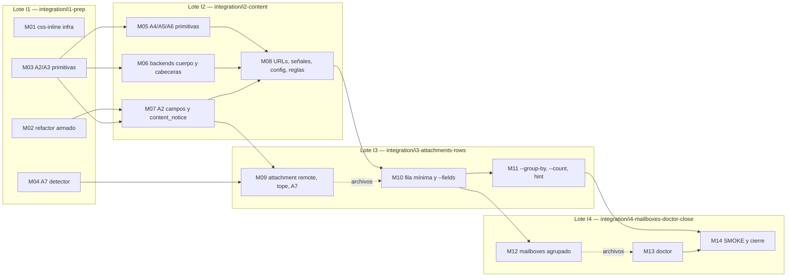

# Plan maestro — implementación de `PRD-v2.2.md` (F1, F2, F3)

**Fuente de verdad del producto:** [`docs/PRD-v2.2.md`](../PRD-v2.2.md) v2.2, **aprobado** por el dueño el 2026-11-13 (commit `aa8209a`; respecto del borrador 21 solo cambian el estado y la fila 22 del historial), delta sobre [`docs/PRD.md`](../PRD.md) v2.1. `PRD.md` no se modifica: se concilia en una tarea futura.
**Base de código:** `develop` en `cf164ff` (paquete `3.0.0a0`; el código es idéntico al de `41e90e1`, donde se midió la línea base).
**Fecha del plan:** 2026-11-13.
**Alcance:** F1 (endurecimiento del contenido, A2–A7, `content_notice`), F2 (adjuntos de drivers `"remote"` y tope de extracción configurable), F3 (fila mínima, `--fields`, `--group-by`, `--count`, `doctor --failures`, sin *preflight*, `hint` sin resultados, `mailboxes` agrupado, plugins en `doctor`).
**Restricciones por defecto:** sin tags, sin release, sin merge a `main`, sin cambiar la versión del paquete (`3.0.0a0`), salvo instrucción explícita del dueño.

Este archivo coordina y monitorea. Cada milestone se describe en su archivo `M<NN>-<slug>.md`, autocontenido para un subagente que lea ese archivo, este plan maestro y `PRD-v2.2.md`.

---

## 1. Leyenda de semáforos (única para todo el plan)

| Semáforo | Significado |
|---|---|
| ⚪ | Pendiente |
| 🟡 | En progreso |
| 🟢 | Completado |
| 🔴 | Bloqueado (siempre con su motivo al lado) |

Quién actualiza cada indicador y cuándo: sección 9.4.

---

## 2. Estado de las fases del plan maestro

| Fase | Contenido | Milestones / lotes | Gate de cierre | Estado |
|---|---|---|---|---|
| P0 — Preparación | Aprobación del PRD, commit del plan, entorno local, línea base, registro de conciliación | — | Sección 2.1 | ⚪ |
| P1 — Refactor e infraestructura | Dependencia `css-inline`, CI, refactor de armado de mensajes, primitivas puras de F1 | Lote I1: M01–M04 | Lote I1 mergeado con la matriz verde | ⚪ |
| P2 — Implementación | F1 completo, F2, F3 | Lotes I2, I3, I4 (M05–M13) | Todos los milestones de código en 🟢 | ⚪ |
| P3 — Integración | Un PR por lote, matriz completa, merge `--no-ff` | I1–I4 | Cuatro PR mergeados, URL de cada run en el registro de ejecución | ⚪ |
| P4 — Documentación y cierre | SMOKE en equipos reales, auditoría de documentos consumidores, registro de conciliación final | M14 (lote I4) | Gate de cierre de fase (sección 8.4) | ⚪ |

P2 y P3 se solapan en el tiempo: cada lote se integra (P3) antes de abrir el siguiente.

### 2.1 Tareas de P0 (las ejecuta el orquestador)

| ID | Tarea | Estado |
|---|---|---|
| P0-1 | Obtener del dueño la confirmación de HITL-05 (versión aprobada de `PRD-v2.2.md`). | 🟢 Respondida el 2026-11-13: v2.2 aprobada (`aa8209a`) |
| P0-2 | Con orden expresa del dueño, un único commit `docs(plan): …` con `docs/plan/` en `develop` y push. Sin esa orden, el plan no se commitea. | 🟢 Ordenado y hecho el 2026-11-13 (rama `docs/plan-v2.2`, merge `--no-ff` en `develop`) |
| P0-3 | Crear el entorno local `.venv` (ya ignorado por `.gitignore`) con `python -m venv .venv`, `.venv\Scripts\python -m pip install "css-inline~=0.23.1" "coverage~=7.17" pywin32` (en macOS, sin `pywin32`). Borrar `src/mailquery.egg-info` (ignorado y local: hace que los tests de metadatos se comporten distinto en el checkout principal y en los worktrees). Todas las corridas locales del plan usan ese intérprete. | ⚪ |
| P0-4 | Línea base en `.venv` sobre la punta de `develop`, en un worktree limpio (sección 8.2): `python -B -m coverage erase`, `python -B -m coverage run -m unittest discover -s tests -t . -v` y `python -B -m coverage report`; anotar total de tests, fallos, errores, saltos, cobertura total y la tabla por módulo en el registro de ejecución (sección 11). Con Outlook clásico abierto, la suite incluye SMOKE contra el Outlook real. Mientras M01 no añada `[tool.coverage.*]` a `pyproject.toml`, se pasan `--branch --source=src/mailquery` a `coverage run`. | ⚪ |
| P0-5 | Al abrir I1, crear en `PRD-v2.2.md` la sección "0.5 Registro de conciliación" con el formato de la sección 10.2, todas las filas en "Pendiente" (autorizado por HITL-06). | ⚪ |

Línea base ya medida en la sesión de planificación (Python 3.14.7 del sistema, sin `.venv`, commit `41e90e1`): `Ran 1063 tests`, `FAILED (failures=5, skipped=6)`. Los 5 fallos son ambientales: `TC-01.01`, `TC-02.07`, `TC-06.02`, `PKG-01.03` y `PKG-02.01` comparan la versión `3.0.0a0` con los metadatos de un `mailquery 2.0.1` instalado en ese intérprete. En un venv limpio (sin el paquete instalado) esos casos se saltan como en CI; P0-4 fija la línea base oficial.

Cobertura medida en la revisión del plan (`cf164ff`, Windows, Python 3.14.7, venv limpio con `coverage 7.17.3` y `pywin32`, sin `css-inline`, Outlook clásico abierto; `Ran 1063 tests`, `OK (skipped=5)`): **total combinado de líneas y ramas 89,0 %** (líneas 90,5 %, ramas 83,9 %). Por debajo del 85 %: `attachments/paths.py` 61,4 % (ramas solo POSIX), `backends/outlook_com.py` 79,9 %, `backends/registry.py` 83,6 %, `attachments/cache.py` 83,7 %, `__main__.py` 0 %. De ellos, el plan solo modifica `outlook_com.py` (M06), que queda bajo la regla D-21 (c); los demás no se tocan y el total cumple.

---

## 3. Milestones

| ID | Milestone | Lote | Oleada | Depende de | ACs (total o parcial) | Archivo | Estado |
|---|---|---|---|---|---|---|---|
| M01 | Dependencia `css-inline`, CI y README de actualización | I1 | W1 | — | AC-H15, AC-H17 | [M01](M01-css-inline-infra.md) | ⚪ |
| M02 | Refactor: armado único de mensajes en `search.py` | I1 | W1 | — | — (preserva comportamiento) | [M02](M02-message-assembly-refactor.md) | ⚪ |
| M03 | Primitivas A2 y A3 en `output.py` | I1 | W1 | — | AC-H01, AC-H02, AC-H04, AC-H05, AC-H17, AC-H18 | [M03](M03-sanitize-visible-body.md) | ⚪ |
| M04 | Detector de contenido activo (A7) | I1 | W1 | — | AC-H12 | [M04](M04-active-content-scanner.md) | ⚪ |
| M05 | Primitivas A4, A5 y A6 en `output.py` | I2 | W2 | M03 | AC-H02, AC-H06, AC-H08, AC-H09, AC-H10, AC-H11 | [M05](M05-url-sender-signals.md) | ⚪ |
| M06 | Cuerpo desde el HTML y cabeceras del remitente en los backends | I2 | W2 | M03 | AC-H04, AC-H11, AC-H17 | [M06](M06-body-source-sender-headers.md) | ⚪ |
| M07 | Campos saneados (A2) y `content_notice` | I2 | W2 | M02, M03 | AC-H01, AC-H03, AC-H14, AC-H18 | [M07](M07-content-notice-sanitized-fields.md) | ⚪ |
| M08 | Modos de URL, señales de F1, `[content]`, `--strip-links` y reglas de seguridad | I2 | W3 | M05, M06, M07 | AC-H02, AC-H04, AC-H05, AC-H06, AC-H07, AC-H08, AC-H09, AC-H10, AC-H11, AC-H13, AC-H16, AC-H18 | [M08](M08-url-modes-content-warnings.md) | ⚪ |
| M09 | `attachment`: drivers `"remote"`, tope configurable y A7 | I3 | W4 | M04, M07 (lote I2 mergeado) | AC-H12, AC-H18, AC-D01–AC-D06 | [M09](M09-attachments-remote-timeout-active.md) | ⚪ |
| M10 | Fila mínima, `--fields` y warnings según lo entregado | I3 | W5 | M08, M09 (orden de archivos) | AC-H14, AC-H18, AC-O01, AC-O02, AC-O03, AC-O08, AC-O09, AC-O10 | [M10](M10-default-row-fields.md) | ⚪ |
| M11 | `--group-by`, `--count` y `hint` sin resultados | I3 | W6 | M10 | AC-H18, AC-O01, AC-O04–AC-O09, AC-O10, AC-O13 | [M11](M11-group-by-count-hint.md) | ⚪ |
| M12 | `mailboxes` agrupado por cuenta y `--fields` | I4 | W7 | M10 (lote I3 mergeado) | AC-O14, AC-O15 | [M12](M12-mailboxes-grouped.md) | ⚪ |
| M13 | `doctor --failures`, sección de plugins y diagnóstico sin *preflight* | I4 | W8 | M12 (orden de archivos) | AC-O10, AC-O11, AC-O12, AC-O16, AC-O17 | [M13](M13-doctor-failures-plugins.md) | ⚪ |
| M14 | SMOKE en equipos reales, auditoría documental y cierre | I4 | W9 | M01–M13 | AC-H15, AC-O15 (p95) y verificación final de todos | [M14](M14-smoke-closure.md) | ⚪ |

"Orden de archivos" significa que la dependencia no es funcional sino de propiedad de archivos (`cli.py`, `search.py`, README, skill): los dos milestones no pueden correr a la vez.

---

## 4. Grafo de dependencias y oleadas



### 4.1 Oleadas de ejecución

Las oleadas deciden orden y paralelismo; los lotes deciden la integración. Una oleada empieza cuando terminan sus dependencias y, si cambia de lote, cuando el lote anterior está mergeado en `develop`.

| Oleada | Lote | Milestones en paralelo (subagentes) | Por qué no más paralelismo |
|---|---|---|---|
| W1 | I1 | M01, M02, M03, M04 | — (write scopes disjuntos) |
| W2 | I2 | M05, M06, M07 | M08 necesita las tres |
| W3 | I2 | M08 | Toca `search.py`, `cli.py`, `config.py`, README y skill |
| W4 | I3 | M09 | Comparte `cli.py`, `config.py` y README con M10 |
| W5 | I3 | M10 | Toca `search.py`, `cli.py`, goldens y casi todos los tests de comandos |
| W6 | I3 | M11 | Comparte `search.py`, `cli.py`, README y skill con M10 |
| W7 | I4 | M12 | Comparte `cli.py`, README y skill con M13 |
| W8 | I4 | M13 | Ídem |
| W9 | I4 | M14 | Cierre: necesita todo |

El paralelismo está limitado por cuatro archivos que casi todos los milestones visibles tocan: `src/mailquery/cli.py`, `src/mailquery/search.py`, `README.md`/`README.es.md` y `skills/mailquery/SKILL.md`. Para no serializar también la documentación interna, `docs/TEST-CATALOG.md`, `docs/INTERFACES.md`, `docs/PRD-v2.2.md`, `docs/plan/00-master-plan.md` y `docs/plan/evidence/**` los escribe solo el orquestador (sección 9.3).

### 4.2 Propiedad de archivos por oleada

Ningún archivo pertenece a dos milestones de la misma oleada. Tabla completa de los archivos que tocan dos o más milestones, incluidos los que un milestone solo modifica "si hace falta" (cada celda, un solo dueño por oleada):

| Archivo | W1 | W2 | W3 | W4 | W5 | W6 | W7 | W8 | W9 |
|---|---|---|---|---|---|---|---|---|---|
| `src/mailquery/output.py` | M03 | M05 | — | — | — | — | — | — | — |
| `src/mailquery/search.py` | M02 | M07 | M08 | — | M10 | M11 | M12 | — | — |
| `src/mailquery/cli.py` | — | M07 | M08 | M09 | M10 | M11 | M12 | M13 | — |
| `src/mailquery/config.py` | — | — | M08 | M09 | — | — | — | — | — |
| `src/mailquery/backends/apple_mail.py`, `backends/outlook.py` | — | M06 | — | — | — | — | M12 | — | — |
| `src/mailquery/plugins/api.py` | — | M06 | — | M09 | — | — | — | M13 | — |
| `src/mailquery/attachments/**` | M04 | — | — | M09 | — | — | — | — | — |
| `README.md`, `README.es.md` | M01 | M07 | M08 | M09 | M10 | M11 | M12 | M13 | M14 |
| `skills/mailquery/SKILL.md` | — | — | M08 | M09 | M10 | M11 | M12 | M13 | M14 |
| `docs/recipes/*` | — | — | M08 | M09 | M10 | — | M12 | M13 | M14 |
| `docs/config.example.toml` | — | — | M08 | M09 | — | — | M12 | — | M14 |
| `docs/security/threat-model.md` | — | — | M08 | — | — | — | — | — | M14 |
| `docs/KNOWN-DEFECTS.md` | — | — | — | M09 | — | — | — | — | M14 |
| `docs/PERFORMANCE-BACKLOG.md` | — | — | — | — | — | — | M12 | — | M14 |
| `tests/fixtures/expected/**` (goldens) | — | M07 | M08 | M09 | M10 | M11 | M12 | M13 | — |
| `tests/test_integration.py` | — | M07 | M08 | M09 | M10 | M11 | M12 | M13 | M14 |
| `tests/test_cli.py` | — | M07 | M08 | M09 | M10 | M11 | M12 | M13 | — |
| `tests/test_search.py` | M02 | M06 | M08 | — | M10 | M11 | M12 | — | — |
| `tests/test_outlook.py` | — | M06 | M08 | M09 | M10 | M11 | M12 | M13 | — |
| `tests/test_multidriver.py` | — | — | M08 | M09 | M10 | M11 | M12 | M13 | — |
| `tests/test_plugins.py` | — | M06 | — | M09 | M10 | — | — | M13 | — |
| `tests/test_emlx.py`, `tests/test_backends.py` | — | M06 | — | — | M10 | — | M12 | — | — |
| `tests/test_config.py` | — | — | M08 | M09 | — | — | — | — | — |
| `tests/test_smoke.py` | M01 | — | — | — | M10 | — | M12 | — | M14 |
| `tests/test_readonly.py` | — | — | M08 | — | M10 | M11 | M12 | M13 | — |
| `tests/test_content.py` (lo crea M03) | M03 | M05 | — | — | — | — | — | — | — |
| `tests/fixtures/content_samples.py` (lo crea M03) | M03 | M05 | M08 | — | — | — | — | — | — |
| `tests/test_content_wiring.py` (lo crea M07) | — | M07 | M08 | — | M10 | — | M12 | — | — |
| `tests/test_active_content.py` (lo crea M04) | M04 | — | — | M09 | — | — | — | — | — |
| `tests/fakes/outlook.py`, `tests/fixtures/make_fixtures.py` | — | M06 | M08 | — | M10 | M11 | M12 | — | — |
| `tests/fakes/plugin.py` | — | M07 | M08 | M09 | M10 | M11 | M12 | M13 | — |
| `tests/fakes/attachment_backend.py` | — | — | — | M09 | M10 | — | — | — | — |

Archivos de un solo milestone (sin riesgo de colisión): `pyproject.toml`, `.github/workflows/tests.yml`, `tests/test_packaging.py` (M01); `tests/test_output.py` (M03); `src/mailquery/errors.py` (M07); `src/mailquery/emlx.py`, `backends/base.py`, `backends/outlook_com.py` (M06); `src/mailquery/store.py`, `tests/test_store.py` (M12); `tests/test_attachments.py`, `tests/fakes/attachment_driver.py` (M09); `tests/test_uid.py`, `tests/test_state.py` (M10); `scripts/install.sh`, `scripts/install.ps1` (M13); `tests/test_install_scripts.py` (M13, solo si alguna aserción cubre el texto de *preflight*); `docs/ROADMAP.md` (M14); y los archivos de test nuevos `tests/test_body_sources.py` (M06), `tests/test_remote_attachments.py` (M09), `tests/test_fields.py` (M10), `tests/test_group_count.py` (M11), `tests/test_mailboxes.py` (M12), `tests/test_doctor.py` (M13), `tests/fixtures/active_content_samples.py` (M04).

Un milestone posterior de otra oleada puede extender un archivo de test creado por otro (lo indica su archivo). Si un subagente descubre que necesita un archivo que no está en su write scope, o uno de otro milestone de su misma oleada, se detiene y lo devuelve al orquestador (sección 9.1, punto 5).

---

## 5. Refactorizaciones propuestas

| ID | Milestone | Qué | Justificación | Alcance acotado | Garantía de comportamiento |
|---|---|---|---|---|---|
| R-01 | M02 | En `search.py`, un único constructor de la fila de mensaje para `search`/`new` y de los campos comunes de `show` (hoy `_message_payload` y el dict en línea de `run_show` están duplicados), un único cargador del cuerpo con sus warnings por mensaje y dos tuplas de orden canónico (`SEARCH_ROW_FIELDS`, `SHOW_FIELDS`). | F1 debe aplicar A2/A4/A5 a los mismos campos en `search`, `new` y `show`, y F3 debe elegir campos en los tres; con la construcción duplicada, cada regla se implementaría dos veces y podría divergir (riesgo de que `show` quede sin sanear o sin `--fields`). El warning por mensaje es requisito del orden de PRD-v2.2 sección 10, punto 8. | Solo `src/mailquery/search.py`; sin cambiar firmas públicas (`run_search`, `run_new`, `run_show`, `run_mailboxes`). | Suite y goldens idénticos a la línea base; dos casos nuevos fijan el orden de claves. |

Se evaluaron y descartaron, por no desbloquear paralelismo real (los milestones afectados siguen compartiendo `cli.py`, README y skill) y porque desviarían la tabla de módulos de `PRD-v2.2.md` sección 7: extraer `doctor` de `cli.py` a un módulo propio y extraer `run_mailboxes` de `search.py`.

---

## 6. Matriz de trazabilidad AC → milestone → tests → estado

Los IDs de grupo de test son los que define cada milestone y que el orquestador lleva a `docs/TEST-CATALOG.md`. Los tests citan solo esos IDs (decisión D-01).

| AC | Qué exige (resumen) | Milestone(s) | Grupos de test | Estado |
|---|---|---|---|---|
| AC-H01 | A2 en campos de contenido, identificadores intactos | M03, M07 | UT-CNT-01, UT-CW-01, UT-CW-02 | ⚪ |
| AC-H02 | `\n`/`\t`, CRLF, idempotencia, determinismo de F1 | M03, M05, M08 | UT-CNT-01, UT-CNT-03, UT-CNT-06, UT-CW-13 | ⚪ |
| AC-H03 | Búsqueda con A2 a ambos lados; bloqueo y caché sin cambios | M07 | UT-CW-03, UT-CW-04 | ⚪ |
| AC-H04 | Cuerpo desde HTML; omisión de ocultos en línea | M03, M06, M08, M14 | UT-CNT-02, UT-BOD-01, UT-BOD-02, UT-BOD-05, UT-CW-07, SMOKE-NEW.09 | ⚪ |
| AC-H05 | Hojas `<style>`, `@media`, `<link>` sin E/S, fallo de CSS; `W_HIDDEN_CONTENT` | M03, M08 | UT-CNT-03, UT-CW-07 | ⚪ |
| AC-H06 | Detección y modos de URL en todos los campos | M05, M08 | UT-CNT-05, UT-CNT-06, UT-CNT-07, UT-CW-08 | ⚪ |
| AC-H07 | `--strip-links`, precedencia, default `neutralize` | M08 | UT-CW-09 | ⚪ |
| AC-H08 | `W_EXTERNAL_LINKS` | M05, M08 | UT-CNT-08, UT-CW-10 | ⚪ |
| AC-H09 | `W_NON_ASCII_DOMAIN` y punycode | M05, M08 | UT-CNT-07, UT-CNT-08, UT-CW-10 | ⚪ |
| AC-H10 | `W_LONG_URL` y `W_SCRIPT_LINK` | M05, M08 | UT-CNT-08, UT-CW-10 | ⚪ |
| AC-H11 | `W_SENDER_AUTH_FAILED` y `W_REPLY_TO_MISMATCH` | M05, M06, M08 | UT-CNT-09, UT-BOD-03, UT-BOD-04, UT-CW-11 | ⚪ |
| AC-H12 | `W_ATTACHMENT_ACTIVE_CONTENT` | M04, M09 | UT-ACT-01–UT-ACT-04, UT-ACT-05, DOC-09 | ⚪ |
| AC-H13 | `[content]` inválido ⇒ `E_CONFIG_INVALID` | M08 | UT-CFG-03, DOC-06.02, DOC-06.04 | ⚪ |
| AC-H14 | Compatibilidad: solo `content_notice` nuevo; resto sin cambios | M07, M10 | UT-CW-06, UT-FLD-07 | ⚪ |
| AC-H15 | `css-inline~=0.23.1`, wheels, parche, sin red, p95 | M01, M14 | TC-06.03, PKG-03, paso de CI "Check css-inline wheels", SMOKE-INSTALL.05, SMOKE-NEW.07 | ⚪ |
| AC-H16 | Logs solo con códigos `W_*` | M08 | UT-CW-12 | ⚪ |
| AC-H17 | README de RF-65; funciona sin `css-inline` | M01, M03, M06 | DOC-07, UT-CNT-03, UT-BOD-05 | ⚪ |
| AC-H18 | `content_notice` en toda respuesta de éxito; reglas en skill y README | M03, M07, M08, M09, M10, M11, M14 | UT-CNT-04, UT-CW-05, UT-ATC-04.01, DOC-08, DOC-09, DOC-10, UT-GRP-10, SMOKE-NEW.08 | ⚪ |
| AC-D01 | Extracción desde plugin `"remote"` igual que `"local"` | M09 | UT-RMT-01 | ⚪ |
| AC-D02 | `reason: network`/`not_local` ⇒ `E_ATTACHMENT_UNAVAILABLE` | M09 | UT-RMT-02 | ⚪ |
| AC-D03 | `attachments: "none"` sigue rechazado con el hint nuevo | M09 | UT-RMT-03 | ⚪ |
| AC-D04 | `[attachments].timeout_seconds` | M09 | UT-CFG-04, UT-RMT-05, DOC-06.05 | ⚪ |
| AC-D05 | Corte duro en plugin externo | M09 | UT-RMT-04 | ⚪ |
| AC-D06 | Topes de 30 s intactos; nativos entre bloques; A7 y caché fuera del tope | M09 | UT-RMT-05, UT-OL-ATT-03.04 | ⚪ |
| AC-O01 | Fila mínima y lecturas | M10, M11, M14 | UT-FLD-01, UT-FLD-02, UT-GRP-07, SMOKE-NEW.08 | ⚪ |
| AC-O02 | `--fields` en `search`/`new` | M10 | UT-FLD-03 | ⚪ |
| AC-O03 | `show --fields` | M10 | UT-FLD-04 | ⚪ |
| AC-O04 | `--group-by from` | M11 | UT-GRP-01 | ⚪ |
| AC-O05 | Dos claves, fechas, errores | M11 | UT-GRP-02, UT-GRP-03 | ⚪ |
| AC-O06 | Más de 50 grupos | M11 | UT-GRP-04 | ⚪ |
| AC-O07 | `--count` | M11 | UT-GRP-05 | ⚪ |
| AC-O08 | `new --fields`; `new --group-by`/`--count` rechazados | M10, M11 | UT-FLD-06, UT-GRP-06 | ⚪ |
| AC-O09 | Warnings según lo entregado | M10, M11 | UT-FLD-05, UT-GRP-09 | ⚪ |
| AC-O10 | Ayudas, skill, README y recetas (RF-75); `doctor --help` | M10, M11, M13 | DOC-10, DOC-11, DOC-12 | ⚪ |
| AC-O11 | `doctor --failures` (también tras un timeout COM, D-25) | M13, M14 | UT-DR-01–UT-DR-04, UT-DR-10, SMOKE-NEW.10 | ⚪ |
| AC-O12 | Sin *preflight* en skill, ayuda y README | M13 | DOC-12 | ⚪ |
| AC-O13 | `hint` de `search` sin resultados | M11 | UT-GRP-08 | ⚪ |
| AC-O14 | `mailboxes` agrupado | M12 | UT-MBX-01, UT-MBX-02, DOC-13 | ⚪ |
| AC-O15 | `mailboxes --fields`, sin recuento, p95, ayudas | M12, M14 | UT-MBX-03–UT-MBX-05, DOC-13, SMOKE-NEW.07 | ⚪ |
| AC-O16 | Sección de plugins en `doctor` | M13 | UT-DR-05–UT-DR-08, UT-DR-10 | ⚪ |
| AC-O17 | `--failures` con plugins | M13 | UT-DR-09, UT-DR-10 | ⚪ |

El estado de un AC pasa a 🟢 solo cuando todos sus milestones están en 🟢 y sus grupos tienen evidencia.

**Requisitos transversales de test (no son AC del PRD):**

| Requisito | Qué exige | Dónde se verifica | Estado |
|---|---|---|---|
| Cobertura de UT (HITL-07, D-21) | Total combinado de líneas y ramas ≥ 85 % en `develop` antes de cada merge; módulos tocados según D-21 (b) y (c) | Paso "Check coverage" de cada job `unittest` y PKG-03.03 (M01); evidencia (g) de cada milestone; gates de la sección 7.3, regla 7 | ⚪ |
| TC heredados acordes a 3.0.0 | Cada TC heredado que cambia con el incremento se actualiza o se retira en el milestone que cambia su comportamiento, con su bloque de `TEST-CATALOG.md` (sección 9 para los retirados) | Sección 8 "Tests existentes afectados" de cada milestone; auditoría final de M14 | ⚪ |
| Gates de solo lectura con las opciones nuevas | TC-03 y OL-30 recorren `--strip-links` (M08), `--fields` (M10), `--group-by`/`--count` (M11), `mailboxes --fields` (M12) y `doctor --failures` (M13) | `tests/test_readonly.py` y `tests/test_outlook.py`; M14 lo verifica | ⚪ |

---

## 7. Protocolo de implementación por lotes (obligatorio para el implementador)

Ejecución e integración son dos cosas distintas: **las oleadas deciden el orden y el paralelismo de ejecución; los lotes deciden cómo se integra el trabajo en `develop`.**

### 7.1 Tabla de lotes

| Lote | Milestones | Rama de integración (desde `develop`) | PR destino | Corridas de CI previstas (nominal / máximo) |
|---|---|---|---|---|
| I1 | M01, M02, M03, M04 | `integration/i1-prep` | `develop` | 1 / 3 |
| I2 | M05, M06, M07, M08 | `integration/i2-content` | `develop` | 1 / 3 |
| I3 | M09, M10, M11 | `integration/i3-attachments-rows` | `develop` | 1 / 3 |
| I4 | M12, M13, M14 | `integration/i4-mailboxes-doctor-close` | `develop` | 1 / 3 |

Ramas de milestone: `feature/m01-css-inline-infra`, `feature/m02-message-assembly-refactor`, `feature/m03-sanitize-visible-body`, `feature/m04-active-content-scanner`, `feature/m05-url-sender-signals`, `feature/m06-body-source-sender-headers`, `feature/m07-content-notice-sanitized-fields`, `feature/m08-url-modes-content-warnings`, `feature/m09-attachments-remote-timeout-active`, `feature/m10-default-row-fields`, `feature/m11-group-by-count-hint`, `feature/m12-mailboxes-grouped`, `feature/m13-doctor-failures-plugins`, `feature/m14-smoke-closure`.

### 7.2 Presupuesto de integración

Matriz completa por corrida: job `unittest` (3 sistemas × Python 3.11, 3.12, 3.13 y 3.14 = 12 jobs) + job `install-scripts` (3 jobs; el de Ubuntu incluye el paso de wheels de `css-inline`) = **15 jobs por corrida**.

| Escenario | PRs | Corridas nominales | Jobs nominales | Corridas máximas (3 por PR) | Jobs máximos |
|---|---|---|---|---|---|
| Un PR por lote (este plan) | 4 | 4 | 60 | 12 | 180 |
| Un PR por milestone | 14 | 14 | 210 | 42 | 630 |
| Ahorro | −10 PRs (−71 %) | −10 (−71 %) | −150 | −30 | −450 |

"Máximo" admite la corrida inicial y hasta dos correcciones por PR. Una cuarta corrida en un mismo PR exige anotar la causa en el registro de ejecución antes de empujar. El paso de cobertura (D-21) va dentro de cada job `unittest`: no añade jobs. Nunca hay dos PR con CI en marcha a la vez (HITL-08): antes de empujar a un PR, `gh run list --status in_progress` y `gh run list --status queued` deben estar vacíos para este repositorio.

### 7.3 Reglas

1. **Lotes de integración.** Cada lote tiene una rama de integración creada desde la punta de `develop` en el momento de abrirlo. Un lote no se abre hasta que el anterior está mergeado en `develop`. Si `develop` avanza con un lote abierto, el orquestador hace `git merge --no-ff develop` en la rama del lote (nunca `rebase`, para conservar los merges de milestone) y vuelve a medir la línea base (sección 8.2).
2. **Ramas y worktrees.** Cada milestone se crea desde la punta de la rama de su lote, nunca desde `develop`. Un solo worktree reutilizable por milestone activo, en `../mailquery-wt/m<NN>` (hermano del checkout principal, en Windows y en macOS):
   - crear: `git worktree add -b feature/m<NN>-<slug> ../mailquery-wt/m<NN> integration/<lote>`;
   - reintentar: se sigue en el mismo worktree y la misma rama; solo si el orquestador decide empezar de cero, `git -C ../mailquery-wt/m<NN> reset --hard integration/<lote>` (nunca un worktree nuevo por intento);
   - cerrar: tras integrar, `git worktree remove ../mailquery-wt/m<NN>` y `git branch -d feature/m<NN>-<slug>`.
   Si dos milestones de la misma oleada corren en paralelo, cada subagente usa su propio worktree y sus write scopes son disjuntos (sección 4.2); si aparece un solape, se ejecutan en secuencia y se anota en el registro.
3. **Integración por milestone.** Con el gate local del milestone en verde, el orquestador, en la rama del lote: `git merge --no-ff feature/m<NN>-<slug>`; aplica en un commit `docs: update test catalog, interfaces and reconciliation record` (sin IDs de plan) los bloques de `TEST-CATALOG.md`, `INTERFACES.md` y del registro de conciliación de `PRD-v2.2.md` que entregó el subagente, escribe `docs/plan/evidence/M<NN>.md` y sincroniza este plan; corre la suite completa en la rama del lote. Sin PR por milestone y sin esperar CI. Un milestone no se cierra con la suite local roja, con deuda de documentación o sin su archivo de evidencia.
4. **PR por lote.** Al cerrar el último milestone del lote, `git push -u origin integration/<lote>` y un único PR a `develop` (`gh pr create --base develop --head integration/<lote>`), con la lista de milestones, los AC cubiertos y los enlaces a `docs/plan/evidence/`. No hay PR de corrección: si algo falla, se corrige en la rama del lote (commit `fix: …`, escrito por el subagente del milestone afectado según la regla 9) y se empuja al mismo PR. El PR no se mergea hasta que la matriz completa está verde, incluido el paso de cobertura de los 12 jobs `unittest` (HITL-07): `gh pr checks <n>` debe dar los 15 jobs en verde. Por HITL-08, el orquestador empuja, abre y mergea el PR sin pedir orden por lote, siempre con un solo PR con CI en marcha (sección 7.2). Se mergea con merge commit, nunca squash ni rebase, en este orden: `gh pr merge <n> --merge --delete-branch`, `git switch develop`, `git pull --ff-only` y `git branch -d integration/<lote>`. Los registros que solo existen después del merge (URL del run verde, estado del lote, fase P3, matriz) van en el primer commit `docs: …` de la rama del lote siguiente; los del lote I4 van en un único commit `docs(plan): record batch I4 closure` empujado directamente a `develop` (un push a `develop` no dispara CI).
5. **CI solo en el PR del lote.** `.github/workflows/tests.yml` corre solo en `pull_request` a `develop` y `main` (ya es así), con `concurrency: cancel-in-progress` (ya es así) y `timeout-minutes` de 20 en `unittest` y 15 en `install-scripts` (M01). No se dispara por push a ramas de milestone ni a `develop`. Las ramas de milestone no se empujan, con una excepción: `feature/m14-smoke-closure` se empuja sin PR para que el dueño corra SMOKE en su Mac (M14) y la rama remota se borra al integrar M14.
6. **Evidencia por milestone.** `docs/plan/evidence/M<NN>.md`, escrito por el orquestador con los datos crudos del subagente (sección 9.2). Contenido mínimo: (a) comandos y conteo final de la suite completa con el commit; (b) grupos del milestone ejecutados solos; (c) goldens creados o actualizados y su justificación; (d) tests nuevos y AC cubiertos con sus IDs; (e) `git diff --check` y `git diff --stat` contra la base del lote; (f) riesgos, deuda aceptada, decisiones HITL y pendientes; (g) cobertura: salida de `coverage report` completa y de `coverage report --include=<módulos de src/ tocados> --fail-under=85`, con la línea base del lote de esos módulos, las líneas sin cubrir de los módulos tocados y la justificación de cada `# pragma: no cover` nuevo. Esta evidencia y los commits del milestone sustituyen al PR y al CI por milestone. **Redacción (el repositorio es público):** la evidencia no copia salidas con datos del cliente real; de SMOKE solo se registran nombre del test, estado, duración y p95; direcciones, etiquetas de cuenta, nombres de carpeta, asuntos, uids reales y rutas de `HOME` se sustituyen por `<redacted>`/`<HOME>` antes de commitear.
7. **Gates.**
   - *Cierre de milestone:* suite local sin fallos nuevos frente a la línea base del lote; los grupos del milestone verdes ejecutados solos; cobertura según D-21 en este Windows (total ≥ 85 %, módulos tocados según D-21 (b) y (c)); evidencia escrita; semáforos de este plan, del archivo del milestone y registro de conciliación de `PRD-v2.2.md` actualizados y coincidentes.
   - *Cierre de lote:* PR con la matriz completa verde, incluido el paso "Check coverage" de los 12 jobs `unittest` (cobertura de `develop` ≥ 85 % garantizada antes del merge); diff acumulado dentro de los write scopes de sus milestones más los archivos del orquestador; merge `--no-ff`; URL del run anotada en el registro de ejecución (regla 4). Al cerrar I1, la salida del paso "Check css-inline wheels" se copia al registro de ejecución.
   - *Cierre de fase:* todos los AC de la fase con evidencia; documentación sin referencias obsoletas; gates de solo lectura (`tests/test_readonly.py`, OL-30) y SMOKE del host verdes o saltados con motivo; registro de conciliación actualizado, sin desviaciones sin registrar.
8. **Estado y trazabilidad.** Solo el orquestador escribe en este plan, en `docs/plan/evidence/`, en `TEST-CATALOG.md`, en `INTERFACES.md` y en el registro de conciliación de `PRD-v2.2.md`. El subagente actualiza los semáforos de las fases de su propio archivo de milestone y entrega la propuesta de transición; el orquestador sincroniza la tabla de milestones, la matriz de trazabilidad y el registro de ejecución al cerrar cada milestone y cada lote.
9. **Restricciones por defecto.** Sin tags, sin release y sin merge a `main` salvo instrucción explícita del dueño. La versión del paquete no se cambia. Las contradicciones o huecos se devuelven al orquestador antes de improvisar, y la respuesta HITL se registra en la sección 10.3. Una ambigüedad menor que el PRD resuelve de forma razonable la decide el subagente con la opción más simple coherente con el PRD y la anota en "decisiones" de su evidencia; si fija comportamiento observable que el PRD no dice literalmente, el orquestador la copia, reformulada y sin IDs de plan, a la nota de su fila del registro de conciliación en el commit de integración.
   - **Desviaciones del PRD.** Si un detalle de `PRD-v2.2.md` no se puede implementar o hay que cambiarlo, el subagente se detiene y lo devuelve; el orquestador abre una HITL. Con el sí del dueño para ese caso, el orquestador aplica el cambio en el texto normativo de `PRD-v2.2.md` con una fila nueva en su historial ("Decisión del dueño durante la implementación: …"), marca la fila afectada del registro como `Implementado con desviación` y resume el cambio en su nota. Un contrato de `PRD.md` contradicho por el incremento y no listado en la sección 0.2 va a la tabla "Hallazgos para la conciliación" del registro. Lo que se difiere va a `docs/KNOWN-DEFECTS.md`, `docs/ROADMAP.md` o `docs/PERFORMANCE-BACKLOG.md`.
   - **Defecto tras el cierre o suite roja tras un merge de milestone.** El milestone vuelve a 🟡 y se anota en el registro de ejecución. El orquestador recrea el worktree con `git worktree add -b fix/m<NN>-<desc> ../mailquery-wt/m<NN> integration/<lote abierto>`, lanza al subagente con el defecto y su archivo de milestone, integra con `git merge --no-ff` y añade a `docs/plan/evidence/M<NN>.md` una sección "Reapertura". Un defecto de un lote ya mergeado se corrige en la rama del lote abierto (o en un lote de corrección con las mismas reglas si ya no queda ninguno). El milestone vuelve a 🟢 al integrarse la corrección con la suite verde.

### 7.4 Reglas de código y de commits (para todo milestone)

- Todo lo que se escribe en el repositorio va en inglés, salvo `README.es.md` y `docs/` (español admitido).
- Comentarios y docstrings de `src/`, `scripts/`, `pyproject.toml` y `.github/workflows/` describen el comportamiento; nunca citan PRD, RF, AC, ADR, tickets, este plan ni milestones.
- Los tests citan en el docstring solo su ID de `TEST-CATALOG.md` (p. ej. `UT-CNT-01.03`); nunca `AC-H*`, `AC-D*`, `AC-O*`, milestones ni lotes.
- Ningún documento fuera de `docs/plan/` cita este plan, sus milestones, lotes o evidencias (tampoco el registro de conciliación de `PRD-v2.2.md`).
- `README.md` y `README.es.md` cambian juntos, con el mismo contenido.
- Commits en formato convencional (`feat(search): …`, `test(content): …`, `docs(readme): …`), sin ninguna atribución a herramientas o modelos de IA.
- Solo `unittest` (y `coverage` para medirlo, D-21); ningún test usa el `HOME` real; todo subproceso fija `HOME` y `USERPROFILE` a un temporal; los saltos permitidos son los de `TEST-CATALOG.md` sección 5.
- `# pragma: no cover` solo en código que no se puede ejecutar en el host de tests: limpieza en un `except` que no debe enmascarar otro fallo, una rama de otra plataforma sin seam o un caso defensivo imposible; siempre con un comentario en inglés que describe el comportamiento; cada pragma nuevo se justifica en la evidencia (g). Nunca se usa para alcanzar el umbral.
- Si un caso nuevo verificaría exactamente el mismo comportamiento que un caso heredado, se actualiza el heredado en lugar de crear un duplicado (regla "un ID, un comportamiento" de `TEST-CATALOG.md`).
- Un test heredado que deja de cumplirse por el incremento se actualiza en el milestone que cambia el comportamiento, sin borrar aserciones que sigan siendo válidas (se piden los campos con `--fields`); si el comportamiento desaparece, el caso se retira con su bloque para la sección 9 de `TEST-CATALOG.md` y el caso que lo sustituye.

---

## 8. Ejecución de la suite y gates locales

### 8.1 Comandos

| Uso | Comando (desde la raíz del worktree, con el intérprete de `.venv`) |
|---|---|
| Suite completa | `python -B -m unittest discover -s tests -t . -v` |
| Un grupo | `python -B -m unittest discover -s tests -t . -k test_ut_cnt_01_` |
| Un caso | `python -B -m unittest discover -s tests -t . -k test_ut_cnt_01_03_` |
| Un módulo | `python -B -m unittest tests.test_content -v` |
| Solo SMOKE | `python -B -m unittest tests.test_smoke -v` |
| Cobertura (suite completa) | `python -B -m coverage erase` y `python -B -m coverage run -m unittest discover -s tests -t .` |
| Informe y gate total | `python -B -m coverage report` (exit 2 por debajo del 85 % de `fail_under`) |
| Gate de módulos tocados | `python -B -m coverage report --include="src/mailquery/output.py,src/mailquery/attachments/active_content.py" --fail-under=85` (los archivos de `src/` de la sección 4 del milestone) |

Mientras `pyproject.toml` no tenga `[tool.coverage.*]` (antes de integrar M01, es decir, en P0-4 y en toda la oleada W1), `coverage run` lleva `--branch --source=src/mailquery`.

`unittest -k` busca subcadenas: el patrón lleva siempre el prefijo `test_` y el `_` final (`-k test_tc_01_` no selecciona `test_ut_atc_01_*`; `-k test_ut_dr_` no selecciona `test_ut_drv_*`).

### 8.2 Línea base por lote

Al abrir cada lote, el orquestador corre la suite completa bajo `coverage` en un worktree limpio de la punta de la rama del lote (igual que las corridas de los subagentes) y anota en el registro de ejecución la lista de fallos y saltos, el total de cobertura y la tabla por módulo. "Sin fallos nuevos" y las reglas D-21 (c) se comparan contra esa línea base.

### 8.3 SMOKE en paralelo

En este equipo Windows, con Outlook clásico abierto, la suite completa ejecuta SMOKE contra el Outlook real (solo lectura). Si en una oleada paralela falla solo SMOKE-NEW.07 (presupuesto p95) y la corrida coincidió con la de otro worktree, el subagente repite `python -B -m unittest tests.test_smoke -v` sin otras corridas en marcha y entrega las dos salidas.

### 8.4 Gate de cierre de fase (P4)

Todos los AC con evidencia; auditoría de textos obsoletos de la lista CL-05 de `PRD-v2.2.md` en los documentos consumidores (no en `PRD.md`); `tests/test_readonly.py` y OL-30 verdes y recorriendo todas las opciones nuevas; SMOKE verdes en este Windows y en el Mac del dueño o saltados con motivo; cobertura total ≥ 85 % en este Windows y en los 12 jobs `unittest` del PR de I4; registro de conciliación con cada fila de la sección 0.2 en estado final, sin desviaciones sin registrar y con la línea "Estado" de `PRD-v2.2.md` actualizada (HITL-06); decisiones D-xx trasladadas a su destino permanente (sección 10.1, columna "Destino").

---

## 9. Protocolo para lanzar un milestone en un subagente

### 9.1 Contexto que recibe

El orquestador lanza el subagente con:

1. Rutas a leer: `CLAUDE.md`, `docs/plan/00-master-plan.md`, `docs/plan/M<NN>-<slug>.md`, `docs/PRD-v2.2.md`; `docs/PRD.md` y `docs/TEST-CATALOG.md` solo como referencia.
2. Worktree y rama ya creados (regla 2 de la sección 7.3) y el intérprete de `.venv`.
3. Línea base del lote (lista de fallos y saltos).
4. Respuestas HITL vigentes (sección 10.3) y decisiones (sección 10.1).
5. Instrucción de write scope: solo los archivos que su milestone declara; cualquier otro archivo exige detenerse y devolverlo al orquestador.
6. Instrucción de autonomía: no preguntar por ambigüedades menores (decidir lo más simple según el PRD y anotarlo); detenerse solo ante una contradicción del PRD, un hueco que cambie el contrato o un archivo fuera de su write scope.

### 9.2 Qué entrega

1. Commits en `feature/m<NN>-<slug>` (sin push, sin merge).
2. Su archivo de milestone con los semáforos de fase y el registro de progreso actualizados (es el único archivo de `docs/plan/` que puede tocar).
3. Un informe final con estas secciones, en este orden:
   - **Transición propuesta:** `M<NN>: 🟡 → 🟢` (o `→ 🔴 <motivo>`).
   - **Datos crudos de evidencia (a)–(g)** de la regla 6 de la sección 7.3, con salidas literales de los comandos y la regla de redacción aplicada.
   - **Bloques para `TEST-CATALOG.md`:** texto Markdown exacto de los grupos nuevos o modificados (sección 8), las filas de la matriz (sección 7), los IDs retirados (sección 9) y cambios de las secciones 2–5, con el lugar de inserción.
   - **Bloques para `INTERFACES.md`:** texto exacto y sección de destino.
   - **Propuesta para el registro de conciliación de `PRD-v2.2.md`:** filas de la sección 0.2 que avanza, estado nuevo, documentos consumidores actualizados y notas para la conciliación (sin citar milestones ni este plan).
   - **Decisiones tomadas** y **pendientes**.

### 9.3 Archivos que escribe solo el orquestador

`docs/plan/00-master-plan.md`, `docs/plan/evidence/**`, `docs/TEST-CATALOG.md`, `docs/INTERFACES.md`, y el registro de conciliación de `docs/PRD-v2.2.md` (sección 0.5). Ningún test lee estos archivos, así que el gate local del subagente no depende de ellos. El orquestador los aplica en el commit de integración del milestone (regla 3), antes de declararlo 🟢.

### 9.4 Quién actualiza cada semáforo y cuándo

| Indicador | Lo actualiza | Cuándo |
|---|---|---|
| Fases dentro de `M<NN>-*.md` | Subagente | Al empezar (🟡) y al terminar (🟢) cada fase; 🔴 con motivo si se bloquea |
| Registro de progreso de `M<NN>-*.md` | Subagente | Una línea con fecha por fase cerrada o bloqueo |
| Columna "Estado" de la sección 3 | Orquestador | 🟡 al lanzar el subagente; 🟢 tras el commit de integración y la suite verde en la rama del lote; 🔴 con motivo si se bloquea; vuelve a 🟡 si aparece un defecto tras el cierre |
| Matriz de trazabilidad (sección 6) | Orquestador | Al cerrar cada milestone (AC parcial sigue ⚪ o 🟡) y cada lote |
| Fases P0–P4 (sección 2) | Orquestador | Al cumplirse su gate |
| Registro de ejecución (sección 11) | Orquestador | Al cerrar cada milestone, cada lote y ante cada defecto o HITL |
| Registro de conciliación de `PRD-v2.2.md` | Orquestador | En el commit de integración de cada milestone y al cerrar P4 |

---

## 10. Decisiones, HITL y riesgos

### 10.1 Decisiones de plan (tomadas)

| ID | Decisión | Destino permanente |
|---|---|---|
| D-01 | Los tests nuevos citan solo IDs de `TEST-CATALOG.md`. Los AC del delta (`AC-H*`, `AC-D*`, `AC-O*`) se renumeran al conciliar y solo aparecen en la matriz de `TEST-CATALOG.md` sección 7, con la nota "delta `PRD-v2.2.md`". | `TEST-CATALOG.md` (ya lo aplica) |
| D-02 | `TEST-CATALOG.md`, `INTERFACES.md` y el registro de conciliación de `PRD-v2.2.md` los escribe el orquestador con los bloques del subagente (sección 9.3). | Solo plan |
| D-03 | `W_HIDDEN_CONTENT` cuenta el texto omitido con el mismo procedimiento que el texto visible: el omitido se acumula en un flujo propio con los mismos separadores de bloque, se colapsan los espacios, se aplica A2 y se toma su longitud (el ejemplo de PRD-v2.2 sección 8 da 30). | Nota del registro (fila "Selección del cuerpo y conversión HTML → texto") |
| D-04 | El ACE de A4 se calcula con el códec estándar `punycode` sobre la etiqueta en minúsculas (`"xn--" + label.lower().encode("punycode").decode("ascii")`), no con el códec `idna`, que aplica *nameprep* (NFKC); da `xn--pypal-4ve` para `pаypal`. | Nota del registro (fila "Cuerpo, `snippet`, asunto, nombres y `headers`") |
| D-05 | En `doctor --failures`, un chequeo va a `not_evaluated` si su `detail` es exactamente `not evaluated: <nombre de chequeo> failed`; cualquier otro `ok: false` (también `not evaluated: <causa concreta>`) se lista en `checks`. | Nota del registro (fila "`doctor`") |
| D-06 | Las lecturas de cabeceras de A6 sin cuerpo se exponen como un hook interno opcional de los backends nativos (`load_headers(row)`, buscado con `getattr`, como `load_snippet`); `plugin_api = 1` no cambia y un plugin nunca lo tiene. | `INTERFACES.md` |
| D-07 | El tope de extracción se prueba inyectando un valor corto con una función de `cli.py` parcheable (`_attachment_timeout(config)`), como hoy se parchea `EXTRACTION_TIMEOUT_SECONDS`; ningún test espera 10 s reales. | `TEST-CATALOG.md` sección 4 (dobles y seams) |
| D-08 | `css-inline` se configura sin cargar hojas enlazadas (`load_remote_stylesheets=False`, sin `base_url`, sin conservar `<style>` ni `<link>`) y cualquier excepción al importarla o al pasar a línea hace que se convierta el HTML original. Los nombres exactos de las opciones se verifican contra `css-inline` 0.23.1 instalada. | `INTERFACES.md` |
| D-09 | A2 de los textos de error se aplica en `MailqueryError.to_payload` y también al resumen de `stderr`; A2 de `warnings[]` se aplica de forma central en `cli._success_payload` para todos los comandos. | `INTERFACES.md` |
| D-10 | `content_notice` lo inserta `cli._success_payload` justo después de `generated_at` para `search`, `new`, `show` y `attachment`; las funciones de `search.py` no lo devuelven. | `INTERFACES.md` |
| D-11 | `EXTRACTION_TIMEOUT_SECONDS` de `plugins/api.py` se conserva (lo documenta `INTERFACES.md` en la API de plugins y lo exporta `plugins/__init__.py`) con el valor `60.0` como valor por defecto documentado; la única fuente efectiva del tope es `config.py`. | `INTERFACES.md` |
| D-12 | Todas las corridas locales usan `.venv` (sección 2.1); los fallos de versión de la línea base del intérprete del sistema son ambientales y no cuentan. | Solo plan |
| D-13 | La regla de SMOKE en paralelo de la sección 8.3. | Solo plan |
| D-14 | El registro de conciliación vive en `PRD-v2.2.md` como sección "0.5 Registro de conciliación" (formato en 10.2), autorizado por el dueño (HITL-06); identifica cada fila de la sección 0.2 por el texto exacto de su contrato y su feature, sin citar este plan. Las filas de la sección 0.2 (tabla de supersesión) y el checklist de la sección 0.4 solo cambian por una desviación aprobada (sección 7.3, regla 9). | Solo plan |
| D-15 | RNF-20 (paso a línea del orden de 100 µs) se mide de forma informativa en la evidencia de M03, sin aserción. | Solo plan (evidencia de M03) |
| D-16 | La categoría `Cf` depende de la base Unicode de cada Python (3.11–3.14); los tests usan puntos de código estables en todas esas versiones. | `TEST-CATALOG.md` sección 1 |
| D-17 | `new --group-by` y `new --count` se rechazan porque `new` no define esas opciones (`E_USAGE` genérico de argparse, exit 2); el PRD no fija texto. | Nota del registro (fila "Opciones de `search`, `new` y `show` y su ayuda" de F3) |
| D-18 | Solo los milestones que lo declaran actualizan goldens, cada actualización se justifica en la evidencia (c). | Solo plan |
| D-19 | `css-inline` vuelve a serializar el HTML con todas las etiquetas cerradas, así que el caso "elemento oculto sin cierre" de RF-53 solo ocurre cuando el paso a línea falla; los tests lo prueban por esa vía. | `TEST-CATALOG.md` (texto del caso) |
| D-20 | Una URL ya neutralizada (`hxxp://`, `[.]`) conserva su esquema, pero se le aplican el ACE de las etiquetas no ASCII y el acortado de más de 2.048 caracteres (RF-54: "además" y "por último" siguen a "no cambia"). | Nota del registro (fila "Cuerpo, `snippet`, asunto, nombres y `headers`") |
| D-21 | **Cobertura de UT.** `coverage~=7.17` como dependencia solo de test (no va a `[project].dependencies`), en `.venv` y en CI. `pyproject.toml`: `[tool.coverage.run] branch = true, source = ["src/mailquery"], relative_files = true`; `[tool.coverage.report] fail_under = 85, precision = 1, show_missing = true, skip_covered = true`. Métrica: total combinado de líneas y ramas que imprime `coverage report` (HITL-07). Alcance: (a) total ≥ 85 % en cada job `unittest` del PR del lote, antes del merge a `develop`, y en este Windows (host de referencia); (b) cada módulo de `src/` nuevo o modificado por un milestone ≥ 85 % en el host de referencia; (c) un módulo modificado que ya estaba por debajo del 85 % en la línea base del lote no baja de ese valor y sus líneas nuevas o cambiadas quedan cubiertas, salvo las justificadas en la evidencia (g). Sin cobertura de subprocesos; SMOKE no cuenta; no se combina la cobertura de los tres sistemas. Pragmas: sección 7.4. | `TEST-CATALOG.md` sección 5 e `INTERFACES.md` (M01) |
| D-22 | Un esquema de script en ancho completo (`ｊａｖａｓｃｒｉｐｔ：`) se neutraliza sustituyendo los dos puntos del esquema (de cualquier anchura) por `[:]`; el resto no cambia. | Nota del registro (fila "Cuerpo, `snippet`, asunto, nombres y `headers`") |
| D-23 | El `hint` de RF-78 cuenta las carpetas buscadas sin repetir dentro de cada cuenta (INBOX en `mailbox_list` o en `--include-mailbox` cuenta una vez). | Nota del registro (fila "`hint` de `search` sin resultados") |
| D-24 | `--fields` y `--group-by` se separan por comas y se quitan los espacios de alrededor de cada nombre; los nombres distinguen mayúsculas (`ALL` es un campo desconocido, `E_USAGE`); un nombre vacío da el error de campo o clave desconocida con `''`. | Nota del registro (fila "Opciones de `search`, `new` y `show` y su ayuda" de F3) |
| D-25 | `doctor` calcula la sección `plugins` antes de los chequeos nativos (cada llamada al plugin con su propio corte de 30 s); tras un timeout COM, el informe aplica `--failures` y lleva la sección `plugins` completa, con exit 0. | `INTERFACES.md` y nota del registro (fila "`doctor`") |

### 10.2 Formato del registro de conciliación (sección 0.5 de `PRD-v2.2.md`)

Lo crea el orquestador en P0-5 (HITL-06). Tres tablas, en español, sin citar este plan:

```markdown
### 0.5 Registro de conciliación

Estado de la implementación de cada contrato de la sección 0.2, desviaciones aprobadas durante la implementación y hallazgos para conciliar `PRD.md`. La conciliación aplica las notas de este registro y la tabla de hallazgos antes de CL-01.

| Contrato (sección 0.2) | Feature | Estado | Commit | Documentos consumidores actualizados | Nota para la conciliación |
|---|---|---|---|---|---|
| Valores de texto del JSON y de los errores | F1 | Pendiente | — | — | — |
| … (una fila por cada una de las 32 filas de la sección 0.2, con el texto exacto de su contrato y su feature) | | | | | |

| Hallazgo para la conciliación | Sección de `PRD.md` afectada | Nota |
|---|---|---|
| — | — | — |

| Ítem | Estado | Evidencia |
|---|---|---|
| CL-04 | Pendiente | — |
| CL-05 (documentos consumidores) | Pendiente | — |
| CL-06 | Pendiente | — |
```

Estados de un contrato: `Pendiente`, `Implementado` (código y tests en la rama), `Implementado y documentado` (además, documentos consumidores al día), `Implementado con desviación` (con una desviación aprobada por el dueño, ya aplicada en el texto normativo del delta y resumida en la nota; sección 7.3, regla 9), `Sin cambio de código` (fila que solo afecta al texto de `PRD.md`). La columna "Commit" lleva el merge `--no-ff` del milestone en la rama del lote, que se conserva en `develop`. La nota recoge también las decisiones de comportamiento observable de la sección 10.1 con destino "Nota del registro", reformuladas y sin IDs de plan. Al cerrar P4, el orquestador cambia la línea "Estado" de la cabecera de `PRD-v2.2.md` a "implementado en `develop`, pendiente de conciliación" (HITL-06).

Correspondencia de filas de la sección 0.2 con milestones (solo para el plan; el registro usa el texto de las dos primeras columnas):

| Contrato (sección 0.2) | Feature | Milestone(s) |
|---|---|---|
| Valores de texto del JSON y de los errores | F1 | M03, M07 |
| Selección del cuerpo y conversión HTML → texto | F1 | M03, M06 |
| Semántica de búsqueda | F1 | M07 |
| Cuerpo, `snippet`, asunto, nombres y `headers` | F1 | M05, M08 |
| Opciones de `search`, `new` y `show` y su ayuda | F1 | M08 (`--strip-links`) |
| Catálogo de warnings | F1 | M08, M09 |
| Respuesta de `attachment` | F1 | M09 |
| Inspección de adjuntos | F1 | M04, M09 |
| Contrato JSON único | F1, F3 | Sin cambio de código (M14 lo anota) |
| Campos de la respuesta de `search`, `new`, `show` y `attachment` | F1 | M07 |
| Skill y README | F1 | M08, M09 |
| Cabeceras leídas | F1 | M06, M08 |
| Contrato de plugins: cuerpo | F1 | M06 (`INTERFACES.md`) |
| Configuración | F1, F2 | M08, M09 |
| Dependencias y actualización | F1 | M01 |
| Responsabilidades de módulos | F1, F2, F3 | M02–M13 (`INTERFACES.md`; nota de A-08) |
| Prompt injection | F1 | M08 (anexo de seguridad) |
| Cambios visibles en 3.0.0 | F1, F3 | Sin cambio de código (M14 lo anota) |
| Recuperación de adjuntos de drivers `"remote"` | F2 | M09 |
| Tiempo de extracción de adjuntos | F2 | M09 |
| Fila de `search` y `new` | F3 | M10 |
| Opciones de `search`, `new` y `show` y su ayuda | F3 | M10, M11 (`--fields`, `--group-by`, `--count`) |
| `--limit` de `search` | F3 | M11 |
| Respuesta de `search` con `--group-by` o `--count` | F3 | M11 |
| Warnings de `search`, `new` y `show` | F3 | M10, M11 |
| Valores fijos | F3 | M11 |
| Rendimiento | F3 | M10, M14 |
| Prompt injection | F3 | M10 |
| Recetas, skill y README | F3 | M10, M11, M12, M13 |
| `doctor` | F3 | M13 |
| `hint` de `search` sin resultados | F3 | M11 |
| Salida de `mailboxes` | F3 | M12 |

### 10.3 Respuestas del human in the loop

| ID | Fecha | Pregunta | Respuesta |
|---|---|---|---|
| HITL-01 | 2026-11-13 | La suite corre desde `src/` sin instalar el paquete y la CI solo instala `pywin32`; ¿cómo entra `css-inline`? | `pip install "css-inline~=0.23.1"` en la CI y en "Running the tests"; los tests lo exigen (sin salto nuevo); AC-H17 se prueba simulando el `ImportError`. (M01, M03) |
| HITL-02 | 2026-11-13 | AC-H15 (wheels en macOS arm64/x86_64 y Windows x64 con Python de 64 y 32 bits; el parche no pasa a 0.24) no se puede probar con un test unitario. | Test estático del especificador + SMOKE-INSTALL comprueba `css-inline` + paso en el job `install-scripts` con `pip download --only-binary=:all:` por etiqueta de plataforma (red solo en CI). (M01) |
| HITL-03 | 2026-11-13 | AC dependientes del cliente real (p95, `BodyFormat`/`HTMLBody`, cabeceras de transporte, cabeceras del `.emlx`). | SMOKE ampliado, ejecutado en este Windows y en el Mac del dueño al cerrar la fase; en otros sitios se salta con motivo. (M14) |
| HITL-04 | 2026-11-13 | AC-H05 exige que `<link rel=stylesheet>` no abra conexiones ni lea archivos, y `css-inline` es Rust. | Test con servidor HTTP en `127.0.0.1` que cuenta peticiones (0) + `<link>` a un `.css` local que no debe aplicarse + aserción de `load_remote_stylesheets=False`. (M03) |
| HITL-05 | 2026-11-13 | `PRD-v2.2.md` decía "borrador para aprobación". ¿El borrador 21 es la versión aprobada para implementar? | Sí. El dueño aprobó el documento sin otros cambios (commit `aa8209a`, merge `cf164ff`: estado "aprobado" y fila 22 del historial). P0 desbloqueada. |
| HITL-06 | 2026-11-13 | El plan añade y mantiene en `PRD-v2.2.md` (aprobado) la sección 0.5 "Registro de conciliación"; CLAUDE.md pide que el seguimiento viva en `docs/plan/`. ¿Dónde va el registro y cómo llegan las desviaciones a la conciliación? | El dueño autoriza añadir notas y editar estados en `PRD-v2.2.md` (sección 0.5 y la línea "Estado"). Un cambio normativo (desviación) sigue exigiendo su sí para cada caso (sección 7.3, regla 9). (P0-5, D-14, sección 10.2, M14) |
| HITL-07 | 2026-11-13 | La línea base da 89,0 % combinado, 90,5 % de líneas y 83,9 % de ramas. ¿Qué métrica es el 85 % de cobertura de los UT? | El total combinado de líneas y ramas. En `develop`, la cobertura ≥ 85 % se garantiza antes de cada merge (paso de cobertura de los jobs `unittest` del PR del lote). (D-21, M01, regla 7) |
| HITL-08 | 2026-11-13 | ¿Quién empuja, abre y mergea el PR de cada lote? | El orquestador, de forma autónoma, con cuidado de tener un solo PR con GitHub Actions en marcha a la vez. (Reglas 4 y 5, sección 7.2) |

### 10.4 Decisiones abiertas y AC no verificables con un test unitario

No bloquean el resto del plan.

| ID | AC / requisito | Situación | Tratamiento |
|---|---|---|---|
| A-01 | AC-H15, RNF-20, RNF-23 (p95 sin cambios) | Solo medible con el cliente real. | SMOKE-NEW.07 ampliado en este Windows y en el Mac (HITL-03, M14); resultados en `PERFORMANCE-BACKLOG.md`. |
| A-02 | AC-O15, O27 (p95 de `mailboxes` en stores grandes de macOS) | Depende del tamaño del store del Mac del dueño. | M14 mide y anota el tamaño del store; si no es representativo, queda como pendiente en `PERFORMANCE-BACKLOG.md`. |
| A-03 | AC-D05 (tolerancia de 1 s) | En runners cargados la tolerancia puede quedarse corta. | Tope inyectado de 1 s y aserción `elapsed < tope + 1`; si fallara por carga, se registra en el registro de ejecución y se repite una vez, sin ampliar la tolerancia sin HITL. |
| A-04 | AC-H05 ("ni lectura de archivo") | La E/S de Rust no es observable desde Python. | Prueba de comportamiento de HITL-04. |
| A-05 | AC-H12 (ZIP cifrado) | `zipfile` no escribe ZIP cifrados. | El fixture fabrica los bytes con el bit de cifrado activado en las cabeceras local y central (M04). |
| A-06 | AC-H15 (Windows con Python de 32 bits) | No hay runner de 32 bits. | Solo el paso `pip download` de la etiqueta `win32` (HITL-02). |
| A-07 | RF-81 (el p95 de `doctor` excluye las llamadas a plugins) | Sin plugins reales en los equipos. | SMOKE mide `doctor` sin plugins; se anota en la evidencia de M14. |
| A-08 | PRD-v2.2 sección 7 (tabla de módulos) | `load_headers` (D-06) y el detector `attachments/active_content.py` son piezas nuevas no nombradas en la tabla. | Se anota en el registro de conciliación ("Responsabilidades de módulos") para reflejarlo en `PRD.md` sección 9.2 al conciliar. |

### 10.5 Riesgos

| ID | Riesgo | Prob. | Impacto | Mitigación |
|---|---|---|---|---|
| RK-01 | M10 (fila mínima) rompe muchos tests y goldens existentes | Alta | Medio | Milestone solo en su oleada; lista previsible de archivos en M10; los cambios de tests son de expectativa, no de lógica, y se justifican en la evidencia. |
| RK-02 | Nombres de opciones o wheels de `css-inline` 0.23.x distintos de lo esperado | Media | Medio | M01 verifica los wheels en CI; M03 verifica la API instalada antes de escribir código; D-08. |
| RK-03 | `BodyFormat` o la lectura de cabeceras de transporte se comportan distinto en el Outlook real | Media | Medio | El doble modela ambos; SMOKE en este equipo (M14); `BodyFormat` en la lista blanca COM (M06). |
| RK-04 | SMOKE concurrente contra el Outlook real da falsos fallos de p95 | Media | Bajo | Sección 8.3. |
| RK-05 | Los puntos calientes (`cli.py`, `search.py`, README, skill) serializan casi todo | Alta | Bajo | Asumido: el plan solo paraleliza donde los write scopes son disjuntos (W1, W2). |
| RK-06 | Diferencias de la base Unicode entre Python 3.11 y 3.14 | Baja | Bajo | D-16. |
| RK-07 | La red de CI falla en `pip install`/`pip download` | Baja | Bajo | Reintento del job dentro del presupuesto de corridas. |
| RK-08 | Las lecturas de cabeceras de A6 en Outlook encarecen `search`/`new` | Media | Medio | Medición en SMOKE (M14); si se excede el p95, defecto registrado y HITL. |
| RK-09 | `PRD-v2.2.md` cambia durante la implementación | Media | Alto | La versión aprobada es la de `aa8209a` (HITL-05); las notas y estados del registro están autorizados (HITL-06); un cambio normativo abre HITL, se aplica con una fila del historial (regla 9) y, si afecta a un milestone cerrado, lo devuelve a 🟡. |
| RK-10 | Mac del dueño no disponible al cierre | Media | Medio | SMOKE de macOS queda "saltado con motivo" y A-01/A-02 pasan a `PERFORMANCE-BACKLOG.md` (HITL-03). |
| RK-11 | Un hilo de plugin colgado sigue vivo tras el corte duro | Alta | Bajo | Riesgo aceptado por el PRD; los tests usan hilos daemon y eventos para no dejar procesos colgados. |
| RK-12 | Un milestone baja la cobertura al reescribir expectativas (M10, M12) o con ramas que dependen de la plataforma | Media | Medio | D-21 (b) y (c); regla de M10 y M12 (pedir los campos con `--fields`, nunca borrar aserciones); evidencia (g); gate de cobertura en el PR del lote. |
| RK-13 | La evidencia publica datos del cliente real en un repositorio público | Media | Alto | Regla de redacción de la sección 7.3, regla 6. |
| RK-14 | Dos PR con CI a la vez agotan la cola de runners o se cancelan entre sí | Baja | Bajo | Un solo PR con CI en marcha (HITL-08, sección 7.2). |
| RK-15 | La cobertura total solo se midió en Windows (89,0 %); en los jobs de Ubuntu y macOS podría quedar por debajo del 85 % | Baja | Medio | El PR de I1 es la primera medición en los tres sistemas; si un job queda por debajo, se trata como defecto del lote I1 (regla 9) y se abre HITL antes de añadir tests fuera del alcance de los milestones. |

---

## 11. Registro de ejecución

Se completa al cerrar cada milestone y cada lote, y ante cada defecto o respuesta HITL.

| Fecha | Milestone / lote | Estado anterior → nuevo | Resultado de la suite | Evidencia | HITL / notas |
|---|---|---|---|---|---|
| 2026-11-13 | Plan | — → ⚪ | `41e90e1`, Python 3.14.7 del sistema: `Ran 1063`, `failures=5`, `skipped=6` (fallos ambientales de versión, D-12) | — | HITL-01 a HITL-04 respondidas; HITL-05 pendiente (P0 🔴) |
| 2026-11-13 | P0 (HITL-05) | 🔴 → ⚪ | — (solo cambió `docs/PRD-v2.2.md`: estado aprobado, sin cambios normativos) | `git diff 41e90e1 cf164ff -- docs/PRD-v2.2.md` | HITL-05 respondida: v2.2 aprobada; P0-1 🟢 |
| 2026-11-13 | Plan (revisión independiente) | ⚪ → ⚪ | `cf164ff`, venv limpio con `coverage 7.17.3`: `Ran 1063`, `OK (skipped=5)`; cobertura total 89,0 % (líneas 90,5 %, ramas 83,9 %) | — | Cuatro revisores (AC, coherencia y protocolo, TC heredados y documentos, cobertura). Defectos corregidos en el plan maestro y en M01–M14; HITL-06 a HITL-08 respondidas; D-11 cerrada; D-20 a D-25 nuevas |
| 2026-11-13 | Plan (revisión rápida) y P0-2 | ⚪ → ⚪ | — | — | Revisión rápida independiente: listo para implementar, sin bloqueantes; tres observaciones menores corregidas y RK-15 añadido. P0-2 🟢 por orden del dueño |
