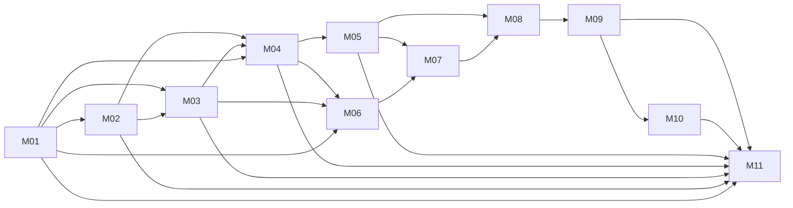

# Plan maestro — incremento PRD-v2.1 (camino a 3.0.0)

| Campo | Valor |
|-------|-------|
| Fecha / revisión | 2026-11-11, rev. 4 (rev. 2: correcciones de la revisión independiente; rev. 3: integración por lotes y CI por lote — §3.2, §6.3, §7.5; rev. 4: esta fase no publica el `3.0.0` — §9.3, D15; ver §11) |
| Autor | Planificador: define cómo se implementa y cómo se prueba; no escribe código de producto |
| Destinatario | Sesión orquestadora y subagentes: **un subagente por milestone** |
| Contrato normativo | [`docs/PRD-v2.1.md`](../PRD-v2.1.md) — delta normativo sobre [`docs/PRD.md`](../PRD.md) v1.3. Para las reglas de la tabla §0.2, el delta es la única fuente de verdad |
| Línea base | rama `feature/prd-v2.1` @ `def690d`, paquete `2.0.1`, suite `747` tests (en el host macOS actual: 2 fallos conocidos en `SMOKE-NEW.07` por presupuesto p95 de `mailboxes`/`show`, 6 saltados; §7.6) |
| Versión objetivo | **Ninguna publicación en esta fase.** Los features de PRD-v2.1 son parte del futuro `3.0.0` (ADR-27), pero no los únicos: `develop` los conserva sin publicar hasta completar el resto del alcance. Bump de versión, tag y release quedan fuera de este plan (D15) |
| Alcance | plugins de backend, `uid` prefijado, `state.json` schema 2, motor multi-driver, `mailquery attachment`, recuperación segura de adjuntos, `doctor`/`--version`, protocolo de errores de plugin y documentación consumidora |
| Fuera de alcance | implementación en esta sesión (el plan es el entregable); reescritura del producto; [`docs/PRD.md`](../PRD.md) (se concilia en tarea futura); features de [`docs/PRD-content-hardening.md`](../PRD-content-hardening.md); plugins externos concretos; cualquier propuesta del [`docs/ROADMAP.md`](../ROADMAP.md) |
| Conciliación | registro, tabla de supresión y checklist viven en **PRD-v2.1 §0.7**; se actualizan al cerrar cada milestone. `PRD.md` no se edita |

> **Regla de oro:** el comportamiento (salidas, textos, errores, warnings, códigos de exit, archivos y permisos) es el del PRD-v2.1, en la sección que cada milestone cita; donde el delta no dice nada, se conserva el de 2.0.1. Cómo se implementa y cómo se prueba lo fija este plan. Si el subagente encuentra una contradicción, un hueco o un AC fuera de alcance, **se detiene y devuelve la pregunta al orquestador** antes de improvisar.

---

## 1. Cómo leer el plan

1. [`PLAN-MASTER.md`](PLAN-MASTER.md) (este documento): estado, orden, dependencias, reglas y puertas de calidad. Es el **único** documento de estado.
2. `docs/plan/milestones/MNN-*.md`: instrucciones completas y autocontenidas de **un** milestone. Cada uno cabe en **un subagente**.
3. Contrato de interfaz vigente: [`docs/INTERFACES.md`](../INTERFACES.md), actualizado por cada milestone en su sección.
4. Al empezar un milestone, el subagente lee, en este orden: su archivo de milestone, las secciones del PRD-v2.1 que cita, este plan y la sección de `INTERFACES.md` que vaya a tocar. El resto del repo se lee según lo pida el milestone.

---

## 2. Semáforos y protocolo de actualización

| Símbolo | Significado | Condición de uso |
|---|---|---|
| ⚪ | **No iniciado** | estado inicial de todo milestone y fase |
| 🟡 | **En curso** | subagente lanzado, rama creada desde la del lote, trabajo sin integrar |
| 🟢 | **Completado** | rama integrada en la rama del lote con tag `prd-v2.1-MNN`, suite completa sin fallos nuevos, archivo de evidencia en `docs/plan/evidence/`, AC con evidencia, documentación del milestone actualizada y propuesta de §0.7. El release no forma parte de este gate |
| 🔴 | **Bloqueado** | pregunta HITL sin responder, dependencia incumplida o fallo de entorno; se registra el motivo y la fecha en §11 |

Reglas:

- **Un solo escritor:** solo el **orquestador** modifica este documento, la fila `Estado` de cada archivo de milestone y `PRD-v2.1 §0.7`. Los subagentes no los editan; proponen la transición en su entrega.
- Una fase es 🟢 solo cuando **todos** sus milestones están 🟢; 🟡 si alguno lo está; 🔴 si alguno lo está; ⚪ en el resto.
- Reapertura: un defecto encontrado después del cierre devuelve el milestone a 🟡 y se registra en §11. No se marca 🟢 un milestone con deuda de tests o de docs.
- Una transición a 🟢 exige, como mínimo: `python -B -m unittest discover -s tests -t . -v` sin fallos nuevos frente a la línea base, los casos del milestone verdes ejecutados solos (`-k <grupo>_<caso>`), `git diff --check` limpio y el checklist de cierre del milestone completo.

---

## 3. Dashboard de fases

| Fase | Nombre | Milestones | Estado | Puerta de fase |
|---|---|---|---|---|
| A | Fundaciones del contrato | M01 | 🟢 | registro, API 1, `uid` y `--version` congelados |
| B | Identidad y configuración | M02, M03 | 🟢 | `[scope]`/`[attachments]` y `state.json` schema 2 congelados |
| C | Núcleo de datos multi-driver | M04, M05 | 🟡 | merge/orden/cursor y protocolo de errores de plugin verdes |
| D | Recuperación de adjuntos (núcleo) | M06, M07, M08 | 🟡 | bloqueo, caché y comando `attachment` verdes |
| E | Adaptadores de backend | M09, M10 | ⚪ | Apple Mail y Outlook con adjuntos verdes |
| F | Documentación y cierre de fase | M11 | ⚪ | documentación y conciliación listas; la publicación del `3.0.0` queda fuera |

### 3.1 Milestones

| ID | Milestone | Fase | Depende de | ACs | Test groups | Docs | Estado |
|---|---|---|---|---|---|---|---|
| M01 | [Contrato de plugin, registro de drivers y uid base](milestones/M01-plugin-contract-and-registry.md) | A | — | AC-01, AC-02 (parcial), AC-05 (parcial), AC-18 (parcial) | UT-PL-01..04, UT-UID-01, PKG-01 | INTERFACES §API/backend; `--version` | 🟢 |
| M02 | [Configuración multi-driver, `[attachments]` y `doctor driver`](milestones/M02-config-scope-and-doctor.md) | B | M01 | AC-02, AC-03, AC-14 (config), AC-18 (doctor) | UT-DRV-01..05; UT-CLI-10/11 y TC-01 actualizados | INTERFACES config; `config.example.toml` | 🟢 |
| M03 | [uid prefijado en comandos y `state.json` schema 2](milestones/M03-uid-and-state-schema-2.md) | B | M01, M02 | AC-05, AC-06 | UT-ST-06/07, UT-UID-02, UT-SR-07/08/11 actualizados; UT-CLI-07/09/11, TC-03 y tests de Outlook actualizados | INTERFACES estado/JSON | 🟢 |
| M04 | [Motor multi-driver](milestones/M04-multi-driver-engine.md) | C | M01, M02, M03 | AC-04, AC-05 (routing de `show`), AC-07 (parcial), AC-19 (inicio) | UT-MD-01..07 | INTERFACES semántica multi-driver y log | 🟢 |
| M05 | [Protocolo de errores de plugin y timeouts](milestones/M05-plugin-errors-and-timeouts.md) | C | M01, M04 | AC-16, AC-17 (metadatos), AC-19 (plugin) | UT-ERR-01..04 | INTERFACES protocolo de errores | ⚪ |
| M06 | [Adjuntos: bloqueo y sanitización](milestones/M06-attachment-blocking-and-sanitization.md) | D | M01, M03, M04 | AC-09, AC-10, AC-11, AC-15 (nombres) | UT-ATT-01..05 | INTERFACES bloqueo/sanitización | 🟢 |
| M07 | [Adjuntos: límites, staging, caché y publicación](milestones/M07-attachment-cache-and-staging.md) | D | M05, M06 | AC-12, AC-13, AC-15 (núcleo), AC-20 | UT-ATT-06..11 | INTERFACES caché/staging/permisos | ⚪ |
| M08 | [Comando `attachment` y `show.attachments`](milestones/M08-attachment-command-and-show.md) | D | M05, M07 | AC-07, AC-08, AC-12 (CLI), AC-14 (CLI), AC-15 (CLI), AC-17 (extracción), AC-19 (fin), AC-21 (parcial) | UT-ATC-01..10; UT-CLI-06/07; goldens `show_*` (forma y valor) | INTERFACES contrato JSON; ayudas en código | ⚪ |
| M09 | [Backend Apple Mail: adjuntos](milestones/M09-apple-mail-attachments.md) | E | M08 | AC-09, AC-10, AC-11, AC-12, AC-15, AC-20 (integración) | UT-AM-01..04, TC-08, SMOKE-ATT-AM | INTERFACES backend Apple Mail | ⚪ |
| M10 | [Backend Outlook: adjuntos](milestones/M10-outlook-attachments.md) | E | M08, M09 | AC-10, AC-12, AC-15, AC-17 (Outlook), AC-19, AC-20 (integración) | UT-OL-ATT-01..04, TC-09, OL-30, SMOKE-ATT-OL | INTERFACES Outlook y excepción COM | ⚪ |
| M11 | [Documentación, cierre de fase y conciliación](milestones/M11-docs-release-and-reconciliation.md) | F | M01–M10 | Cierre de AC-01…AC-21; AC-19 (docs), AC-21 | DOC-01..06, PKG-02, INS-SMOKE-01, TC-04/TC-05/TC-06/TC-07 | READMEs, recetas, skills, instaladores, PRD-v2.1 §0.7 | ⚪ |

**Resumen:** milestones 🟢 5/11 · 🟡 1 · 🔴 0 · ⚪ 5. ACs 🟢 7/21. Documentos consumidores 🟢 0/10. Suite: línea base 747 tests (2 fallos conocidos de `SMOKE-NEW.07` en el host macOS, 6 saltados); objetivo final: 0 fallos nuevos y SMOKE verde en los hosts del dueño.

### 3.2 Lotes de integración

La ejecución sigue siendo secuencial (§5); lo que se agrupa es la **integración**. Cada lote cierra con un único PR a `develop` y una única corrida de la matriz completa; el detalle de ramas, tags y evidencia está en §6.3 y el gate del lote en §9.2.

| Lote | Milestones | Rama de integración | Tag por milestone | PR destino | Corridas de CI |
|---|---|---|---|---|---|
| I1 | M01–M03 | `feature/prd-v2.1-w1` | `prd-v2.1-M01`…`prd-v2.1-M03` | `develop` | 1 (PR) |
| I2 | M04–M07 | `feature/prd-v2.1-w2` | `prd-v2.1-M04`…`prd-v2.1-M07` | `develop` | 1 (PR) |
| I3 | M08–M10 | `feature/prd-v2.1-w3` | `prd-v2.1-M08`…`prd-v2.1-M10` | `develop` | 1 (PR) |
| I4 | M11 | `feature/prd-v2.1-m11` | `prd-v2.1-M11` | `develop` | 1 (PR) |

Total: **4 PRs y 4 corridas de matriz** (15 jobs cada una: 12 de `unittest` + 3 de `install-scripts`) en lugar de 11 PRs y hasta 22 corridas si cada milestone abriera PR y volviera a disparar CI al mergear en `develop`. La trazabilidad por milestone se conserva con su tag y su archivo de evidencia, no con un PR propio. No hay tag de release ni merge a `main` en esta fase (§9.3).

---

## 4. Matriz de criterios de aceptación

Cada fila indica el milestone **dueño** de la evidencia principal; las filas con dos milestones separan contrato y comportamiento de punta a punta.

| AC | Requisito (PRD-v2.1) | Milestone(s) | Pruebas | Golden / doc | Estado |
|---|---|---|---|---|---|
| AC-01 | Registro de drivers, `plugin_api = 1`, duplicado/reservado/inválido ⇒ `E_PLUGIN_INCOMPATIBLE` | M01 | UT-PL-01, PKG-01 | INTERFACES API 1 | 🟢 |
| AC-02 | Capacidades válidas y mostradas por `doctor` | M01, M02 | UT-PL-02, UT-DRV-05 | `doctor.json` | 🟢 |
| AC-03 | `[scope."<driver>:<cuenta>"]`, fallback nativo, driver no declarado/instalado | M02 | UT-DRV-01..03 | INTERFACES config | 🟢 |
| AC-04 | Ejecución multi-driver, orden, sin dedupe cross-driver, fail-fast | M04 | UT-MD-01..07 | goldens `search/new` multi-driver | 🟢 |
| AC-05 | `uid` string prefijado en JSON/state, legado aceptado, validación temprana | M01, M03, M04 | UT-UID-01/02, UT-SR-11 actualizado, UT-MD-07 | goldens `search/new/show` | 🟢 |
| AC-06 | Migración determinista schema 1→2, persistencia atómica, poda de anillos | M03 | UT-ST-06/07 | doctor `state` | 🟢 |
| AC-07 | `show.attachments` con `index`, `name`, `cached_path`; `show` no escribe | M04, M08 | UT-ATC-01, UT-MD-07, UT-ATC-10 | goldens `show_*` | 🟡 |
| AC-08 | `attachment` con `--index`/`--all`, validaciones y textos | M08 | UT-ATC-02..03 | golden ejemplo G | ⚪ |
| AC-09 | Bloqueo del mensaje completo con adjunto hostil y otro seguro | M06, M09 | UT-ATT-03, UT-AM-01 | goldens `attachment_blocked_name/content` | 🟡 |
| AC-10 | Bloqueo por nombre, traversal, reservados y *magic bytes* | M06, M09, M10 | UT-ATT-01/02, UT-AM-01, UT-OL-ATT-02 | fixtures `make_fixtures` | 🟡 |
| AC-11 | Sanitización determinista y límites de nombre; ruta/fallback 32 hex | M06, M09 | UT-ATT-04, UT-AM-02 | golden `attachment_saved` | 🟡 |
| AC-12 | Caché `cached`/`--force`, staging atómico, `E_IO` sin parciales | M07, M08, M09, M10 | UT-ATT-07, UT-ATT-08, UT-ATC-04, TC-08, TC-09 | goldens `attachment_cached/saved` | ⚪ |
| AC-13 | Límites `>` estricto, MiB, caché cuenta, exceso conocido/streaming | M07 | UT-ATT-06 | golden `attachment_too_large` | ⚪ |
| AC-14 | `enabled = false` y validación de rangos de `[attachments]` | M02, M08 | UT-DRV-04, UT-ATC-05 | `config.example.toml` | 🟡 |
| AC-15 | Disponibilidad (`not_local`, `not_downloaded`, `unsupported`, `network`), S/MIME, `attachments: none` | M06, M07, M08, M09, M10 | UT-ATT-05, UT-ATT-11, UT-ATC-06, UT-ATC-10, UT-OL-ATT-03 | goldens de error | 🟡 |
| AC-16 | Protocolo de errores de plugin: `reason`/`hint`/`detail`/`log_message`, `code` del núcleo | M05 | UT-ERR-01..03 | INTERFACES errores | ⚪ |
| AC-17 | Timeout 30 s metadatos / 120 s extracción | M05, M08, M10 | UT-ERR-04, UT-ATC-07, UT-OL-ATT-03 | — | ⚪ |
| AC-18 | `doctor` con `driver`; `--version` aditivo con drivers | M01, M02 | UT-PL-03, UT-DRV-05, PKG-02 | `doctor.json`, ayuda | 🟢 |
| AC-19 | Logs `backend=`/`drivers=`, conteos de `attachment`, sin PII | M04, M05, M08, M10, M11 | UT-MD-06, UT-ERR-02, UT-ATC-08, UT-OL-ATT-04 | INTERFACES log | 🟡 |
| AC-20 | Caché best-effort, borrado concurrente, sin barrido ni purga | M07, M09, M10 | UT-ATT-10, SMOKE-ATT-AM / SMOKE-ATT-OL | — | ⚪ |
| AC-21 | Ayuda raíz con 6 comandos, ayuda de `attachment` y línea de exits | M08, M11 | UT-ATC-09, DOC-01..06, TC-07 extendido | READMEs/`--help` | ⚪ |

---

## 5. Dependencias, olas y contratos congelados

| Ola (orden de ejecución) | Milestone | Nota |
|---|---|---|
| 1 | M01 | congela el contrato de la API 1, registro, `uid` y `--version` |
| 2 | M02 | congela configuración, `[scope]`, `[attachments]` y `doctor driver` |
| 3 | M03 | congela identidad prefijada y `state.json` schema 2 |
| 4 | M04 | merge, orden total, cursor y despacho de `show` por prefijo |
| 5 | M05 | protocolo de errores y timeout de metadatos |
| 6 | M06 | catálogo, bloqueo de nombres/contenido y sanitización |
| 7 | M07 | límites, staging, caché y publicación atómica |
| 8 | M08 | comando `attachment`, contrato JSON y `show.attachments` |
| 9 | M09 | adaptador Apple Mail (adjuntos) |
| 10 | M10 | adaptador Outlook (adjuntos y COM) |
| 11 | M11 | documentación, cierre de fase y conciliación |

Reglas de paralelismo: **no hay olas con dos milestones** y las olas son solo orden de ejecución; la agrupación para integrar son los lotes de §3.2. La revisión independiente (2026-11-11) detectó solapes de `docs/INTERFACES.md` y de los archivos de test/gates entre M04∥M06, M05∥M07 y M09∥M10; por eso la ejecución es estrictamente secuencial, cada milestone en una rama propia creada desde la rama de su lote y en un único worktree reutilizado (§6.3). El orquestador integra cada milestone en la rama del lote y corre la suite completa; la matriz de CI se ejecuta por lote (§3.2, §7.5).

### 5.1 Contratos congelados

Un milestone cerrado no cambia estos contratos sin reabrir el milestone y actualizar el plan.

| ID | Contrato | Congelado en | Consumido por |
|---|---|---|---|
| C1 | Grupo de entry points `mailquery.backends`, validación de `driver`/`plugin_api`/capacidades, API pública de plugin (`PluginContext`, `PluginError`, enum de `reason`), formato/parseo de `uid` y `native_order_key` por mensaje: la fila de mensaje que devuelve cada operación de listado incluye `native_order_key` (string); la capacidad `native_order` (`numeric`/`text`) indica cómo compararlo (entero vs. texto), y el núcleo nunca compara el `uid` como texto | M01 | M02–M11 |
| C2 | Esquema de `config.toml` (`[scope."<driver>:<cuenta>"]`, `[attachments]`, rangos), resolución de cuenta por driver, detalle del chequeo `driver` | M02 | M03–M11 |
| C3 | `state.json` schema 2, migración y persistencia atómica, emisión de `uid` prefijado en JSON, aceptación del uid legado | M03 | M04, M06–M11 |
| C4 | Semántica multi-driver: orden total, cursor global, anillo, merge, fail-fast, log `event=start` | M04 | M08–M11 |
| C5 | Protocolo de errores de plugin (mapeo `reason`→`code`/exit, saneado, límites) y timeout de metadatos (30 s) | M05 | M08–M11 |
| C6 | Catálogo de extensiones, reglas de bloqueo de nombre/contenido y `sanitized_name` | M06 | M07–M11 |
| C7 | Caché `~/.mailquery/attachments/<driver>/<native_id>/`, staging, publicación atómica, permisos, límites, SHA-256 | M07 | M08–M11 |
| C8 | Comando `attachment` (sintaxis, precedencia §11.3, JSON, textos, ayuda) y forma de `show.attachments` | M08 | M09–M11 |
| C9 | Adaptadores Apple Mail/Outlook (operaciones de adjunto, motivos, materialización COM) | M09, M10 | M11 |

---

## 6. Reglas de ejecución

### 6.1 Orquestador

1. Lanza **un subagente por milestone** con el archivo del milestone como tarea completa. No implementa código de producto.
2. Crea la rama del milestone (`feature/prd-v2.1-MNN-<slug>`) desde la rama del lote vigente (§3.2), revisa el diff contra el PRD y el milestone, corre la suite completa e integra en la rama del lote con `--no-ff` y tag `prd-v2.1-MNN`. **No abre PR por milestone ni espera CI**: el PR y la matriz son del lote (§6.3, §9.2).
3. Tras integrar: actualiza este dashboard (§3), la matriz AC (§4), el registro de ejecución (§11) y `PRD-v2.1 §0.7`. Es el único que escribe estado.
4. Reutiliza **un solo worktree** (`../mailquery-prd-v2.1`), reseteado al punto de integración del lote; la rama se crea por milestone y el subagente trabaja solo en los archivos de su milestone. No hay ejecución en paralelo (§5).
5. Ante una pregunta HITL, la traslada al dueño en el momento, registra la respuesta en §11 y relanza el milestone.
6. No autoriza merges a `main` ni tags de release: la publicación del `3.0.0` (bump de versión, tag, `main`) queda fuera de este plan y la hará el dueño cuando se complete el resto del alcance.
7. Al cerrar un lote (§3.2): abre **un PR** de la rama del lote a `develop`, espera la matriz completa y mergea con `--no-ff` cuando esté verde (§9.2). Si el lote falla, no mergea: abre un milestone de corrección o relanza el que rompió. El PR de I4 además publica la evidencia de cierre de M11. Al mergear, `develop` avanza y la rama del lote siguiente se crea desde ese `develop`.

### 6.2 Subagente

1. Lee su milestone, las secciones del PRD-v2.1 que cita y este plan. Si algo no está resuelto, **pregunta** al orquestador y espera.
2. Respeta el **write scope** del milestone. No toca archivos de otros milestones, `docs/PRD.md`, `docs/PRD-v2.1.md` ni este plan.
3. Escribe primero los tests del milestone (rojo por la razón correcta) y después la implementación. Los casos llevan su ID en el nombre (§7.1) y pasan también ejecutados solos.
4. Código en inglés; documentación y este plan en español. Sin dependencias nuevas: solo stdlib (≥ 3.11) y `pywin32` en Windows.
5. Nunca lee ni escribe el home real, el `~/.mailquery` real ni los stores reales del usuario. Los tests aíslan `HOME`/`USERPROFILE`; las únicas pruebas contra clientes reales son las SMOKE del dueño (§7.6).
6. Al terminar entrega: rama y commits, salida de la suite (corridos/fallidos/saltados), lista de archivos, AC cubiertos con sus casos, docs actualizados, riesgos abiertos, datos crudos de evidencia (§6.3) y la propuesta de transición de estado. No abre PR, no integra en `develop` y no marca nada en el master.

### 6.3 Git, integración y evidencia

**Ramas.** Una rama por milestone desde la rama del lote vigente (§3.2), no desde `develop`; commits en inglés (`feat(...)`, `test(...)`, `docs(...)`). Un solo worktree (`../mailquery-prd-v2.1`), reseteado al punto de integración del lote; no se crean 11 worktrees.

**Integración.** Cada milestone se integra en la rama del lote con `--no-ff` y tag local `prd-v2.1-MNN` cuando su gate local (§9.1) está verde. El lote se publica como **un PR** a `develop` (4 PRs en total: I1–I4): la revisión por milestone se hace sobre los commits y el tag, no sobre un PR propio. Un milestone no se cierra con la suite local roja y un lote no se mergea con la matriz roja (§9.2).

**Evidencia por milestone.** El orquestador escribe `docs/plan/evidence/MNN.md` tras el gate local; el subagente entrega los datos crudos de la plantilla, nunca edita `docs/plan/`. Contenido mínimo:

1. comandos ejecutados y conteo final (corridos/fallidos/saltados) de la suite completa en el host macOS del dueño, con el commit y el tag;
2. grupos del milestone ejecutados solos (comando y resultado);
3. goldens afectados (creados/actualizados) por icono y ruta, y comparación estructural cuando se reescribieron;
4. número de tests nuevos y AC cubiertos con sus IDs;
5. `git diff --check` y `git diff --stat` contra la base del lote;
6. riesgos abiertos, deuda aceptada y preguntas HITL.
   El resumen (tres líneas) va al registro §11; el detalle queda en el archivo de evidencia. Ver plantilla en [`docs/plan/evidence/README.md`](evidence/README.md).

**Sin release.** Esta fase no cambia la versión del paquete (sigue en `2.0.1`), no crea tag de release, no mergea a `main` y no publica. Los tags `prd-v2.1-MNN` son de trazabilidad interna, no de versión. El bump a `3.0.0` y el release se harán cuando se complete el resto del alcance (D15).

**Higiene.** `git diff --check` limpio; sin archivos temporales, `.pyc` ni salidas de depuración en el repo; sin cambios en `docs/PRD.md`, `docs/PRD-v2.1.md` (salvo el orquestador) ni en este plan.

### 6.4 Plantilla de lanzamiento de un subagente

El orquestador envía, como tarea completa, este contenido con `<NN>` completado:

> Ejecuta el milestone M`<NN>` de `docs/plan/milestones/M<NN>-*.md` en `/Users/dayler/dev/github/mailquery`. Lee, en este orden: el archivo del milestone, las secciones del `docs/PRD-v2.1.md` que cita, `docs/plan/PLAN-MASTER.md` (§2, §6.2, §7, §9) y la sección de `docs/INTERFACES.md` que vayas a tocar. Implementa solo las tareas del milestone, dentro de su write scope, con los tests de sus grupos primero. No toques `docs/PRD.md`, `docs/PRD-v2.1.md`, `docs/plan/**` ni el home real. Al terminar, entrega: rama y commits, suite completa (corridos/fallidos/saltados), tests nuevos y verdes solos, archivos tocados, AC cubiertos, docs actualizados, datos crudos de evidencia (§6.3), riesgos y propuesta de transición de estado. No abras PR ni mergees en `develop`: integras en la rama del lote. Si encuentras una contradicción o un hueco, detente y devuelve la pregunta antes de improvisar.

---

## 7. Suite de pruebas

### 7.1 Convenciones (heredadas de 2.0.0)

- `unittest`, descubrimiento con `python -B -m unittest discover -s tests -t . -v`; sin red (salvo las SMOKE de instalación del dueño) y sin frameworks nuevos.
- Cada grupo (`UT-PL-01`, `UT-ATT-03`, …) cubre un requisito del PRD; cada caso es **un método** con tipo: **P** positivo, **N** negativo (error o algo que no debe ocurrir) o **B** borde.
- Nombre: `test_<grupo>_<caso>_<descripción>` en minúsculas (`test_ut_att_03_01_blocks_whole_message`). Ejecutable solo con `-k ut_att_03_01`.
- `Esperado` = lo que fija la sección citada del PRD; los textos literales del PRD se comparan literalmente.
- Aislamiento: cada caso crea sus datos temporales; ningún test usa el `HOME` real. Subprocesos con `HOME`/`USERPROFILE` temporales.
- Tests dependientes de plataforma: la condición va dentro del test (aserción condicional); los únicos saltos permitidos son los de §7.6 y CI.
- Un test existente que pasa a ser un caso se **renombra**; no se duplica. Los goldens se comparan estructuralmente tras normalizar (`<ISO>`, `<HOME>`, `<ROOT>`, `<PYTHON>`).

### 7.2 Archivos de test y grupos

| Prefijo | Archivo | Milestone |
|---|---|---|
| UT-PL, UT-ERR | `tests/test_plugins.py` (nuevo) | M01, M05 |
| UT-UID | `tests/test_uid.py` (nuevo) | M01, M03 |
| UT-DRV, UT-CFG | `tests/test_config.py`; los casos de `doctor` viven en `tests/test_cli.py` y `tests/test_integration.py` | M02 |
| UT-ST | `tests/test_state.py` | M03 |
| UT-SR, UT-MD | `tests/test_search.py`, `tests/test_multidriver.py` (nuevo) | M03, M04 |
| UT-ATT | `tests/test_attachments.py` (nuevo) | M06, M07 |
| UT-ATC | `tests/test_cli.py` y el doble de adjuntos `tests/fakes/attachment_backend.py` (nuevo) | M08 |
| UT-AM | `tests/test_integration.py` para UT-AM-03/04; `tests/test_backends.py` para UT-AM-01/02 | M09 |
| UT-OL, UT-OL-ATT | `tests/test_outlook.py` | M10 |
| TC | `tests/test_integration.py` (TC-01/02/04/05/07) y `tests/test_readonly.py` (TC-03) | M02, M03, M08, M09, M10, M11 |
| SMOKE | `tests/test_smoke.py` | M09, M10, M11 |
| PKG, INS | `tests/test_packaging.py`, `tests/test_install_scripts.py` | M01, M11 |

Los grupos exactos y sus casos están en cada archivo de milestone. La matriz AC (§4) es el mapa de trazabilidad; ningún AC puede quedar sin al menos un caso o golden. Los IDs nuevos no pueden duplicar un ID o grupo existente: cuando el plan reutiliza un comportamiento ya probado (`UT-CLI-01..03`, `UT-CLI-06`, `UT-CLI-09`, `TC-06`, `UT-INS-01`), se **extiende/renombra** el test existente y se declara en el milestone; no se crea un grupo paralelo.

### 7.3 Goldens

Base: `tests/fixtures/expected/` con **18 goldens**: 11 de Apple Mail (`doctor`, `mailboxes`, `new_first_run`, `new_seeded`, `search_default`, `search_all_mail`, `show_2714`, `show_83170`, `show_83180`, `show_not_in_scope_error`, `show_smime_encrypted`) y 7 de Outlook en `expected/outlook/` (`doctor`, `mailboxes`, `new_first_run`, `search`, `show`, `show_header_only`, `show_smime`). Regla: **un solo dueño por golden**; el diff se justifica con la fila del PRD que lo ordena y los demás milestones no lo reescriben.

| Golden | Cambia en | Motivo |
|---|---|---|
| `doctor.json`, `outlook/doctor.json` | M02 | única edición: chequeo `driver` y orden; la versión del paquete no cambia en esta fase |
| `search_default.json`, `search_all_mail.json`, `new_first_run.json`, `new_seeded.json`, `show_2714.json`, `show_83170.json`, `show_83180.json`, `show_smime_encrypted.json`, `show_not_in_scope_error.json` | M03 | `uid` string prefijado y `cursor.last_uid` |
| `outlook/new_first_run.json`, `outlook/search.json`, `outlook/show.json`, `outlook/show_header_only.json`, `outlook/show_smime.json` | M03 | `uid` pasa de `EntryID` a `outlook:<EntryID>` |
| `show_2714.json`, `show_83170.json`, `show_83180.json`, `show_smime_encrypted.json`, `outlook/show.json`, `outlook/show_header_only.json`, `outlook/show_smime.json` | M08 (segunda y única edición de forma/valor) | `attachments[{index,name,cached_path}]`; en `show_smime_encrypted`/`outlook/show_smime` el valor pasa a `[]` |
| `search_multidriver.json`, `new_multidriver.json` (nuevos) | M04 | merge/orden multi-driver con plugin de prueba |
| `attachment_saved.json`, `attachment_cached.json`, `attachment_blocked_name.json`, `attachment_blocked_content.json`, `attachment_too_large.json`, `show_2714_with_cache.json` (nuevos) | M09 | flujo real Apple Mail sobre fixtures; `attachment_cached` se siembra con una primera corrida y se documenta la semilla |
| `outlook/attachment_saved.json`, `outlook/attachment_cached.json`, `outlook/attachment_unavailable.json`, `outlook/attachment_blocked.json` (nuevos) | M10 | flujo Outlook sobre dobles; misma semilla documentada para `attachment_cached` |

Los goldens nuevos se numeran dentro de TC-08 (Apple) y TC-09 (Outlook); el conteo final se registra en M11.

### 7.4 Dobles

- `tests/fakes/outlook.py`: se amplía en M10 con adjuntos locales, no descargados, S/MIME, corruptos, materialización y fallos de COM.
- `tests/fakes/plugin.py` (nuevo, M01): plugin de prueba instalable con API 1, capacidades configurables, `native_order_key`, cuerpo/adjuntos y fallos inyectables; es la única vía de ejercitar AC-01/02/04/15/16/17 sin publicar un plugin real.
- `tests/fakes/attachment_backend.py` (nuevo, M08): backend inyectable en la CLI con capacidades, adjuntos, motivos y timeouts controlables; lo usan UT-ATC-02/03/06/07 y los positivos de plugin.
- `tests/fakes/attachment_driver.py` o stub local en los tests del motor (M06/M07): entrega bytes decodificados y motivos; nunca escribe en caché.
- `tests/fixtures/make_fixtures.py`: se amplía en M09 con adjuntos (varios, mismo nombre, nombres hostiles, contenido ejecutable, vacío, S/MIME, externalizados de `.partial.emlx`, un archivo > 1 MiB para `max_file_size_mb`) y con `build_store(..., attachments=False)` para los tests que no los necesitan.

### 7.5 CI

- **Matriz sin cambios de forma:** `ubuntu-latest`, `macos-latest`, `windows-latest` × Python 3.11–3.14, `fail-fast: false`, `python -m unittest discover -s tests -t . -v`; `pywin32` solo en Windows; 3 jobs de `install-scripts`. La matriz **no instala el paquete**: los casos de metadata de entry points usan metadata inyectada o se saltan con motivo (PKG-01).
- **Disparo por lote, no por milestone:** el workflow deja de disparar `push` en `develop`/`main` y queda en `pull_request` a `develop`/`main`. El PR del lote (§3.2) es el único que ejecuta la matriz completa antes del merge; no hay disparo por tag en esta fase (el release futuro del `3.0.0` añadirá el suyo, fuera de este plan). Así las corridas son exactamente las 4 de §3.2. Se añade `concurrency` con `cancel-in-progress` (un push nuevo a la rama del PR cancela el run anterior en lugar de acumular jobs) y `timeout-minutes: 30` por job.
- **Único cambio de infraestructura permitido:** `.github/workflows/tests.yml` lo modifica M01 (M01-T08) y lo verifica el PR de I1; M11 verifica que el PR de I4 es la última corrida de la fase (M11-T08). Ningún otro milestone toca CI.
- **Evidencia de CI:** la matriz verde del PR del lote queda registrada en `docs/plan/evidence/` (URL del run, commit, los 15 jobs) del último milestone del lote y en el registro §11. Cerrar un milestone no exige CI (exige el gate local, §9.1); cerrar un lote sí (§9.2).
- Los casos que dependen de un cliente real se saltan donde no aplican (§7.6); el resto debe dar el mismo número en los 3 SO, salvo los saltos permitidos (instaladores sin `sh`/PowerShell, UT-INS fuera de Windows, `POSIX-only` y `Windows-only` declarados en el propio test).
- Gate de solo lectura (`tests/test_readonly.py`) bloqueante: TC-03 se extiende en M09 y OL-30 en M10; cada gate pertenece a un único milestone y no se reescribe en el otro. Corre en cada milestone (local) y en el PR del lote.
- **Coste:** 4 corridas de 15 jobs ≈ 60 jobs, frente a ≈330 del esquema anterior (11 PRs + 11 pushes a `develop`); las correcciones reusan el PR del lote y `cancel-in-progress` descarta los runs obsoletos. No se añaden runners propios, servicios externos ni dependencias.
- `UT-CLI-09.01` (matriz de exit) se amplía en M01 a todos los códigos de §11.7 y se compara contra `errors._EXIT_ERRORS`; M08 añade los casos de CLI de los códigos de adjuntos.
- Escaneo de "solo stdlib" (RNF-12): se extiende en M06/M07/M11 a `attachments/**`, `plugins/**` y `backends/registry.py`, no solo a los módulos que ya vigila `test_backends.py`.

### 7.6 SMOKE y hosts reales

- SMOKE-ATT-AM (M09, macOS) y SMOKE-ATT-OL (M10, Windows): recuperación real de un adjunto en Apple Mail y en Outlook clásico, con `HOME`/`USERPROFILE` temporales y sin tocar el `~/.mailquery` real. IDs distintos (`SMOKE-ATT-AM.01..04`, `SMOKE-ATT-OL.01..03`) y skip declarado en la clase de cada plataforma; se saltan en CI y en hosts sin cliente/almacén.
- SMOKE presupuesto: el caché-hit de `attachment` (< 50 ms) y los presupuestos de §12.2 se miden en los hosts del dueño durante M11; SMOKE-ATT no impone umbrales duros de tiempo (evita flakiness). Los 2 fallos conocidos de `SMOKE-NEW.07` (presupuesto p95 de `mailboxes`/`show`) en el host macOS actual se registran como deuda conocida y no se heredan como criterio de aceptación de los milestones; M11 los re-mide.
- Outlook real: la materialización COM (`Attachment.SaveAsFile`) solo se verifica en el host Windows del dueño; en CI/desarrollo se usa el doble. Si el host no permite verificarla, se registra como riesgo aceptado (PRD §15) y se mantiene la cobertura del doble.

---

## 8. Documentación

Todo artefacto consumidor del contrato se actualiza en el milestone que cambia su contenido y se revisa en M11. **`docs/PRD.md` no se toca**: su conciliación es una tarea futura posterior al plan maestro.

| Documento | Qué debe reflejar | Milestone dueño | Verificación |
|---|---|---|---|
| `docs/INTERFACES.md` | API 1, protocolo de backend v1, capacidades, `uid`, config, estado, multi-driver, errores, adjuntos, caché | M01–M10 (por sección, ejecución secuencial); M11 (revisión final) | revisión del planificador |
| `docs/config.example.toml` | `[attachments]`, `[scope."<driver>:<cuenta>"]`, comentarios y rangos vigentes | M02; M11 | `INS-SMOKE-01`, parseo real |
| Ayuda raíz y de subcomandos (código) | 6 comandos, línea de exits, ayuda de `attachment` §11.4, ejemplos válidos | M08 | `UT-ATC-09`, `DOC-05` |
| `README.md` | manual: instalación, 6 comandos, `uid` string, `[scope]`, `[attachments]`, caché, permisos, exit codes, `doctor`/`--version`, errores nuevos | M11 | `DOC-01`, `DOC-03` |
| `README.es.md` | mismo manual en español, coherente con `README.md` | M11 | `DOC-02` |
| `docs/recipes/01-*.md`, `02-*.md` | comandos válidos con uid prefijado y `attachment`; exit 3/5/6 | M11 | `TC-04` (`RecipeCommandTest`) |
| `skills/mailquery/SKILL.md` | contrato para el harness: uid opaco string, `attachment`, `show.attachments`, errores | M11 | `DOC-04` |
| `scripts/install.sh`, `scripts/install.ps1`, `skills/install.*` | versión vigente sin bump, `pipx inject mailquery <paquete>`, textos sin `cinco comandos`/`five commands` | M11 | `INS-SMOKE-01`, `UT-INS-01` |
| `docs/security/threat-model.md` | excepción COM de materialización y frontera de confianza de plugins, sin contradicciones | M10; M11 | revisión del planificador |
| `docs/PRD-v2.1.md §0.7` | registro de conciliación, tabla de supresión y checklist, con semáforos | orquestador tras cada milestone; M11 cierre | revisión del planificador |

---

## 9. Puertas de calidad y definición de terminado

### 9.1 Cierre de milestone

1. Suite completa en el host macOS del dueño sin fallos nuevos frente a la línea base (los 2 de `SMOKE-NEW.07` se registran como deuda conocida, §7.6); los casos del milestone verdes solos.
2. Todos los AC del milestone con al menos un caso o golden, y trazados en la matriz (§4).
3. Documentación del milestone actualizada (tabla §8).
4. Sin cambios fuera del write scope; sin `PRD.md`; `git diff --check` limpio.
5. Sin dependencias nuevas; sin red en el núcleo; invariante I-1 intacto.
6. Archivo `docs/plan/evidence/MNN.md` con los seis puntos de §6.3 y tag `prd-v2.1-MNN` en la rama del lote.
7. Entrega con propuesta de transición; el orquestador actualiza master y PRD §0.7. La matriz de CI **no** es requisito de este gate.

### 9.2 Cierre de lote (integración)

- La rama del lote contiene los milestones del lote con su tag y su archivo de evidencia; el orquestador corrió la suite completa tras cada integración.
- El PR del lote a `develop` tiene la matriz completa verde (15 jobs, §7.5), sin fallos nuevos frente a la línea base y con los saltos de §7.6 documentados en el run.
- El `git diff` acumulado del lote contra `develop` solo toca archivos de los write scopes de sus milestones; sin `docs/PRD.md` ni cambios en este plan fuera de dashboard, registro y evidencias.
- Merge `--no-ff` a `develop` y anotación en §11 con la URL del run. Si la matriz falla, no hay merge: el orquestador relanza el milestone que rompió y adjunta la evidencia del fallo.

### 9.3 Cierre de fase (M11)

- AC-01…AC-21 verdes en la matriz de CI del PR de I4 (con los saltos de §7.6) y SMOKE verdes en los hosts del dueño o saltadas con motivo.
- Suite completa verde en macOS y Windows con los clientes reales; gate de solo lectura bloqueante en verde (TC-03 Apple, OL-30 Windows).
- Documentación completa y sin referencias obsoletas: "cinco comandos"/"five commands", uid entero, `attachments` solo con `name`, `[scope]` sin prefijo, `doctor` sin `driver`, `--version` sin `drivers`, `baseline`/`retention_days` u otras marcas de versiones anteriores. Donde se muestre una versión, coincide con `__version__` (no se anuncia `3.0.0`, que no está publicado).
- Escaneo de imports de solo stdlib extendido a `attachments/**`, `plugins/**` y `backends/registry.py`; presupuestos de extracción de §12.2 medidos o registrados como deuda explícita.
- `PRD-v2.1 §0.7`: filas de features 🟢 con su evidencia; filas de publicación (RC-25, CL-05, CL-09, CL-12 y CL-08 en lo que dependa de ellas) quedan ⚪ pendientes del release futuro del `3.0.0`.
- **Sin release:** versión del paquete sin bump (`2.0.1`), sin tag `v3.0.0`, sin merge a `main`, sin publicación. `develop` conserva los features sin publicar hasta completar el resto del alcance del `3.0.0` (D15).
- `git diff` contra `develop` sin cambios en `docs/PRD.md` ni en este plan (salvo su dashboard, registro y evidencias).

---

## 10. Riesgos del plan

| Riesgo | Prob. | Impacto | Mitigación |
|---|---|---|---|
| Los AC de plugin externo no se pueden probar sin un plugin real | Alta | Medio | Plugin de prueba instalable en `tests/fakes/plugin.py` y metadata de entry points inyectada; aprobado como criterio (HITL 2026-11-11) |
| Adjuntos externalizados de `.partial.emlx` no verificables en producción | Media | Medio | Contrato: si no se puede leer ⇒ `E_ATTACHMENT_UNAVAILABLE` (`unsupported`); SMOKE best-effort (PRD §15) |
| Windows real no disponible en el desarrollo | Media | Medio | Doble de Outlook completo; SMOKE y materialización COM en el host del dueño; riesgo aceptado |
| Alta rotación de goldens por el uid string | Alta | Bajo | Un solo milestone actualiza cada golden, con justificación y comparación estructural; `doctor` tiene una sola edición prevista (M02), porque la versión no cambia en esta fase |
| Deriva de versión entre goldens y `--version` | Media | Medio | `UT-PL-03` usa `__version__`; los goldens `doctor` se editan solo en M02 y la versión no cambia (D15); ningún test fija la versión literal |
| Deriva de documentación al final | Media | Medio | Cada milestone actualiza su sección; `DOC-*` y M11 como gate |
| Scope creep (ROADMAP, hardening de contenido) | Media | Alto | Fuera de alcance explícito; el subagente pregunta antes de ampliar |
| Fallo de E/S a mitad de publicación deja archivos completos | Baja | Bajo | Publicación atómica y `E_IO`; documentado como riesgo aceptado (PRD §15) |
| Fallos conocidos de `SMOKE-NEW.07` (presupuesto p95) en el host actual | Media | Bajo | No se heredan como criterio de milestone; se re-miden en M11 |
| Lote grande oculta una regresión de un milestone | Media | Medio | Tag y evidencia por milestone, suite completa local tras cada integración y PR del lote con matriz completa; el bisect usa los tags `prd-v2.1-MNN` |
| Coste de CI por exceso de corridas | Alta | Bajo | 4 PRs y 4 corridas (§3.2, §7.5); `cancel-in-progress`; sin `push` en `develop` ni en `main` |
| Confundir el cierre de fase con el release del `3.0.0` | Media | Alto | D15: sin bump, sin tag, sin `main`; docs y ejemplos usan `__version__`; §0.7 distingue filas de features de las de publicación |
| Features del `3.0.0` en `develop` con versión `2.0.1` | Media | Medio | Es un estado de desarrollo no publicado; el bump y el release se harán al completar el alcance; la documentación no anuncia `3.0.0` |
| PR de lote demasiado grande para revisar | Media | Medio | Revisión por commits y tags, evidencia por milestone y diff acumulado contra `develop`; tres lotes de 3–4 milestones como máximo |

---

## 11. Registro de ejecución

Se completa al cerrar cada milestone (solo el orquestador).

| Fecha | Milestone | Estado previo → nuevo | Evidencia (suite, tests nuevos, goldens) | Preguntas HITL / notas |
|---|---|---|---|---|
| 2026-11-11 | Plan (rev. 1 → rev. 2) | — | Revisión independiente normativa y de pruebas: [`reviews/2026-11-11-normative-review.md`](reviews/2026-11-11-normative-review.md) y [`reviews/2026-11-11-test-review.md`](reviews/2026-11-11-test-review.md); correcciones aplicadas a este plan y a los 11 milestones | 0 bloqueantes abiertos; decisiones de interpretación en §13 |
| 2026-11-11 | Plan (rev. 2 → rev. 3) | — | Optimización de la integración: lotes de 3–4 milestones con un PR por lote, CI por lote con `cancel-in-progress`, evidencia local por milestone y tag `prd-v2.1-MNN` (§3.2, §6.3, §7.5, §9) | Decisión del dueño 2026-11-11; sin cambios de alcance ni de AC |
| 2026-11-11 | Plan (rev. 3 → rev. 4) | — | Alcance corregido: los features de PRD-v2.1 son parte del futuro `3.0.0` pero no los únicos; esta fase **no publica**: sin bump de versión, sin tag `v3.0.0`, sin merge a `main`. `develop` acumula los features hasta completar el resto del alcance (§3.2, §6.3, §9.3, D15) | Decisión del dueño 2026-11-11; sin cambios de AC ni de casos |
| 2026-11-11 | M01 | ⚪ → 🟢 | suite 770 tests, 2-3 fallos conocidos `SMOKE-NEW.07`, 6 saltados; UT-PL-01..04, UT-UID-01 y PKG-01 verdes solos; +36 tests; goldens intactos; +2443/−241; CI por lote (`pull_request`, `concurrency`, `timeout-minutes: 30`). Evidencia: [`evidence/M01.md`](evidence/M01.md) | 0 HITL; `PKG-01.02` se salta sin metadata instalada; hook pre-commit local roto, commits con `--no-verify` |
| 2026-11-11 | M02 | ⚪ → 🟢 | suite 797 tests, 2 fallos conocidos `SMOKE-NEW.07`, 7 saltados; UT-DRV-01..05 verdes solos; +27 tests; goldens `doctor`/`outlook/doctor` solo con el check `driver`; +1402/−122. Evidencia: [`evidence/M02.md`](evidence/M02.md) | 0 HITL; `[scope]` sin prefijo mantiene el comportamiento 2.0.1 |
| 2026-11-11 | M03 | ⚪ → 🟢 | suite 810 tests, 2 fallos conocidos `SMOKE-NEW.07`, 6 saltados; UT-ST-06/07, UT-UID-02, UT-CLI-07/11 y TC-03 verdes solos; +13 tests; 14 goldens con diff solo de uid; +1782/−687. Evidencia: [`evidence/M03.md`](evidence/M03.md) | 0 HITL; `check_state_uid` retirado; lote I1 completo (M01–M03) |
| 2026-11-11 | M06 | ⚪ → 🟢 | suite del milestone 829/2/6 y del lote 842/2/7 (solo `SMOKE-NEW.07`); UT-ATT-01..05 verdes solos; +32 tests; sin goldens; +2119/−0 (solo altas). Ejecutado en paralelo con M03 y M04 sobre su propio worktree. Evidencia: [`evidence/M06.md`](evidence/M06.md) | 0 HITL abiertas; la frontera S/MIME/lista vacía queda para M08 |
| 2026-11-11 | M04 | ⚪ → 🟢 | suite 875 tests, 2 fallos conocidos `SMOKE-NEW.07`, 6 saltados; UT-MD-01..07 verdes solos; +33 casos; 2 goldens multi-driver nuevos (semilla documentada); +3109/−368. Evidencia: [`evidence/M04.md`](evidence/M04.md) | 0 HITL; config sin `[scope]` conserva el nativo 2.0.1; `PluginError` de runtime pendiente de M05 |

---

## 12. Índice de milestones

1. [M01 — Contrato de plugin, registro de drivers y uid base](milestones/M01-plugin-contract-and-registry.md)
2. [M02 — Configuración multi-driver, `[attachments]` y `doctor driver`](milestones/M02-config-scope-and-doctor.md)
3. [M03 — uid prefijado en comandos y `state.json` schema 2](milestones/M03-uid-and-state-schema-2.md)
4. [M04 — Motor multi-driver](milestones/M04-multi-driver-engine.md)
5. [M05 — Protocolo de errores de plugin y timeouts](milestones/M05-plugin-errors-and-timeouts.md)
6. [M06 — Adjuntos: bloqueo y sanitización](milestones/M06-attachment-blocking-and-sanitization.md)
7. [M07 — Adjuntos: límites, staging, caché y publicación](milestones/M07-attachment-cache-and-staging.md)
8. [M08 — Comando `attachment` y `show.attachments`](milestones/M08-attachment-command-and-show.md)
9. [M09 — Backend Apple Mail: adjuntos](milestones/M09-apple-mail-attachments.md)
10. [M10 — Backend Outlook: adjuntos](milestones/M10-outlook-attachments.md)
11. [M11 — Documentación, cierre de fase y conciliación](milestones/M11-docs-release-and-reconciliation.md)

---

## 13. Decisiones de interpretación (revisión 2026-11-11)

Las preguntas que el PRD-v2.1 no cerraba se resuelven así; ningún milestone vuelve a preguntarlas salvo que el dueño cambie la decisión. Todas respetan el PRD y la más simple compatible con 2.0.1.

| ID | Pregunta | Decisión | Fundamento |
|---|---|---|---|
| D1 | ¿`show`/`attachment` cargan el driver de un plugin declarado? | Sí: M04 despacha `show` al driver del prefijo (`find_message`/`load_body`, adjuntos con índice) y M08 añade el positivo de `attachment` con plugin. | O10, RF-36, RF-38, RF-40, PRD-v2.1 §9.2 |
| D2 | ¿Cómo expone el driver el `native_order_key`? | Campo `native_order_key` (string) en cada fila de mensaje de las operaciones de listado; la capacidad `native_order` fija la comparación (`numeric` ⇒ entero, `text` ⇒ texto). Apple Mail usa el id numérico, Outlook el `EntryID` hexadecimal en mayúsculas y el plugin su clave. | §10.2.7 |
| D3 | ¿El timeout de 30 s aplica al backend nativo? | Sí: el núcleo envuelve toda operación de metadatos de cualquier driver; el mecanismo se prueba con doble y plazo inyectado. Outlook conserva además su watchdog COM. | RNF-16 |
| D4 | `uid` con driver que no cumple `[a-z0-9_]{1,64}` | `E_USAGE` (formato de uid). En `[scope]` el mismo nombre inválido ⇒ `E_DRIVER_UNKNOWN`. | §11.3 fila 2 vs. §11.7 `[scope]`; AC-05 |
| D5 | Fallo de E/S de caché/staging | `E_IO`; `E_PERMISSION` solo permisos. La fila de `E_PERMISSION` de §11.7 que menciona E/S de caché queda superada por DP-01, §11.3 fila 15 y AC-12. | DP-01, AC-12 |
| D6 | S/MIME en `show` | `attachments: []` en macOS y Windows; `W_ATTACHMENTS_UNAVAILABLE` se mantiene solo para cuerpo ilegible, no para S/MIME. | RF-43; se añade fila a §0.4 del PRD-v2.1 |
| D7 | `event=end` de `attachment` en fallo | Solo se emite en éxito, con `exit_code=0`; un fallo registra `event=error` como en 2.0.1 y no emite `event=end`. | §12.1 compatibilidad con 2.0.1 |
| D8 | Migración de enteros `0`/negativos | Se migran solo enteros ≥ 1 (ids válidos de Apple Mail); `0`, negativos y cualquier otro tipo ⇒ `E_STATE_CORRUPT` con hint de renombrar el estado. | §10.2.5 + validación de 2.0.1; evita emitir un `native_id` inválido |
| D9 | Fallback de nombre largo | Presupuesto conservador de 240 bytes de ruta en Windows; en POSIX se usa el límite de la plataforma (255 por componente / `PATH_MAX`), sin imponer 240. | §10.3.3 “límite del sistema de archivos” |
| D10 | Disponibilidad de plugins externos en `--version` | Los plugins externos se listan siempre (su metadata de distribución no declara plataforma); solo se filtran los backends internos por SO. | DP-02, §11.9 |
| D11 | ¿`attachment` con uid legado? | Sí, en ambos backends: entero Apple Mail y `EntryID` Outlook, resueltos con el driver nativo; la salida lleva uid prefijado. | §11.2 |
| D12 | Ruta materializada de Outlook inválida (fuera de staging/symlink) | Se rechaza con `E_ATTACHMENT_UNAVAILABLE` (`unsupported`) antes de publicar; el detalle se registra en el log sin ruta. | RNF-13/RNF-14 |
| D13 | Poda del anillo de un plugin desinstalado | Se poda en silencio al cargar/validar el estado y se informa en `doctor state`; la caché se conserva. | §10.2 puntos 6 y 10, DP-03 |
| D14 | ¿Un PR y una corrida de CI por milestone? | No: integración por lotes (§3.2). 11 ramas y tags por milestone, 4 PRs a `develop` y CI solo en el PR del lote; la evidencia de CI deja de ser requisito de cierre de milestone y se exige al cerrar el lote. | Reduce ~330 jobs de CI a ~60 y 11 bloqueos de merge a 4; la trazabilidad se mantiene con tags y `docs/plan/evidence/MNN.md` |
| D15 | ¿Esta fase publica el `3.0.0`? | No. Implementa el delta completo de PRD-v2.1 en `develop` sin bump de versión (sigue `2.0.1`), sin tag de release, sin merge a `main` y sin publicación; los features son parte del `3.0.0`, que se publicará cuando se complete el resto del alcance. `--version` conserva la versión del paquete y añade `drivers:`. | El dueño confirmó 2026-11-11 que el `3.0.0` incluirá más features; los tags `prd-v2.1-MNN` son de trazabilidad, no de versión |
