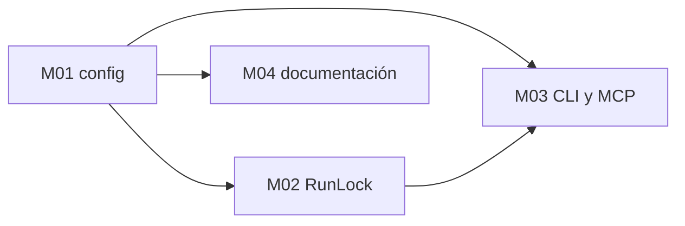

# Plan — Espera del lock de ejecución

- **Unidad:** `docs/changes/espera-del-lock.md` (el plan la completa).
- **Rama de la unidad:** `feature/espera-del-lock`, creada desde `develop`.
- **Archivos del plan:** reglas para subagentes en [`REGLAS.md`](REGLAS.md); fases, lotes, presupuesto y gates en [`INTEGRACION.md`](INTEGRACION.md); trazabilidad en [`TRAZABILIDAD.md`](TRAZABILIDAD.md); decisiones, riesgos y respuestas del dueño en [`DECISIONES.md`](DECISIONES.md); registro de ejecución en [`REGISTRO.md`](REGISTRO.md); evidencia en `evidence/M<NN>.md`; notas de relevo, propuestas y evidencia cruda en `work/`.

## Validación

- **Veredicto del plan:** listo (2026-11-24, 1 revisión)
- **Aprobación:** aprobado por Ariel Salazar Hinojosa (2026-11-24)
- **Veredicto de la implementación:** sin verificar (fecha —, revisiones —)

## Preguntas sin resolver

Ninguna.

## Leyenda

⚪ pendiente · 🟡 en progreso · 🟢 completado · 🔴 bloqueado

## Milestones

**Tabla: Milestones**

| Milestone | Estado | Depende de | ACs | Oleada | Lote | Unidad |
|---|---|---|---|---|---|---|
| [M01 — Sección `[lock]` de la configuración](M01-config-lock.md) | 🟢 | — | AC-80 (esquema) | 1 | 1 | contribuye |
| [M02 — Reintento en `RunLock`](M02-reintento-runlock.md) | 🟢 | M01 | AC-79 (pausas, `retries = 0`, `E_PERMISSION`) | 2 | 1 | contribuye |
| [M04 — Documentación](M04-documentacion.md) | 🟢 | M01 | — (documentos consumidores) | 2 | 1 | contribuye |
| [M03 — Comandos, `doctor`, ayuda y MCP](M03-cli-mcp.md) | 🟡 | M01, M02 | AC-79, AC-80 | 3 | 1 | la completa |

## Dependencias y oleadas

**Figura: Grafo de dependencias**

- **Oleada 1:** M01.
- **Oleada 2:** M02 y M04 en paralelo, cada uno en su worktree; sus alcances de escritura son disjuntos.
- **Oleada 3:** M03.

## Propiedad de archivos

- **M01:** `src/mailquery/config.py`, `tests/test_config.py`.
- **M02:** `src/mailquery/state.py`, `tests/test_state.py`.
- **M03:** `src/mailquery/cli.py`, `tests/test_cli.py`, `tests/test_mcp_server.py`.
- **M04:** `README.md`, `README.es.md`, `docs/config.example.toml`, `docs/INTERFACES.md`, `docs/security/threat-model.md`, `tests/test_integration.py`.
- **Cada milestone:** su brief y sus archivos de `work/`.
- **Orquestador (documentos compartidos):** los de la lista de `REGLAS.md`.

## Protocolo de lanzamiento

1. **Antes de lanzar.** Ningún milestone se lanza si el veredicto del plan no es listo, si hay preguntas sin resolver o si el plan no está aprobado. El orquestador comprueba que la fase 0 de `INTEGRACION.md` está 🟢 y que las dependencias están 🟢 e integradas en la rama del lote, crea o resetea el worktree del milestone al tip del lote y toma la línea base de la suite.
2. **Contexto.** El subagente recibe su brief, `REGLAS.md`, el commit base y la línea base de la suite; copia esos dos datos en su brief en su primer commit. Lee `CLAUDE.md`, `REGLAS.md` y su brief enteros, y después los rangos que el brief cita. No lee este plan ni la unidad entera.
3. **Entrega.** Commits en la rama del milestone, con `work/M<NN>-evidencia.md` (evidencia cruda), `work/M<NN>-propuestas.md` (cambios para documentos compartidos y transición de estado propuesta) y, si releva, `work/M<NN>-handoff.md`. El mensaje final es el índice que fija `CLAUDE.md`: cita las rutas y no pega esos archivos.
4. **Semáforos.** El subagente cambia los de las fases de su brief al empezar (🟡) y al terminar (🟢) cada fase, o 🔴 con el motivo. El orquestador cambia el del milestone en la tabla de milestones (🟡 al lanzar, 🟢 al cerrar su gate, 🔴 al bloquearse) y el de cada fase de `INTEGRACION.md` al abrirla y cerrarla.
5. **Cierre del milestone.** El orquestador verifica con los gates, `git diff --stat` y búsquedas dirigidas; escribe `evidence/M<NN>.md` a partir de la evidencia cruda; aplica las propuestas a los documentos compartidos; quita las marcas `[pendiente]` y `[por actualizar]` de `docs/tests/`; integra en el lote; sincroniza la tabla de milestones, `TRAZABILIDAD.md` y `REGISTRO.md`.
6. **Defectos y huecos.** Un defecto hallado tras el cierre devuelve el milestone a 🟡 y se anota en `REGISTRO.md`. Una contradicción o un hueco vuelve al orquestador antes de improvisar; la respuesta del dueño se anota en `DECISIONES.md` y en el brief.
7. **Relanzamientos.** Según `CLAUDE.md`; cada uno se anota en `REGISTRO.md`.
