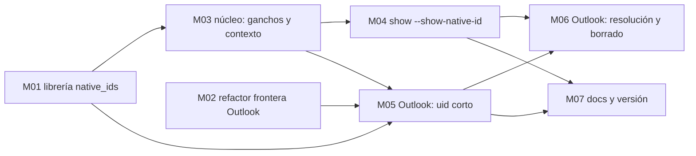

# Plan maestro: id corto de mensaje en Outlook

- **Unidad que completa:** `docs/changes/id-corto-outlook.md` (estado `aprobado`, paquete `3.0.0 (mayor)`, IDs RF-80…RF-83, ADR-50, AC-63…AC-70).
- **Commit base:** `384e5a8` (tip de `develop` al planificar). Línea base de la suite en [decisiones.md](decisiones.md), sección "Línea base".
- **Rama de la unidad:** `feature/id-corto-outlook`, en el worktree `../mailquery-id-corto-outlook`.
- **Archivos del plan:** reglas de los subagentes en [protocolo.md](protocolo.md); plantilla de milestone en [plantilla-milestone.md](plantilla-milestone.md); trazabilidad en [trazabilidad.md](trazabilidad.md); decisiones y respuestas del dueño en [decisiones.md](decisiones.md); riesgos en [riesgos.md](riesgos.md); registro de ejecución en [registro-ejecucion.md](registro-ejecucion.md); evidencia en `evidence/M<NN>.md` (la crea el orquestador al cerrar cada milestone).

## Leyenda de semáforos

Única leyenda del plan; todos los archivos la usan igual.

- ⚪ pendiente
- 🟡 en progreso
- 🟢 completado
- 🔴 bloqueado (siempre con su motivo al lado)

Quién actualiza cada indicador y cuándo:

- **Fases de un milestone** (en su archivo `M<NN>-*.md`): el subagente, en su rama, al empezar (🟡) y al terminar (🟢) cada fase, o 🔴 con motivo al devolver una contradicción.
- **Registro de progreso de un milestone:** el subagente, con fecha, al terminar cada fase y al hacer handoff.
- **Tabla de milestones, fases del plan, tabla de lotes y matriz de trazabilidad:** solo el orquestador, al lanzar un milestone (🟡), al cerrarlo (🟢), al bloquearlo (🔴) y al cerrar cada lote y cada fase.
- **Registro de ejecución:** solo el orquestador, al cerrar cada milestone y cada lote, y en cada relanzamiento o defecto posterior al cierre.
- **Unidad de cambio** (tabla de conciliación, documentos consumidores): solo el orquestador, al cerrar el milestone que completa cada fila (mapa en [trazabilidad.md](trazabilidad.md)).

## Fases del plan

**Tabla: Fases del plan maestro**

| Fase | Contenido | Puerta de salida | Estado |
|---|---|---|---|
| F0 Preparación | Pasos de "Preparación (F0)" | Rama de la unidad en el tip de `develop`, desviación H-03 aplicada a la unidad, venv y línea base registrados, definiciones `[pendiente]` en `docs/tests/` | 🟢 |
| F1 Cimientos y refactor (lote 1) | M01, M02, M03 | Cierre del lote 1 | ⚪ |
| F2 Implementación (lote 2) | M04, M05, M06 | Cierre de milestone de los tres | ⚪ |
| F3 Documentación y versión (lote 2) | M07 | Cierre de milestone de M07 | ⚪ |
| F4 Integración | Pasos de "Integración (F4)" | Unidad `implementado` en la rama de la unidad y matriz completa verde en el PR | ⚪ |
| F5 Cierre | Pasos de "Cierre (F5)" | Evidencia completa y revisión del dueño | ⚪ |

## Milestones

**Tabla: Milestones**

| ID | Milestone | Estado | Depende de | Oleada | Lote | ACs | Archivo |
|---|---|---|---|---|---|---|---|
| M01 | Librería `native_ids.py` | 🟡 | — | 1 | 1 | AC-64, AC-69, AC-70 (librería) | [M01-libreria-native-ids.md](M01-libreria-native-ids.md) |
| M02 | Refactor: frontera uid ↔ `EntryID` en el driver `outlook` | 🟡 | — | 1 | 1 | — (refactor sin cambio de comportamiento) | [M02-refactor-frontera-outlook.md](M02-refactor-frontera-outlook.md) |
| M03 | Núcleo: ganchos opcionales, aviso de impresos y contexto de plugin | ⚪ | M01 | 2 | 1 | AC-65, AC-68 (validación de la forma nativa), AC-69, AC-70 (núcleo) | [M03-nucleo-ganchos-contexto.md](M03-nucleo-ganchos-contexto.md) |
| M04 | `show --show-native-id` en el núcleo | ⚪ | M03 | 3 | 2 | AC-68, AC-70 (núcleo y plugin) | [M04-show-native-id.md](M04-show-native-id.md) |
| M05 | Outlook: uid corto, asignación, registro y validación | ⚪ | M01, M02, M03 | 3 | 2 | AC-63, AC-65, AC-67, AC-69 (Outlook) | [M05-outlook-uid-corto.md](M05-outlook-uid-corto.md) |
| M06 | Outlook: resolución, ausente confirmado, colisiones y `--show-native-id` | ⚪ | M04, M05 | 4 | 2 | AC-63 (SMOKE), AC-64, AC-66, AC-68, AC-69 (Outlook) | [M06-outlook-resolucion-borrado.md](M06-outlook-resolucion-borrado.md) |
| M07 | Documentación consumidora y versión `3.0.0a2` | ⚪ | M04, M05 | 4 | 2 | AC-68 (README, RF-73); CL-05, CL-06, CL-11 (documentos y versión) | [M07-docs-version.md](M07-docs-version.md) |

Todos los milestones contribuyen a la unidad `id-corto-outlook`; ninguno la completa solo. La unidad pasa a `implementado` en F5.

## Grafo de dependencias y oleadas

**Figura: Dependencias entre milestones**

**Tabla: Oleadas de ejecución**

| Oleada | Milestones en paralelo | Por qué pueden ir juntos |
|---|---|---|
| 1 | M01 ∥ M02 | Sin dependencias; M01 solo crea archivos nuevos y M02 solo toca el driver `outlook` y su test |
| 2 | M03 | Depende de M01; toca los módulos centrales del núcleo |
| 3 | M04 ∥ M05 | M04 toca `cli.py`, `search.py` y un test nuevo; M05 toca el driver `outlook` y los tests que usan el doble de Outlook |
| 4 | M06 ∥ M07 | M06 toca el driver `outlook` y sus tests; M07 toca documentos, versión, goldens de `doctor` y tests DOC/PKG |

La oleada 3 empieza cuando el lote 1 está integrado (M04 y M05 son del lote 2).

## Propiedad de archivos

Ningún archivo es de dos milestones de la misma oleada. Los documentos compartidos (lista en [protocolo.md](protocolo.md)) son solo del orquestador.

**Tabla: Propiedad de archivos por milestone**

| Milestone | Archivos que crea o modifica |
|---|---|
| M01 | `src/mailquery/native_ids.py` (nuevo), `tests/test_native_ids.py` (nuevo) |
| M02 | `src/mailquery/backends/outlook.py`, `tests/test_outlook.py` |
| M03 | `src/mailquery/plugins/api.py`, `src/mailquery/plugins/__init__.py`, `src/mailquery/search.py`, `src/mailquery/cli.py`, `src/mailquery/backends/base.py`, `tests/fakes/plugin.py`, `tests/test_plugins.py`, `tests/test_multidriver.py`, `tests/test_cli.py` |
| M04 | `src/mailquery/cli.py`, `src/mailquery/search.py`, `tests/test_show_native_id.py` (nuevo) |
| M05 | `src/mailquery/backends/outlook.py`, `tests/fakes/outlook.py`, `tests/fakes/run_cli.py`, `tests/test_outlook.py`, `tests/test_uid.py`, `tests/test_backends.py`, `tests/test_cli.py`, `tests/test_integration.py`, `tests/test_body_sources.py`, `tests/test_content_wiring.py`, `tests/test_doctor.py`, `tests/test_fields.py`, `tests/test_group_count.py`, `tests/test_mailboxes.py`, `tests/test_search.py`, `tests/test_readonly.py`, `tests/fixtures/expected/outlook/*.json` salvo `outlook/doctor.json` |
| M06 | `src/mailquery/backends/outlook.py`, `tests/fakes/outlook.py`, `tests/fakes/run_cli.py`, `tests/test_outlook.py`, `tests/test_smoke.py`, `tests/fixtures/expected/outlook/attachment_*.json` |
| M07 | `README.md`, `README.es.md`, `skills/mailquery/SKILL.md`, `docs/INTERFACES.md`, `docs/recipes/*.md`, `docs/security/threat-model.md`, `pyproject.toml`, `src/mailquery/__init__.py`, `tests/test_packaging.py`, `tests/test_integration.py`, `tests/test_install_scripts.py`, `tests/fixtures/expected/doctor.json`, `tests/fixtures/expected/outlook/doctor.json`; solo para tests DOC existentes que cambien: `tests/test_content_wiring.py`, `tests/test_fields.py`, `tests/test_group_count.py`, `tests/test_doctor.py`, `tests/test_mailboxes.py`, `tests/test_remote_attachments.py` |

Además, cada milestone escribe su propio archivo `M<NN>-*.md` (fases y registro de progreso) y sus archivos de trabajo `docs/plan/id-corto-outlook/work/M<NN>-handoff.md` y `docs/plan/id-corto-outlook/work/M<NN>-propuestas.md`.

Comprobación por oleada: en la 1, M01 y M02 no comparten archivos; en la 3, M04 (`cli.py`, `search.py`, `tests/test_show_native_id.py`) y M05 (driver y tests del doble de Outlook) tampoco; en la 4, M06 y M07 tampoco (`tests/test_integration.py`, `tests/test_content_wiring.py`, `tests/test_fields.py`, `tests/test_group_count.py`, `tests/test_doctor.py`, `tests/test_mailboxes.py`, `tests/test_remote_attachments.py` y los goldens de `doctor` son de M07 en esa oleada; seis de esos tests eran de M05 en la anterior).

## Preparación (F0)

La hace el orquestador, en este orden. Nada de F0 lo hace un subagente.

1. Comprueba que el plan está en `develop` (commit del plan por orden del dueño) y que la unidad sigue `aprobado` con los mismos IDs.
2. Rama de la unidad: la rama `feature/id-corto-outlook` ya existe, integrada en `develop` y con su worktree en `../mailquery-id-corto-outlook`. En ese worktree, `git merge --ff-only develop` la deja en el tip de `develop` (decisión D-01). Si el avance rápido no es posible, se detiene y lo consulta al dueño.
3. Aplica a la unidad la desviación aprobada H-03 (condición "Garantía" de RF-81 y entrada en "Desviaciones aprobadas"), corre `-k doc_15` y hace commit en la rama de la unidad: `docs(changes): record the approved deviation of id-corto-outlook`.
4. Crea el directorio de logs `../mailquery-logs/id-corto-outlook/` y el venv `../mailquery-venv-id-corto/` con `css-inline~=0.23.1` y `coverage~=7.17` (decisión D-02).
5. Corre la suite completa con el venv en el tip de la rama de la unidad y anota en [decisiones.md](decisiones.md) ("Línea base") el commit, el conteo, los fallos y los saltos. Esos fallos y saltos son los conocidos que citan los milestones.
6. Escribe en `docs/tests/` las definiciones de los grupos y casos de la sección "Tests" de cada milestone, con la marca `[pendiente]`, y marca `[por actualizar]` los casos existentes que la sección "Tests que cambian" de cada milestone nombra; añade el prefijo `UT-NID` (archivo nuevo `docs/tests/native-ids.md`) y el prefijo `UT-SNI` (en `docs/tests/cli-config.md`) a la tabla de prefijos de `TEST-CATALOG.md`; añade AC-63…AC-70 a `acceptance-matrix.md`. Commit en la rama de la unidad: `docs(tests): define the cases of id-corto-outlook`.
7. Dónde escribe el orquestador: F0 hace sus commits en la rama de la unidad. Mientras un lote está abierto, el worktree de integración tiene la rama del lote y el orquestador hace ahí sus commits (evidencia, plan, marcas de `docs/tests/`, documentos consumidores en la unidad); al cerrar el lote vuelve a la rama de la unidad e integra el lote. Sus commits en la rama del lote solo tocan archivos que ningún milestone abierto tiene en su alcance.

## Protocolo de lanzamiento de un milestone

1. **Cuándo.** Un milestone se lanza cuando sus dependencias están 🟢 e integradas en la rama de su lote, y su lote está abierto.
2. **Rama y worktree.** El orquestador crea `feature/id-corto-outlook-m<NN>` desde el tip de la rama del lote y la pone en un worktree reutilizable (`../mailquery-wt-a` o `../mailquery-wt-b`), reseteado a ese tip. Un relanzamiento usa el mismo worktree y la misma rama. El commit base del milestone es ese tip (D-20).
3. **Contexto que recibe el subagente.** Exactamente: la ruta de [protocolo.md](protocolo.md), la ruta de su archivo `M<NN>-*.md` (que hace de brief), el worktree y la rama, el commit base y la línea base de la suite (que el subagente copia en la cabecera de su archivo), el directorio de logs `../mailquery-logs/id-corto-outlook/M<NN>/` y, en un relanzamiento, la ruta de su `docs/plan/id-corto-outlook/work/M<NN>-handoff.md`. Lee `CLAUDE.md` (si el harness no lo cargó), `protocolo.md` y su archivo de milestone enteros, y después solo los rangos que su archivo cita.
4. **Qué entrega.** Commits en su rama; las fases de su archivo de milestone con sus semáforos y su registro de progreso; `docs/plan/id-corto-outlook/work/M<NN>-propuestas.md` si propone cambios a documentos compartidos; `docs/plan/id-corto-outlook/work/M<NN>-handoff.md` si hace handoff; los datos crudos de evidencia en `../mailquery-logs/id-corto-outlook/M<NN>/evidencia-cruda.md` (fuera del repositorio); y un mensaje final con el formato de [protocolo.md](protocolo.md), con la transición de estado que propone (por ejemplo `M05: 🟡 → 🟢`).
5. **Cómo reporta el estado.** El subagente solo cambia los semáforos de sus fases. La transición del milestone es una propuesta; la aplica el orquestador.
6. **Verificación del orquestador.** Corre los gates del milestone en el worktree, revisa `git diff --stat` y `git diff --check` contra la base del lote, comprueba que el diff está dentro del alcance de escritura y hace búsquedas dirigidas de lo que el milestone debía cambiar.
7. **Cierre del milestone.** Con la puerta de cierre cumplida: integra la rama del milestone en la rama del lote con `git merge --no-ff`, escribe `evidence/M<NN>.md` a partir de los datos crudos, aplica las propuestas aceptadas, actualiza la tabla de milestones, la matriz de trazabilidad, las marcas de `docs/tests/`, las filas de la unidad que el milestone completa y el registro de ejecución, y borra la rama del milestone.
8. **Relanzamientos.** Los cuenta y los anota en el registro de ejecución, con los topes `relaunch-split` y `relaunch-stop` de `CLAUDE.md`.

## Protocolo de implementación por lotes

Las oleadas deciden el orden y el paralelismo; los lotes deciden cómo se integra el trabajo.

**Tabla: Lotes de integración**

| Lote | Milestones | Rama de integración | Corridas de la matriz previstas | Estado |
|---|---|---|---|---|
| 1 | M01, M02, M03 | `feature/id-corto-outlook-lote-1` | 1 (+1 de contingencia) | 🟡 |
| 2 | M04, M05, M06, M07 | `feature/id-corto-outlook-lote-2` | 1 (+1 de contingencia) | ⚪ |

### Presupuesto de integración

- **PRs:** 1, de `feature/id-corto-outlook` a `develop`. Se abre al cerrar el lote 1 y se actualiza al cerrar el lote 2.
- **Una corrida de la matriz** son 15 jobs: 12 de `test suite` (3 sistemas × Python 3.11–3.14) y 3 de `install scripts`.
- **Corridas previstas en el PR antes de conciliar:** 2 (una por lote), 30 jobs; con las contingencias, 4 (60 jobs). El commit que pasa la unidad a `implementado` va en el mismo empuje del lote 2 (F4), sin corrida propia.
- **Después:** 1 corrida en el PR con el commit de conciliación, si el dueño la ordena, y 1 en `develop` al mergear (el workflow corre en cada push a `develop`). Total previsto: 4 corridas, 60 jobs; máximo con contingencias: 6 corridas, 90 jobs.
- **Escenario de un PR por milestone:** 7 PRs, cada uno con al menos 1 corrida en el PR y 1 en `develop` tras su merge: 14 corridas, 210 jobs como mínimo, sin contar correcciones ni la conciliación. El plan ahorra al menos 10 corridas (150 jobs).

### Reglas de integración, CI y evidencia

1. **Ramas.** `feature/id-corto-outlook` sale de `develop` (F0, paso 2). Cada lote tiene su rama, creada desde el tip de la rama de la unidad cuando el lote anterior ya está integrado en ella. Cada milestone sale del tip de la rama de su lote, nunca de `develop`.
2. **Worktrees.** Uno reutilizable por milestone activo: `../mailquery-wt-a` y `../mailquery-wt-b`, cada uno reseteado al tip del lote al lanzar. No se crea un worktree por intento. La integración se hace en `../mailquery-id-corto-outlook`. Dos milestones de una misma oleada usan worktrees distintos y alcances disjuntos; con un solape de archivos irían en secuencia (ninguna oleada de este plan lo tiene).
3. **Integración por milestone.** Con el gate local verde, el orquestador integra el milestone en la rama del lote con `--no-ff`, sin PR y sin esperar CI. No se cierra un milestone con la suite local roja, con documentación pendiente de su alcance o sin `evidence/M<NN>.md`.
4. **PR único.** Al cerrar un lote: la rama del lote se integra en la rama de la unidad con `--no-ff` y se empuja `feature/id-corto-outlook`. No hay PR de corrección: un fallo se corrige en la rama de la unidad (o en una rama de corrección del lote integrada en ella) y se vuelve a empujar al mismo PR. El PR no se mergea hasta que la matriz completa está verde y el dueño lo ordena.
5. **CI solo en el PR.** `.github/workflows/tests.yml` ya corre solo en `pull_request` a `develop` y en `push` a `develop`, con `concurrency: cancel-in-progress` y `timeout-minutes` de 20 (suite) y 15 (instaladores); la suite local tarda unos 4 minutos. No hace falta cambiar el workflow. Las ramas de lote y de milestone no se empujan al remoto, y nunca se abre un PR desde ellas.
6. **Evidencia por milestone.** `evidence/M<NN>.md`, escrita por el orquestador a partir de `evidencia-cruda.md`, con: (a) comandos y conteo final de la suite completa con el commit; (b) grupos del milestone ejecutados solos; (c) goldens creados o actualizados y su justificación; (d) tests nuevos y ACs cubiertos con sus IDs; (e) `git diff --check` y `git diff --stat` contra la base del lote; (f) riesgos, deuda aceptada, decisiones HITL y pendientes.
7. **Gates.**
   - Cierre de milestone: suite local sin fallos nuevos frente a la línea base; casos del milestone verdes ejecutados solos; evidencia escrita; semáforos del milestone, del plan maestro y filas de la unidad actualizados y coincidentes.
   - Cierre de lote: matriz completa verde en el PR; diff acumulado del lote dentro de la unión de los alcances de sus milestones; integración `--no-ff` en la rama de la unidad; URL del run anotada en el registro de ejecución.
   - Cierre de fase: todos los ACs de la fase con evidencia; documentación sin referencias obsoletas en el alcance de la fase; gates de solo lectura (`tests/test_readonly.py`, OL-30) y SMOKE del host verdes o saltados con motivo; tabla de conciliación de la unidad actualizada.
8. **Estado y trazabilidad.** Solo el orquestador escribe en el plan maestro, en los archivos que lo acompañan, en `docs/tests/` y en la unidad. El subagente actualiza las fases de su archivo de milestone y entrega la transición propuesta; el orquestador sincroniza el resto al cerrar cada milestone y cada lote.
9. **Restricciones.** Sin tags, sin release y sin merge a `main` salvo orden explícita del dueño. La versión del paquete solo cambia como dice la unidad (`3.0.0a2` en M07). Un defecto hallado después de cerrar un milestone lo devuelve a 🟡 y se anota en el registro de ejecución. Una contradicción o un hueco se devuelve al orquestador antes de improvisar; la respuesta del dueño se anota en [decisiones.md](decisiones.md).

## Integración (F4)

1. Al cerrar M06, el orquestador revisa en `docs/INTERFACES.md` y en los README los pasajes de M07 que describen la ausencia confirmada, la resolución y los adjuntos (RC-15, RC-23, RC-34, RC-38) contra lo que M06 implementó, y los corrige en la rama del lote si difieren.
2. Con los cuatro milestones del lote 2 cerrados, integra la rama del lote en la rama de la unidad con `--no-ff` e integra `develop` si avanzó (R-10).
3. En la rama de la unidad, antes de empujar: pasa a `implementado` todas las filas de la tabla de conciliación (comprobando cada una con el mapa de `trazabilidad.md`), los documentos consumidores que falten, las marcas de `docs/tests/` y la unidad a `implementado`; comprueba que no queda `[pendiente]` ni `[por actualizar]` de los grupos del plan; corre la suite completa con `doc_14` y `doc_15`; commit `docs(changes): mark id-corto-outlook as implemented`.
4. Empuja la rama de la unidad (una sola corrida de la matriz) y anota la URL del run en el registro de ejecución. Si falla, corrige en la rama de la unidad y vuelve a empujar.

## Cierre (F5)

1. Comprueba que la matriz de F4 está verde, que cada AC tiene evidencia en la matriz de trazabilidad y que las búsquedas de CL-06 y CL-11 no encuentran textos obsoletos fuera del PRD.
2. Pide la revisión del dueño. La conciliación con el PRD (`docs(prd): reconcile id-corto-outlook`), el merge del PR y el borrado del plan se hacen solo por orden del dueño (decisión D-09).
