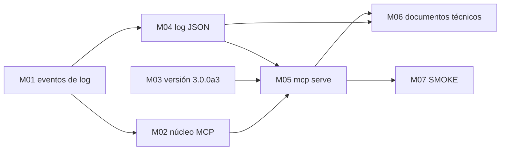

# Plan servidor-mcp — plan maestro

- **Unidad que implementa:** `docs/changes/servidor-mcp.md` (Servidor MCP por stdio). Ningún milestone la completa solo: la fase F5 la pasa a `implementado` cuando los siete milestones están en 🟢.
- **Base:** `develop` en `f868036`. **Rama de la unidad:** `feature/servidor-mcp`, creada desde `develop`.
- **Archivos del plan:** este plan maestro; [PROTOCOLO-PLAN.md](PROTOCOLO-PLAN.md) (reglas de los subagentes); [DECISIONES.md](DECISIONES.md) (decisiones del plan, decisiones abiertas y respuestas del dueño); [RIESGOS.md](RIESGOS.md); [TRAZABILIDAD.md](TRAZABILIDAD.md); [REGISTRO.md](REGISTRO.md) (registro de ejecución); [DEFINICIONES-TESTS.md](DEFINICIONES-TESTS.md) (casos que F0 copia a `docs/tests/`); [PLANTILLA-MILESTONE.md](PLANTILLA-MILESTONE.md) (copia adaptada de la plantilla de milestone, base de cada archivo de milestone); un archivo por milestone (`M01-…` a `M07-…`); `evidence/M<NN>.md` (lo escribe el orquestador al cerrar cada milestone); `work/M<NN>-handoff.md` y `work/M<NN>-propuestas.md` (los escribe el subagente).

## 1. Semáforos

**Tabla: Leyenda de semáforos**

| Indicador | Significado |
|---|---|
| ⚪ | Pendiente |
| 🟡 | En progreso |
| 🟢 | Completado |
| 🔴 | Bloqueado (la celda o el registro dicen el motivo) |

Esta leyenda vale para todos los archivos del plan.

**Tabla: Quién actualiza cada semáforo y cuándo**

| Semáforo | Quién | Cuándo |
|---|---|---|
| Fases de un milestone (su archivo) | El subagente del milestone | Al empezar una fase (🟡) y al terminarla con sus tests verdes (🟢); 🔴 si se detiene por una contradicción o un hueco, con el motivo en su registro de progreso |
| Estado de un milestone (tabla 3) | El orquestador | 🟡 al lanzarlo; 🟢 al cerrarlo con el gate de cierre de milestone; 🔴 si queda bloqueado; vuelve a 🟡 si aparece un defecto después del cierre |
| Fases del plan (tabla 2) | El orquestador | Al cerrar cada milestone o lote que la hace avanzar |
| Matriz de trazabilidad | El orquestador | Al cerrar cada milestone (tests y estado) y cada lote (columna CI) |
| Registro de ejecución | El orquestador | Al lanzar, cerrar o bloquear un milestone y al cerrar cada lote |

## 2. Fases del plan

**Tabla: Fases del plan maestro**

| Fase | Contenido | Milestones | Estado |
|---|---|---|---|
| F0 Preparación | Unidad aprobada y con IDs reales, y plan con esos IDs (hecho el 2026-11-23); commit de la unidad aprobada en `develop`; rama de la unidad; definiciones `[pendiente]` y marcas `[por actualizar]` en `docs/tests/` (de [DEFINICIONES-TESTS.md](DEFINICIONES-TESTS.md)); consumidores `docs/tests/attachments-command.md` y `docs/tests/infrastructure.md` añadidos a la unidad (DP-14); worktrees en `.worktrees/servidor-mcp-*`, cada uno con su `.venv` (PROTOCOLO-PLAN.md, sección 1); línea base de la suite, medida con ese `.venv`, en el commit de partida | — (orquestador) | 🟢 |
| F1 Refactor | Eventos de log estructurados sin cambiar el log de texto | M01 | 🟢 |
| F2 Implementación | Núcleo del servidor, pre-release `3.0.0a3`, log JSON y comando `mcp serve` | M02, M03, M04, M05 | 🟢 |
| F3 Documentación | Documentos técnicos y barrido de textos obsoletos (CL-06, CL-11) | M06 | 🟢 |
| F4 Integración y verificación real | Cierre del lote 1 y del lote 2 con la matriz de CI verde en el PR; ejecución de SMOKE-MCP por el dueño en macOS y Windows y verificación manual con Claude Code (CL-10, DA-03) | M07, lotes 1 y 2 | 🟡 (tests y lotes hechos; la ejecución del dueño queda pendiente) |
| F5 Cierre | Todos los AC con evidencia; documentos consumidores `actualizado` o `sin cambio`; filas de conciliación `implementado`; unidad `implementado`; PR listo para la conciliación que ordene el dueño (DA-02). La conciliación con el PRD y la unidad se difiere por orden del dueño a una tarea posterior | — (orquestador) | 🟡 (verificación hecha; conciliación diferida) |

## 3. Milestones

**Tabla: Milestones del plan**

| ID | Milestone | Oleada | Lote | Depende de | ACs | Archivo | Estado |
|---|---|---|---|---|---|---|---|
| M01 | Eventos de log estructurados (refactor) | 1 | 1 | — | — (prepara AC-77) | [M01-eventos-log.md](M01-eventos-log.md) | 🟢 |
| M02 | Núcleo del servidor MCP | 2 | 1 | M01 | AC-71, AC-72 (ejecutor sustituido), AC-73, AC-74 (en proceso), AC-76 (imports y dependencias) | [M02-nucleo-mcp.md](M02-nucleo-mcp.md) | 🟢 |
| M03 | Pre-release `3.0.0a3` | 1 | 1 | — | — (CL-11) | [M03-version.md](M03-version.md) | 🟢 |
| M04 | Log en JSON | 2 | 1 | M01 | AC-77, AC-75 (línea de logs de la ayuda raíz) | [M04-log-json.md](M04-log-json.md) | 🟢 |
| M05 | Comando `mcp serve`, ayuda, README y skill | 3 | 2 | M02, M03, M04 | AC-72 (ejecutor real), AC-74 (proceso real), AC-75, AC-76 (plugin), AC-78, AC-71 (fin de línea del proceso real en Windows) | [M05-mcp-serve.md](M05-mcp-serve.md) | 🟢 |
| M06 | Documentos técnicos | 4 | 2 | M04, M05 | — (CL-05, CL-06) | [M06-documentos-tecnicos.md](M06-documentos-tecnicos.md) | 🟢 |
| M07 | SMOKE del servidor MCP con el cliente real | 4 | 2 | M05 | — (CL-10) | [M07-smoke.md](M07-smoke.md) | 🟢 |

## 4. Dependencias y oleadas

**Figura: Grafo de dependencias de los milestones**

**Tabla: Oleadas de ejecución**

| Oleada | Milestones en paralelo | Lote | Condición de inicio |
|---|---|---|---|
| 1 | M01 ∥ M03 | 1 | F0 en 🟢 |
| 2 | M02 ∥ M04 | 1 | M01 y M03 integrados en `feature/servidor-mcp-lote-1` (oleada 1 cerrada) |
| 3 | M05 | 2 | Lote 1 integrado en `feature/servidor-mcp`; `feature/servidor-mcp-lote-2` creada |
| 4 | M06 ∥ M07 | 2 | M05 integrado en `feature/servidor-mcp-lote-2` |

## 5. Propiedad de archivos

Ningún archivo pertenece a dos milestones de la misma oleada. Entre oleadas distintas, un archivo puede cambiar de dueño; el milestone posterior parte del tip del lote, que ya contiene el trabajo anterior.

**Tabla: Archivos por milestone**

| Milestone | Oleada | Archivos que crea o modifica |
|---|---|---|
| M01 | 1 | `src/mailquery/logging_setup.py`, `src/mailquery/cli.py`, `src/mailquery/store.py`, `src/mailquery/accounts.py`, `src/mailquery/backends/outlook_com.py`, `tests/test_logging.py` |
| M03 | 1 | `pyproject.toml`, `src/mailquery/__init__.py`, `tests/fixtures/expected/doctor.json`, `tests/fixtures/expected/outlook/doctor.json`, `tests/test_packaging.py`, `tests/test_integration.py`, `tests/test_install_scripts.py` (comentarios de la versión), `README.md`, `README.es.md`, `docs/INTERFACES.md`, `docs/ROADMAP.md`, `docs/security/threat-model.md` (solo las menciones de la versión) |
| M02 | 2 | `src/mailquery/mcp_server.py` (nuevo), `tests/test_mcp_server.py` (nuevo) |
| M04 | 2 | `src/mailquery/logging_setup.py`, `src/mailquery/config.py`, `src/mailquery/cli.py`, `src/mailquery/backends/outlook_com.py`, `tests/test_logging.py`, `tests/test_config.py`, `tests/test_cli.py`, `tests/test_outlook.py`, `tests/test_packaging.py`, `tests/test_integration.py`, `docs/config.example.toml`, `README.md`, `README.es.md` |
| M05 | 3 | `src/mailquery/cli.py`, `src/mailquery/mcp_server.py`, `src/mailquery/logging_setup.py`, `tests/test_mcp_server.py`, `tests/test_cli.py`, `tests/test_integration.py`, `tests/test_packaging.py`, `README.md`, `README.es.md`, `skills/mailquery/SKILL.md`, `skills/README.md` |
| M06 | 4 | `docs/INTERFACES.md`, `docs/security/threat-model.md`, `docs/ROADMAP.md`, `docs/recipes/01-new-mail-digest.md`, `docs/recipes/02-search-invoices.md` |
| M07 | 4 | `tests/test_smoke.py` |

Además, cada milestone escribe su propio archivo `M<NN>-….md` (fases y registro de progreso) y `work/M<NN>-handoff.md` y `work/M<NN>-propuestas.md`. Los documentos compartidos de la sección 3 de [PROTOCOLO-PLAN.md](PROTOCOLO-PLAN.md) solo los escribe el orquestador.

## 6. Protocolo de implementación por lotes

Las oleadas deciden el orden y el paralelismo de la ejecución; los lotes deciden cómo se integra el trabajo.

**Tabla: Lotes de integración**

| Lote | Milestones | Rama de integración | Corridas de CI previstas |
|---|---|---|---|
| 1 | M01, M03, M02, M04 (+ M05, integrado al adelantar la ola 3) | `feature/servidor-mcp-lote-1` | 1 (al cerrar: se abre el PR) + 1 de reserva |
| 2 | M06, M07 | `feature/servidor-mcp-lote-2` | 1 (al cerrar: se actualiza el PR) + 1 de reserva |

1. **Lotes.** `feature/servidor-mcp` se crea desde `develop` en F0. Cada lote tiene una rama de integración creada desde el tip de `feature/servidor-mcp` y se integra en ella con `git merge --no-ff` al cerrarse. El lote 2 no se abre hasta que el lote 1 está integrado.
2. **Ramas y worktrees.** Cada milestone crea `feature/servidor-mcp-m<NN>` desde el tip de la rama de su lote, nunca desde `develop`. Hay dos worktrees reutilizables fuera del repositorio, `<padre del repositorio principal>/mailquery-wt/servidor-mcp-a` y `…/servidor-mcp-b`, uno por milestone activo, cada uno con su `.venv`; en el primer lanzamiento de un milestone, su worktree se resetea al tip del lote (comandos en [PROTOCOLO-PLAN.md](PROTOCOLO-PLAN.md)). No se crea un worktree por intento: un relanzamiento usa el mismo worktree y la misma rama, sin resetearlos. Los milestones de una misma oleada tienen alcances de escritura disjuntos (sección 5); si un solape aparece, se ejecutan en secuencia.
3. **Integración por milestone.** Con el gate local del milestone verde, el orquestador integra su rama en la rama del lote con `--no-ff`, sin PR por milestone y sin esperar CI. No se cierra un milestone con la suite local roja, con documentación pendiente de su alcance o sin `evidence/M<NN>.md`.
4. **PR único.** Un solo PR de `feature/servidor-mcp` a `develop`, abierto al cerrar el lote 1 y actualizado al cerrar el lote 2. No hay PR de corrección: un fallo se corrige en la rama del lote (o en `feature/servidor-mcp` si el lote ya se integró) y se vuelve a empujar al mismo PR. El PR no se mergea hasta que la matriz completa está verde, la unidad está `conciliado` (DA-02) y el dueño lo ordena.
5. **CI solo en el PR.** `.github/workflows/tests.yml` ya cumple lo que el plan necesita y no cambia (DP-16): se dispara en `pull_request` a `develop` y en `push` a `develop`, nunca por un push a ramas de milestone o de lote; tiene `concurrency` con `cancel-in-progress: true`; `timeout-minutes` es 20 en `test-suite` y 15 en `install-scripts`. Cada corrida tiene 15 jobs: 12 de `test-suite` (3 sistemas × Python 3.11–3.14) y 3 de `install-scripts`.
6. **Evidencia por milestone.** El orquestador escribe `evidence/M<NN>.md` con los datos crudos que entrega el subagente (sección "Evidencia cruda" de [PROTOCOLO-PLAN.md](PROTOCOLO-PLAN.md)): (a) comandos y conteo final de la suite completa con el commit; (b) grupos del milestone ejecutados solos; (c) goldens creados o actualizados y su justificación; (d) tests nuevos y AC cubiertos con sus IDs; (e) `git diff --check` y `git diff --stat` contra la base del lote; (f) riesgos, deuda aceptada, decisiones HITL y pendientes. La evidencia y los commits del milestone sustituyen al PR y al CI por milestone.
7. **Gates.** Ver sección 8.
8. **Estado y trazabilidad.** Solo el orquestador escribe en este plan maestro, en los archivos auxiliares compartidos, en `docs/tests/` y en la unidad. El subagente actualiza los semáforos de las fases de su propio archivo de milestone y propone la transición de estado del milestone en su mensaje final; el orquestador sincroniza la tabla 3, la matriz de trazabilidad y el registro de ejecución al cerrar cada milestone y cada lote.
9. **Restricciones.** Sin tags, sin release y sin merge a `main` salvo orden explícita del dueño. La versión del paquete solo cambia como dice la unidad (M03: `3.0.0a2` → `3.0.0a3`). Un defecto encontrado después de cerrar un milestone lo devuelve a 🟡 y se anota en el registro de ejecución. Una contradicción o un hueco se devuelven al orquestador antes de improvisar; la respuesta del dueño se anota en [DECISIONES.md](DECISIONES.md).

**Tabla: Presupuesto de integración**

| Escenario | PRs | Corridas de la matriz previstas | Jobs previstos | Con una corrección por PR o lote |
|---|---|---|---|---|
| Este plan (PR único, 2 lotes) | 1 | 2 en el PR + 1 tras el commit de conciliación + 1 en `develop` tras el merge = 4 | 60 | 6 corridas, 90 jobs |
| Un PR por milestone | 7 | 7 en los PR + 7 en `develop` tras cada merge = 14 | 210 | 21 corridas, 315 jobs |

La corrida del commit de conciliación y la de `develop` tras el merge ocurren fuera de los milestones, pero se cuentan porque las dispara este cambio.

## 7. Protocolo de lanzamiento de un milestone

1. **Antes de lanzar.** La oleada del milestone está abierta (tabla de oleadas), sus dependencias están 🟢 e integradas en la rama del lote y las definiciones de sus tests están en `docs/tests/` con `[pendiente]` o `[por actualizar]`. Solo en el primer lanzamiento, el orquestador resetea el worktree asignado al tip del lote y crea la rama del milestone (en un relanzamiento no se resetea nada: sección 1 de [PROTOCOLO-PLAN.md](PROTOCOLO-PLAN.md)); en todo lanzamiento y anota en el archivo del milestone el commit base y la línea base de la suite (conteo, fallos y saltos conocidos) medida en ese commit.
2. **Qué recibe el subagente.** Solo dos archivos: su archivo de milestone y [PROTOCOLO-PLAN.md](PROTOCOLO-PLAN.md), más la ruta del worktree, la rama, el commit base, la línea base y su directorio de logs. Lee `CLAUDE.md` si el harness no lo cargó, esos dos archivos enteros y después solo los rangos que cita su archivo.
3. **Qué entrega.** Commits en su rama; las fases de su archivo con semáforo; `work/M<NN>-propuestas.md` con los cambios de marca de `docs/tests/` y las filas de la unidad que propone; `work/M<NN>-handoff.md` si hace handoff; los datos crudos de evidencia en `<logs>/M<NN>/evidencia-cruda.md`, fuera del repositorio; y un mensaje final con el índice de [PROTOCOLO-PLAN.md](PROTOCOLO-PLAN.md).
4. **Cómo reporta.** El mensaje final propone el estado (🟢 o 🔴 con motivo), el rango y número de commits, los conteos de la suite, la cobertura de los módulos tocados y las rutas de sus archivos.
5. **Qué hace el orquestador al recibirlo.** Verifica con los gates, `git diff --stat` contra la base del lote y búsquedas puntuales; aplica las propuestas a `docs/tests/` y a la unidad; escribe `evidence/M<NN>.md`; integra con `--no-ff`; actualiza la tabla 3, la tabla 2, la matriz y el registro. Un handoff o un fallo se trata con las reglas de relanzamiento de `CLAUDE.md` (límites `relaunch-split` y `relaunch-stop`), y cada relanzamiento se anota en el registro.

## 8. Gates

- **Cierre de milestone.** Suite local completa sin fallos nuevos frente a la línea base; los grupos del milestone verdes ejecutados solos; `git diff --check` limpio; el diff dentro de su alcance de escritura; su documentación hecha; `evidence/M<NN>.md` escrito; semáforos del milestone, tabla 3, matriz, filas de conciliación y documentos consumidores de la unidad actualizados y coherentes entre sí.
- **Cierre de lote.** En este orden: todos los milestones del lote 🟢 e integrados en la rama del lote; el diff acumulado del lote dentro de los alcances de escritura de sus milestones; integración `--no-ff` del lote en `feature/servidor-mcp`; push y PR abierto o actualizado; matriz completa verde en el PR (15 jobs; si falla, se corrige en `feature/servidor-mcp` y se vuelve a empujar); URL de la corrida anotada en el registro de ejecución. El lote 2 se cierra con M07 en 🟢 (sus fases 1–3); la ejecución del dueño de SMOKE-MCP es un gate de F4, no del lote.
- **Cierre de fase.** Cada AC de la fase con evidencia; documentación sin referencias obsoletas (búsquedas de CL-06 y CL-11); gates de solo lectura (`tests/test_readonly.py`, OL-01, OL-30) verdes; SMOKE del host verdes o saltados con motivo; tabla de conciliación y documentos consumidores de la unidad al día.
