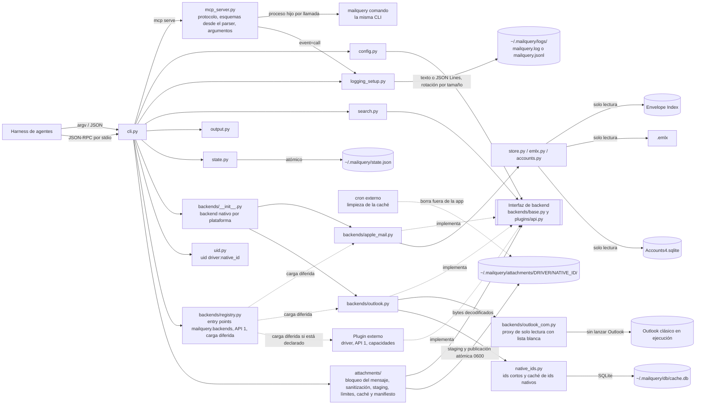
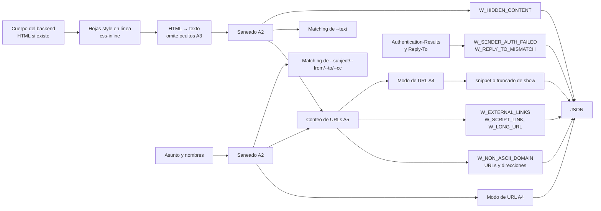
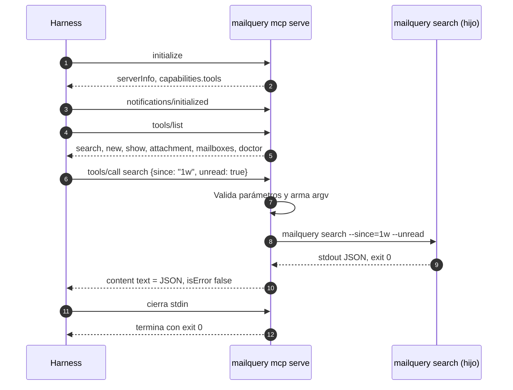

## 9. Arquitectura

### 9.1 Vista de componentes

**Figura: Vista de componentes**



### 9.2 Responsabilidades de módulos

**Tabla: Responsabilidades de cada módulo**

| Módulo | Responsabilidad | No debe |
|--------|-----------------|---------|
| `__init__.py` | Versión del paquete (`__version__`). | Importar backends. |
| `__main__.py` | Entrada `python -m mailquery` hacia `cli.main`. | — |
| `cli.py` | Parsear argumentos (incl. `-h`), obtener el backend, despachar comandos (incluido `attachment`), mapear errores a códigos de salida. Opción `--strip-links` en `search`, `new` y `show`; textos de error saneados. Rechazar en `attachment` solo los drivers `attachments: "none"` (RF-48) y pasar al motor de adjuntos el tope de `[attachments].timeout_seconds` (RF-49). Opciones `--fields` (`search`, `new`, `show` y `mailboxes`), `--group-by` y `--count` (`search`) y su validación (RF-68–RF-71, RF-78); `doctor --failures` (RF-74); línea de `doctor` en la ayuda general (RF-75); sección `plugins` de `doctor`: llamar a `doctor_checks()` de cada plugin declarado y resolver sus bloques `[scope]`, también con `--failures` (RF-79, RF-74). Opción de depuración `--show-native-id` en `show` (RF-83). Despachar `mcp serve` hacia `mcp_server.py` con solo la tabla `[logging]` de la configuración y registrar sus eventos `start` y `end` (RF-84). | Contener SQL, COM ni parseo MIME; aceptar `--strip-links` en otros comandos; abrir red. |
| `config.py` | Cargar y validar `~/.mailquery/config.toml`; resolver cuentas y carpetas permitidas contra la interfaz de backend, dentro del driver de cada bloque `[scope]`; validar `[attachments]` (incluido `timeout_seconds`, RF-49) y `[content]` (RF-63). | Leer el store ni crear configuración. |
| `search.py` | Lógica común: filtros, comodines, acotamiento, dedupe dentro de cada driver, merge multi-driver con orden total, paginación, cursor de `new`, armado de mensajes en el modelo común. Aplicar A2 a ambos lados de la comparación de los filtros de texto; armar los mensajes de `search`/`new`/`show` con el mismo constructor de metadatos y de cuerpo, con los campos de contenido saneados, el modo de URL de RF-54, el cuerpo procesado según §12.12 y los warnings de contenido por mensaje (RF-55–RF-61). Armar la fila por defecto y la de `--fields`, los grupos y el recuento, y los warnings según RF-72, sin pedir al backend lo que no se entrega (RNF-22); el `hint` de RF-76 con el alcance ya resuelto; `mailboxes` agrupado por cuenta con los campos de `--fields`, pidiendo los contadores al backend solo si se piden (RF-77, RF-78). Avisar a cada driver de los mensajes impresos (RF-82). | Acceder al store directamente; renderizar; cambiar el bloqueo, la caché o los adjuntos; excluir un mensaje por su contenido. |
| `state.py` | Cursor, anillo de uids prefijados, `schema: 2` y migración desde `schema: 1`, lock no bloqueante (POSIX y Windows), escritura atómica. | Guardar contenido de correos. |
| `output.py` | Serializar JSON estable, snippets y truncados. Saneado del texto (A2); paso a línea de las hojas `<style>` con `css-inline` y conversión HTML → texto con omisión y conteo de elementos ocultos (A3); detección de URLs y de sus dominios, modos de visualización con punycode (A4) y conteos (A5); texto fijo de `content_notice` (RF-66). | Escribir logs; cargar hojas enlazadas, remotas o locales; resolver ni abrir URLs. |
| `logging_setup.py` | Logger en texto (`mailquery.log`, formato log4j) o en JSON Lines (`mailquery.jsonl`, RF-88), con rotación por tamaño y redacción; eventos con sus campos `clave=valor` para los dos formatos. | Escribir en `stdout`; tocar el archivo del otro formato. |
| `errors.py` | Errores del producto con `code`, código de salida y `hint` (§12.6). | — |
| `uid.py` | Formato `"<driver>:<native_id>"` (RF-38): validación, uid legado sin prefijo, driver desconocido e identificador estable de 32 hex para rutas largas. | Abrir el store ni leer la configuración. |
| `native_ids.py` | Librería de ids cortos y caché de ids nativos (RF-80): cálculo del id corto, conexión a `~/.mailquery/db/cache.db` y operaciones de asignar, registrar, resolver y descartar. La usan los drivers que lo deciden. | Ser llamada por los comandos del núcleo; guardar contenido de correos. |
| `plugins/api.py` | API pública de plugin `plugin_api = 1`: capacidades, enum de `reason`, `PluginError`, `PluginContext`, timeouts y la envoltura de cada llamada a un driver que mapea `reason` a `code`/`exit` (RF-36, RF-50, RNF-21); el corte duro de RNF-21 también para la entrega de los bloques de un adjunto de un plugin externo y para `doctor_checks()` (RF-79). Las llamadas a los dos ganchos opcionales del driver (RF-82, RF-83) siguen las reglas de las demás llamadas a un plugin; el contexto de plugin da el acceso a la base de la caché de ids nativos de su driver, que se abre en su primera operación (RF-80). | Depender de un backend concreto; usar un hilo aparte con Apple Mail u Outlook. |
| `plugins/__init__.py` | Superficie pública que importa un plugin: reexporta la API 1 de `plugins/api.py` y el cálculo del id corto (RF-80). La base de la caché de ids nativos no se importa: el plugin la recibe en su contexto. | Importar backends ni el store. |
| `backends/registry.py` | Descubrir backends por `mailquery.backends`, validar `driver`, `plugin_api` y capacidades, detectar duplicados y dar la metadata de versión de `--version` (RF-33). | Importar drivers no declarados; importar plugins en `--version`. |
| `backends/__init__.py` | Backend nativo por plataforma (RF-24). | Importar `win32com` en macOS/Linux. |
| `backends/base.py` | Interfaz de backend y tipos del modelo común (§11.1). | Depender de un cliente concreto. |
| `backends/apple_mail.py` | Adaptador sobre `store.py`, `emlx.py` y `accounts.py`; contiene las consultas de búsqueda de Apple Mail. El adaptador no añade comportamiento propio. Expone el gancho interno opcional `load_headers(row)`, que lee solo las cabeceras de A6 sin abrir el cuerpo; no forma parte de `plugin_api`. | Cambiar el contrato de macOS (RNF-11). |
| `store.py`, `emlx.py`, `accounts.py` | Acceso read-only al store de Apple Mail (§9.3). `emlx.py` elige el cuerpo según RF-53, entrega la primera `Authentication-Results` y `Reply-To` (RF-60, RF-61) y lee el cuerpo solo cuando se entrega o lo pide `--text` (RNF-22); `store.py` lista las carpetas sin recontar sus mensajes cuando `mailboxes` no pide contadores (RF-78). | Ser importados por el backend Outlook; recurrir al texto plano cuando el HTML no da texto; recontar las carpetas sin `total` ni `unread`. |
| `backends/outlook.py` | Traducción Outlook → modelo común (§11.3), alcance de stores (§15.7), chequeos de `doctor` (§12.8). Elegir el cuerpo según RF-53, con `BodyFormat` en la lista blanca COM; entregar la primera `Authentication-Results` y `Reply-To` de las cabeceras de transporte con el gancho interno `load_headers(row)` (RF-60, RF-61); no leer el cuerpo, los destinatarios ni los adjuntos si no se piden (RNF-22), ni los contadores de las carpetas en `mailboxes` si no se piden (RF-78). Emitir el id corto de cada mensaje y resolverlo en la caché de ids nativos (RF-81); registrar en el aviso los mensajes impresos (RF-82). | Usar objetos COM sin el proxy; abrir más items para elegir el cuerpo o leer cabeceras. |
| `backends/outlook_com.py` | Único módulo que importa `win32com`; conexión sin lanzamiento, proxy de solo lectura con lista blanca (§9.3), reintento ante rechazo transitorio. | Exponer el objeto COM crudo. |
| `attachments/` | Motor de adjuntos: `catalog.py` (catálogo de extensiones y nombres reservados), `blocking.py` (reglas de nombre y *magic bytes*), `screening.py` (bloqueo del mensaje completo), `sanitize.py` (`sanitized_name`), `paths.py` (rutas de caché e identificador estable), `cache.py` (aciertos, manifiesto, staging y publicación atómica), `engine.py` (orden, límites, extracción, tope por adjunto de RF-49 y errores) y `active_content.py` (marcadores de contenido activo de RF-62); `__init__.py` define la plantilla de `W_ATTACHMENT_ACTIVE_CONTENT` (§10.3, §10.4). | Escribir fuera de `~/.mailquery/attachments/` y `~/.mailquery/tmp/`; recibir bytes de un plugin sin validarlos; descomprimir, abrir o bloquear por los marcadores de RF-62; contar A7 o un acierto de caché dentro del tope. |
| `mcp_server.py` | Servidor MCP por stdio (RF-84–RF-86): leer y escribir mensajes JSON-RPC, responder a `initialize`, `ping`, `tools/list` y `tools/call`, generar los esquemas de las herramientas desde el parser de la CLI, validar y traducir los argumentos, lanzar el proceso hijo `<intérprete> -P -m mailquery` de cada llamada, armar el resultado y registrar `event=call`. Interfaz: `serve(stdin, stdout, *, runner)`, `tool_definitions(parser)`, `build_argv(tool, arguments)`, el protocolo `ToolRunner` (`run(argv) -> ToolOutcome`) y `ToolOutcome` (`stdout`, `exit_code`, `duration_ms`). | Cargar plugins, instanciar drivers ni abrir un store; leer la configuración salvo `[logging]`, el estado o el correo; abrir red; mantener abierto el log entre eventos; escribir en `stdout` fuera del protocolo; importar módulos fuera de la biblioteca estándar y de `mailquery`. |

La reorganización detallada de firmas se documenta en `docs/INTERFACES.md`; este PRD manda sobre él.

### 9.3 Garantía de solo lectura de cada backend

- **Apple Mail:** lee el `Envelope Index` (metadatos), los `.emlx` (cuerpos) y `Accounts4.sqlite` (etiquetas de cuenta), todos en solo lectura impuesta por el sistema. Si existe el `-shm` del `Envelope Index` (Mail abierto), lee la base viva (estrategia `live_ro`); si no existe, lee una copia en `~/.mailquery/tmp/` (estrategia `copy_ro`), para no crear archivos dentro del store.
- **Outlook:** el Outlook Object Model es de lectura y escritura, así que la garantía se impone en capas: se conecta solo a un Outlook ya abierto (ADR-13); todo objeto de Outlook pasa por un proxy de solo lectura con lista blanca que rechaza cualquier otra operación con `E_INTERNAL` antes de que llegue a Outlook, y el resto del código nunca ve el objeto sin el proxy; solo se leen carpetas e items de stores locales (§15.7); la caché de `pywin32` queda en `~/.mailquery/tmp/gen_py`; y toda llamada tiene el timeout de RF-31. Excepción para adjuntos: el proxy autoriza solo `Attachment.SaveAsFile` (nunca `GetTemporaryFilePath`) para materializar un adjunto ya descargado en el staging `~/.mailquery/tmp/staging/` (§4); el backend comprueba que el archivo materializado sea regular y esté dentro de su sesión antes de leerlo y lo borra siempre (RNF-13). Estrategia `com_readonly`.

### 9.4 Flujo de `show` y `attachment`

**Figura: Flujo de `show` y `attachment`**

```mermaid
sequenceDiagram
    autonumber
    participant H as Harness / Agente
    participant Core as Núcleo
    participant REG as Registro
    participant BK as Driver del prefijo
    participant ST as Staging en tmp/
    participant FS as Caché de adjuntos

    Note over H,FS: Parte 1: show, solo lectura del correo
    H->>Core: mailquery show apple_mail:83143
    Core->>Core: Valida uid y separa driver y native_id
    Core->>REG: Carga diferida del driver apple_mail
    REG-->>Core: Driver con API 1, capacidades y orden nativo
    Core->>BK: find_message 83143 más load_body
    BK-->>Core: Mensaje con 3 adjuntos: factura.pdf, Factura Octubre 2026.pdf y recibo.pdf
    loop Para cada adjunto
        Core->>Core: Si el nombre es seguro, calcula sanitized_name
        Core->>FS: ¿Existe sanitized_name como archivo regular?
        FS-->>Core: Si existe, cached_path; si no, null
    end
    Core-->>H: JSON con uid apple_mail:83143 y attachments con index, name y cached_path

    Note over H,FS: Parte 2: attachment, bloqueo del mensaje y staging
    H->>Core: mailquery attachment apple_mail:83143 --index 2
    Core->>Core: Valida args, uid, config, enabled, driver y capacidades
    Core->>BK: attachments 83143, metadatos ordenados
    Core->>Core: Bloqueo de nombres de todos los adjuntos del mensaje
    alt Cualquier nombre bloqueado
        Core-->>H: E_ATTACHMENT_BLOCKED (exit 4), nada escrito
    end
    Core->>Core: Límites con tamaño conocido
    alt Excede límites
        Core-->>H: E_ATTACHMENT_TOO_LARGE (exit 4), nada escrito
    end
    Core->>BK: attachment_stream 83143, index
    BK-->>Core: bytes decodificados en stream
    Core->>Core: ¿Primer bloque con magic bytes ejecutable? Antes de escribir
    alt Contenido bloqueado
        Core-->>H: E_ATTACHMENT_BLOCKED (exit 4), nada escrito
    end
    Core->>ST: Escribe en staging 0600 validando tamaño en streaming
    alt Fallo de lectura, timeout o límite excedido
        Core->>ST: Limpia staging
        Core-->>H: E_ATTACHMENT_UNAVAILABLE, E_ATTACHMENT_UNREADABLE, E_ATTACHMENT_TOO_LARGE o E_CLIENT_TIMEOUT
    end
    Core->>FS: publica staging en la caché de forma atómica al validar el mensaje completo
    Core->>Core: A7: marcadores de contenido activo en los bytes de cada adjunto devuelto
    Core-->>H: JSON con uid, output_dir, count, attachments y warnings
```

En `attachment`, después de extraer o servir desde la caché cada adjunto, se buscan los marcadores de RF-62 en sus bytes y se añade `W_ATTACHMENT_ACTIVE_CONTENT`.

En `attachment`, un driver `"remote"` sigue el mismo flujo que uno `"local"` (RF-48).

`show` no escribe en el correo, en el estado ni en la caché de adjuntos. Con un driver que usa la caché de ids nativos, puede crearla y borrar la fila de un mensaje *ausente confirmado* (RF-41, RF-81).

### 9.5 Flujo de un mensaje en `search`, `new` y `show`



En `search`, `new` y `show`, el núcleo decide antes de consultar al backend qué campos se entregan y solo pide lo que se entrega o necesita un filtro (RNF-22); filtros, deduplicación, agrupación y procesamiento de F1: §12.12, puntos 8 y 9.

### 9.6 Flujo de una llamada de `mcp serve`

El harness lanza `mailquery mcp serve` al abrir su sesión. El servidor atiende las peticiones en serie y ejecuta cada `tools/call` como un proceso hijo de la CLI, cuyo JSON devuelve tal cual (RF-84, RF-86, ADR-51).

**Figura: Secuencia de una llamada MCP**



Un parámetro inválido no lanza el proceso hijo y devuelve `E_USAGE`; un hijo que termina con un código distinto de 0 da `isError: true`; un hijo que no escribe un objeto JSON da `E_INTERNAL` y el servidor sigue sirviendo (RF-86).

---

