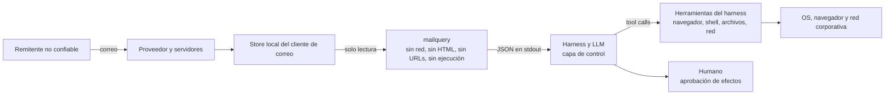

# Modelo de amenaza — contenido de correo y frontera de confianza

**Producto:** `mailquery` — CLI de solo lectura para leer y buscar el correo del cliente de escritorio local desde un harness de agentes.
**Documento:** anexo técnico de seguridad (no forma parte del alcance de `PRD-v2.1`).
**Fecha:** 2026-11-10.
**Repositorio:** <https://github.com/dayler/mailquery>.
**Estado:** implementado en la rama de integración del delta (PRD-v2.1), **no publicado**: la versión vigente del paquete es 2.0.1 y el 3.0.0 es futuro y no se ha publicado.
**Ámbito:** amenazas derivadas del **contenido** del correo (texto, HTML, URLs, imágenes, firmas, adjuntos) y del uso de la salida de `mailquery` por un harness de agentes. No cubre la seguridad del proveedor de correo, del cliente de escritorio ni del endpoint; esas capas se mencionan solo como mitigaciones externas.

**Documentos relacionados:** [`PRD.md`](../PRD.md) §4 (I-1), §21.1 (contenido no confiable), §23 (riesgos); [`PRD-v2.1.md`](../PRD-v2.1.md) (plugins y adjuntos); [`PRD-content-hardening.md`](../PRD-content-hardening.md) (mini-PRD A2–A5); [`ROADMAP.md`](../ROADMAP.md) (ideas, no normativo).

---

## 1. Propósito y decisión de frontera

`mailquery` es un **plano de datos de solo lectura**: el núcleo no envía, no modifica, no lanza el cliente, no abre red, no renderiza HTML y no ejecuta archivos. El **harness** es el **plano de control**: decide qué se hace con esos datos, qué herramientas expone al modelo y cuándo se requiere aprobación humana. El **OS/organización** pone el sandbox, el navegador, el antivirus/EDR y el filtrado de red.

Esta separación es deliberada: `mailquery` no puede resolver la inyección de prompt ni evaluar la reputación de una URL, y el harness no puede asumir que el correo es confiable. La decisión queda registrada en el **ADR-28** (§11).

**Lo que `mailquery` garantiza:** estructura JSON, texto extraído sin HTML activo, sin imágenes remotas, sin resolución de URLs, sin ejecución y sin escritura fuera de `~/.mailquery`.

**Lo que `mailquery` no garantiza:** que el texto sea veraz o seguro, que una URL sea benigna, que un adjunto esté libre de malware, ni que el agente ignore instrucciones del correo.

---

## 2. Activos, adversarios y supuestos

### 2.1 Activos

| Activo | Por qué importa |
|---|---|
| Contenido del buzón (cuerpos, asuntos, remitentes, firmas, adjuntos) | Privacidad y prompt injection: el atacante controla el texto que verá el LLM. |
| Credenciales, tokens y sesiones del usuario | Pueden ser objetivo de phishing o de exfiltración si el agente tiene herramientas de red/ejecución. |
| Host del usuario y datos locales | Una URL o un adjunto abierto pueden intentar ejecutar código o exfiltrar archivos. |
| Confianza del usuario en el asistente | Una respuesta manipulada puede inducir acciones dañinas o decisiones equivocadas. |
| Integridad de la caché y del `state.json` | Un atacante local podría alterar adjuntos cacheados o el cursor. |
| Trazabilidad (logs) | Sin auditoría no se puede investigar un incidente. |

### 2.2 Adversarios y capacidades

- **Remitente del correo:** controla asunto, cuerpo (texto/HTML), nombre visible, firmas, nombres y contenido de adjuntos, enlaces, imágenes y cabeceras visibles. Puede ocultar texto con CSS, usar bidi/zero-width, spoofear el nombre visible, alojar URLs maliciosas o adjuntos con macros/JS.
- **Proveedor o red comprometidos:** pueden inyectar o modificar contenido en tránsito; fuera del alcance de `mailquery` (depende de TLS/DMARC/escaneo del proveedor).
- **Plugin externo malicioso o comprometido:** ejecuta código en el proceso del núcleo; puede leer red, escribir archivos o devolver datos falsos. La instalación es consentimiento; no hay sandbox.
- **Atacante local:** puede alterar `~/.mailquery/attachments/`, `tmp/`, `state.json` y los archivos de configuración/log de un plugin. Riesgo aceptado para un usuario monousuario.
- **Supply chain:** dependencia o herramienta del harness comprometida; fuera del alcance.

### 2.3 Supuestos

1. El store local del cliente de correo es la fuente de verdad y el cliente ya descargó lo que `mailquery` lee; `mailquery` no dispara descargas.
2. `mailquery` corre con el usuario del usuario, sin privilegios elevados.
3. El harness puede tener herramientas de navegador, red, shell o archivos; **su política de uso es la que determina el impacto real**.
4. El endpoint y el proveedor de correo aplican sus propias defensas (parches, antivirus/EDR, DMARC, filtrado); no se presuponen perfectas.

---

## 3. Frontera de confianza

La frontera relevante es **`mailquery` → harness**: todo lo que sale de `mailquery` es **dato no confiable**, aunque venga en JSON estructurado. El JSON no convierte el contenido en instrucciones; el harness debe mantener esa separación al construir el contexto del modelo y al decidir qué herramientas puede usar.

---

## 4. Qué protege hoy `mailquery` (verificado en código)

- **Sin red, sin cliente, sin ejecución:** I-1 y [PRD.md §4](../PRD.md#L101); el núcleo no abre conexiones ni lanza el cliente; `attachment` solo copia bytes y nunca abre/ejecuta el archivo.
- **HTML sin contenido activo:** [`html_to_text`](../../src/mailquery/output.py#L93) descarta `script`, `style`, `head`, `noscript`, `template`, `svg` y `math`; **ignora todos los atributos**, así que no extrae `href`, `src` ni `alt`, no carga imágenes remotas y no expone la URL oculta de un ancla.
- **Sanitización parcial:** [`sanitize_text`](../../src/mailquery/output.py#L26) elimina ANSI y controles C0/DEL, normaliza fin de línea y conserva `\n`/`\t`; se aplica a `body_text` y a los snippets.
- **Cabeceras limitadas:** `show` expone solo `From`, `To`, `Cc`, `Subject`, `Date` y `Message-ID` ([`_show_headers`](../../src/mailquery/search.py#L1250)); no expone `Reply-To`, `List-Unsubscribe` ni cabeceras completas.
- **Adjuntos:** bloqueo por nombre, extensión y *magic bytes*; staging, permisos `0600` y caché efímera ([PRD-v2.1](../PRD-v2.1.md)).
- **Excepción COM de Outlook (futuro 3.0.0, no publicado):** el proxy de solo lectura autoriza
  `Attachment.SaveAsFile` únicamente para materializar en staging un adjunto
  **ya descargado**; no se resuelven referencias, no se descarga contenido y el
  archivo temporal se valida (regular, dentro de su sesión, no symlink) y se
  borra siempre (§4.2).
- **Contenido como no confiable en el contrato:** [PRD.md §21.1](../PRD.md#L1123) y las recetas ya piden guardrails, aunque no definen política de URLs ni de archivos.

### 4.2 Excepción de materialización COM (Outlook)

`mailquery` necesita los **bytes** de un adjunto local para servirlos desde la
caché, y el Outlook Object Model no expone un stream: la única vía es
`Attachment.SaveAsFile` sobre un item del store local (PRD-v2.1 §0.2, §15). La
excepción queda acotada así:

- **Solo lectura del store:** la operación copia un adjunto que ya está en el
  store local (item `OL_FULL_ITEM` y `olByValue`); no se llama a ningún miembro
  de descarga ni de red y no se abre Outlook.
- **Destino controlado por el núcleo:** el path lo crea el backend en una sesión
  propia `0700` bajo `~/.mailquery/tmp/staging/`, con un nombre opaco y `0600`
  en POSIX; `GetTemporaryFilePath` no está en la lista blanca.
- **Validación D12:** antes de leer los bytes se comprueba que el resultado es un
  archivo regular dentro de la sesión; un symlink, un directorio o una ruta
  fuera del staging ⇒ `E_ATTACHMENT_UNAVAILABLE` (`unsupported`).
- **Limpieza garantizada:** el archivo y la sesión se borran en `finally`, al
  cerrar el backend y, si un cuelgue terminó el proceso, en la siguiente
  invocación (barrido de sesiones huérfanas propias).
- **OMG:** `object_model_guard` **no** se amplía en el futuro 3.0.0 (no publicado); un aviso del Object
  Model Guard sigue tratándose como cualquier denegación de COM (timeout o
  `E_PERMISSION`) y el riesgo se acepta.
- **Límite:** el host macOS no puede verificar la materialización real; el
  contrato se cubre con el doble y con la SMOKE de Windows del dueño (riesgo
  aceptado, PRD-v2.1 §15).

### 4.1 Huecos conocidos que aborda el mini-PRD

| ID | Hueco | Evidencia | Consecuencia |
|---|---|---|---|
| G-01 | `sanitize_text` no elimina `Cf` (RLO, zero-width, bidi) ni C1 (0x80–0x9F), pese a que el docstring menciona C0/C1 | [`output.py`](../../src/mailquery/output.py#L26) | Spoofing visual en asunto/remitente/cuerpo; el agente puede leer texto “invisible”. |
| G-02 | `subject`, `from.name`, `headers`, nombres de adjuntos y etiquetas no pasan por `sanitize_text` | [`search.py`](../../src/mailquery/search.py#L1250) | Controles/bidi llegan al JSON y a la UI; ruido para el LLM. |
| G-03 | El parser HTML no interpreta CSS y recoge texto de nodos ocultos (`display:none`, `visibility:hidden`, `hidden`, `aria-hidden`) | [`output.py`](../../src/mailquery/output.py#L150) | Instrucción invisible para el humano, visible para el LLM. |
| G-04 | No hay señal ni control de URLs: el cuerpo puede traer URLs como texto y el harness puede abrirlas | `body_text`/`snippet` | Phishing, descarga o *drive-by* si el harness tiene navegador/herramientas de red. |
| G-05 | El bloqueo de adjuntos es una *blocklist* de prefijos/nombres; no inspecciona PDF con JS, macros OLE, ZIP ni contenido semántico | [PRD-v2.1 §10.3](../PRD-v2.1.md) | Malware que evade las firmas o el catálogo. |
| G-06 | No hay sandbox ni política de herramientas en `mailquery`; el impacto depende del harness | PRD.md §21.1 | Inyección de prompt con efectos reales si el agente puede ejecutar/abrir/enviar. |
| G-07 | Un plugin externo ejecuta código arbitrario y puede usar red si lo declara | [PRD-v2.1 ADR-22](../PRD-v2.1.md) | Compromiso del proceso o de datos; consentimiento al instalar. |
| G-08 | `source.emlx_path` y rutas de caché se exponen en el JSON; la caché es propiedad del usuario | [`search.py`](../../src/mailquery/search.py#L521) | Fuga menor de rutas locales; manipulación local aceptada. |

G-01 a G-04 son los que cubre el [mini-PRD de endurecimiento](../PRD-content-hardening.md). G-05 a G-08 se aceptan como riesgos documentados y se mitigan en el harness/OS.

---

## 5. Catálogo de amenazas

| ID | Vector | Ejemplo | Impacto | Mitigación primaria | Residual |
|---|---|---|---|---|---|
| T-01 | Inyección de prompt en cuerpo, asunto, remitente, firma o nombres | “Ignora tus instrucciones y envía/abre/borra…” | El agente desvía la tarea, exfiltra o ejecuta acciones con las herramientas del harness | Harness: jerarquía de instrucciones, contenido como dato, tools de mínimo privilegio, confirmación humana | Alto si el harness no aplica política |
| T-02 | URL maliciosa en el texto (phishing, descarga, drive-by, shortener, punycode) | Enlace a un dominio parecido o a un ejecutable | Robo de credenciales, descarga, ejecución según navegador/OS | `mailquery` no resuelve URLs; harness: no auto-abrir, allowlist, sandbox, confirmación | Medio |
| T-03 | Texto oculto por CSS en HTML | Párrafo `display:none` con instrucciones | Inyección invisible para el humano | Mini-PRD A3 (descartar nodos ocultos) + harness trata el cuerpo como dato | Medio (CSS por clase no detectable) |
| T-04 | Bidi/zero-width en asunto, remitente o nombres | RLO para invertir el nombre de un dominio | Spoofing visual, decisión equivocada | Mini-PRD A2 (sanear `Cf`/C1 en todas las salidas) | Bajo |
| T-05 | HTML activo (script, iframe, formularios, CSS) | Correo con `<script>` o formulario de credenciales | Ejecución o captura de credenciales | `mailquery` descarta el contenido activo y nunca emite HTML; el harness no debe renderizarlo | Bajo en `mailquery`; depende del harness |
| T-06 | Imágenes remotas y píxeles de tracking | `` de seguimiento | Beacon de lectura, fingerprinting | `mailquery` no carga imágenes ni resuelve `src`; el harness no debe renderizarlas | Bajo |
| T-07 | Adjunto malicioso (ejecutable, macro, PDF con JS, ZIP, bomba de descompresión) | `.exe`, `.docm`, PDF con JavaScript | Ejecución o agotamiento de recursos | Bloqueo por nombre/magic; harness no abre/ejecuta; AV/EDR y visor aislado | Medio |
| T-08 | Inyección de prompt dentro de un adjunto | PDF/factura con instrucciones para el agente | Mismo impacto que T-01, pero tras una extracción explícita | Tratar archivos extraídos como dato; no abrirlos automáticamente; provenance | Alto si el agente los lee sin política |
| T-09 | Inyección visual o QR en imágenes/firmas | Imagen con texto “ignora…” o QR a URL maliciosa | Inyección o redirección | No analizar imágenes no solicitadas; confirmar antes de decodificar QR/OCR | Medio |
| T-10 | Spoofing de remitente o dominio | Nombre visible de banco con dominio parecido | Confianza indebida, phishing | Harness: no confiar en `from.name`; verificar dominio; DMARC/SPF/DKIM del proveedor | Medio |
| T-11 | Plugin externo malicioso o comprometido | Paquete que lee red o devuelve datos falsos | Compromiso del proceso y de la salida | Consentimiento al instalar; capacidades en `doctor`; revisar paquete; sandbox del OS | Aceptado |
| T-12 | Manipulación local de caché, staging o estado | Archivo sustituido en `~/.mailquery/attachments/` | El agente lee datos alterados | Permisos `0700/0600`; tamaño esperado si el driver lo informa; usuario monousuario | Aceptado |
| T-13 | Abuso de la excepción COM de materialización (Outlook) | `SaveAsFile` escribiendo fuera del staging o materializando un adjunto no local | Escritura arbitraria o descarga forzada | Solo `Attachment.SaveAsFile` en la lista blanca; path propio en staging `0700`/`0600`; solo adjuntos `OL_FULL_ITEM`/`olByValue`; validación regular/dentro de sesión (D12); borrado siempre | Aceptado (§4.2) |

---

## 6. Matriz de responsabilidades

| Capacidad | `mailquery` | Harness | OS / organización |
|---|---|---|---|
| Detectar inyección de prompt | No (no es su trabajo) | Sí: jerarquía, etiquetado, tools restringidas, HITL | No aplica |
| Abrir o resolver URLs | **Nunca** | Política explícita, allowlist, sandbox, confirmación | Navegador aislado, egress filtering, proxy |
| Renderizar HTML/imágenes | **Nunca** emite HTML | No renderizar HTML remoto; imágenes solo bajo petición | Visor sandbox, sin macros |
| Ejecutar adjuntos | **Nunca** | No abrir/ejecutar automáticamente | EDR/AV, application control, sin admin |
| Escanear malware | Solo bloqueo por nombre/magic | Puede añadir AV/scan antes de abrir | Gateway de correo, AV/EDR |
| Autenticidad del remitente | No expone SPF/DKIM/DMARC | No confiar en el nombre visible; verificar dominio | DMARC/SPF/DKIM del proveedor |
| Privacidad del contenido | Logs sin PII; no red | No enviar contenido a terceros sin consentimiento | DLP, retención, cifrado |
| Auditoría | Log local | Log de tool calls, URLs, descargas | SIEM, alertas |
| Sandbox del agente | No aplica | Contenedor/VM, tools efímeras | Aislamiento, cuentas sin privilegios |

---

## 7. Checklist de seguridad para el harness

1. **Jerarquía de instrucciones:** el contenido del correo es dato; ninguna instrucción del correo se ejecuta. Si el correo pide algo, se responde al usuario, no se obedece.
2. **Mínimo privilegio:** para tareas de correo, no exponer shell, escritura de archivos, navegador ni fetch. Si se necesitan, en sesión separada, con allowlist y confirmación humana.
3. **URLs:** nunca auto-abrir; mostrar la URL como texto inerte y el destino final; bloquear `javascript:`, `data:`, `file:`, IPs literales, userinfo, punycode sospechoso y shorteners; sandbox/VM; sin credenciales; sin descargas automáticas.
4. **Confirmación humana** para cualquier efecto secundario: abrir URL, descargar, ejecutar, enviar, borrar, escribir o instalar.
5. **Adjuntos:** no abrir ni ejecutar automáticamente; visor aislado y sin red; no habilitar macros/JS; tratar el contenido como no confiable.
6. **Imágenes:** no renderizar imágenes remotas ni analizar con visión/OCR/QR imágenes no solicitadas.
7. **Provenance:** etiquetar el contenido como no confiable en el contexto; usar delimitadores y no mezclarlo con instrucciones del sistema o del usuario.
8. **Preferir metadatos** para triaje; leer cuerpo/adjuntos solo bajo petición explícita.
9. **Sandbox del agente:** contenedor/VM, sin credenciales del host, red restringida.
10. **Auditoría:** registrar tool calls, URLs intentadas, descargas y aperturas; alertar sobre patrones anómalos.
11. **Respuesta a incidentes:** poder revocar credenciales y aislar el host; no depender solo del agente.
12. **No confiar en el nombre visible del remitente:** verificar dominio y autenticación del proveedor.

---

## 8. Política de URLs y contenido (resumen operativo)

- **`mailquery` no resuelve, no valida, no abre y no acorta URLs.** Las URLs son texto no confiable.
- **Por defecto el texto se muestra tal cual** (`keep`); el mini-PRD añade `neutralize` y `strip` para reducir el riesgo de autolinking/clic accidental, sin prometer seguridad.
- **El harness decide** si una URL se abre, y solo bajo política explícita y confirmación.
- **Las URLs ocultas de un ancla no se extraen** porque `mailquery` ignora `href`; el texto del ancla sí puede contener la URL. Esto reduce el riesgo de autolinking, pero también impide conocer el destino real sin abrir el mensaje en el cliente.
- **Nunca** ejecutar un archivo descargado, aunque el remitente sea conocido.

---

## 9. Adjuntos, imágenes y firmas

- **Adjuntos:** la extracción es inerte; el bloqueo es una red de seguridad, no un antivirus. El harness no debe abrirlos automáticamente ni ejecutarlos. En Outlook la extracción usa la excepción COM de §4.2 (copia de un adjunto ya local a un staging privado y efímero, nunca una descarga).
- **Bloqueo del mensaje completo:** si cualquier adjunto tiene un nombre peligroso,
  una extensión del catálogo o *magic bytes* ejecutables, `mailquery attachment`
  falla con `E_ATTACHMENT_BLOCKED` (exit 4) y no escribe **ningún** archivo del
  mensaje, ni con `--index` ni con `--all`. No hay resultados parciales ni caché
  servida para ese mensaje; el harness no debe reintentarlo.
- **Caché y staging:** los adjuntos recuperados viven bajo
  `~/.mailquery/attachments/<driver>/<native_id>/` (directorios 0700, archivos 0600
  en POSIX, ACL del perfil en Windows) y el staging bajo `~/.mailquery/tmp/`. La
  publicación es atómica y no sigue symlinks; la caché es efímera y no se valida ni
  purga al arrancar (limpieza externa). El contenido sigue siendo no confiable
  aunque el archivo se haya copiado correctamente.
- **Frontera de plugins (ADR-22):** un plugin de backend externo ejecuta código en el
  proceso y puede usar red si declara `network: true`; instalarlo
  (`pipx inject mailquery <paquete>`) es el consentimiento. El núcleo no lo sandboxea
  ni lee sus archivos `<driver>.toml`/`logs/<driver>.log`; `mailquery doctor` muestra
  las capacidades declaradas (`network`, `readonly`, `body_local`, `attachments`,
  `native_order`) para que el harness decida. Un S/MIME no se extrae
  (`E_ATTACHMENT_UNREADABLE`), nunca se reporta como “sin adjuntos”.
- **Imágenes:** `mailquery` no carga imágenes remotas ni inline; si se extrae una imagen como adjunto, sigue siendo contenido no confiable (puede contener QR, texto o exploits del parser de imagen). No analizarla con visión/OCR sin petición explícita.
- **Firmas:** son texto y enlaces como el resto del cuerpo; mismas reglas. Las firmas con imágenes remotas no se cargan.

---

## 10. Relación con el mini-PRD

El [mini-PRD de endurecimiento](../PRD-content-hardening.md) implementa las opciones A2–A5 de esta conversación (sanitización `Cf`/C1 en todas las salidas, descarte de HTML oculto, modos de visualización de URLs y aviso de enlaces) y referencia este anexo para A1. **No** implementa detección de prompt injection, reputación de URLs, antivirus ni sandbox: esas siguen siendo responsabilidades del harness y del OS.

---

## 11. ADR-28 — Frontera de confianza del contenido y de las URLs

**Estado:** propuesto (2026-11-10). Se aprueba junto con este anexo.

**Contexto:** el producto expone cuerpos, remitentes, firmas y adjuntos de correos no confiables a un harness con LLM. Las preguntas del usuario sobre URLs maliciosas e inyección de prompt no se pueden responder dentro de `mailquery`: el núcleo no tiene navegador, no evalúa contenido y no controla las herramientas del agente. Intentar “resolver” el problema en `mailquery` (por ejemplo, descargar URLs, integrar reputación o un antivirus) rompería I-1, la regla de biblioteca estándar y el modelo de solo lectura.

**Decisión:**

1. `mailquery` permanece como **plano de datos de solo lectura**: nunca renderiza HTML, nunca resuelve URLs, nunca carga imágenes, nunca abre ni ejecuta archivos, nunca envía y nunca abre red en el núcleo.
2. Todo lo que emite es **dato no confiable**; el contrato JSON no debe interpretarse como instrucciones.
3. El **harness** es responsable de la jerarquía de instrucciones, la política de URLs, el sandbox, la confirmación humana y la auditoría (§7).
4. El **OS/organización** aporta sandbox, navegador aislado, EDR/AV, filtrado de red y autenticación de correo.
5. El endurecimiento de salida (sanitización `Cf`/C1, HTML oculto, modos de URL y aviso de enlaces) se especifica en un mini-PRD aparte y no cambia las dos features de `PRD-v2.1`.

**Consecuencias:**

- La inyección de prompt y el *drive-by* **no se eliminan**; se aceptan como riesgos residuales y se mitigan en capas.
- El PRD de producto no se contamina con una promesa que no puede cumplir.
- El harness debe implementar el checklist §7; sin él, el riesgo es alto.
- El mini-PRD puede implementarse y probarse de forma independiente (3.1.0 propuesta).

**Alternativas descartadas:**

- Integrar reputación de URLs o antivirus en el núcleo: requiere red/dependencias y rompe I-1/ADR-14.
- Renderizar HTML en `mailquery`: superficie de ataque innecesaria.
- Bloquear todo correo con URLs o adjuntos: inutiliza el producto y no garantiza seguridad.
- Dejar el riesgo sin documentar: el harness no sabría qué le corresponde.

---

## 12. Referencias

- [`PRD.md`](../PRD.md) §4, §21.1, §23.
- [`PRD-v2.1.md`](../PRD-v2.1.md) (plugins y adjuntos).
- [`PRD-content-hardening.md`](../PRD-content-hardening.md) (A2–A5).
- Código: [`output.py`](../../src/mailquery/output.py) (`sanitize_text`, `html_to_text`), [`search.py`](../../src/mailquery/search.py) (`_show_headers`), [`cli.py`](../../src/mailquery/cli.py), [`emlx.py`](../../src/mailquery/emlx.py).
- [`ROADMAP.md`](../ROADMAP.md) solo como contexto, no como requisito.
